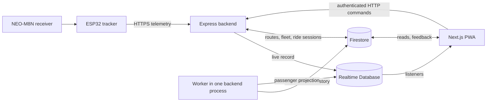

# Eki Campus Bus Tracking

| Document ID | Version | Status | Last updated |
|---|---|---|---|
| EKI-GEN-001 | 1.0 | Current | 2026-10-30 |

Eki tracks university buses in real time. An ESP32 tracker with a NEO-M8N GNSS receiver in each bus sends its position to an Express backend, which runs each ride through its stops in order and publishes live state through Firebase. Passengers follow buses and board rides in a progressive web app; administrators manage routes, the fleet and ride operations.

## 1. Features

| Role | What Eki provides |
|---|---|
| Passenger | Routes with live buses, the bus position with live health ("Updates delayed", "GPS signal lost", "Live tracking lost"), stop estimates and progress, boarding by location with no code, ride chat, ride feedback and account deletion |
| Administrator | **Live Ops** map with delay, chat, **End ride early** and **Resume tracking**; route editor with Google road geometry; vehicles and operators; ride history with stop evidence; feedback review; passenger-facing settings |
| Operator | No browser action needed: the operator's assignment to a bus lets the tracker start, advance and complete rides automatically |
| Tracker | Authenticated HTTPS telemetry once per second, GNSS loss reporting, signed fleet firmware and signed over-the-air updates |

## 2. How data moves


Figure 1. Telemetry path from the receiver to the browser.

The backend takes each tracker's bus and route from the device registry, never from the device. Browsers never read raw live records: passengers subscribe to a per-route projection that the worker writes. Commands such as route edits, boarding and ending a ride go through authenticated HTTP; feedback is written directly to Firestore under security rules. The [architecture](docs/design/ARCHITECTURE.md) document describes the full design.

## 3. Quick start

### 3.1 Prerequisites

- Git, and Node.js 24 with its bundled npm (the CI version).
- A Firebase development project with Google sign-in, Firestore, Realtime Database and a web app, plus Google Maps browser and server keys.
- Java 21 for Firebase rules tests; Python 3.12 and PlatformIO 6.2.0 for firmware work.

### 3.2 Install and configure

From the repository root, in PowerShell:

```powershell
npm ci
Copy-Item backend/.env.example backend/.env
Copy-Item frontend/env.production.example frontend/.env.local
```

Both templates hold production values. Edit them as described in [getting started](docs/GETTING_STARTED.md#4-configure-the-backend): at minimum `NODE_ENV=development`, `PORT=4000` and `CORS_ORIGIN=http://localhost:3000` in the backend file, and the Firebase, Maps and `NEXT_PUBLIC_BACKEND_URL=http://localhost:4000` values in the frontend file. The [configuration reference](docs/CONFIGURATION.md) lists every variable.

### 3.3 Run and check

```powershell
npm run dev
Invoke-RestMethod http://localhost:4000/health
```

Open `http://localhost:3000`. The health check returns `status: ok` when the backend reaches Firestore and RTDB; HTTP 503 with `status: degraded` means the credentials or the RTDB URL need fixing. [Getting started](docs/GETTING_STARTED.md) continues with an administrator account, routes, buses, operators, a tracker and a walkthrough of each role.

## 4. Repository map

| Path | Contents |
|---|---|
| `frontend/` | Next.js 16 and React 19 static-export PWA: passenger and admin workspaces |
| `backend/` | Express 5 API, telemetry ingestion, ride lifecycle worker and admin command-line tools |
| `hardware/` | ESP32 firmware (PlatformIO, Arduino and ESP-IDF), native tests and fleet build verification scripts |
| `e2e/` | Playwright browser suites with synthetic Firebase and Maps fixtures |
| `qa/` | Acceptance maps that link requirements to tests, and evidence guides |
| `scripts/` | Build, CSP, documentation, QA and trace analysis scripts |
| `tools/` | Local build tooling |
| `observability/` | Optional local OpenTelemetry Collector and Jaeger stack |
| `docs/` | Documentation set, including generated mirrors of Markdown files kept beside the code |
| `.github/workflows/` | CI, CodeQL, scheduled QA and deployment workflows |
| `firestore.rules`, `database.rules.json`, `firestore.indexes.json` | Firebase security rules and indexes |

## 5. Documentation

The [documentation index](docs/README.md) lists every document with reading paths by role. Start with [getting started](docs/GETTING_STARTED.md), the [glossary](docs/GLOSSARY.md) and the [architecture](docs/design/ARCHITECTURE.md). Package guides: [backend](backend/README.md), [API reference](backend/API.md), [frontend](frontend/README.md) and [hardware](hardware/README.md).

## 6. Verify a change

```powershell
npm run verify
```

This runs lint, all unit tests, the production build with service worker and CSP generation, and the production dependency audit. [Contributing](CONTRIBUTING.md) lists the extra checks for rules, browser, firmware and documentation changes.

## 7. Deployment status

A green CI run on a push to `main` deploys Firebase Hosting, Firestore and RTDB rules, and Firestore indexes to the staging project. Production deploys run only by manual dispatch from `main` and need an approving reviewer. No workflow deploys the Express backend: `backend/Dockerfile` builds its container image, which CI only smoke-tests, and bench and demonstration setups run the backend on a workstation behind an [ngrok tunnel](docs/operations/NGROK_TUNNEL.md). A university production release also needs owned backend hosting, approved retention, monitoring, protected firmware provisioning and field acceptance; see the [deployment checklist](docs/operations/UNIVERSITY_DEPLOYMENT_CHECKLIST.md) and [CI, deployment and releases](docs/operations/CI_CD_AND_RELEASES.md).

Report vulnerabilities as described in the [security policy](SECURITY.md).

## 8. License

Eki is released under the [MIT License](LICENSE).
