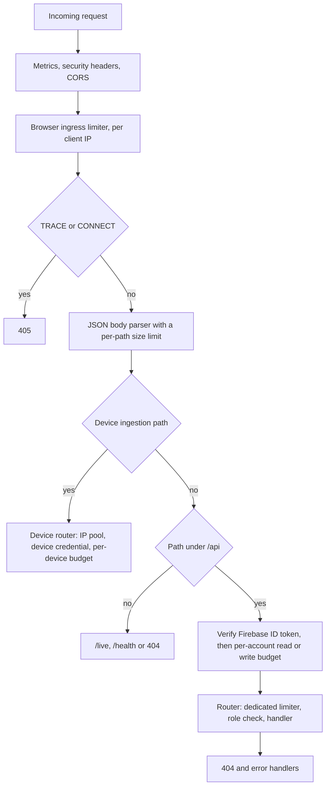

# Eki Backend HTTP API

| Document ID | Version | Status | Last updated |
|---|---|---|---|
| EKI-API-001 | 3.0 | Current | 2026-10-30 |

## 1. Introduction

### 1.1 Purpose and scope

This document specifies every HTTP operation that the Eki backend serves: who may call it, how to authenticate, what to send, what comes back and which limits apply. It is written for developers of the web app, the device firmware and any other client.

The machine-readable contract is [`openapi.json`](openapi.json) (OpenAPI 3.1.1 [1]). `npm run verify:openapi` fails when an operation registered in the code is missing from that file or from this document, or when either names an operation that does not exist. How the contract is validated, and the boundary between HTTP operations and Firebase SDK reads and writes, are described in the [HTTP contract](../docs/api/HTTP_CONTRACT.md). Firebase listeners are not HTTP operations and are not listed here.

### 1.2 Callers

| Caller | Description |
|---|---|
| Public | Load balancers and container health checks; no credentials |
| Device | GNSS tracker registered with a per-device secret |
| User | Any signed-in Firebase account |
| Passenger | Account whose token has no `role` claim or `role: "passenger"` |
| Operator | Bus operator account: token with `role: "driver"` and `driverId` and `assignedBusId` claims |
| Administrator | Account with current administrator authority (Section 2.3), including on operations shared with operators and passengers. |

The web app calls a subset of these operations; the [resource migration](API_RESOURCE_MIGRATION.md) lists which paths it uses. Terms are defined in the [glossary](../docs/GLOSSARY.md).

### 1.3 Related documents

| Topic | Document |
|---|---|
| Contract validation, compatibility rules, SDK boundary | [HTTP contract](../docs/api/HTTP_CONTRACT.md) |
| Ride session states and transitions | [Ride session contract](../docs/api/RIDE_SESSION_CONTRACT.md) |
| Long-running administrator operations and recovery | [Operation resources](../docs/api/OPERATION_RESOURCES.md) |
| Legacy and resource-style paths | [Resource migration](API_RESOURCE_MIGRATION.md) |
| Security design | [Security architecture](../docs/security/SECURITY_ARCHITECTURE.md), [browser API security](../docs/security/BROWSER_API_SECURITY.md), [privileged database authorization](../docs/security/PRIVILEGED_DATABASE_AUTHORIZATION.md) |
| Stored records | [Firebase data model](../docs/data/FIREBASE_DATA_MODEL.md) |
| Running the backend | [Backend package guide](README.md) |

## 2. Conventions

### 2.1 Base URL and versions

All paths are relative to the backend origin, for example `http://localhost:4000` in development. Do not append `/api` to the configured origin; every path below already includes it.

The API has one version. Paths under `/api/v2/` are resource-style aliases that were added next to the original paths, not a second API version. An alias and its original call the same handler, so validation, authorization and side effects are identical; differences in request shape or headers are stated in each operation. Both paths remain served and no removal date is set. The mapping and its status are in the [resource migration](API_RESOURCE_MIGRATION.md).

### 2.2 Request pipeline



Figure 1. Order in which the backend processes a request.

Figure 1 shows that body parsing runs before authentication, so a malformed body returns 400 even without a token. Every `/api` request other than the four device ingestion operations is authenticated before routing. An unknown `/api` path therefore returns 401 without a valid token and 404 with one.

### 2.3 Authentication and roles

| Scheme | Header | Used by |
|---|---|---|
| Firebase ID token | `Authorization: Bearer <firebase-id-token>` | Every `/api` operation except device ingestion |
| Device credential | `Authorization: Device <device-secret>` (secret of 20 to 512 characters) | The four operations in Section 3.2 |
| None | | `GET /live` and `GET /health` |

A device credential is never sent as `Bearer`. The backend verifies the ID token's signature, expiry, disabled state and revocation. Tokens that carry a privileged claim (`admin: true`, `role` of `admin` or `driver`, `driverId` or `assignedBusId`) are checked for revocation on every request (`backend/src/services/authTokenVerifier.ts:44-50`); other tokens may reuse a verification result for up to `AUTH_REVOCATION_CACHE_MS`. The security design is in the [security architecture](../docs/security/SECURITY_ARCHITECTURE.md) and [browser API security](../docs/security/BROWSER_API_SECURITY.md); App Check is not used.

Authorization levels:

| Level | Requirement | Applied by |
|---|---|---|
| Administrator | `role: "admin"`, `admin: true` and an `authorizationVersion` claim equal to the version stored in `_userAuthorization/{uid}` in both Firestore and RTDB ([privileged database authorization](../docs/security/PRIVILEGED_DATABASE_AUTHORIZATION.md)) | Every operation whose caller includes an administrator: `requireAdmin` routes, and `hasCurrentAdminAuthority` (`backend/src/middleware/adminAuthority.ts`) on operations shared with operators and passengers. A token that fails this check is treated as an operator or passenger. |
| Operator assignment | `drivers/{driverId}` exists with `assignedBusId` equal to the requested bus, and `buses/{busId}` lists the requested route in `assignedRoutes`. For an operator, the record's `authUid` must also equal the caller and the `assignedBusId` claim must equal the requested bus. | Start, delay, End ride early, session read. Re-read on every request. |

An administrator acting through an operator operation names the operator in `driverId`, and that operator must pass the same assignment check.

Authentication failures:

| Status | Body | Cause |
|---|---|---|
| 401 | `{"error":"Missing or malformed Authorization header."}` | No `Bearer` header |
| 401 | `{"error":"Invalid or expired token."}` | Token rejected, revoked, or account disabled or deleted |
| 403 | `{"error":"Forbidden: Admin access required.","code":"ADMIN_REQUIRED","phase":"authentication"}` | Administrator operation without current administrator authority |
| 503 | `{"error":"Authentication service is busy. Retry shortly."}`, `Retry-After: 1` | Too many token verifications in progress (`AUTH_MAX_PENDING_VERIFICATIONS`) |
| 503 | `code: "AUTH_UNAVAILABLE"`, `Retry-After: 1` | Admin authorization records could not be read by `requireAdmin`. Operations shared with operators and passengers return their own error status instead, as stated in each operation. |

Examples for a POSIX shell. `read -rs` takes the secret without echoing it or writing it to the shell history:

```sh
ORIGIN="http://localhost:4000"
read -rs TOKEN
curl -H "Authorization: Bearer $TOKEN" "$ORIGIN/api/buses"

DEVICE_ID="device_01"
read -rs DEVICE_SECRET
NOW=$(node -e "console.log(Date.now())")
curl -X POST -H "Authorization: Device $DEVICE_SECRET" -H "Content-Type: application/json" \
  --data "{\"deviceSentAt\":$NOW,\"gpsHdop\":1.2,\"heading\":94,\"lat\":23.034,\"lng\":72.55,\"motionState\":\"moving\",\"seq\":1,\"speed\":18.2,\"timestamp\":$NOW}" \
  "$ORIGIN/api/devices/$DEVICE_ID/telemetry"
```

Never put a real token or device secret in a command line, ticket or log.

### 2.4 Requests

- Bodies are JSON with `Content-Type: application/json`. The parser accepts only an object or array at the top level. Size limits are in Section 4.1.
- Identifiers in paths and bodies use 1 to 128 characters from `A-Z`, `a-z`, `0-9`, `_` and `-`. Route, save-operation and preview identifiers must also not match `__...__`, which Firestore reserves.
- Operation IDs, idempotency keys and request IDs use 16 to 128 characters from the same set.
- Each operation states whether it rejects or ignores unknown body fields.

### 2.5 Responses and errors

Responses are JSON. Errors are an object with a required `error` message and optional fields:

| Field | Meaning |
|---|---|
| `error` | Human-readable message. It never contains stack traces, credentials or upstream response bodies. |
| `code` | Stable machine code, on route, Places, durable operation and administrator authorization errors |
| `phase` | Stage that failed: `authentication`, `validation`, `routing`, `persistence` or `places` |
| `retryAfterMs` | Delay before retrying, in milliseconds |
| `outcomeUnknown` | `true` when the change may or may not have been committed |
| `currentVersion` | Current route version on a version conflict |
| `commitState` | On telemetry 503: `not_dispatched` or `unknown` |

Statuses that any operation can return:

| Status | Cause | Message |
|---|---|---|
| 400 | Malformed JSON | `Invalid JSON body.` |
| 400 | Corrupt compressed body or undecodable path parameter | `Invalid request.` |
| 401, 403, 503 | Authentication (Section 2.3) | |
| 404 | No operation matches the path and method; the path is not echoed | `Not found.` |
| 405 | `TRACE` or `CONNECT` | `Method not allowed.` |
| 413 | Body over the size limit | `Request body is too large.` |
| 415 | Unsupported body charset or `Content-Encoding` | `Unsupported request body encoding.` |
| 429 | Rate limit (Section 4.2) | Limiter message |
| 500 | Unexpected failure | `Internal server error.` or a fixed handler message |
| 503 | Bounded queue full, read deadline passed or dependency unavailable | Handler message, usually with `Retry-After: 1` |

These are not repeated under each operation. Operations list their own statuses only.

Headers:

- Most handlers set `Cache-Control: no-store`; geometry reads set `private, no-store`. Clients and proxies must not cache API responses.
- CORS allows only the origins in `CORS_ORIGIN` (plus `http://localhost:3000` outside production), without credentials, and exposes `Location`, `Retry-After`, `X-Reconciliation-Complete` and `X-Next-Cursor` to browser code.

Retry guidance: do not resend a 400, 401, 403, 404, 409 or 422 unchanged. On 429 and 503, wait for `Retry-After` or `retryAfterMs`. When `outcomeUnknown` is `true`, retry with the same idempotency key, save ID or request ID, or read the status resource, so that the backend can return the original outcome.

### 2.6 Idempotency

| Operation | Key | Replay | Conflict |
|---|---|---|---|
| `POST /api/v2/ride-sessions` | `Idempotency-Key` header, scoped to the caller's account | Returns the session bound to the key, even after it ended | 409 when the key was used for another bus, route or operator; 410 when its session was deleted |
| `POST /api/v2/route-geometry-previews`, `POST /api/v2/fleet-reconciliation-jobs` | `Idempotency-Key` header | Returns the stored operation snapshot | 409 `IDEMPOTENCY_KEY_REUSED` for a different body |
| `PUT /api/routes/:routeId`, `PUT /api/v2/routes/:routeId` | `saveId` body field | Returns the stored save result | 409 `IDEMPOTENCY_KEY_REUSED` for different route content |
| Chat messages (Section 3.6.3) | `requestId` body field, per account | 200 with the original message ID | 409 for different text |
| `POST /api/feedback` | `requestId` body field, per account | 200 | 409 for a different payload |

Operations without a key converge instead: telemetry ignores samples that are not newer, start without a key resumes the operator's live session, End ride early on an interrupted session repeats cleanup, and disable and delete operations leave the same final state. Fleet mutations are audited but have no replay protection.

### 2.7 Pagination

| Operation | Request | Response | Page size |
|---|---|---|---|
| `GET /api/buses` | `limit`, `after`, optional `routeId` | `nextCursor`, or `null` on the last page | Default and maximum 250 |
| `GET /api/routes-list`, `GET /api/v2/routes` | `limit`, `after` | `nextCursor`, or `null` | Default and maximum 250 |
| Recovery lists (Section 3.8.3) | `cursor` | `nextCursor`, or `null` | 25 |
| `GET /api/v2/privacy-deletion-requests` | `cursor` | `nextCursor`, or `null` | 20 |
| `POST /api/fleet/reconcile` | Query `cursor` | `X-Reconciliation-Complete` and `X-Next-Cursor` headers | 100 operators |
| `POST /api/v2/fleet-reconciliation-jobs` | Body `cursor` | `result.nextCursor` | 100 operators |

A cursor is the last document ID or RTDB key of the previous page. Pages are not a snapshot: records inserted before the cursor during paging can be missed until the client starts again from the first page. Unknown or repeated query parameters return 400. `GET /api/v2/feedback` returns the latest 200 records and has no cursor.

### 2.8 Long-running operations

Route saves, geometry previews and fleet reconciliation jobs can outlast a request. While one is running, the backend answers `202` with `Location` (the status resource), `Retry-After: 1` and `retryAfterMs: 1000`. Poll the status resource; polling never starts or repeats work. States, budgets and the crash recovery procedure are in [operation resources](../docs/api/OPERATION_RESOURCES.md).

## 3. Operations

Each operation lists its caller, request, success response and the statuses specific to it. Statuses from Section 2.5 apply in addition.

### 3.1 Health

#### 3.1.1 Liveness

`GET /live`

- Caller: public.
- Success: 200 `{"status":"alive"}`. The process answers without reading Firebase.

#### 3.1.2 Readiness

`GET /health`

- Caller: public.
- Success: 200 `{"status":"ok"}` when the cached Firestore and RTDB probes are ready.
- Errors: 503 `{"status":"degraded"}` otherwise. Probe timing is in the [package guide](README.md#6-health-and-liveness).

#### 3.1.3 Detailed health

`GET /api/health`

- Caller: administrator. Exempt from the per-account read budget.
- Success: 200, or 503 when not ready, with `status`, `firestore` and `rtdb` (`connected` or `disconnected`), `telemetry`, `backgroundTasks` and `checkedAt`. `telemetry` holds process-local counters: accepted and rejected samples, credential cache hit rate, work queue states, latency summaries over the last 512 samples, rate-limit counters, route processing, API read caches and legacy-path traffic. `backgroundTasks` flags a source as `sustained` after 5 failures within 5 minutes and logs `[BackgroundFailures] SUSTAINED failure alert` once per episode. Counters reset when the process restarts. The schema is `AdminHealth` in [`openapi.json`](openapi.json); queue fields are explained in [work admission](../docs/operations/WORK_ADMISSION.md).

### 3.2 Device ingestion

These operations use the device credential, bypass the browser limiters and are limited per client IP and per device (Section 4.2). The device's bus and route always come from its registry entry in `devices/{deviceId}`, never from the request.

#### 3.2.1 Submit a telemetry sample

`POST /api/devices/:deviceId/telemetry`

- Caller: device.
- Request: a closed object of at most 512 bytes in one of three schemas. The current firmware sends all nine fields; the previous schema omits `gpsHdop`; the legacy schema also omits `seq` and `deviceSentAt`.

| Field | Type and range | Meaning |
|---|---|---|
| `lat`, `lng` | Number, -90 to 90 and -180 to 180 | Position |
| `speed` | Number, 0 to 200 | Speed in km/h |
| `heading` | Number, 0 to less than 360 | Course in degrees |
| `gpsHdop` | Number, 0 to 99 | Horizontal dilution of precision |
| `motionState` | `moving`, `stopped` or `uncertain` | Firmware motion classification |
| `seq` | Integer, 1 to 4294967295 | Queue sequence number |
| `timestamp` | Integer epoch ms, from 60 s before to 10 s after server time | GNSS capture time |
| `deviceSentAt` | Integer epoch ms, not before `timestamp` and at most 10 s after server time | Time of this HTTP attempt |

- Success: 202 `{"accepted":true,"duplicate":false}` after the live record transaction in RTDB commits. 200 `{"accepted":true,"duplicate":true}` when the sample is not newer than the stored one. Both carry `X-Eki-Server-Received-At` and `X-Eki-Server-Responded-At` in epoch ms. A `timestamp` ahead of server time is stored as server time. Route matching and ride progress run after the response and do not change it.
- Errors: 400 invalid ID or payload, including a missing body or non-JSON `Content-Type`; 401 missing, malformed or wrong credential, or a disabled or unknown device; 403 device without a usable assignment; 413 body over 512 bytes; 429 `{"error","retryAfterMs"}` with `Retry-After`; 503 `{"error","retryAfterMs":1000,"commitState"}` with `Retry-After: 1`. With `commitState: "unknown"` the sample may be stored; resending it returns 200 if so.
- Deadlines and ordering: [telemetry deadlines](../docs/operations/TELEMETRY_DEADLINES.md). Firmware behaviour: [hardware telemetry](../docs/hardware/HARDWARE_TELEMETRY.md).

#### 3.2.2 Submit diagnostics

`POST /api/devices/:deviceId/diagnostics`

- Caller: device.
- Request: a closed object of at most 1 KiB with `firmwareVersion`, `uptimeMs`, `freeHeapBytes`, `rssiDbm`, `queueDepth`, `queueHighWater`, `queueOverflowDrops`, `queueStaleDrops`, `acceptedFixes`, `rejectedFixes`, `nmeaChecksumFailures`, `uartBufferOverflows`, `uartFifoOverflows`, `resetTotal`, `fault` (`none` or `credential-rejected`), `flashEncryption`, `secureBoot` and `timestamp`. The fields `gnssFixAvailable`, `gnssNoFixMs` and `lastTelemetryResponseCode` are optional but must be sent together.
- Success: 202 `{"accepted":true}`. The report replaces `_device_diagnostics/{deviceId}`, with the registry `busId` and `routeId` and a server `receivedAt`.
- Errors: 400 invalid ID or payload; 401; 403 device without a usable assignment; 503.

#### 3.2.3 Check for a firmware release

`GET /api/devices/:deviceId/firmware?sequence=<installed-sequence>`

- Caller: device.
- Request: `sequence`, 1 to 10 decimal digits.
- Success: 200 `{"version","sequence","url","sha256","size"}` when the configured release has a higher sequence and the device's bus has no active ride and no active bus lock. 204 with no body when releases are disabled, the device is current or a ride is in progress. The backend never serves the image; the device downloads it from `url` without its credential.
- Errors: 400 invalid ID or `sequence`; 401; 403; 503 release configuration incomplete or lookup failed.

#### 3.2.4 Reserve or release the bus for flashing

`POST /api/devices/:deviceId/firmware/installation`

- Caller: device.
- Request: exactly `{"action":"acquire"}` or `{"action":"release"}`.
- Success: 200 `{"acknowledged":true}`. `acquire` creates the active bus lock `_active_bus_locks/{busId}` as a firmware reservation, which prevents any ride from starting on the bus. `release` deletes only this device's firmware lock and succeeds when there is none. The lock does not expire; if a board is lost during flashing, an administrator must remove it after confirming that flashing stopped.
- Errors: 400; 401; 403; 409 `{"error":"Bus is busy."}` when a ride or another lock owns the bus, or the registry entry is disabled or reassigned; 503.

### 3.3 Device administration

New devices and secret rotation use `npm run provision-device --workspace=backend`, not HTTP. See [hardware provisioning](../docs/security/HARDWARE_SECURITY_PROVISIONING.md).

#### 3.3.1 Read device diagnostics

`GET /api/devices/:deviceId/diagnostics`

- Caller: administrator.
- Success: 200 with the last report from Section 3.2.2, plus `deviceId`, `busId`, `routeId` and `receivedAt`.
- Errors: 400 invalid ID; 404 no report received; 503.

#### 3.3.2 Assign a device

`PUT /api/devices/:deviceId`

- Caller: administrator.
- Request: `{"busId","routeId","enabled"}`. `enabled` is optional; when omitted, an existing entry keeps its state and a new entry is enabled.
- Success: 200 `{"saved":true}`. Creates or updates the registry entry, invalidates the device's cached credential and, when the assignment changed, increments `assignmentRevision` and retires the live record of the previous bus and route. It does not create or rotate the secret.
- Errors: 400 invalid IDs, unknown bus or route, or route not assigned to the bus; 409 another device already serves the bus and route, a ride or active bus lock exists on the target or previous bus, or an earlier retirement is still pending; 500.

#### 3.3.3 Disable a device

`POST /api/devices/:deviceId/disable` (no body) and `PATCH /api/v2/devices/:deviceId` (body exactly `{"enabled":false}`)

- Caller: administrator.
- Success: 200 `{"disabled":true}`. Sets `enabled: false` and `disabledAt` and invalidates the cached credential, so the device receives 401 from then on. Re-enable a device with Section 3.3.2.
- Errors: 400 invalid ID or PATCH body; 404 unknown device (no entry is created); 500.

### 3.4 Live buses

The web app reads live buses through an RTDB subscription ([HTTP contract](../docs/api/HTTP_CONTRACT.md)); these operations return snapshots for other clients.

#### 3.4.1 List live buses

`GET /api/buses`

- Caller: user.
- Request: optional query `routeId`, `limit` (1 to 250) and `after`.
- Success: 200 `{"buses":[...]}`. Without query parameters the list holds every live bus; with any parameter it is one page plus `nextCursor`. Each entry contains only allow-listed public fields, including identifiers, position and timing, `status`, `deviceState`, `motionState`, `tripState`, `currentStopIndex`, `atStopIndex`, `unobservedStopIndices`, `delayMinutes`, direction and route-match fields. Records of retired assignments are omitted. Results are cached for 1 s per process.
- Errors: 400 unknown or invalid query parameter; 503 `Retry-After: 1`; 500.

#### 3.4.2 Read one live bus

`GET /api/buses/:busId`

- Caller: user.
- Success: 200 with the first public live record of the bus.
- Errors: 400 invalid ID; 404 no public record; 503; 500.

### 3.5 Ride sessions

A ride session is a `ride_sessions/{sessionId}` document with status `pending`, `armed`, `active`, `completed`, `interrupted` or `failed`. Rides normally start automatically from qualified device telemetry ([automatic GNSS service](../docs/operations/AUTOMATIC_GNSS_SERVICE.md)), and only telemetry completes them. States and transitions are in the [ride session contract](../docs/api/RIDE_SESSION_CONTRACT.md).

#### 3.5.1 Start or resume a ride session

`POST /api/shifts/start` and `POST /api/v2/ride-sessions`

- Caller: operator, or an administrator acting for a named operator. Both must pass the operator assignment check.
- Request: `{"busId","routeId","driverId"}`. `driverId` is required for an administrator; an operator's comes from the token. The v2 path also requires an `Idempotency-Key` header (Section 2.6).
- Success: 201 for a new session, 200 for a resumed one, with `{"sessionId","resumed","direction","pending"}`. `direction` is `forward`, `reverse` or `null`; `pending: true` means the direction is not yet known. The v2 path adds `Location: /api/v2/ride-sessions/{sessionId}` and `Cache-Control: no-store`.
- Errors: 400 (v2) missing or invalid `Idempotency-Key`; 403 assignment check failed; 409 the bus has another active ride, the live record has no fix from the last 60 s, the route changed during the start, the earlier session awaits lifecycle or completion recovery, or the key belongs to another assignment; 410 (v2) the key's session was deleted; 422 the route has fewer than two valid stops; 500.

#### 3.5.2 Read a ride session

`GET /api/v2/ride-sessions/:sessionId`

- Caller: an administrator, a passenger in the session manifest, or the session's operator passing the assignment check.
- Success: 200 `{"sessionId","busId","routeId","status","direction"}`. The manifest, chat and other fields are not returned.
- Errors: 400 invalid ID; 403 not a member; 404 unknown session; 500.

#### 3.5.3 Read a joined ride's status

`GET /api/sessions/:sessionId/status`

- Caller: an administrator (current administrator authority, Section 2.3); the operator whose `driverId` and `assignedBusId` claims match the session; or a passenger with a profile and an entry in the manifest.
- Success: 200 `{"sessionId","busId","routeId","status"}`. For a passenger it adds `boarding` with the passenger's own `boardingStopId` and `alightingStopId`. The web app calls this to recover a joined ride after its live record disappears.
- Errors: 400 invalid ID; 403 for both an unknown session and a session the caller cannot see, with the same body; 503 (without `Retry-After`) when the stored session or the administrator authorization records cannot be read.

#### 3.5.4 Report a delay

`PATCH /api/shifts/delay` and `PATCH /api/v2/ride-sessions/:sessionId`

- Caller: operator, or an administrator acting for a named operator, passing the assignment check.
- Request: legacy `{"busId","routeId","driverId","delayMinutes"}` with `driverId` required for an administrator; v2 exactly `{"delayMinutes"}`, taking bus, route and operator from the session. `delayMinutes` is an integer from 0 to 1440.
- Success: 200 `{"saved":true,"delayMinutes","delayUpdatedAt","durable"}`. The delay is written to the live record, which must hold an active ride in `pre_departure` or `in_service` (and, on v2, the same session). `durable: false` means the copy in `active_rides` was skipped because a newer revision exists, or failed; the live value still applies.
- Errors: legacy 400 invalid body or failed assignment check; v2 400 other body fields, 403 failed assignment check, 404 unknown session; both 409 no matching active ride or terminal session; 500.

#### 3.5.5 End a ride early

`POST /api/shifts/stop`

- Caller: an administrator, or the assigned operator. An administrator may also act for a named operator.
- Request: `{"busId","routeId","sessionId","driverId"}`; `driverId` is optional for an administrator.
- Authorization: an administrator (current administrator authority, Section 2.3) ends the session by its own identity. The session's `busId` and `routeId` must equal the request, and its `driverId` too when one is given; the operator's current assignment is not checked, so a reassigned operator or a live record without a driver does not block the action. Every other caller, including a token with an admin claim but without current authority, must pass the operator assignment check for the named operator.
- Effect: a `pending`, `armed` or `active` session becomes `interrupted` with `interruptionReason: "manual_end_early"`, `interruptedBy` (the caller's UID), `endTime` and the last known location. The session's `active_rides` record and active bus lock are deleted, automatic service is paused for the bus while this session still owned it, and the live record is set offline if it still belongs to the session. The session is never marked `completed`.
- Success: 200 `{"stopped":true,"interrupted":true,"alreadyInterrupted":false}`; on a session that was already interrupted the cleanup runs again and `alreadyInterrupted` is `true`; on a completed session `{"stopped":true,"alreadyCompleted":true}` and nothing changes.
- Errors: 403 not authorized or invalid `sessionId`; 404 session not found or bus, route or operator do not match; 409 session `failed`; 500.

#### 3.5.6 Clear a session's chat

`DELETE /api/shifts/:sessionId/messages` and `DELETE /api/v2/ride-sessions/:sessionId/messages`

- Caller: administrator.
- Success: 200 `{"deleted":<count>}`. Messages are copied to the session's `archivedMessages` subcollection and deleted, in transactions of up to 200. Allowed while the ride is live; messages sent during the call can remain. Stops early when the session is missing or its history is being deleted.
- Errors: 400 invalid ID; 500.

#### 3.5.7 Delete ride history

`DELETE /api/shifts/:sessionId/history` and `DELETE /api/v2/ride-sessions/:sessionId`

- Caller: administrator.
- Success: 200 `{"deleted":true,"sessionDeleted","completedTripProjectionsDeleted"}`. Deletes a `completed`, `interrupted` or `failed` session with all subcollections, and its `completed_trips` records. An already deleted session succeeds with `sessionDeleted: false`. Idempotency-key bindings are kept.
- Errors: 400 invalid ID; 409 session is `pending`, `armed` or `active`; 500.

### 3.6 Boarding and chat

#### 3.6.1 Board a ride

`POST /api/sessions/:sessionId/join` and `PUT /api/v2/ride-sessions/:sessionId/passengers/me`

- Caller: passenger with a `users/{uid}` profile.
- Request: `{"boardingStopId","alightingStopId","lat","lng","accuracy"}`. Both stop IDs are required and the alighting stop must come after the boarding stop in the ride's direction. `lat`, `lng` and `accuracy` (0 to 100 m) are required the first time; a passenger already in the manifest may change stops without them. Other fields, including a legacy `boardingCode`, are ignored.
- Checks on first boarding: the live record belongs to this session, is active, is not offline or `uncertain`, and has a fix from the last 60 s; the passenger is within 150 m of that fix. The location comes from the browser and is not proof of presence.
- Success: 200 `{"joined":true,"sessionId"}`. Adds or updates only the caller's manifest entry; the name and `joinedAt` are set by the backend.
- Errors: 400 invalid ID, missing location or invalid stops; 403 non-passenger role, no profile or too far from the bus; 404 unknown session; 409 session not `armed` or `active`, direction still pending, live position unavailable, session changed during the request, membership changed, or 1,000 passengers reached; 422 session has no bus or route; 500.

#### 3.6.2 Read the legacy boarding code

`POST /api/sessions/:sessionId/boarding-code` and `POST /api/v2/ride-sessions/:sessionId/boarding-code`

- Caller: an administrator, or the operator whose `driverId` and `assignedBusId` claims match the session.
- Success: 200 `{"sessionId","boardingCode"}`, with an 8-character code created on the first call and stored on the session. Boarding (Section 3.6.1) does not use the code; the operation remains for older clients and Live Ops.
- Errors: 400 invalid ID; 403 not allowed, or session not `armed` or `active`; 404 unknown session; 500.

#### 3.6.3 Send a chat message

`POST /api/sessions/:sessionId/messages` and `POST /api/v2/ride-sessions/:sessionId/messages`

- Caller: a passenger in the manifest with a profile, the operator whose claims match the session, or an administrator.
- Request: exactly `{"text","requestId"}`. `text` has at most 2,000 characters and, after normalization, 1 to 500 characters. `requestId` is a request ID (Section 2.4).
- Success: 201 `{"id","sent":true,"moderated"}` for a new message; 200 for a repeat of the same `requestId` and text, even after the ride ended. The backend sets the sender role and name, normalizes the text and censors profanity; only the censored text is stored, and `moderated` reports whether it changed. Clients read messages through a Firestore listener.
- Errors: 400 invalid ID, body, fields or text; 403 not part of the ride, or passenger without a profile; 404 unknown session; 409 session not `armed` or `active`, or `requestId` reused with other text; 429 `{"error","retryAfterMs"}` with `Retry-After` (Section 4.2); 500.

### 3.7 Routes and planning

#### 3.7.1 Compute road geometry

`POST /api/routes/compute-polyline`

- Caller: administrator.
- Request: `{"waypoints":[{"lat","lng"}, ...]}` with 2 to 100 points.
- Success: 200 `{"polyline","distanceMeters","duration","polylineQuality"}` from the Google Routes API. Nothing is stored. [Section 3.8.1](#381-preview-route-geometry) offers the same computation as a retryable operation.
- Errors with `code`: 400 invalid waypoints; 502 `ROUTING_UPSTREAM_FAILURE`, `ROUTING_INVALID_RESPONSE`; 503 `ROUTING_NOT_CONFIGURED`, `ROUTING_RATE_LIMITED`, `ROUTING_CAPACITY_EXHAUSTED`; 504 `ROUTING_TIMEOUT`.

#### 3.7.2 Read stored geometry

`GET /api/routes/:routeId/geometry`

- Caller: user.
- Success: 200 with `polyline`, `forwardPolyline`, `reversePolyline`, the matching distance and duration fields, `polylineQuality`, `configVersion`, `geometryVersion` and `cached: true`. The read never calls Google and never writes. `Cache-Control: private, no-store`.
- Errors: 400 invalid ID; 404 unknown route; 409 `GEOMETRY_REPAIR_REQUIRED` when stored geometry is missing or outdated (an administrator must save the route again); 422 route has no valid coordinates; 503 `GEOMETRY_READ_UNAVAILABLE`. Cache bounds: [route geometry reads](../docs/operations/ROUTE_GEOMETRY_READS.md).

#### 3.7.3 Save a route

`PUT /api/routes/:routeId` and `PUT /api/v2/routes/:routeId`

- Caller: administrator.
- Request, at most 64 KiB:

| Field | Rule |
|---|---|
| `name` | 1 to 100 characters after trimming |
| `color` | `#` and six hexadecimal digits |
| `mode` | `create` or `edit` |
| `saveId` | Operation ID for this exact content (Section 2.6) |
| `expectedVersion` | `0` for `create`; the route's current `configVersion` for `edit` |
| `stops` | 2 to 100 objects with a unique `id`, `name` (1 to 100 characters), `shortName` (1 to 32 characters), `lat` and `lng` |

- Behaviour: the backend holds a 30 s lease on `saveId`, refuses an edit while a ride, or an active bus lock held by a session, uses the route, reuses the stored forward and reverse geometry when the stop coordinates are unchanged and otherwise computes both directions through Google, then commits only if the version still matches. `configVersion` increases on every save and `geometryVersion` only when geometry is recomputed.
- Success: 200 `{"saved":true,"status":"succeeded","saveId","routeId","configVersion","geometryVersion","geometryReused", ...geometry}`; a repeat with the same `saveId` returns the same body. 202 `{"status":"processing","saveId","retryAfterMs":1000}` with `Retry-After: 1` while another request holds the lease. Both carry `Location` pointing to the save-operation resource on the same path generation.
- Errors with `code` and `phase`: 400 `INVALID_ROUTE_DATA`; 404 `ROUTE_NOT_FOUND`; 409 `IDEMPOTENCY_KEY_REUSED`, `ROUTE_ALREADY_EXISTS`, `STALE_ROUTE_VERSION` (with `currentVersion`), `ACTIVE_RIDE_ROUTE_EDIT`, `ROUTE_SAVE_LEASE_LOST`; routing errors as in Section 3.7.1; 503 `ROUTE_PERSISTENCE_FAILED` with `outcomeUnknown`. A recorded failure is returned again for the same `saveId`, except an `outcomeUnknown` failure, which a retry with the same `saveId` and content runs again.

#### 3.7.4 Check a route save

`GET /api/routes/:routeId/save-operations/:saveId` and `GET /api/v2/routes/:routeId/save-operations/:saveId`

- Caller: administrator.
- Success, legacy path: 200 with the stored save result; 202 `{"status":"processing","saveId","retryAfterMs":1000}`; a stored failure is returned with its original status and body.
- Success, v2 path: always 200 with a snapshot `{"operationId","routeId","status"}` plus `result` when `succeeded`, `error` (`code`, `error`, optional `outcomeUnknown`) when `failed`, or `retryAfterMs` when `processing`, with `outcomeUnknown: true` once the lease has expired. `Retry-After: 1` while processing.
- Errors: 400 `INVALID_SAVE_OPERATION`; 404 `SAVE_OPERATION_NOT_FOUND` (the save never reached the backend, or belongs to another route); 503 `ROUTE_RECONCILIATION_FAILED`.

#### 3.7.5 Delete a route

`DELETE /api/routes/:routeId`

- Caller: administrator.
- Success: 200 `{"deleted":true}`.
- Errors: 400 invalid ID; 404 `ROUTE_NOT_FOUND`; 409 `ROUTE_IN_USE` when a bus lists the route, a ride uses it or a device is registered to it; 503 `ROUTE_DELETE_FAILED` with `outcomeUnknown`.

#### 3.7.6 Plan a trip segment

`POST /api/plan` and `GET /api/v2/routes/:routeId/segments`

- Caller: user.
- Request: legacy body `{"routeId","startStopId","endStopId","viaStopId"}`; v2 query `from`, `to` and `via` with no other keys. The via stop is optional.
- Success: 200 `{"routeId","routeName","routeColor","startStop","endStop","viaStop","stopsOnSegment","polyline","totalStops","direction"}`. The segment is cut from the stored directional geometry without calling Google. `direction` is `forward` when the start stop precedes the end stop in the route's stop order, otherwise `reverse`. Routes are cached for 5 min per process.
- Errors: 400 invalid IDs, equal start and end, or a via stop outside the segment; 404 unknown route or stop; 422 route has fewer than two stops or no stored geometry for the direction; 500.

#### 3.7.7 List routes

`GET /api/routes-list` and `GET /api/v2/routes`

- Caller: user.
- Request: optional `limit` (1 to 250, default 250) and `after`.
- Success: 200 `{"routes":[{"id","name","color","stops"}],"nextCursor"}` in document-ID order, without geometry. Cached for 5 s per process.
- Errors: 400 invalid query; 503; 500.

#### 3.7.8 Search places

`GET /api/places/search?q=<text>`

- Caller: administrator.
- Request: `q`, 3 to 200 characters after trimming.
- Success: 200 `{"results":[{"name","address","lat","lng"}]}` with at most 5 results from Google Places Text Search; `name` has at most 100 characters and `address` may be absent. An empty list means no match. Results are cached for 5 min per process.
- Errors with `code`: 400 `INVALID_PLACE_QUERY`; 429 `PLACE_SEARCH_RATE_LIMITED`; 502 `PLACES_UPSTREAM_FAILURE`; 503 `PLACES_NOT_CONFIGURED`, `PLACES_UPSTREAM_RATE_LIMITED`; 504 `PLACES_TIMEOUT`.

### 3.8 Durable operations

All operations in this section require an administrator and return `Cache-Control: no-store`. A status snapshot has `operationId`, `status` (`processing`, `succeeded` or `failed`), and `result`, `error`, `progress`, `retryAfterMs` or `recovery` as applicable. The model and the recovery procedure are in [operation resources](../docs/api/OPERATION_RESOURCES.md).

#### 3.8.1 Preview route geometry

`POST /api/v2/route-geometry-previews` and `GET /api/v2/route-geometry-previews/:operationId`

- Request (POST): `Idempotency-Key` header and exactly `{"waypoints":[...]}` with 2 to 100 points. The key becomes the operation ID.
- Success: POST returns 202 with the processing snapshot or 200 with the final one, and `Location: /api/v2/route-geometry-previews/{operationId}`. GET returns 200 with the snapshot. A succeeded `result` has the shape of Section 3.7.1; a routing failure is a failed snapshot with the routing `code`.
- Errors: 400 `INVALID_PREVIEW` or `INVALID_OPERATION_ID`; 404 `OPERATION_NOT_FOUND` (GET); 409 `IDEMPOTENCY_KEY_REUSED` (POST); 503 `OPERATION_UNAVAILABLE`.

#### 3.8.2 Reconcile fleet authorization as a job

`POST /api/v2/fleet-reconciliation-jobs` and `GET /api/v2/fleet-reconciliation-jobs/:operationId`

- Request (POST): `Idempotency-Key` header and an optional body `{"cursor"}`. Use a new key for each page.
- Success: as in Section 3.8.1, with `Location: /api/v2/fleet-reconciliation-jobs/{operationId}`. One job checks one page of up to 100 operators within 30 s; its `result` is `{"checked","repaired","failed","records","nextCursor","timeBudgetExceeded"}`. A job with failed records or an exceeded budget ends `failed` with code `RECONCILIATION_PARTIAL_FAILURE` and keeps its `result`; `FLEET_RECONCILIATION_BUSY` means another reconciliation holds the fleet lock.
- Errors: as in Section 3.8.1, with `INVALID_RECONCILIATION` for a bad POST.

#### 3.8.3 Recover an interrupted operation

`GET /api/v2/route-geometry-previews/recovery`, `GET /api/v2/fleet-reconciliation-jobs/recovery`, `POST /api/v2/route-geometry-previews/:operationId/recovery`, `POST /api/v2/fleet-reconciliation-jobs/:operationId/recovery`, `GET /api/v2/fleet-reconciliation-jobs/lock` and `POST /api/v2/fleet-reconciliation-jobs/lock/recovery`

- Discovery (GET `.../recovery`): optional `cursor`; returns `{"operations":[...],"nextCursor"}` with up to 25 `processing` operations.
- Abandon (POST `.../:operationId/recovery`): body `{"expectedExecutorId","expectedGeneration","executorStopped":true}` copied from the snapshot's `recovery` object after confirming that the previous executor stopped. Returns 200 with a `failed` snapshot, code `OPERATION_ABANDONED_AFTER_EXECUTOR_STOP`. Nothing is executed again.
- Lock (GET `.../lock`): 200 `{"owner","executorId","operationId","auditOperationId","privacyRequestId"}` (the last two only when set) or 404 `LOCK_NOT_FOUND`.
- Lock release (POST `.../lock/recovery`): body `{"expectedOwner","executorStopped":true}`; returns 200 `{"recovered":true}` and records the release in `_fleet_lock_recoveries`.
- Errors: 400 `INVALID_RECOVERY` or `INVALID_CURSOR`; 409 `RECOVERY_CONFLICT` when the identity changed, the operation is not expired, a linked operation or privacy request is still processing, or this process still runs the work; 503 `OPERATION_UNAVAILABLE`.

### 3.9 Fleet administration

All operations in this section require an administrator. Every `/api/fleet` mutation writes an audit record to `_fleet_operations`, runs through a bounded executor and takes the fleet lock shared with reconciliation and privacy deletion. Besides their own statuses, these mutations return 409 with `Retry-After: 1` while the fleet lock is held, and 503 with `Retry-After: 1` when the executor is full or the audit record cannot be written; inspect the current state before retrying a 503.

#### 3.9.1 Reconcile fleet authorization

`POST /api/fleet/reconcile`

- Request: optional query `cursor`.
- Success: 200 `{"checked","repaired","failed"}` for one page of up to 100 operators processed within 30 s; 207 with the same body when any record failed or the time budget ran out. `X-Reconciliation-Complete` is `true` on the last page; otherwise `X-Next-Cursor` names the next cursor. Repeat until complete. See [reconciliation](../docs/operations/RECONCILIATION.md).
- Errors: 400 invalid cursor.

#### 3.9.2 Save a bus

`PUT /api/fleet/buses/:id`

- Request: `{"name","assignedRoutes"}`. `name` has 1 to 100 characters; `assignedRoutes` is a list of up to 50 route IDs and is empty when omitted.
- Success: 200 `{"saved":true}`. Creates or updates `buses/{id}` with only `id`, `name` and `assignedRoutes`, removes the legacy `assignedRouteId`, and republishes the authorization of operators assigned to the bus.
- Errors: 400 invalid data or unknown route; 409 removing the last route while operators are assigned, or removing a route with an active ride or a registered device; 500.

#### 3.9.3 Delete a bus

`DELETE /api/fleet/buses/:id`

- Success: 200 `{"deleted":true}`. Unassigns the bus's operators and republishes their authorization, deletes `buses/{id}` and `bus_locations/{id}`, and removes the bus's live records.
- Errors: 400 invalid ID; 409 active ride, active bus lock or registered device; 500.

#### 3.9.4 Save an operator

`PUT /api/fleet/drivers/:id`

- Request: `{"name","authUid","assignedBusId"}`. `name` has 1 to 100 characters; `authUid` must be an existing Firebase Auth account not used by another operator; `assignedBusId` is a bus with at least one route, or `null` or an empty string to unassign.
- Success: 200 `{"saved":true}`. Demotes a previous account to passenger, sets the profile role to `driver` and publishes the operator's claims, assignment mirror and authorization version, which revokes the account's refresh tokens.
- Errors: 400 invalid data, unknown account or bus without routes; 409 changing the account or bus during an active ride, or account already used by another operator; 500.

#### 3.9.5 Delete an operator

`DELETE /api/fleet/drivers/:id`

- Success: 200 `{"deleted":true}`. Demotes the account to passenger (skipped when the Auth account no longer exists) and deletes the operator record and its assignment mirror.
- Errors: 400 invalid ID; 404 unknown operator; 409 active ride; 500.

#### 3.9.6 Read fleet statistics

`GET /api/analytics/fleet`

- Request: optional `scope=all`.
- Success: 200 `{"totalBuses","activeBuses","idleBuses","signalLostBuses","ongoingTrips","passengerCount":null,"completedTripsByDirection","statistics"}`. By default the counts come from the first 1,000 `bus_locations` and 1,000 `completed_trips` records; `scope=all` counts every record with Firestore aggregation queries. `statistics.sampled` says which. `passengerCount` is always `null`. Cached for 10 s per process; see [API reads](../docs/operations/API_READS_AND_RETIREMENT.md).
- Errors: 400 other query parameters; 503; 500.

### 3.10 Accounts, feedback and settings

#### 3.10.1 Create the caller's profile

`POST /api/users/bootstrap`

- Caller: user. The body is ignored.
- Success: 201 when `users/{uid}` was created as a passenger profile from the token's e-mail, name and picture; 200 when it already existed. Body `{"role"}` with the account's current role. For a passenger whose claims were out of date, the backend sets the `role: "passenger"` claim, removes stale privileged claims and adds `"claimsUpdated":true` to the body; it never overwrites a profile or demotes an administrator or operator.
- Errors: 401 Auth account missing or disabled; 409 account deletion in progress; 500.

#### 3.10.2 Submit feedback

`POST /api/feedback`

- Caller: user with a profile. The web app does not use this operation: it writes feedback to Firestore directly under equivalent rules ([HTTP contract](../docs/api/HTTP_CONTRACT.md)).
- Request: `type` (`general` or `ride`), `requestId`, `comment`, `rating`, and for ride feedback `sessionId`, `busId` and `driverId`. Other fields are rejected. The comment has at most 200 words and 2,000 characters; general feedback needs a comment; ride feedback needs a rating from 1 to 5 or a comment.
- Success: 201 `{"submitted":true}`; 200 for a repeat of the same `requestId` and payload.
- Errors: 400 invalid payload; 403 no profile, not a passenger of the ride, or ride details do not match; 404 unknown session; 409 ride not yet `completed`, or `requestId` reused; 429 `{"error","retryAfterMs"}` with `Retry-After` within 24 h of the account's previous feedback; 500.

#### 3.10.3 List feedback

`GET /api/v2/feedback`

- Caller: administrator.
- Success: 200 `{"feedbacks":[...]}` with the latest 200 records by `timestamp`. The web app reads the same records from Firestore instead. Each item has `id`, `userId`, `userName`, `type`, `busId`, `driverId`, `sessionId`, `rating`, `comment`, `status` and `timestamp` (`{"seconds","nanoseconds"}` or `null`).
- Errors: 500.

#### 3.10.4 Update feedback status

`PATCH /api/feedback/:feedbackId/status` and `PATCH /api/v2/feedback/:feedbackId`

- Caller: administrator.
- Request: exactly `{"status"}` with `new`, `reviewed` or `resolved`.
- Success: 200 `{"updated","status"}`; `updated` is `false` when the status was already set. Records `reviewedAt` and `reviewedBy`. The web app writes the status to Firestore directly instead.
- Errors: 400 invalid ID or body; 404 unknown feedback; 500.

#### 3.10.5 Update service settings

`PUT /api/settings` and `PATCH /api/v2/settings/global`

- Caller: administrator.
- Request: a non-empty object with any of `serviceStartTime` (1 to 64 characters), `noBusesMessage` (1 to 200), `noBusesSubMessage` (1 to 300), `announcementText` (0 to 500) and `announcementActive` (boolean). Other keys are rejected. Both methods merge the given fields.
- Success: 200 `{"saved":true}`. Writes `settings/global` with `updatedAt` and `updatedBy`.
- Errors: 400; 500.

#### 3.10.6 Replace passenger route schedules

`PUT /api/v2/settings/passenger-routes`

- Caller: administrator. The operation exists only under `/api/v2/` and has no original path.
- Request: exactly `{"routes":[{"routeId","stopTimes"}, ...]}` with at most 50 entries, in the order passengers see them. Each entry has exactly two fields: `routeId`, a route ID (Section 2.4) that appears only once, and `stopTimes`, an object that maps every current stop ID of `routes/{routeId}`, and no other, to a 24-hour `HH:mm` time (`^([01]\d|2[0-3]):[0-5]\d$`). A route without stops uses `{}`. `{"routes":[]}` unpublishes every route.
- Behaviour: the backend reads every named route in one `getAll`, builds each entry from the validated times in the route document's stop order, and replaces `settings/passengerRoutes` with `{routes, updatedAt, updatedBy}`. It never merges, so routes and stops removed by the administrator do not remain. Route names and stop order are not stored; browsers read them from `routes/{routeId}` ([data model](../docs/data/FIREBASE_DATA_MODEL.md)).
- Success: 200 `{"saved":true}` with `Cache-Control: no-store`.
- Errors: 400 with a message that names the entry, route or stop, for example `Route <id> no longer exists. Reload and try again.`, `Missing time for stop <stop name> on route <route name>.` or `Invalid time for stop <stop name> on route <route name>; use 24-hour HH:mm.`; 413 when the body exceeds 16 KiB, which with generated stop IDs (`stop-<ms>-<6 characters>`) allows roughly 450 stop times across all routes; 500 `Unable to save passenger routes.`

#### 3.10.7 Manage passenger requests

`PATCH /api/requests/:id` and `DELETE /api/requests/:id`

- Caller: administrator. Clients have no write access to `passenger_requests`; these operations are its only write path.
- Request (PATCH): `{"status"}` with `pending`, `accepted`, `completed` or `cancelled`.
- Success: PATCH 200 with the updated record; DELETE 200 `{"message":"Deleted successfully"}`.
- Errors: 400 invalid ID or status; 404 unknown request; 500.

### 3.11 Account deletion

#### 3.11.1 Request account deletion

`POST /api/privacy/deletion-request` and `POST /api/v2/privacy-deletion-requests`

- Caller: passenger. The account is identified by the token; the v2 path accepts no body or `{}`, the legacy path ignores the body.
- Success: 202 `{"accepted":true}` once `_privacy_deletion_requests/{uid}` is recorded. Acceptance is not completion: the worker removes the profile, Auth account and account-owned controls later and keeps feedback, ride manifest entries and messages. A repeated request keeps the retry history and restarts a failed one. The web app signs the passenger out after the confirmation.
- Errors: 400 (v2) body present; 409 operator or administrator account, which university IT must offboard, or account identity changed; 503 with `Retry-After: 1` when the request could not be confirmed within 3 s; retry the same request.

#### 3.11.2 List deletion requests

`GET /api/v2/privacy-deletion-requests`

- Caller: administrator.
- Request: optional `cursor`.
- Success: 200 `{"requests":[...],"nextCursor"}` with up to 20 records holding `uid`, `status` (`pending`, `processing` or `failed`), attempt counters, `generation`, `executorId`, optional error and timing fields, and `recoveryRequired`.
- Errors: 400 invalid cursor; 503.

#### 3.11.3 Recover a deletion request

`POST /api/v2/privacy-deletion-requests/:uid/recovery`

- Caller: administrator.
- Request: `{"expectedExecutorId","expectedGeneration","executorStopped"}`. `expectedExecutorId` is `legacy` or a UUID; `executorStopped: true` is required for an expired `processing` request.
- Success: 200 `{"recovered":true}`. The request returns to `pending` with the next generation.
- Errors: 400; 409 identity changed, not eligible or still executing; 503. Procedure: [privacy deletion](../docs/operations/PRIVACY_DELETION.md).

## 4. Limits

### 4.1 Body size

| Operation | Maximum raw body |
|---|---|
| `POST /api/devices/:deviceId/telemetry` | 512 bytes |
| `POST /api/devices/:deviceId/diagnostics` | 1 KiB |
| `PUT /api/routes/:routeId`, `PUT /api/v2/routes/:routeId` | 64 KiB |
| All other operations | 16 KiB |

### 4.2 Rate limits

| Limiter | Key | Budget | Applies to |
|---|---|---|---|
| Browser ingress | Client IP | 1,000 per minute | All requests except `OPTIONS`, `GET` and `HEAD` on `/health` and `/live`, and device ingestion |
| Reads | Account | 200 per minute | `GET` and `HEAD` under `/api`, except `/api/health` and device ingestion |
| Writes | Account | 30 per minute | `POST`, `PUT`, `PATCH` and `DELETE` under `/api`, except device ingestion |
| Route computation | Account | 10 per minute | Requests other than `GET` and `HEAD` under `/api/routes` and `/api/v2/route-geometry-previews`, and the v2 route save |
| Route planning | Account | 30 per minute | Section 3.7.6 |
| Places | Account | 20 per minute | Section 3.7.8 |
| Telemetry ingress | Client IP | 15 per 10 s for each of `HTTPS_INGRESS_DEVICES_PER_IP` devices (default 100) | Section 3.2.1 |
| Diagnostics ingress | Client IP | 2 per 10 s per configured device | Section 3.2.2 |
| Firmware ingress | Client IP | 2 per 10 s per configured device, shared by both firmware operations | Sections 3.2.3 and 3.2.4 |
| Per-device telemetry | Device, after authentication | `HTTPS_DEVICE_RATE_PER_MINUTE` (default 90) per minute | Section 3.2.1 |
| Chat | Account and session | One message per 3 s, 10 per minute, 60 per hour | Section 3.6.3 |
| Feedback | Account | One submission per 24 h | Section 3.10.2 |

The client IP is the socket address unless `TRUST_PROXY` names a trusted proxy. Account limiters use the verified UID. Process-local budgets are divided by `RATE_LIMIT_SHARD_FACTOR`, which must equal the number of backend replicas; startup fails when it exceeds a budget. By default the per-device budget is shared across replicas through RTDB. A global cap needs an edge load balancer or firewall. Variables are described in the [configuration reference](../docs/CONFIGURATION.md).

Limiter responses carry `RateLimit-Policy`, `RateLimit-Limit`, `RateLimit-Remaining` and `RateLimit-Reset` headers, and `Retry-After` on 429. Device, chat and feedback 429 bodies also carry `retryAfterMs`.

### 4.3 Deadlines

| Stage | Deadline | Result when exceeded |
|---|---|---|
| Receiving the request | 15 s | 408 and the connection is closed |
| Cached reads (buses, routes, analytics) | 3 s per caller | 503, `Retry-After: 1` |
| Telemetry ingestion | 8 s response, 5 s per dependency stage | 503 with `commitState` |
| Device credential lookup on a cache miss | 5 s | 503 |
| Durable operation admission and status reads | 3 s | 503 `OPERATION_UNAVAILABLE` |
| Google Routes call | 10 s | 504 `ROUTING_TIMEOUT` |
| Google Places call | 5 s | 504 `PLACES_TIMEOUT` |
| Route save lease | 30 s | Another request may claim the save |
| Geometry preview, reconciliation job | 10 s, 30 s execution budget | `outcomeUnknown` after the budget |

Queue sizes and retry rules for these stages are in [work admission](../docs/operations/WORK_ADMISSION.md) and [telemetry deadlines](../docs/operations/TELEMETRY_DEADLINES.md).

## 5. References

[1] OpenAPI Initiative, "OpenAPI Specification v3.1.1," spec.openapis.org/oas/v3.1.1.html. Accessed: 2026-10-30.

[2] R. Fielding, M. Nottingham and J. Reschke, "HTTP Semantics," IETF RFC 9110, Jun. 2022.

[3] Google, "Verify ID tokens," firebase.google.com/docs/auth/admin/verify-id-tokens. Accessed: 2026-10-30.
