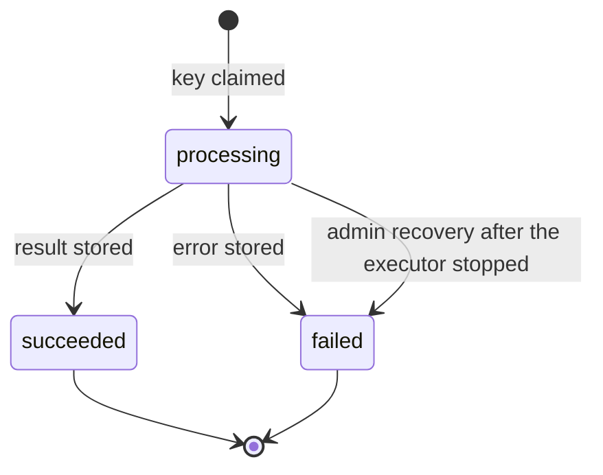

# Operation Resources

| Document ID | Version | Status | Last updated |
|---|---|---|---|
| EKI-API-004 | 1.0 | Current | 2026-10-30 |

## 1. Purpose

Three administrator operations call Google or Firebase Auth and can outlast an HTTP request: route saves, route geometry previews and fleet reconciliation jobs. This document describes how they are submitted, replayed and polled, their execution budgets and retention, and the procedure to recover one after a backend crash. Request and response formats are in the [API reference](../../backend/API.md) Sections 3.7.3, 3.7.4 and 3.8.

## 2. Operations

| Operation | Submit | Status resource | Key | Execution budget | External calls |
|---|---|---|---|---|---|
| Route save | `PUT /api/routes/:routeId` or `PUT /api/v2/routes/:routeId` | `GET .../routes/:routeId/save-operations/:saveId` on the same path generation | `saveId` body field | 30 s lease | None when stop coordinates are unchanged; otherwise up to 4 Google Routes requests per direction, 8 in total |
| Geometry preview | `POST /api/v2/route-geometry-previews` | `GET /api/v2/route-geometry-previews/:operationId` | `Idempotency-Key` header | 10 s | Up to 4 Google Routes requests |
| Fleet reconciliation job | `POST /api/v2/fleet-reconciliation-jobs` | `GET /api/v2/fleet-reconciliation-jobs/:operationId` | `Idempotency-Key` header | 30 s | Firebase Auth claim and token updates for up to 100 operators, in batches of 10 |

Each Google Routes request covers up to 27 points and has a 10 s deadline. Route saves, previews and `POST /api/routes/compute-polyline` share one geometry executor per process: 2 computations at a time, 8 waiting, and at most 2 s in the queue; beyond that the caller receives 503 `ROUTING_CAPACITY_EXHAUSTED`. A computation keeps its slot until every request it sent has settled.

These budgets are limits. No staging measurement of end-to-end latency or Google usage is recorded.

## 3. Route saves

The operation record is `_route_save_operations/{saveId}`. It holds a hash of the submitted content, a 30 s lease, the status (`processing`, `succeeded` or `failed`) and the stored result or error with its HTTP status.

When a save request arrives, the backend decides from that record:

| Record | Response |
|---|---|
| None | Claim the lease and run the save |
| Different content | 409 `IDEMPOTENCY_KEY_REUSED` |
| `succeeded` | 200 with the stored result |
| `failed` with `outcomeUnknown` | Claim again and run the save. Such a failure is recorded only while its lease is held, which proves the route was not written. |
| `failed` otherwise | The stored error with its original status |
| `processing`, lease valid | 202 with `Location` and `Retry-After: 1` |
| `processing`, lease expired | Claim again and run the save |

A save that is claimed again after an expired lease may call Google a second time; billing is not exactly once. The final transaction rechecks the route version and the absence of rides on the route, so a stale or concurrent save cannot overwrite newer content.

The administrator route editor uses the original paths. It allows the PUT 30 s. When the outcome is unknown, it polls `GET /api/routes/:routeId/save-operations/:saveId` with the same `saveId` for up to 35 s, at the interval given by `retryAfterMs`, clamped to 250 to 2,000 ms. It keeps polling after network timeouts, 429, `ROUTE_RECONCILIATION_FAILED` and generic gateway 5xx responses, stops on 401, 403 or a stored failure, and sends the PUT once more with the same `saveId` if the status read returns 404. When the 35 s run out it reports the outcome as unknown instead of claiming that the save failed.

## 4. Previews and reconciliation jobs

### 4.1 Lifecycle

The records are `_route_geometry_previews/{operationId}` and `_fleet_reconciliation_jobs/{operationId}`, where the operation ID is the `Idempotency-Key`.

Figure 1. Status of a geometry preview or fleet reconciliation job.

1. Admission. Each process admits at most 16 submissions at once, with 32 callers waiting on an identical submission, and answers within 3 s. Execution is limited to 2 running and 8 queued operations, each queued for at most 2 s. A submission that cannot be admitted in time has no durable record and receives 503 with `Retry-After: 1`; send it again with the same key. An admission that expires never starts external work, even if its record is written later.
2. Claim. The record is created with `status: "processing"`, the payload hash, the administrator UID, the executor identity (`executorId`, a random UUID per process, logged at startup as `[Operations] Executor identity: <uuid>`), `generation: 1` and a deadline equal to the budget.
3. Execution. Progress is checkpointed in `progress`: `phase` (`claimed`, `executing`, `locking` or `authorizing`) and, for fleet jobs, `checked`, `repaired`, `failed`, `cursor` and the IDs of the batch in flight (`batchDriverIds`, at most 10).
4. Outcome. `succeeded` stores `result`; `failed` stores a fixed `error` (`code`, `error`, optional `outcomeUnknown`) and any partial `result`. Every write is conditional on the original executor and generation, so a recovered operation cannot be overwritten by a late executor.

Errors never contain upstream response bodies, credentials, stack traces or Auth UIDs. Fleet results list operator IDs with an outcome and a fixed error code.

### 4.2 Replay and polling

- The same key and payload return the current snapshot: 202 with `Location` and `Retry-After: 1` while processing, 200 once final. A different payload returns 409 `IDEMPOTENCY_KEY_REUSED`.
- Status reads return 200 snapshots and never start work. Control reads (status, discovery and recovery) have their own limit of 16 concurrent reads, 32 waiting callers and a 3 s response.
- Work continues if the caller disconnects. On a graceful shutdown the process waits for running operations, within its 10 s shutdown limit.
- A fleet job stops starting new batches after 30 s and returns `nextCursor` with `timeBudgetExceeded: true`, but waits for the Auth calls already sent. Submit the next page with a new key.

### 4.3 Expired operations

The backend never takes over an operation automatically: an Auth update or a billable Google request may have succeeded without being recorded. Once a `processing` operation passes its deadline, its snapshot adds `outcomeUnknown: true` and a `recovery` object with `required: true`, `executorId`, `generation` and `requiresStoppedExecutor: true`. A status read by a process that is not executing it also records `phase: "recovery_required"`. Section 6 describes how to resolve it.

## 5. Fleet lock

The document `_fleet_reconciliation_locks/singleton` serializes every change to operator authorization: reconciliation jobs, `POST /api/fleet/reconcile`, all `/api/fleet` mutations, the worker's periodic reconciliation, `npm run sync-role-claims` and the Auth deletion step of privacy deletion. While it is held, other callers receive 409 or a `FLEET_RECONCILIATION_BUSY` job error. The lock records its `owner`, `executorId` and, when set, the linked `operationId`, `auditOperationId` (an `_fleet_operations` audit record) or `privacyRequestId`. The lock has no expiry and retention never removes it.

## 6. Recovery after a crash

Use this procedure when an operation stays `processing` with `recovery.required: true`, or the fleet lock stays held, after the process that ran it stopped. Every call needs an administrator token; all responses are `Cache-Control: no-store`.

1. Find stuck operations with `GET /api/v2/route-geometry-previews/recovery` and `GET /api/v2/fleet-reconciliation-jobs/recovery`. Pass `nextCursor` as `?cursor=` until it is `null`.
   Expected result: pages of up to 25 `processing` operations. Only entries with `recovery.required: true` are eligible.
2. Read the operation's status resource and `GET /api/v2/fleet-reconciliation-jobs/lock`.
   Expected result: the recovery identity (`executorId`, `generation`) and the lock owner, or 404 when no lock exists.
3. Confirm through the runtime supervisor (container platform or process manager) that the process whose startup log shows `[Operations] Executor identity: <executorId>` has stopped. For `executorId: "legacy"` with generation 0, confirm that every process that could have run the operation has stopped. A passed deadline is not proof.
   Expected result: evidence that no process can still complete the work. Keep it with the incident record.
4. Audit the effects. For a preview, check Google Routes usage. For a fleet job, check each operator in `progress.batchDriverIds`: custom claims, token revocation and the RTDB assignment mirror. Firebase cannot show that a timed-out Auth call failed.
   Expected result: a decision on whether operators need another reconciliation.
5. Abandon the operation with `POST /api/v2/route-geometry-previews/:operationId/recovery` or `POST /api/v2/fleet-reconciliation-jobs/:operationId/recovery` and the body `{"expectedExecutorId":"<executorId>","expectedGeneration":<generation>,"executorStopped":true}`.
   Expected result: 200 with a `failed` snapshot, `generation` increased by one and error `OPERATION_ABANDONED_AFTER_EXECUTOR_STOP` with `outcomeUnknown: true`. Nothing is executed again.
6. If the fleet lock is still held, release it with `POST /api/v2/fleet-reconciliation-jobs/lock/recovery` and `{"expectedOwner":"<owner>","executorStopped":true}`. A lock linked to an operation can be released only after that operation is final; a lock linked to a privacy request only after that request is recovered ([privacy deletion](../operations/PRIVACY_DELETION.md)). Locks held by the legacy endpoint, a fleet mutation or the periodic worker have no linked operation and can be released directly.
   Expected result: 200 `{"recovered":true}` and an audit record in `_fleet_lock_recoveries`, including `missing` for a linked record that no longer exists.
7. If step 4 showed that work is still needed, submit it with a new key. The old key keeps returning the abandoned outcome.
   Expected result: a new operation runs under the current process.

Troubleshooting:

| Response | Meaning | Action |
|---|---|---|
| 409 `RECOVERY_CONFLICT` | The identity changed, the deadline has not passed, the operation is final, a linked record is still processing, or this process still runs the work | Read the status again and repeat from step 2 |
| 503 `OPERATION_UNAVAILABLE` | The recovery could not be confirmed | Read the status before retrying |
| 503 on submission, no record exists | Admission expired before a claim | Retry with the same key |

These operations cannot prove that another replica stopped. A false `executorStopped` statement is unsafe: the generation check protects the stored records, not Auth or Google side effects that are already in flight. Page continuation and worker checkpoints for reconciliation are described in [reconciliation](../operations/RECONCILIATION.md).

## 7. Retention

The retention sweeper deletes operation records after `OPERATION_LOG_RETENTION_DAYS` (default 90):

| Record | Age counted from |
|---|---|
| `_route_geometry_previews`, `_fleet_reconciliation_jobs` | `completedAt`; records still `processing` are kept |
| `_route_save_operations`, `_fleet_operations` | `createdAt` |
| `_fleet_lock_recoveries` | `recoveredAt` |

After deletion the status resource returns 404 and a repeated key is treated as new, so clients must not reuse old keys.

## 8. Observability

The span `http.operation.execute` covers a preview or fleet job from execution to the stored outcome. The counter `eki.http.operation.executions` counts claimed executions by `operation.kind` (`geometry_preview` or `fleet_reconciliation`); polls and replays are not counted. The histogram `eki.http.operation.duration` records execution time in seconds by `operation.kind` and `operation.outcome`. Outbound Google requests appear as automatically instrumented HTTP spans; see the [backend package guide](../../backend/README.md#7-logging-and-tracing).
