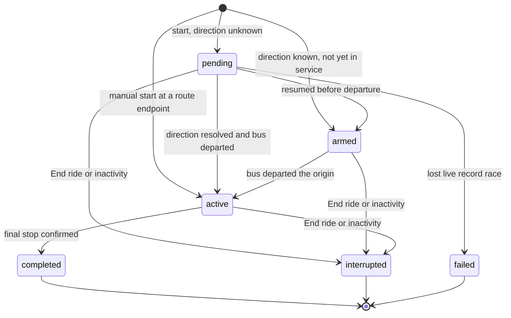

# Ride Session Contract

| Document ID | Version | Status | Last updated |
|---|---|---|---|
| EKI-API-003 | 2.0 | Current | 2026-10-30 |

## 1. Purpose

This document defines the states of a ride session, the events that change them, and what each HTTP operation may do in each state. Request and response formats are in the [API reference](../../backend/API.md#35-ride-sessions). How telemetry detects direction, stop arrival and completion is described in the [tracking algorithms](../design/TRACKING_ALGORITHMS.md), and automatic start in the [automatic GNSS service](../operations/AUTOMATIC_GNSS_SERVICE.md) runbook.

## 2. Records

A ride session is the Firestore document `ride_sessions/{sessionId}`. While a session holds a bus, the backend keeps three more records consistent with it:

| Record | Store | Role |
|---|---|---|
| `_active_bus_locks/{busId}` | Firestore | Active bus lock: at most one session (or one firmware installation) per bus |
| `active_rides/{busId}_{routeId}` | Firestore | Durable copy of the ride's progress, written once the direction is known |
| `activeBuses/{busId}_{routeId}` | RTDB | Live record with `sessionId`, `status` and `tripState` |

Field definitions are in the [Firebase data model](../data/FIREBASE_DATA_MODEL.md).

## 3. States

| Status | Meaning | `tripState` of the live record |
|---|---|---|
| `pending` | The session holds the bus; its direction is not yet known | `pre_departure` |
| `armed` | Direction known; the bus has not left the origin | `pre_departure` |
| `active` | In service; stop progress is recorded | `in_service` |
| `completed` | Telemetry confirmed arrival at the final stop | `completed` |
| `interrupted` | Ended before completion | Record set offline, or removed |
| `failed` | The start lost the race for the live record | Not linked |

`completed`, `interrupted` and `failed` are terminal: a terminal session never becomes live again.

Figure 1. Ride session states and the events that change them.

The events in Figure 1:

| Event | Source | Result |
|---|---|---|
| Automatic start | A qualified fix from an enabled, assigned device | New session, `pending` or `armed` |
| Manual start | `POST /api/shifts/start` or `POST /api/v2/ride-sessions` | New session, or the operator's live session resumed. A fresh fix at a route endpoint gives the direction; the session then starts `active` at stop 0, or `armed` if automatic service was paused for the bus. Without a direction it starts `pending`. |
| Direction resolved | Telemetry at an endpoint, or departure evidence on the first leg | Direction written to the session and active bus lock; never chosen by a client |
| Departure | Telemetry leaves the origin | `active`, `startTime` set |
| Completion | Telemetry confirms the stopped arrival at the final stop | `completed` |
| Turnaround | A fresh stopped fix at the destination at least `AUTOMATIC_TURNAROUND_DWELL_MS` (default 30 s) after completion | New `armed` session in the opposite direction with `automaticTurnaround: true` and `previousSessionId` |
| End ride early | `POST /api/shifts/stop` (Section 5) | `interrupted`, `interruptionReason: "manual_end_early"` |
| Inactivity | Hourly abandoned-ride reconciler: no activity for `ABANDONED_RIDE_THRESHOLD_HOURS` (default 12 h); 24 h for a turnaround session that never departed | `interrupted`, `interruptionReason: "abandoned_session_timeout"`; the matching active bus lock and progress records are released |
| Lost race | Two starts for the same bus; the loser created its session but could not claim the live record | `failed`, `failureReason: "shift_conflict"`; its active bus lock is released |

A session's direction never changes once resolved, and a session restored after a backend or device outage keeps its stored direction.

## 4. HTTP operations by state

| Operation | Allowed when | Effect on state |
|---|---|---|
| Start (legacy or v2) | The bus has no live session, or the live session belongs to the same operator | Creates or resumes; see Section 6 for keys |
| Read (`GET /api/v2/ride-sessions/:sessionId`, `GET /api/sessions/:sessionId/status`) | Any state | None |
| Report a delay | Live record `active` in `pre_departure` or `in_service`; v2 also needs the session `pending`, `armed` or `active` | None; updates `delayMinutes` |
| Board | `armed` or `active` with a resolved direction | None; adds the passenger to the manifest |
| Chat | `armed` or `active`; a repeated request ID is answered in any state | None |
| Legacy boarding code | `armed` or `active` | None |
| End ride early | `pending`, `armed` or `active` | `interrupted`. A `completed` session returns success without change; an `interrupted` one repeats cleanup; a `failed` one returns 409. |
| Clear chat | Session exists | None |
| Delete history | `completed`, `interrupted`, `failed` or already deleted | Deletes the session; 409 for a live session |

No HTTP operation completes a ride; only telemetry does. There is no resource-style End ride early operation.

## 5. Ending a ride early

`POST /api/shifts/stop` accepts two kinds of caller:

- An administrator (`role: "admin"`, `admin: true` and a current `authorizationVersion`) ends the session by its own identity. The session's `busId` and `routeId` must match the request, and its `driverId` too when the request names one. The operator's current assignment is not checked, so a ride whose operator was reassigned, or whose live record lacks a driver, can still be ended.
- Every other caller, including a token with administrator claims but without current authority, is treated as an operator and must pass the operator assignment check for its own driver identity.

In one Firestore transaction the backend marks the session `interrupted` with `endTime`, `interruptedBy` and the latest known location, deletes the session's `active_rides` record and active bus lock, and pauses automatic service for the bus if this session still owned it. It then sets the live record offline and removes its ride fields, but only if the record still carries this session. Telemetry from the device keeps the bus visible as online but cannot recreate the ended ride. An administrator restarts tracking with Resume tracking in Live Ops, which calls `POST /api/v2/ride-sessions` with a stable key. The new session starts before departure (`armed`, or `pending` until the direction is known) and does not claim an arrival at the origin.

A retry of End ride early for a session that a newer session has replaced changes nothing on the bus: the active bus lock, progress record and live record are touched only while they still carry the old session.

## 6. Idempotent creation

`POST /api/v2/ride-sessions` requires an `Idempotency-Key` header of 16 to 128 characters from `A-Z`, `a-z`, `0-9`, `_` and `-`.

1. The key is scoped to the caller's account and bound to the bus, route and operator of the first request. The binding is written in the same transaction that claims the active bus lock and is stored in `_ride_session_creation_keys`.
2. The first request returns 201 or 200 with `Location: /api/v2/ride-sessions/{sessionId}`. A retry with the same key returns 200 with the bound session, even after that session completed or was interrupted. It never starts the next ride; use a new key for a new ride.
3. The same key with a different bus, route or operator returns 409. If the bound session was deleted, the key returns 410.
4. Bindings are not deleted with ride history and no retention job removes them.

Automatic start runs the same start logic (`startAssignedService`) without HTTP, with a fixed key scoped to the device, its assignment revision and the bus's automatic-service epoch, so retries and several backend replicas create one session.

`POST /api/shifts/start` takes no key. A repeated request resumes the operator's live session or, when the bus is free again, starts a new one.
