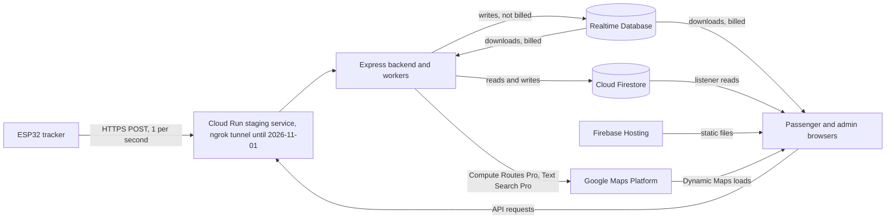

# Eki Cost Model

| Document ID | Version | Status | Last updated |
|---|---|---|---|
| EKI-CST-001 | 2.1 | Current | 2026-11-02 |

## 1. Purpose and scope

This model lets an operator estimate the monthly cost of running Eki and find the quotas that fail first. It covers Firebase (Realtime Database, Cloud Firestore, Authentication, Hosting), Google Maps Platform, backend hosting (the ngrok tunnel used until 2026-11-01 and the Cloud Run service that has run the staging backend since then), GitHub Actions and the tracker hardware fitted to each bus.

### 1.1 Summary

| Estimate | Pilot | Campus | Large |
|---|---|---|---|
| Fleet and riders (Section 4.1) | 3 buses, 2 routes, 300 passengers a day | 10 buses, 5 routes, 2,000 passengers a day | 30 buses, 12 routes, 10,000 passengers a day |
| Firebase and Google Maps, per month | USD 20 to 27 | USD 278 to 391 | USD 2,246 to 3,250 |
| Backend through ngrok Pay-as-you-go (the hosting used until 2026-11-01), per month | USD 60 | USD 163 | USD 477 |
| Total per month | USD 80 to 87 (INR 7,670 to 8,263) | USD 441 to 554 (INR 42,080 to 52,847) | USD 2,723 to 3,727 (INR 259,711 to 355,459) |
| Tracker hardware, once per bus (Section 3.10) | INR 1,160 to 2,375, or INR 3,960 to 5,175 with a 4G hotspot | Same | Same |

All figures are estimates from Section 4.3, on the Firebase Blaze (pay-as-you-go) plan and the Google Maps India price list. "Firebase and Google Maps" is the Section 4.3 subtotal plus Firestore overage at `us-central1` prices. Each range runs from the lower to the upper bound of the Realtime Database download model (Section 3.3).

- At campus scale and above, passenger downloads from the Realtime Database and Google Maps map loads make up most of the cost. Both grow with the number of daily passengers.
- The no-cost Spark plan cannot run the pilot: the pilot exhausts its Realtime Database download quota in 8 to 10 days, and Firebase then turns the product off for the rest of the month (Section 5). The ngrok Free and Hobbyist plans run out within 10 hours of tracker traffic (Section 4.4).
- The backend figures price the ngrok setup used until 2026-11-01. Cloud Run, which has run the staging backend since then, is not included because its cost is not yet confirmed (Section 3.7).
- Not included: the cellular data plan, about 1.9 GB per bus per month; and the automotive power converter, fuse holder and enclosure.

### 1.2 Conventions

Every quantity in Sections 3 and 4 is an estimate. Each one is derived from the code at the cited `path:line`, from recorded evidence, or from a stated assumption. Replace the assumptions in Section 4.1 with measured values before you commit to a budget. Section 6.7 describes how to measure.

- Prices are in US dollars (USD) as listed by the vendor. Indian rupee (INR) amounts use the Reserve Bank of India reference rate of INR 95.3688 per USD, published by FBIL for 2026-10-29 at 13:00 and retrieved 2026-10-30 [25].
- KB, MB and GB are decimal (1 GB = 10^9 bytes). The Firebase pricing pages do not define the unit.
- A month is 30 days.

## 2. Pricing basis

All prices were retrieved on 2026-10-30. "Not confirmed" means the official page did not render or did not state the value; this model does not substitute a remembered price.

### 2.1 Firebase

| Service | Item | No-cost allowance | Price above allowance (Blaze) | Source |
|---|---|---|---|---|
| Realtime Database | Simultaneous connections | Spark: 100. Blaze: 200,000 per database | Not applicable | [1], [3] |
| Realtime Database | Data stored | 1 GB | USD 5 per GB-month | [1], [2] |
| Realtime Database | Data downloaded | Spark: 10 GB per month. Blaze: 360 MB per day | USD 1 per GB | [1] |
| Cloud Firestore (Standard) | Reads, writes, deletes | 50,000 reads, 20,000 writes and 20,000 deletes per day per project, one free database per project | `us-central1`: USD 0.03 per 100,000 reads, USD 0.09 per 100,000 writes, USD 0.01 per 100,000 deletes | [1], [7], [9], [35] |
| Cloud Firestore (Standard) | Stored data, network egress | 1 GiB stored, 10 GiB egress per month | Not confirmed | [1], [7] |
| Cloud Firestore | Regional price for `asia-south2` (Delhi) | Not confirmed | Not confirmed | [8] |
| Authentication | Monthly active users (MAU) | 50,000 MAU | Not confirmed | [1] |
| Authentication | Daily active users on Spark (Identity Platform) | Tier 1: 3,000 per day | Not applicable | [13] |
| Hosting | Storage | 10 GB | USD 0.026 per GB | [1], [14] |
| Hosting | Data transfer | 360 MB per day (pricing page) or 10 GB per month (Hosting guide) | USD 0.15 per GB | [1], [14] |
| Hosting | Custom domain and SSL certificate | Included | Included | [1] |

The Firebase pricing page states that Blaze includes the Spark no-cost usage and calculates it daily [1]. Firebase publishes Firestore Standard edition operation prices for `us-central1` only [35]. The regional price list is on a Google Cloud page whose content did not render for retrieval [8]; read the `asia-south2` prices in the Cloud console or the Google Cloud pricing calculator.

### 2.2 Google Maps Platform

Google publishes a global price list and an India price list. The India list applies to accounts with "billing and a large majority of usage in India" and is charged in INR [17]. The India list shows prices in USD [16]; no official INR price per SKU was found, so this model converts the USD list.

| SKU | Category | India list: free calls per month | India list: USD per 1,000 above cap (up to 5,000,000) | Global list: free calls per month | Global list: USD per 1,000 (first paid tier, up to 100,000) |
|---|---|---|---|---|---|
| Dynamic Maps | Essentials | 70,000 | 2.10 | 10,000 | 7.00 |
| Compute Routes Pro | Pro | 35,000 | 3.00 | 5,000 | 10.00 |
| Compute Routes Essentials | Essentials | 70,000 | 1.50 | 10,000 | 5.00 |
| Text Search Pro (Places API (New)) | Pro | 35,000 | 9.60 | 5,000 | 32.00 |
| Geocoding | Essentials | 70,000 | 1.50 | 10,000 | 5.00 |

Sources: [15], [16]. The SKU depends on the request:

- Compute Routes requests with `TRAFFIC_AWARE` or `TRAFFIC_AWARE_OPTIMAL` bill as Compute Routes Pro [19]. Every Eki Routes request sets one of the two (Section 3.8).
- Text Search requests whose field mask includes `places.displayName`, `places.formattedAddress` or `places.location` bill as Text Search Pro [20].
- Dynamic Maps bills each successful map load from the Maps JavaScript API [18], [27].

### 2.3 Backend hosting, CI and exchange rate

| Service | Item | No-cost allowance | Price | Source |
|---|---|---|---|---|
| ngrok Free | HTTP/S requests, data transfer | 20,000 requests per month, 1 GB | USD 0 | [23] |
| ngrok Hobbyist | Monthly plan | 100,000 requests, 5 GB | USD 10 per month; endpoints stop when the usage credit is spent | [23] |
| ngrok Pay-as-you-go | Monthly plan | 100,000 requests, 5 GB | USD 20 per month, then USD 1 per 100,000 requests and USD 0.10 per GB | [23] |
| Cloud Run | Request-based billing free tier | 2,000,000 requests, 180,000 vCPU-seconds and 360,000 GB-seconds per month per billing account | Not confirmed | [9], [10] |
| Cloud Run | Instance-based billing | None stated | Not confirmed | [10], [12] |
| Cloud Run | Region pricing tier | `asia-south1` (Mumbai) is Tier 1; `asia-south2` (Delhi) is Tier 2 | Not confirmed | [11] |
| GitHub Actions | Standard GitHub-hosted runners | Free in public repositories | Linux 2-core USD 0.006 per minute in private repositories | [24] |
| Exchange rate | USD to INR | Not applicable | INR 95.3688 per USD (FBIL, 2026-10-29) | [25] |

`gh repo view notnamansinha/Eki --json visibility,isPrivate` returned `PUBLIC` on 2026-10-30, so the workflows in `.github/workflows/` run on free standard runners.

## 3. Usage model

### 3.1 Parameters

| Symbol | Meaning |
|---|---|
| `B` | Buses with a powered tracker |
| `R` | Routes; `n_r = B / R` is buses per route |
| `H` | Hours per day that each tracker is powered |
| `D` | Days per month (30) |
| `P` | Daily passengers |
| `V` | App opens per passenger per day |
| `T` | Seconds per passenger per day with the passenger workspace in the foreground |
| `A`, `H_a` | Admin dashboards open, and their hours per day |
| `V_a` | Administrator page loads (launch, reload or new tab) per admin per day |
| `r_b` | Rides per bus per day |
| `S` | Stops per route; `L` lifecycle changes per ride |
| `c_r` | Routes API calls per ride |

Figure 1 shows where each billed quantity arises.


Figure 1. Billable paths in Eki. Edge labels name the billed quantity.

### 3.2 Telemetry ingestion

The firmware evaluates and publishes one fix per second while moving and while stopped (`hardware/include/telemetry_policy.h:48-55`). Each fix is one HTTPS `POST /api/devices/{deviceId}/telemetry` with nine JSON fields (`hardware/src/main.cpp:1413-1424`); the backend rejects bodies over 512 bytes (`backend/src/routes/devices.ts:107-109`). The tracker also sends a diagnostic report every 5 minutes (`hardware/src/main.cpp:120-121`), and fleet builds check for firmware every 6 hours (`hardware/include/firmware_update_policy.h:13-14`). The backend accepts at most `HTTPS_DEVICE_RATE_PER_MINUTE=90` requests per device per minute (`backend/.env.example`).

| Quantity | Formula (estimate) |
|---|---|
| Telemetry requests per month | `B * H * 3,600 * D` |
| Diagnostic requests per month | `B * 12 * H * D` |
| Cellular data per bus per month | `H * 3,600 * D * 1.5 KB`, about 1.9 GB for `H = 12` |

The 1.5 KB per request (headers, body, response, TLS and TCP framing) is an assumption; read the hotspot's data counter to replace it. The tracker connects to a 2.4 GHz Wi-Fi network or phone hotspot ([tracker bill of materials](../../hardware/README.md#2-bill-of-materials)).

### 3.3 Realtime Database

The Realtime Database bills stored data and downloaded data, not write operations. Downloaded data includes protocol and TLS overhead, which writes also generate [2]. The backend's Admin SDK listeners download like any other client. Each browser tab and each backend process is one simultaneous connection [3]. Trackers do not connect to the Realtime Database.

| Client | Path | Code | What it downloads |
|---|---|---|---|
| Backend, one connection per process | `activeBuses` child events | `backend/src/services/tripStateEngine.ts:791,1338-1340`, `backend/src/services/liveBusProjection.ts:112,291` | Every write to any bus node, about four per fix |
| Backend | `activeBuses/{busId}_{routeId}`, one read per public publication | `backend/src/services/liveBusProjection.ts:164` | One full bus node |
| Passenger | `publicRouteBuses/route:{routeId}/buses` for the selected route and any joined ride's route | `frontend/src/lib/liveBusStore.ts:17`, `frontend/src/components/passenger/PassengerWorkspace.tsx:196-198` | Route snapshot, then each public commit on that route |
| Passenger | `liveRouteCatalog/values` and `clientProjectionStatus/public` | `frontend/src/hooks/useLiveRouteCatalog.ts:34,42` | The whole catalog on each change |
| Passenger | `activeRouteGeometry/{busId}_{routeId}/{version}`, one read | `frontend/src/lib/activeRouteGeometry.ts:73` | One encoded polyline per new route version |
| Admin | `publicRouteBuses` (all routes) | `frontend/src/components/admin/DashboardPanel.tsx:609`, `frontend/src/components/admin/FleetManagementPanel.tsx:77` | Each changed route node |

Each public commit replaces the whole `publicRouteBuses/route:{routeId}` node in one transaction (`backend/src/services/liveBusProjection.ts:170-178`); the evidence below records two commits per fix. The worker rewrites the whole `liveRouteCatalog` node when a route's availability changes (`backend/src/services/liveBusProjection.ts:137-142`). Each bus's availability receipt moves in 30 s steps and the catalog stores one receipt per bus, so receipt changes add at most two catalog changes per minute per bus (`backend/src/services/liveBusProjection.ts:92-97`).

Sizes come from a loopback emulator run recorded in the [R14 live projection evidence](../testing/R14_LIVE_PROJECTION.md). They are application JSON bytes and exclude protocol and TLS overhead, so treat them as lower bounds on billed bytes.

| Constant | Value | Evidence |
|---|---|---|
| Backend download per fix per bus | 4.8 KB | 78,611 bytes of listener events plus 17,626 bytes of source reads over 20 fixes |
| Public bus record | 0.4 KB | 4,318 bytes for 10 buses; 13,894 bytes over 40 commits |
| Public commits per fix | 2 | 40 commits for 20 fixes |
| Catalog size per route | 81 bytes | 811 bytes for 10 routes |
| TLS handshake per new connection | 3.5 KB | Firebase billing guide [2] |

The R14 run had one bus per route, so it cannot show whether the database forwards the whole route node or only the changed record to a route listener. The model carries both: exponent `k = 2` (whole node, upper bound) and `k = 1` (changed record, lower bound).

| Download | Formula, KB per day (estimate) |
|---|---|
| Backend | `B * H * 3,600 * 4.8` |
| Passengers, route buses | `P * T * 0.8 * n_r^k` |
| Passengers, catalog | `P * T * (2 * B / 60) * 0.081 * R` |
| Admin fleet view | `A * H_a * 3,600 * 0.8 * B * n_r^(k - 1)` |

A hidden tab keeps its connection and listeners: `frontend/src/hooks/useRTDBResume.ts:40,51-53` only schedules a reconnect when the tab becomes visible again after at least 30 s (`useRTDBResume.ts:14`). Each such reconnect adds a TLS handshake and a fresh route snapshot.

Stored data stays small: `activeBuses` holds one node per bus, and the retention job removes unreferenced `activeRouteGeometry` versions after 180 days (`backend/src/services/rtdbRetention.ts:3-5`). See [RTDB retention](../operations/RTDB_RETENTION.md).

### 3.4 Cloud Firestore

Firestore bills one read per document returned, with a minimum of one read per query [7]. The backend generates a fixed background load whether or not buses run. Every leader-worker write runs in a transaction that first reads the lease document (`backend/src/lib/workerFence.ts:43-49`); the read counts below include that read.

| Source | Rate | Reads per day | Writes per day | Code |
|---|---|---|---|---|
| Worker lease renewal (leader) | Every 15 s | 5,760 | 5,760 | `backend/src/services/workerCoordinator.ts:15-16,96,109,199` |
| Worker lease attempt (each other replica) | Every 15 s | 5,760 | 0 | same |
| Health probe of `_health` (each process) | Every 30 s | 2,880 | 0 | `backend/src/server.ts:223-229` |
| Privacy deletion queue scan: cursor, pending-request query, lease | Every 60 s | 4,320 | 1,440 | `backend/src/services/privacyDeletionWorker.ts:92-95,112-114,126` |
| Fleet authorization reconciliation: cursor, fleet lock, driver page, then driver, authorization and bus documents per driver | Every 10 min | `144 * (5 + 4 * drivers)` (estimate) | 288, plus 144 deletes | `backend/src/services/workerCoordinator.ts:139-155,171`, `backend/src/routes/fleet.ts:27,82,181`, `backend/src/services/userAuthorization.ts:24-27`, `backend/src/services/fleetMutationLock.ts:18-29` |
| Abandoned ride reconciliation: cursor, ride page, lease | Hourly | 96 or more | 24 or more | `backend/src/services/abandonedRideReconciler.ts:18,232-240,249` |
| Retention sweep | Daily, only with `RETENTION_SWEEPER_ENABLED=true` | Varies | Deletes | `backend/src/services/retentionSweeper.ts:187-191`, `backend/.env.example` |

Usage that scales with the fleet and with passengers:

| Source | Formula (estimate) | Code |
|---|---|---|
| Device credential cache fills: 3 reads per device per 60 s while sending | `180 * H * B` reads per day | `backend/src/services/deviceTelemetryService.ts:49,462,480-483` |
| Tracker diagnostics: the latest report replaces one `_device_diagnostics` document every 5 min | `12 * H * B` writes per day | `backend/src/services/deviceDiagnostics.ts:120` |
| Tracker powered without a ride: restore attempt | At most 2 reads per 30 s per bus | `backend/src/services/durableRideRecovery.ts:59-63,95` |
| Ride start and completion | About 10 reads and 10 writes per ride | `backend/src/services/rideSessionStart.ts:326-430`, `backend/src/services/tripStateEngine.ts:1121-1165` |
| Each lifecycle change (stop reached, activation, delay) | About 4 reads and 3 writes | `backend/src/services/tripStateEngine.ts:453-468,705-757` |
| Passenger app open: settings listener, user document, route catalog API, stored geometry, and the route schedule listener when the passenger opens the Routes tab | `R + 4` reads (upper bound: the Routes tab opened on every app open) | `frontend/src/hooks/useSettings.ts:68`, `frontend/src/hooks/useAuth.ts:293`, `backend/src/routes/routesList.ts:20-23`, `backend/src/services/routeGeometryReads.ts:22-24`, `frontend/src/hooks/usePassengerRouteConfig.ts:47` |
| Ride chat opened | Up to 200 reads, then 1 per message | `frontend/src/components/shared/MessagingPanel.tsx:96-101` |
| Feedback submitted | 1 write | `frontend/src/lib/feedbackStore.ts:70` |
| Admin dashboard day: drivers (up to 250), ride history (2 x 100), feedback (up to 200), authorization check per admin request | About 1,000 reads per admin per day (assumption) | `frontend/src/hooks/useDrivers.ts:48-51`, `frontend/src/components/admin/RideHistoryPanel.tsx:202-220`, `frontend/src/lib/feedbackStore.ts:120`, `backend/src/services/userAuthorization.ts:22-26` |

Combined, for one backend process:

```text
reads/day  = 13,056 + 144 * (5 + 4 * B) + 180 * H * B + B * r_b * (10 + 4 * L) + P * V * (R + 4) + 1,000 * A
writes/day = 7,512 + 12 * H * B + B * r_b * (10 + 3 * L)
```

The constants add the fixed rows above with drivers equal to buses. The formulas exclude restore attempts by trackers powered without a ride, which add at most `240 * H` reads per such bus per day. The route catalog cache holds results for only 5 s (`backend/src/services/apiReadCache.ts:35`), so most passenger app opens miss it and read every route document.

Firestore retention defaults are 180 days for ride sessions, feedback and completed trips and 90 days for operation logs (`backend/.env.example`). The sweeper is off unless enabled.

### 3.5 Authentication

Eki uses Google sign-in only (`frontend/src/lib/firebaseAuth.ts:30`, `frontend/src/hooks/useAuth.ts:571,616`). There is no phone sign-in, so there are no SMS charges. MAU is at most the number of distinct people who sign in during a month. Every scenario in Section 4 stays below 50,000 MAU.

### 3.6 Hosting

The frontend is a static export (`frontend/next.config.ts:92`) served from `frontend/out` (`firebase.json:10`). It publishes source maps (`frontend/next.config.ts:101`), which count toward storage but are excluded from the service worker precache (`scripts/generate-sw.mjs:49-52`). Files under `/_next/static/` carry a one-year immutable cache header (`firebase.json:74-79`), so a returning device fetches mostly HTML until the next deploy changes the chunk names.

Measured on a local production build of 2026-10-29 (estimate for the current code):

| Item | Size |
|---|---|
| `frontend/out`, all files | 17 MB, 140 files |
| `passenger.html`, gzip | 4.5 KB |
| JavaScript chunks referenced by `passenger.html`, gzip | 192 KB |
| All JavaScript, gzip | 715 KB |

To measure your own build, run `npm run build` from the repository root, then `du -sh frontend/out`. The model assumes 4.5 KB of HTML per app open and 0.5 MB per device on the first open after each deploy, with four deploys per month.

### 3.7 Backend hosting

Until 2026-11-01 the backend ran on a workstation and received device and browser traffic through an ngrok tunnel ([ngrok tunnel runbook](../operations/NGROK_TUNNEL.md)); the ngrok figures in this model price that setup. Every telemetry request, diagnostic and browser API call counts as one ngrok request. Since 2026-11-01 the staging backend runs on the Cloud Run service `eki-backend-staging` in `asia-south2`, deployed only by the manual job `deploy-backend-staging` ([CI, deployment and releases](../operations/CI_CD_AND_RELEASES.md#52-steps)). Its cost is not yet confirmed.

The Cloud Run service uses the container in `backend/Dockerfile` (port 8080). The process starts the HTTP server and the leader-elected workers together (`backend/src/server.ts:307-311`), and the workers hold Realtime Database listeners and renew a Firestore lease every 15 s ([worker leadership](../operations/WORKER_LEADERSHIP.md)). This work runs outside requests, so the service needs instance-based billing, which charges for the whole instance lifecycle [12], and at least one minimum instance. The staging service runs with `minScale` 0 and `WORKER_ENABLED=false`, so it bills only while an instance runs; after the worker handoff it needs `minScale` 1. One always-on instance consumes `vCPU * 2,592,000` vCPU-seconds and `GiB * 2,592,000` GiB-seconds per month. The free tier page lists allowances for request-based billing only [9], and the unit prices were not confirmed [10].

### 3.8 Google Maps Platform

The frontend loads the Maps JavaScript API with `NEXT_PUBLIC_GOOGLE_MAPS_API_KEY` (`frontend/src/config/maps.ts:17`). The backend calls the Routes and Places web services with `GOOGLE_MAPS_API_KEY` (`backend/.env.example`). No code calls Geocoding, Directions, Distance Matrix or Places Autocomplete.

| SKU | Caller | Trigger | Existing bounds |
|---|---|---|---|
| Dynamic Maps | Passenger map (`frontend/src/components/maps/PassengerMap.tsx:625-627`) | The first opening of the tracking view in a page load (app launch, reload or new tab). The map unmounts in other views (`frontend/src/components/passenger/PassengerWorkspace.tsx:747-748`), but every later opening, route, direction or bus change in the same page reattaches the cached map | `reuseMaps` on every map (`frontend/src/config/maps.ts:1-15`) |
| Dynamic Maps | Admin dashboard and route editor maps (`frontend/src/components/admin/DashboardPanel.tsx:862-864`, `frontend/src/components/admin/RouteManagementPanel.tsx:567`) | Each administrator page load, because Live Ops is the default tab (`frontend/src/app/admin/page.tsx:45`). Switching tabs or opening the route editor (`frontend/src/app/admin/page.tsx:59-60`) reattaches the same map | Same as above |
| Compute Routes Pro | Route save (`backend/src/routes/polyline.ts:199,288-291`) | Two requests per changed save, one per direction; skipped when the stops are unchanged (`polyline.ts:669-672`) | 10 compute requests per admin per minute (`backend/src/lib/routeComputeLimiter.ts:9`); 2 concurrent and 8 queued (`polyline.ts:46`) |
| Compute Routes Pro | Route preview and `compute-polyline` (`polyline.ts:361-373,895-906`) | One request per preview | Same as above |
| Compute Routes Pro | Departure route (`backend/src/services/telemetryRouteService.ts:861-879,917-918`) | One request when a ride enters `pre_departure`; reused at departure for up to 5 min (`telemetryRouteService.ts:54`), otherwise one more; at most three attempts per phase | `LIVE_DEPARTURE_ROUTES_ENABLED` (`backend/.env.example`) |
| Compute Routes Pro | Off-route reroute (`telemetryRouteService.ts:1032-1038`) | One request per off-route episode | Retry backoff 10 s to 5 min (`backend/src/services/rerouteRetry.ts:1-2`); process-wide circuit opens after 5 failures (`rerouteRetry.ts:23-50`) |
| Compute Routes Pro | `npm run seed --workspace=backend` (`backend/src/seed.ts:29-30`) | Two requests per seeded route | Manual |
| Text Search Pro | Admin stop search (`backend/src/routes/places.ts:73-80`) | Typing at least 3 characters, after a 300 ms pause (`frontend/src/components/admin/RouteManagementPanel.tsx:53-58,91`) | 20 searches per admin per minute (`places.ts:19-22`); 5 min cache of 100 queries (`places.ts:8,128-132`) |

A route with more than 27 points is split into several requests of up to 27 points each (`backend/src/lib/orderedRouteGeometry.ts:3-4,21-24`). The Maps JavaScript API also displays a traffic layer (`frontend/src/components/maps/TrafficLayer.tsx:12`); no separate SKU for it was found on the pricing pages.

The three maps share one map ID and one set of options, so the passenger map, Live Ops and the route editor reattach the same `google.maps.Map`, and a page constructs at most one ([EKI-ADR-004](../design/GOOGLE_MAP_REUSE_DECISION.md)). This model counts one Dynamic Maps load per constructed map. An app that resumes a page still in memory constructs no map; a relaunch, reload or new tab constructs one when it first shows a map. The passenger term below counts every app open as such a page load that opens the tracking view, so it is an upper bound.

| Quantity | Formula (estimate) |
|---|---|
| Dynamic Maps loads per month | `(P * V + A * V_a) * D` |
| Compute Routes Pro calls per month | `B * r_b * c_r * D` plus route saves and previews |
| Text Search Pro calls per month | Admin searches; assumed far below the free cap |

### 3.9 Other costs

| Item | Cost basis |
|---|---|
| Domain and DNS | Firebase Hosting includes custom domains and SSL [1]. A registrar or campus DNS charge is outside this model. See [DNS and domains](../operations/DNS_AND_DOMAINS.md). |
| OpenTelemetry export | Off unless `OTEL_EXPORTER_OTLP_ENDPOINT` is set (`backend/.env.example`). A hosted collector is not priced here. |
| Firmware release hosting | Optional HTTPS URL in `FIRMWARE_RELEASE_URL` (`backend/.env.example`). Not priced here. |
| GitHub Actions | USD 0: public repository and `ubuntu-latest` runners. CI builds use a placeholder Maps key (`.github/workflows/ci.yml:174`), so CI makes no billable Maps calls. |

### 3.10 Tracker hardware per bus

Components follow the [tracker bill of materials](../../hardware/README.md#2-bill-of-materials). Prices are indicative, include GST where the listing says so, and were retrieved on 2026-10-30. "Page" means the retailer page was read; "search" means only a search-engine summary of the retailer page was available.

| Item | Indicative price (INR) | Source |
|---|---|---|
| ESP32 30-pin development board (`esp32dev`; fleet units need silicon revision ECO3 or newer) | 415 to 499 | [28] page, [29] search |
| u-blox NEO-M8N module with active antenna | 691 to 1,795 | [30] search, out of stock; [31] search |
| 12 V to 5 V buck module, hobby grade | 54 to 81 | [32], [33] search |
| Fused automotive-rated converter, fuse holder, enclosure, cabling | Not priced | No listing confirmed |
| Portable 4G hotspot, only when the bus has no Wi-Fi | 2,800 (JioFi M2S) | [34] page |
| Cellular data plan, about 1.9 GB per month (Section 3.2) | Not confirmed | None |

The priced items total INR 1,160 to 2,375 per bus without a hotspot, or INR 3,960 to 5,175 with one. Hobby buck modules are not automotive-rated; the tracker guide requires a fused automotive-rated converter.

## 4. Scenarios

### 4.1 Assumptions

| Parameter | Pilot | Campus | Large |
|---|---|---|---|
| Buses `B` | 3 | 10 | 30 |
| Routes `R` | 2 | 5 | 12 |
| Buses per route `n_r` | 1.5 | 2 | 2.5 |
| Daily passengers `P` | 300 | 2,000 | 10,000 |
| Admin dashboards `A` and hours `H_a` | 1 for 8 h | 2 for 12 h | 3 for 12 h |

All scenarios assume trackers powered for `H = 12` h a day (07:00 to 19:00) on `D = 30` days, `V = 2` app opens and `T = 960` s (two 8-minute views) per passenger per day, `r_b = 12` rides per bus per day, `S = 15` stops, `L = 2S = 30` lifecycle changes per ride, `c_r = 2` Routes calls per ride (on average 1 departure preview, 0.5 departure refresh and 0.5 reroute), `V_a = 2` administrator page loads per admin per day (the start of the day and one reload, for example after a deploy), one backend process, and drivers equal to buses. They also assume that each tracker has a valid fix for all `H` hours, 40 route saves and previews per month, four Hosting deploys per month (Section 3.6), and, for ngrok, 10 browser API calls of 5 KB each per app open and 1.5 KB per tracker request (Section 3.2).

### 4.2 Monthly usage (estimate)

| Quantity | Pilot | Campus | Large |
|---|---|---|---|
| Telemetry requests | 3.89 million | 12.96 million | 38.88 million |
| RTDB download, backend | 18.7 GB | 62.2 GB | 186.6 GB |
| RTDB download, passengers, upper and lower bound | 15.6 and 10.4 GB | 184.3 and 92.2 GB | 1,440.0 and 576.0 GB |
| RTDB download, route catalog | 0.1 GB | 7.8 GB | 279.9 GB |
| RTDB download, admin fleet view, upper and lower bound | 3.1 and 2.1 GB | 41.5 and 20.7 GB | 233.3 and 93.3 GB |
| RTDB download, total, upper and lower bound | 37.5 and 31.2 GB | 295.8 and 182.9 GB | 2,139.8 and 1,135.9 GB |
| Peak RTDB connections, `0.5 * P * T / 7,200 + A + 1` (half of passenger time in a 2 h peak) | 22 | 136 | 671 |
| Firestore reads per day | 31,300 | 94,700 | 465,700 |
| Firestore writes per day | 11,500 | 21,000 | 47,800 |
| Dynamic Maps loads (passenger plus administrator) | 18,060 (18,000 + 60) | 120,120 (120,000 + 120) | 600,180 (600,000 + 180) |
| Compute Routes Pro calls | 2,200 | 7,240 | 21,640 |
| Hosting transfer on a deploy day | 0.15 GB | 1.02 GB | 5.09 GB |
| Requests through ngrok, assuming 10 API calls per app open | 4.08 million | 14.20 million | 45.01 million |
| Cellular data per bus | 1.9 GB | 1.9 GB | 1.9 GB |

### 4.3 Monthly cost (estimate)

Costs assume the Blaze plan, the India Maps price list and the daily Hosting allowance. INR is in parentheses.

| Service | Pilot | Campus | Large |
|---|---|---|---|
| RTDB download, upper bound | USD 26.66 (INR 2,543) | USD 284.98 (INR 27,178) | USD 2,129.04 (INR 203,044) |
| RTDB download, lower bound | USD 20.44 (INR 1,949) | USD 172.08 (INR 16,411) | USD 1,125.07 (INR 107,297) |
| Firestore | USD 0 | 1.34 million reads and 0.03 million writes above the free quota: USD 0.43 (INR 41) at `us-central1` prices; `asia-south2` price not confirmed | 12.47 million reads and 0.83 million writes above the free quota: USD 4.49 (INR 428) at `us-central1` prices; `asia-south2` price not confirmed |
| Authentication | USD 0 | USD 0 | USD 0 |
| Hosting | USD 0 | USD 0.39 (INR 37) | USD 2.84 (INR 271) |
| Maps: Dynamic Maps | USD 0 | USD 105.25 (INR 10,038) | USD 1,113.38 (INR 106,182) |
| Maps: Compute Routes Pro, Text Search Pro | USD 0 | USD 0 | USD 0 |
| GitHub Actions | USD 0 | USD 0 | USD 0 |
| Subtotal, upper bound | USD 26.66 (INR 2,543) | USD 390.62 (INR 37,253) | USD 3,245.26 (INR 309,497) |
| Subtotal, lower bound | USD 20.44 (INR 1,949) | USD 277.72 (INR 26,486) | USD 2,241.29 (INR 213,749) |
| Backend until 2026-11-01: ngrok Pay-as-you-go | USD 59.98 (INR 5,720) | USD 163.08 (INR 15,553) | USD 477.45 (INR 45,534) |
| Backend since 2026-11-01 (staging): Cloud Run, instance-based, minimum 1 after the worker handoff | Not confirmed | Not confirmed | Not confirmed |
| Tracker cellular data | Not confirmed | Not confirmed | Not confirmed |

The subtotals exclude Firestore overage and backend hosting. Under the global Maps list, the pilot's 18,060 map loads would exceed the 10,000 free loads and cost USD 56.42 (INR 5,381).

Passenger downloads from the Realtime Database and Dynamic Maps loads dominate at campus and large scale. Both grow with `P`; the Realtime Database term also grows with `n_r` (Section 3.3).

### 4.4 Allowances exceeded first

| Scenario | Allowance exceeded | When |
|---|---|---|
| Pilot | ngrok Free, 20,000 requests per month | After about 1.9 h of three trackers |
| Pilot | ngrok Hobbyist, 100,000 requests per month | After about 9.3 h of three trackers |
| Pilot | RTDB Spark download, 10 GB per month | After 8 to 10 days (1.04 to 1.25 GB per day) |
| Pilot | RTDB Blaze no-cost download, 360 MB per day | Every operating day |
| Campus | RTDB Spark connections, 100 | At peak (136) |
| Campus | Firestore reads, 50,000 per day, and writes, 20,000 per day | Every day (94,700 reads, 21,000 writes) |
| Campus | Hosting, 360 MB per day | On each deploy day (1.02 GB) |
| Campus | Dynamic Maps India cap, 70,000 per month | Around day 18 |
| Large | Authentication Spark, 3,000 daily active users | Daily, if the project uses Identity Platform on Spark |
| Large | Firestore writes, 20,000 per day | Every day (47,800) |

## 5. Quotas and limits that cause outages

These limits stop service instead of adding to the bill.

| Limit | Value | Effect when reached | Eki exposure |
|---|---|---|---|
| Spark no-cost quota, any product | Per product | The product is shut off for the rest of the calendar month for every app in the project [5]. The Realtime Database FAQ describes the app as "turned off" until the plan is upgraded or the quota resets [4]. | The pilot exhausts the RTDB download quota in 8 to 10 days. Check the plan under Usage and billing in the Firebase console. |
| RTDB simultaneous connections | Spark 100; 200,000 per database | The limits page does not describe the behaviour at the limit [3]. | Campus peak of 136 exceeds Spark. |
| RTDB writes | 1,000 per second per database, soft | Writes may be rate-limited [3]. | About six writes per fix per bus (estimate: telemetry, matcher, metadata, two public commits, rate-limit lease), so about 160 buses per database. |
| Firestore daily quota on Spark | 50,000 reads, 20,000 writes | More quota requires billing; quotas reset around midnight Pacific time [7]. The Spark shut-off rule above also applies [5]. | Campus and large reads and writes. |
| Hosting transfer on Spark | 360 MB per day or 10 GB per month | After a short grace period the site is disabled until the next month [14]. | Deploy days at campus scale. |
| Hosting storage on Spark | 10 GB | New deploys fail [14]. | Each retained release adds about 17 MB; set a release retention limit. |
| Authentication on Spark (Identity Platform) | 3,000 Tier 1 daily active users | Not described [13]. | Large scenario. |
| Authentication account creation | 100 accounts per hour per IP address [13] | Not described. Whether Google sign-in counts as account creation was not confirmed. | First-day onboarding of many students behind one campus NAT address. |
| Maps per-day quota | Set by the operator | Requests fail for the rest of the day [21]. | Only after an operator lowers a quota (Section 6.3). |
| ngrok Free and Hobbyist | 20,000 and 100,000 requests per month | Free allows no usage beyond its allowance; Hobbyist endpoints stop until the billing cycle resets [23]. | Any bus fleet; Section 4.4. |
| Backend device admission | `HTTPS_DEVICE_RATE_PER_MINUTE=90`, `HTTPS_INGRESS_DEVICES_PER_IP=100` | Requests beyond the limit receive HTTP 429 (`backend/.env.example`). | A fleet sharing one public address above 100 devices. |

## 6. Cost controls

### 6.1 Budgets and alerts

1. Create a Cloud Billing budget for the project with alert thresholds, for example at 50%, 90% and 100% of the monthly figure from Section 4.3. Budgets send alerts and do not cap spending [5], [22].
2. Firebase spend caps pause a service at its budget, but they apply only to Firebase AI Logic, App Hosting, Cloud Functions and Extensions [6]. Eki uses none of these, so no spend cap protects the Realtime Database, Firestore, Hosting, Maps or Cloud Run.
3. When a Firebase usage alert email or console notification arrives, follow the Realtime Database FAQ steps for the limit named in it [4].

### 6.2 API key restrictions

| Key | Restrict to |
|---|---|
| `NEXT_PUBLIC_GOOGLE_MAPS_API_KEY` | HTTP referrers of the Hosting origins; Maps JavaScript API only (`frontend/env.production.example:14`). Applied to the key in project `bustrack-501917` with the referrers `https://bustrack-be165.web.app/*`, `https://bustrack-be165.firebaseapp.com/*`, `http://localhost:3000/*` and `http://localhost:3001/*`. |
| `NEXT_PUBLIC_FIREBASE_API_KEY` | HTTP referrers of the Hosting origins; Firebase APIs only (`frontend/env.production.example:6`) |
| `GOOGLE_MAPS_API_KEY` (server) | Routes API and Places API (New) only. No application restriction, because Cloud Run egress addresses are not fixed; Cloud Run reads the key from the Secret Manager secret `google-maps-server-key`. The server key calls both (`backend/src/routes/polyline.ts:217`, `backend/src/routes/places.ts:73`). |

Keep the browser and server Maps keys separate, as the comment above `GOOGLE_MAPS_API_KEY` in `backend/.env.example` requires. The [configuration reference](../CONFIGURATION.md) lists both keys. Key restrictions are set in the Google Cloud console, not in this repository.

### 6.3 Quota caps

Google documents a lower per-day quota as the way to put a hard cap on a Maps API [21]. Set the Maps JavaScript API, Routes API and Places API (New) daily quotas slightly above the forecast daily calls from Section 4.2. When a quota is reached, maps or route calculations fail for the rest of the day, so size caps from forecasts and review them monthly.

`LIVE_DEPARTURE_ROUTES_ENABLED=false` (`backend/.env.example`) removes the departure-route calls. Passengers then lose the traffic-aware route at departure.

### 6.4 Caching

| Cache | Lifetime | Effect | Code |
|---|---|---|---|
| Place search results | 5 min, 100 queries | Repeated searches make no Places call | `backend/src/routes/places.ts:8,128-132` |
| Stored route geometry | Reused while stops are unchanged | Route saves without stop changes make no Routes call | `backend/src/routes/polyline.ts:669-672` |
| Departure route preview | Reused for 5 min | One Routes call per ride when departure follows within 5 min | `backend/src/services/telemetryRouteService.ts:54,875-876` |
| Route catalog API | 5 s | Reduces Firestore reads only under bursts | `backend/src/services/apiReadCache.ts:35` |
| Route geometry document | 60 s | At most one Firestore read per route per minute | `backend/src/services/routeGeometryReads.ts:22-24` |
| Device credentials | 60 s | 3 Firestore reads per device per minute | `backend/src/services/deviceTelemetryService.ts:49` |
| Static assets | One year, immutable | Returning devices fetch HTML only | `firebase.json:74-79` |

The route catalog TTL, the credential cache TTL and the lease renewal interval are code constants. Raising them reduces Firestore reads, at the cost of staler route lists, slower credential revocation and slower worker failover respectively. Review each trade-off before changing it.

### 6.5 Listener scoping and publication rate

Current behaviour:

- A passenger listens only to the selected route and a joined ride's route (`frontend/src/components/passenger/PassengerWorkspace.tsx:196`), not to the fleet.
- The public projection publishes only listed fields (`backend/src/services/liveBusProjection.ts:15-23,36-43`), which keeps each record near 0.4 KB.
- The admin fleet view listens to every route, so its download grows with `B * n_r`.

Changes that would reduce the dominant Realtime Database terms (not implemented; each needs a design change and acceptance tests):

| Change | Term reduced |
|---|---|
| Publish one public commit per fix instead of two | Passenger and admin downloads, about half |
| Update only the changed bus record instead of replacing the route node | Removes the `n_r^2` upper bound |
| Disconnect the Realtime Database while the tab is hidden | Passenger downloads from background tabs |
| Replace the passenger Google map with a route view that does not use Google Maps; prerequisites are listed in [EKI-ADR-004](../design/GOOGLE_MAP_REUSE_DECISION.md) | Passenger Dynamic Maps loads, the largest Maps term |
| Close admin dashboards when not in use | Admin fleet download |

### 6.6 Retention

- Firestore: enable `RETENTION_SWEEPER_ENABLED` only after review; the defaults keep 180 or 90 days (`backend/.env.example`).
- Realtime Database: run the retention job described in [RTDB retention](../operations/RTDB_RETENTION.md).
- Hosting: set a release retention limit so old releases do not accumulate storage [14].

### 6.7 Measurement

Repeat this check each month and whenever `B`, `R` or `P` changes:

1. Read the Realtime Database, Firestore, Hosting and Authentication usage in the Firebase console. Firebase bills these totals.
2. Run `firebase database:profile` during service hours to see downloaded bytes by path [26]. The profiler excludes protocol and TLS overhead, so use it to attribute traffic, not to price it.
3. Read `workQueues.publicProjection` and `apiReads` from the admin-only `GET /api/health` (`backend/src/server.ts:249,267,277`). They count public bytes, source reads and cache hits.
4. For a controlled capture of payload, watch and connection counts, follow [realtime transport measurements](../operations/REALTIME_TRANSPORT_MEASUREMENTS.md).
5. Read Maps calls per SKU in the Google Cloud console and compare them with Section 4.2.
6. Replace the assumptions in Section 4.1 with the measured values and recompute Section 4.

## 7. Assumptions and uncertainty

1. **Byte sizes.** The Realtime Database constants come from one loopback emulator run with one bus per route. They exclude protocol and TLS overhead, which Firebase bills [2], so billed bytes are higher.
2. **Route-node forwarding.** Whether the database forwards whole route nodes or single records was not verified; the passenger and admin terms differ by a factor of `n_r` between the bounds.
3. **Passenger behaviour.** `V`, `T` and the 2 h peak are assumptions. The passenger download and Dynamic Maps terms are linear in them. The Dynamic Maps term also assumes that every app open is a fresh page load that opens the tracking view, and that each open visits the Routes tab for the Firestore term; both are upper bounds. `V_a` is an assumption.
4. **Map load billing.** This model counts one Dynamic Maps load per constructed `google.maps.Map` and none for a reattached map. Google's pricing pages bill per map load without defining it in those terms, and the Cloud Console metric has not yet confirmed the effect of map reuse ([EKI-ADR-004](../design/GOOGLE_MAP_REUSE_DECISION.md)).
5. **Ride activity.** `r_b`, `L` and `c_r` are assumptions. Reroutes depend on driver behaviour and road works.
6. **Firestore operation counts.** Counts per ride, the fleet reconciliation factor of 4 reads per driver and 1,000 reads per admin day are estimates from code reading, not measurements.
7. **Prices not confirmed.** Firestore prices for `asia-south2` and for stored data, Cloud Run unit prices, Identity Platform prices above 50,000 MAU and cellular data plans were not confirmed. Section 4.3 marks these.
8. **Maps price list.** The India list applies only if billing and most usage are in India [17]; otherwise use the global list. Google charges India accounts in INR, so the invoice amount depends on Google's conversion, not on the rate in Section 1.2.
9. **Plan and location.** Cloud Billing is linked to the deployed project `bustrack-be165` (checked on 2026-11-01), which places it on the Blaze plan [5]. The Realtime Database instance is in `us-central1` ([RTDB region decision](../design/RTDB_REGION_LATENCY_DECISION.md)) and the default Firestore database was recorded in `asia-south2` on 2026-10-11 ([non-motion inventory](../testing/LIVE_NON_MOTION_INVENTORY_2026_10_11.md)).
10. **Hardware prices** are indicative retail listings and change often.

## 8. References

[1] Google, "Firebase pricing," https://firebase.google.com/pricing. Accessed: 2026-10-30.

[2] Google, "Understand Realtime Database billing," https://firebase.google.com/docs/database/usage/billing. Accessed: 2026-10-30.

[3] Google, "Realtime Database limits," https://firebase.google.com/docs/database/usage/limits. Accessed: 2026-10-30.

[4] Google, "Realtime Database FAQ and troubleshooting," https://firebase.google.com/docs/database/faq-and-troubleshooting. Accessed: 2026-10-30.

[5] Google, "Firebase pricing plans," https://firebase.google.com/docs/projects/billing/firebase-pricing-plans. Accessed: 2026-10-30.

[6] Google, "Spend caps," https://firebase.google.com/docs/projects/billing/spend-caps. Accessed: 2026-10-30.

[7] Google, "Understand Cloud Firestore billing," https://firebase.google.com/docs/firestore/pricing. Accessed: 2026-10-30.

[8] Google Cloud, "Firestore pricing," https://cloud.google.com/firestore/pricing. Accessed: 2026-10-30. Page content did not render for retrieval.

[9] Google Cloud, "Free cloud features," https://docs.cloud.google.com/free/docs/free-cloud-features. Accessed: 2026-10-30.

[10] Google Cloud, "Cloud Run pricing," https://cloud.google.com/run/pricing. Accessed: 2026-10-30. Page content did not render for retrieval.

[11] Google Cloud, "Cloud Run locations," https://docs.cloud.google.com/run/docs/locations. Accessed: 2026-10-30.

[12] Google Cloud, "Billing settings for services," https://docs.cloud.google.com/run/docs/configuring/billing-settings. Accessed: 2026-10-30.

[13] Google, "Authentication limits," https://firebase.google.com/docs/auth/limits. Accessed: 2026-10-30.

[14] Google, "Hosting usage, quotas, and pricing," https://firebase.google.com/docs/hosting/usage-quotas-pricing. Accessed: 2026-10-30.

[15] Google, "Google Maps Platform core services pricing list," https://developers.google.com/maps/billing-and-pricing/pricing. Accessed: 2026-10-30.

[16] Google, "Google Maps Platform core services pricing list, India," https://developers.google.com/maps/billing-and-pricing/pricing-india. Accessed: 2026-10-30.

[17] Google, "Google Maps Platform pricing in India," https://developers.google.com/maps/billing-and-pricing/india. Accessed: 2026-10-30.

[18] Google, "Google Maps Platform API usage details," https://developers.google.com/maps/billing-and-pricing/sku-details. Accessed: 2026-10-30.

[19] Google, "Routes API usage and billing," https://developers.google.com/maps/documentation/routes/usage-and-billing. Accessed: 2026-10-30.

[20] Google, "Text Search (New)," https://developers.google.com/maps/documentation/places/web-service/text-search. Accessed: 2026-10-30.

[21] Google, "Manage your costs," https://developers.google.com/maps/billing-and-pricing/manage-costs. Accessed: 2026-10-30.

[22] Google Cloud, "Create, edit, or delete budgets and budget alerts," https://docs.cloud.google.com/billing/docs/how-to/budgets. Accessed: 2026-10-30.

[23] ngrok, "Pricing," https://ngrok.com/pricing. Accessed: 2026-10-30.

[24] GitHub, "GitHub Actions billing," https://docs.github.com/en/billing/concepts/product-billing/github-actions. Accessed: 2026-10-30.

[25] Reserve Bank of India, "Reference rate, INR per USD (source: FBIL)," https://www.rbi.org.in/. Accessed: 2026-10-30.

[26] Google, "Profile Realtime Database performance," https://firebase.google.com/docs/database/usage/profile. Accessed: 2026-10-30.

[27] Google, "Maps JavaScript API usage and billing," https://developers.google.com/maps/documentation/javascript/usage-and-billing. Accessed: 2026-10-30.

[28] techiesms, "ESP32 Development Board, 30 Pin WiFi Bluetooth Type-C (CP2102)," https://techiesms.com/product/esp32-development-board-30-pin-type-c/. Accessed: 2026-10-30.

[29] Probots, "ESP32 30 pin CP2102 development board," https://probots.co.in/esp32-30-pin-cp2102-development-board.html. Accessed: 2026-10-30.

[30] Robu.in, "NEO-M8N GPS Module with Ceramic Active Antenna," https://robu.in/?p=43095. Accessed: 2026-10-30.

[31] IndiaMART, "NEO-M8N GPS Module with Compass for APM," https://m.indiamart.com/proddetail/neo-m8n-gps-module-with-compass-for-apm-with-extra-connector-for-pixhawk-2853341537297.html. Accessed: 2026-10-30.

[32] Zbotic, "DC-DC 3A 5V-12V to 5V step-down power supply module," https://zbotic.in/product/dc-dc-3a-5v-12v-to-5v-step-down-power-supply-module/. Accessed: 2026-10-30.

[33] Zbotic, "Dual USB output car charger 5V 3A buck regulator module," https://zbotic.in/product/dual-usb-output-9v-12v-24v-36v-car-charger-switch-5v-dc-dc-power-supply-module-3a-buck-regulator/. Accessed: 2026-10-30.

[34] Reliance Jio, "What is the price of a JioFi M2S device?," https://www.jio.com/help/faq/devices/jiofi/what-is-the-price-of-the-jiofi-m2s-device/. Accessed: 2026-10-30.

[35] Google, "Native mode support in Cloud Firestore Standard and Enterprise editions," https://firebase.google.com/docs/firestore/compare-editions-for-native-mode. Accessed: 2026-10-30.
