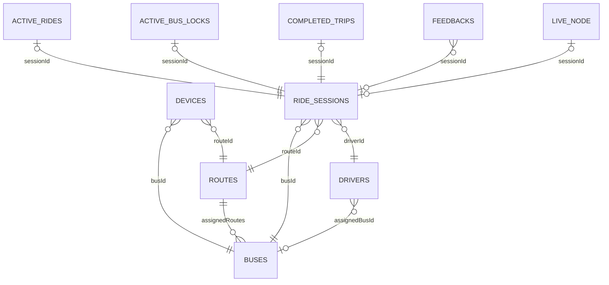

# Firebase Data Model

| Document ID | Version | Status | Last updated |
|---|---|---|---|
| EKI-DAT-001 | 1.0 | Current | 2026-10-30 |

## 1. Purpose

This reference lists every Realtime Database (RTDB) path and every Cloud Firestore collection that Eki uses, with fields, types, writers, readers, client access and retention. It is checked against `firestore.rules`, `database.rules.json`, `firestore.indexes.json` and the code in `backend/src` and `frontend/src`. The algorithms that compute the tracking fields are specified in [tracking algorithms](../design/TRACKING_ALGORITHMS.md); the split between the two databases is explained in [storage architecture](STORAGE_ARCHITECTURE.md).

## 2. Conventions

### 2.1 Roles of the two databases

RTDB holds the latest state of each bus and the public projections that browsers subscribe to. Firestore holds configuration, durable ride records, history and backend coordination records.

### 2.2 Writers and readers

- **Backend** means the Firebase Admin SDK in `backend/src`. Admin SDK access bypasses security rules.
- **Leader** means the backend replica that holds the worker lease `_worker_leases/trip-state-worker` (see [worker leadership](../operations/WORKER_LEADERSHIP.md)).
- **Browser** means the client SDK in `frontend/src`, governed by the rules cited in each table.
- A **current admin** is a signed-in user whose token has `role: admin`, `admin: true` and an `authorizationVersion` that matches `_userAuthorization/{uid}` (`firestore.rules:12`, `database.rules.json:18`). A **current driver** is defined the same way with `role: driver` and a matching driver record (`firestore.rules:26`).

### 2.3 Identifiers and time values

- External IDs match `[A-Za-z0-9_-]{1,128}`. Firestore rejects document IDs of the form `__...__`, and the backend treats such IDs as invalid.
- `{busId}_{routeId}` is a composite key. Read `busId` and `routeId` from the stored fields; never split the key, because IDs can contain underscores.
- Time values take five forms: device epoch milliseconds (`timestamp`), backend epoch milliseconds (`armedAt`, `endTime`), RTDB server time (`receivedAt`), Firestore `Timestamp` (`updatedAt`) and ISO 8601 strings (`completed_trips.completedAt`, `bus_locations.lastSeen`). Each table names the form.

### 2.4 Entity relationships

Figure 1. Main entities. `LIVE_NODE` is the RTDB path `activeBuses/{busId}_{routeId}`.

### 2.5 Summary

| Store | Path or collection | Writer | Browser access |
|---|---|---|---|
| RTDB | `activeBuses/{busId}_{routeId}` | Backend | None |
| RTDB | `activeRouteGeometry/{busId}_{routeId}/{routeVersion}` | Backend | Read, signed in |
| RTDB | `publicRouteBuses/route:{routeId}/buses` | Leader | Read, signed in; root read by a current admin |
| RTDB | `liveRouteCatalog/values` | Leader | Read, signed in |
| RTDB | `clientProjectionStatus/public` | Leader | Read, signed in |
| RTDB | `_userAuthorization/{uid}` | Backend | None (read by rules) |
| RTDB | `driverRouteAssignments/{driverId}` | Backend | None |
| RTDB | `_deviceRateLimits/{deviceId}`, `_deviceCredentialVersions/{deviceId}` | Backend | None |
| RTDB | `_health`, legacy `users`, legacy `messages` | None | None |
| Firestore | `users`, `routes`, `buses`, `drivers`, `settings` | Backend | Read (Section 4) |
| Firestore | `ride_sessions` and subcollections | Backend | Session read by a current admin or the assigned driver; `messages` also read by members (Section 4.6) |
| Firestore | `bus_locations`, `completed_trips` | Leader | Read by a current admin |
| Firestore | `feedbacks`, `feedbackCooldowns` | Browser | Create and read under rules (Section 4.9) |
| Firestore | Every collection in Section 5 | Backend | None |

## 3. Realtime Database

The rules deny every path not granted in `database.rules.json` (`database.rules.json:3`) [1].

### 3.1 `activeBuses/{busId}_{routeId}`

The authoritative live node for one device assignment. Telemetry ingestion creates it as device presence; ride fields appear only when a ride starts.

| Item | Value |
|---|---|
| Writers | Telemetry ingestion (`backend/src/services/deviceTelemetryService.ts:648`), matching and rerouting (`backend/src/services/telemetryRouteService.ts`), ride start and stop (`backend/src/services/rideSessionStart.ts`, `backend/src/routes/shifts.ts`), and on the leader the trip-state engine and stale sweep (`backend/src/services/tripStateEngine.ts`, `backend/src/services/staleBusSweeper.ts`). Every write is a transaction on the node. |
| Readers | Backend only. Browsers read the projection in Section 3.3. |
| Client rule | Read and write denied (`database.rules.json:5`) |
| Indexes | `routeId`, `busId`, `timestamp` (`database.rules.json:8`) |
| Retention | The stale sweep removes a node silent for longer than `BUS_STALE_MS` (default 300 s) unless it carries an active ride, which it marks offline instead (`staleBusSweeper.ts:43`). |

**Telemetry fields**, written on every accepted fix:

| Field | Type | Meaning |
|---|---|---|
| `busId`, `routeId`, `deviceId` | string | Registry assignment of the authenticated device |
| `assignmentRevision` | integer | Device assignment revision. `retiredAssignmentRevision` marks a retired assignment so that late requests cannot revive it |
| `lat`, `lng` | number | Accepted position; the previous position when the fix was held as implausible |
| `speed` | number | km/h, 0 to 200; 0 for a held fix |
| `heading` | number | Degrees, 0 to less than 360 |
| `gpsHdop` | number or null | Receiver HDOP, 0 to 99; null for the previous sequenced schema |
| `motionState` | `moving`, `stopped`, `uncertain` | `uncertain` for a GNSS-loss packet or a held fix |
| `timestamp` | epoch ms | Fix capture time, clamped to server time |
| `deviceTimestamp` | epoch ms, optional | Raw capture time while `timestamp` is clamped; ordering only |
| `seq`, `deviceSentAt` | integer, epoch ms | Firmware sequence and send time |
| `backendReceivedAt` | epoch ms | Server receipt time; browsers measure freshness from it |
| `receivedAt` | RTDB server time | Commit time |
| `rawLocation` | object | `{lat, lng, speed, heading, gpsHdop, motionState, seq, sampledAt}` of the fix as received |
| `plausibilityAnchor` | object | `{lat, lng, speed, gpsHdop, timestamp}` of the last physically accepted fix |
| `plausibilityReacquisition` | object, optional | `{count, startedAt}` while a reacquisition is being corroborated |
| `deviceState` | `online`, `offline` | `offline` after the stale sweep or ride retirement |
| `signalState` | `connected`, `gnss_lost`, `lost` | Only the stale sweep sets `lost` |

**Lifecycle fields**, written by ride start, the trip-state engine and the stop and delay endpoints:

| Field | Type | Meaning |
|---|---|---|
| `status` | `active`, `offline` | Ride ownership of the node, not hardware power; a new node starts `offline` |
| `sessionId`, `driverId` | string | Current ride and driver |
| `tripState` | `pre_departure`, `in_service`, `completed` | Live trip state |
| `direction` | `forward`, `reverse`, null | Ride direction; null while pending |
| `directionState` | `pending`, `resolved` | Direction resolution state |
| `directionEndpointVersion` | string | Endpoint snapshot used for the direction |
| `directionResolutionSource` | `endpoint_fix`, `departure_trajectory` | How a pending direction was resolved |
| `directionResolvedAt` | RTDB server time | Resolution time |
| `directionFirestoreSynced` | boolean | `false` while a telemetry-resolved direction still has to be written to the session |
| `pendingDeparture` | object or null | `{context, samples[]}` departure evidence, at most 8 samples |
| `originStopId`, `destinationStopId` | string | Endpoints in travel order |
| `currentStopIndex` | integer | Next expected stop; the terminal once completed |
| `hasDepartedOrigin` | boolean | Origin left |
| `terminalArrival` | object or null | `{startedAt, lastSampledAt}` terminal arrival evidence |
| `gnssGap` | object or null | `{sessionId, since}` open GNSS gap |
| `atStop` | object or null | `{sessionId, index}` stop the bus is at now; published as `atStopIndex` |
| `unobservedStops` | object or null | `{sessionId, indices}` stops credited `skipped_gnss_gap` or `passed_unobserved`; published as `unobservedStopIndices` |
| `delayMinutes`, `delayUpdatedAt` | integer, epoch ms | Driver delay of 0 to 1440 min and its monotonic revision |
| `completedAt`, `terminalArrivalConfirmedAt` | epoch ms | Completion time |
| `lastCompletedSessionId`, `lastCompletedAt`, `lastCompletedRouteId` | string, epoch ms, string | Last natural completion, kept through an automatic turnaround |
| `turnaroundEligibleAt`, `turnaroundSampledAt` | epoch ms | Earliest return arming time and the minimum fix time for it |
| `turnaroundClaimId`, `turnaroundClaimedAt` | string, epoch ms | Cross-replica turnaround claim; stale after 60 s |
| `automaticTurnaround`, `previousSessionId` | boolean, string | Set on an automatically armed return ride |
| `serviceSetupPending` | boolean | Automatic start is still writing its projections |
| `automaticServicePaused` | boolean | Set by End ride early |
| `automaticServiceState` | `assignment_required`, `paused`, `awaiting_return`, `setup_pending`, null | Why automatic start is blocked |
| `lifecycleUpdatedAt` | RTDB server time | Last lifecycle change |
| `_workerGeneration` | integer | Lease generation of the last leader write; a lower generation cannot overwrite it |

**Route context fields**, written by matching and rerouting and cleared together when the ride, direction or geometry changes (`backend/src/lib/liveRouteContext.ts:1`):

| Field | Type | Meaning |
|---|---|---|
| `activeRouteId` | string | `{routeId}:configured:{direction}` or `{routeId}:reroute:{routeVersion}` |
| `routeVersion` | integer | Matching context version |
| `routeSource` | `configured`, `dynamic-reroute` | Geometry source |
| `routeDirection`, `routeSessionId`, `routeGeometryVersion` | string, string, integer | Context the match belongs to; `routeSessionId` is `device-only` without a ride |
| `routeState` | `ON_ROUTE`, `POSSIBLE_OFF_ROUTE`, `OFF_ROUTE`, `REROUTING`, `ON_NEW_ROUTE` | Route adherence |
| `offRouteSampleCount` | integer | Deviation count, 0 to 2 |
| `matchedLocation` | object or null | `{lat, lng, segmentIndex, segmentFraction, alongRouteDistanceM, distanceToRouteM, headingDifference, matchConfidence, seq, sampledAt, routeVersion, speed, uncertain?}`. `speed` (km/h) is not public. `uncertain: true` marks a match made from a GNSS-loss fix: it is displayed but never becomes `routeMatchAnchor` (`backend/src/services/telemetryRouteService.ts:700-704`) |
| `routeMatchAnchor` | object or null | Same shape: the last confident match of a reliable fix, used as the progress anchor |
| `routeMatchHistory` | array | Up to 4 `{lat, lng, seq, sampledAt}` for the trajectory heading |
| `matchConfidence`, `distanceToActiveRoute` | number | Latest confidence (0 to 1) and distance to the path in metres |
| `mapMatchSeq`, `mapMatchSampledAt`, `mapMatchUpdatedAt` | integer, epoch ms, RTDB server time | Fix identity of the last matching pass |
| `rerouteRequestId`, `lastRerouteAttemptAt`, `rerouteError`, `rerouteCompletedAt`, `rerouteFailedAt` | string, epoch ms, string, server time, server time | Reroute request state |
| `rerouteRetry` | object or null | `{context, failures, nextAttemptAt}` backoff |
| `routeComputedAt`, `routeTrafficState` | epoch ms; `pending`, `current` or `fallback` | Provider route time and traffic data state |
| `departureRoute` | object or null | `{context, phase, state, requestId, attempts, nextAttemptAt, computedAt}` departure route request |

`rtdbCommittedAt` and `activeRoutePolyline` are retired fields; ingestion deletes them when present.

### 3.2 `activeRouteGeometry/{busId}_{routeId}/{routeVersion}`

Reroute polylines, written once per version so that the live node never carries a polyline.

| Field | Type | Meaning |
|---|---|---|
| `polyline` | string | Encoded polyline in travel order, at most 500,000 characters |
| `routeId`, `direction`, `sessionId` | string | Owning route, direction and ride |
| `source` | `dynamic-reroute` | Marker |
| `routeVersion` | integer | Version, equal to the key |
| `firstStopIndex` | integer | First stop the geometry covers, at least 1 |
| `computedAt`, `createdAt` | epoch ms, RTDB server time | Provider and write times |

| Item | Value |
|---|---|
| Writer | Backend reroute and departure-route activation (`telemetryRouteService.ts:778`) |
| Readers | Backend matcher; browser map when `routeSource` is `dynamic-reroute` (`frontend/src/lib/activeRouteGeometry.ts:73`) |
| Client rule | Read, signed in (`database.rules.json:13`) |
| Retention | The leader's retention sweep deletes a version that is not the node's current `routeVersion` when it is older than 180 days and has been seen unreferenced for at least 24 h (`backend/src/services/rtdbRetention.ts:3`, `rtdbRetention.ts:108`). See [RTDB retention](../operations/RTDB_RETENTION.md). |

Configured geometry is never stored here; it comes from `routes/{routeId}`.

### 3.3 `publicRouteBuses/route:{routeId}`

The browser-readable projection of live nodes, materialized by the leader (`backend/src/services/liveBusProjection.ts:108`).

| Field | Type | Meaning |
|---|---|---|
| `buses/node:{busId}_{routeId}` | object | Public view of one live node (below) |
| `revision` | integer | Increments on every change |
| `_workerGeneration` | integer | Publisher generation |

The public view (`liveBusProjection.ts:37`) contains only `busId`, `routeId`, `driverId`, `sessionId`, `lat`, `lng`, `speed`, `heading`, `timestamp`, `seq`, `deviceSentAt`, `backendReceivedAt`, `receivedAt`, `status`, `deviceState`, `signalState`, `motionState`, `tripState`, `currentStopIndex`, `delayMinutes`, `direction`, `directionState`, `originStopId`, `destinationStopId`, `automaticServicePaused`, `automaticServiceState`, `activeRouteId`, `routeVersion`, `routeSource`, `routeState`, `routeDirection`, `routeGeometryVersion`, `routeComputedAt`, `routeTrafficState`, `mapMatchSeq`, `mapMatchSampledAt`, `mapMatchUpdatedAt`, `matchConfidence` and `distanceToActiveRoute`, plus:

| Field | Condition |
|---|---|
| `rawLocation` | Subset `{lat, lng, speed, heading, gpsHdop, motionState, seq, sampledAt}` |
| `matchedLocation` | Subset without `speed` |
| `lastCompletedSessionId`, `lastCompletedAt`, `lastCompletedRouteId` | All three valid |
| `automaticTurnaround`, `previousSessionId` | Automatic return ride |
| `atStopIndex` | `atStop.sessionId` equals `sessionId` |
| `unobservedStopIndices` | `unobservedStops.sessionId` equals `sessionId`; sorted, indices below 500 |

A node with `retiredAssignmentRevision`, or with an invalid `busId` or `routeId`, is not published.

| Item | Value |
|---|---|
| Readers | Passenger map (one route's `buses`) and admin Live Ops (whole root) (`frontend/src/lib/createLiveBusStore.ts:182`) |
| Client rule | `buses` read, signed in; root read, current admin (`database.rules.json:17`) |
| Retention | Follows `activeBuses`: an entry is removed when its source node is removed |

### 3.4 `liveRouteCatalog`

| Field | Type | Meaning |
|---|---|---|
| `values/route:{routeId}` | object | `{active, available, freshestAt, activeReceipts[], availableReceipts[]}`. Receipts are floored to 30 s; a bus counts while its receipt is at most 90 s old (`liveBusProjection.ts:81`) |
| `revisions/route:{routeId}`, `generations/route:{routeId}` | integer | Private publication lineage |
| `_workerGeneration` | integer | Publisher generation |

Writer: leader. Reader: the passenger route list (`frontend/src/hooks/useLiveRouteCatalog.ts:42`). Client rule: `values` read, signed in (`database.rules.json:24`).

### 3.5 `clientProjectionStatus/public`

`{schemaVersion: 1, ready: boolean}`. The leader sets `ready` once the startup backfill of the public projection has settled. Browsers treat a missing, incompatible or not-ready status as "live updates unavailable", not as an empty fleet (`frontend/src/hooks/useLiveRouteCatalog.ts:34`). Client rule: `public` read, signed in (`database.rules.json:28`).

### 3.6 Backend-only paths

| Path | Fields | Writer and readers | Retention |
|---|---|---|---|
| `_userAuthorization/{uid}` | `version`, `role` (`passenger`, `driver`, `admin`, `blocked`), `driverId`, `assignedBusId` | Written by `publishUserAuthorization` together with the Firestore copy (`backend/src/services/userAuthorization.ts:44`). Read by the `publicRouteBuses` root rule and by `authorizationIsCurrent` | Kept |
| `driverRouteAssignments/{driverId}` | `{ {busId}: { {routeId}: true } }` | Written and removed by fleet management and role sync (`backend/src/routes/fleet.ts:125`, `backend/src/syncRoleClaims.ts:82`); read only by fleet reconciliation | Removed on unassignment |
| `_deviceRateLimits/{deviceId}` | `{startedAt, count}`, a fixed one-minute window | Distributed device rate limiter (`deviceTelemetryService.ts:547`) | Overwritten each window |
| `_deviceCredentialVersions/{deviceId}` | `{nonce, updatedAt}` | Written on device disable, reassignment or provisioning; every replica listens and evicts its credential cache (`deviceTelemetryService.ts:307`, `deviceTelemetryService.ts:919`) | Kept |
| `_health` | None | Read on every 30 s health probe to open the connection (`backend/src/lib/healthState.ts:7`) | Not applicable |
| `users`, `messages` | Legacy trees | No writer or reader | Deleted by the retention sweep after 180 days without activity when `LEGACY_RTDB_RETIRED=true` (`rtdbRetention.ts:98`) |

Clients cannot read or write any of these paths, by explicit rule or through the root rule (`database.rules.json:33`).

## 4. Firestore collections readable by browsers

Every collection not matched by a rule falls through to the catch-all deny (`firestore.rules:303`).

### 4.1 `users/{uid}`

| Field | Type | Meaning |
|---|---|---|
| `uid` | string | Firebase Auth UID |
| `email` | string, at most 320 | Account email |
| `displayName` | string, at most 100 | Display name |
| `photoURL` | string, at most 2048 | Avatar URL |
| `role` | `passenger`, `driver`, `admin` | Role mirror; rules require it to match the token and `_userAuthorization` |
| `createdAt` | Timestamp | Creation time |

Writer: `POST /api/users/bootstrap` creates a missing profile as `passenger` (`backend/src/routes/users.ts:94`); fleet management and role sync change `role`. Readers: the owner and the rules (`hasCurrentRole`, feedback name check). Client rule: owner read, no writes (`firestore.rules:76`). Retention: removed by passenger account deletion.

### 4.2 `routes/{routeId}`

| Field | Type | Meaning |
|---|---|---|
| `id`, `name`, `color` | string | ID, display name (at most 100) and color |
| `stops[]` | `{id, name, shortName, lat, lng}` | 2 to 100 stops in forward order (`backend/src/routes/polyline.ts:106`) |
| `waypoints[]` | `{lat, lng}` | Control points used to compute geometry |
| `polyline`, `forwardPolyline`, `reversePolyline` | encoded string | `polyline` equals `forwardPolyline`; each direction is routed separately |
| `distanceMeters`, `forwardDistanceMeters`, `reverseDistanceMeters` | number | Provider distances |
| `duration`, `forwardDuration`, `reverseDuration` | string | Provider durations such as `1200s` |
| `configVersion` | integer | Increments on every save |
| `geometryVersion` | integer | Increments only when route-shaping inputs change |
| `geometrySignature` | SHA-256 hex | Signature of the ordered coordinates and routing contract |
| `updatedAt` | Timestamp | Save time |

Writer: the admin route save, in one transaction with `_route_save_operations` and an active-ride check (`backend/src/routes/polyline.ts:700`); `npm run seed`. Readers: every signed-in browser, the matcher route catalog, the trip-state engine and the plan endpoint. Client rule: read, signed in (`firestore.rules:87`). Retention: deleted only by an administrator; deletion is refused while a ride uses the route.

### 4.3 `buses/{busId}`

Fields: `id`, `name` (at most 100) and `assignedRoutes` (string array, at most 50). A legacy `assignedRouteId` is read and removed on save. Optional `active` and `automaticServiceEnabled` flags are read by automatic start (`backend/src/services/automaticServiceAdmission.ts:94`) but no endpoint writes them. Writer: admin fleet endpoints (`fleet.ts:307`). Client rule: read, signed in (`firestore.rules:104`). Retention: admin deletion.

### 4.4 `drivers/{driverId}`

Fields: `id`, `name`, `authUid` and `assignedBusId` (string or null). The browser type also reads an optional `photoUrl` (`frontend/src/hooks/useDrivers.ts:15`) that the backend never writes. Optional `enabled` and `active` flags gate automatic start. Writer: admin fleet endpoints, which also update Auth claims, `_userAuthorization` and `driverRouteAssignments` (`fleet.ts:454`). Client rule: read by a current admin, or by a current driver for their own record (`firestore.rules:150`). Retention: admin deletion.

### 4.5 `settings/global`

Fields: `serviceStartTime` (at most 64), `noBusesMessage` (at most 200), `noBusesSubMessage` (at most 300), `announcementText` (at most 500), `announcementActive` (boolean), `updatedAt` (Timestamp) and `updatedBy` (UID) (`backend/src/routes/settings.ts:19`). Writer: admin settings endpoint. Client rule: read, signed in (`firestore.rules:293`). Browsers apply defaults for missing fields.

### 4.6 `ride_sessions/{sessionId}`

The durable record of one ride.

| Field | Type | Meaning |
|---|---|---|
| `id`, `busId`, `routeId`, `driverId` | string | Identity and assignment |
| `status` | `pending`, `armed`, `active`, `completed`, `interrupted`, `failed` | Durable status ([tracking algorithms](../design/TRACKING_ALGORITHMS.md#61-states)) |
| `direction` | `forward`, `reverse`, null | Ride direction |
| `directionState`, `directionEndpointVersion`, `directionResolvedAt`, `directionResolutionSource` | string, string, Timestamp, string | Direction resolution |
| `originStopId`, `destinationStopId` | string | Endpoints in travel order |
| `armedAt`, `startTime`, `endTime` | epoch ms | Creation, service start and terminal time |
| `activatedAt`, `updatedAt` | Timestamp | Activation and last update |
| `passengers.{uid}` | `{userId, userName, boardingStopId, alightingStopId, joinedAt}` | Passenger manifest entry; at most 1,000 entries |
| `passengerIds` | string array | UIDs in the manifest |
| `stopsReached.{index}` | `{stopIndex, stopId, stopName, timestamp, evidence?}` | Progress evidence. `evidence` is `gnss_progress`, `recovered_checkpoint`, `skipped_gnss_gap` or `passed_unobserved` (`backend/src/services/rideProgressHistory.ts:47`) |
| `firstKnownLocation`, `lastKnownLocation` | `{lat, lng, sampledAt, seq, receivedAt}` | First and last raw fixes of the ride |
| `firstTelemetryAt`, `lastSignalLostAt` | epoch ms | First fix time and last signal loss |
| `connectionEvents.lost_{sampledAt}_{seq}` | `{type: signal_lost, observedAt, location}` | Signal loss events |
| `terminalArrivalConfirmedAt` | epoch ms | Completion confirmation |
| `interruptionReason`, `interruptedBy`, `reconciledAt` | string, UID, Timestamp | `manual_end_early` or `abandoned_session_timeout` |
| `failureReason` | string | `shift_conflict` |
| `automaticTurnaround`, `previousSessionId`, `directionFirestoreSynced` | boolean, string, boolean | Automatic return ride |
| `boardingCode`, `boardingCodeIssuedAt` | 8-character string, Timestamp | Issued by `POST /api/sessions/{sessionId}/boarding-code`. Boarding does not check it (`backend/src/routes/sessions.ts:168`) |
| `path` | legacy | Declared in the admin history type only; no code writes or reads it |

| Item | Value |
|---|---|
| Writers | Ride start (`rideSessionStart.ts`), boarding (`sessions.ts:299`), trip-state engine progress and completion (`tripStateEngine.ts:654`, `tripStateEngine.ts:1121`), stop endpoint (`shifts.ts:356`), abandoned-ride reconciler |
| Readers | Admin Ride History (`frontend/src/components/admin/RideHistoryPanel.tsx:202`, ordered by `armedAt` and by `startTime`), the assigned driver, feedback rules |
| Client rule | Read by a current admin or the assigned current driver; no writes (`firestore.rules:111`) |
| Retention | Terminal sessions are deleted recursively 180 days after `endTime` (`RIDE_SESSION_RETENTION_DAYS`) and on admin history deletion (Section 7) |

**Subcollections:**

| Path | Fields | Writer | Client rule |
|---|---|---|---|
| `messages/{id}` | `text` (1 to 500), `from` (`driver`, `passenger`), `senderName`, `senderId`, `requestHash`, `moderated`, `moderationVersion`, `timestamp`. The ID is a hash of the UID and the client `requestId`, so a retry finds the same message | `POST /api/sessions/{sessionId}/messages` (`sessions.ts:466`) | Read by a session operator, or a manifest member with a profile (`firestore.rules:124`) |
| `archivedMessages/{id}` | Copy of a cleared message | Admin message clear (`shifts.ts:437`) | Read by a session operator (`firestore.rules:135`) |
| `messageRateLimits/{uid}` | `userId`, `sentAt` (Timestamp array), `lastSentAt`. Limits: 60 per hour, 10 per minute, 3 s gap (`backend/src/services/chatRateLimit.ts:1`) | Message endpoint, in the same transaction as the message | Owner read, when also allowed to read the session (`firestore.rules:140`) |

Browsers read the latest 200 messages (`frontend/src/components/shared/MessagingPanel.tsx:98`).

### 4.7 `bus_locations/{busId}`

A per-bus lifecycle projection, written when lifecycle state changes rather than on every fix.

| Field | Type | Meaning |
|---|---|---|
| `sessionId`, `routeId`, `driverId` | string | Current or last ride |
| `status`, `deviceState`, `tripState`, `direction`, `motionState` | string | Lifecycle snapshot |
| `lastSeen` | ISO string | Time of the projection write |
| `lastKnownLocation` | `{lat, lng, sampledAt, seq, receivedAt}` | Last raw fix; keeps an offline bus on the admin map |
| `automaticServicePaused` | boolean | Set by End ride early; cleared by a manual start |
| `automaticServiceEpoch` | integer | Automatic start generation; one automatic ride per epoch |
| `terminalJourney` | object | `{busId, routeId, driverId, sessionId, direction, directionEndpointVersion, completedAt, turnaroundEligibleAt, turnaroundSampledAt, consumedBy, currentStopIndex, hasDepartedOrigin, originStopId, destinationStopId}`, the completion checkpoint for the automatic return |

Writers: leader (`tripStateEngine.ts:434`, `tripStateEngine.ts:1165`), ride start and stop. Readers: admin Live Ops (`frontend/src/hooks/useBusLocations.ts:15`), the analytics endpoint and automatic start. Client rule: read by a current admin (`firestore.rules:94`). Retention: kept per bus.

### 4.8 `completed_trips/{sessionId}`

Fields: `busId`, `driverId`, `routeId`, `direction`, `originStopId`, `destinationStopId`, `completedAt` (ISO string), `automaticTurnaroundEligibleAt` (epoch ms), `stopCount`, `stopNames[]` (travel order) and `sessionId`. Writer: leader at completion (`tripStateEngine.ts:1121`). Readers: the analytics endpoint (forward and reverse counts) and history deletion. Client rule: read by a current admin (`firestore.rules:158`). Retention: 180 days after `completedAt` (`COMPLETED_TRIP_RETENTION_DAYS`), and with admin history deletion.

### 4.9 `feedbacks/{feedbackId}` and `feedbackCooldowns/{uid}`

Browsers write feedback directly to Firestore, creating both documents in one transaction (`frontend/src/lib/feedbackStore.ts:76`). The feedback ID is the SHA-256 hex of the UID and the client `requestId`.

| Collection | Fields | Client rule |
|---|---|---|
| `feedbacks` | `userId`, `userName` (`Passenger` or the profile `displayName`), `type` (`general`, `ride`), `sessionId`, `busId`, `driverId`, `rating` (1 to 5 or null), `comment` (at most 2000 characters and 200 words), `requestHash` (64 hex), `timestamp` (server time), `status` (`new`, `reviewed`, `resolved`), optional `reviewedAt` and `reviewedBy` | Create: signed in with a profile, exact field set, `status: new`; ride feedback only for a `completed` ride whose manifest contains the caller; cooldown ready. Get: the owner, a current admin, or any signed-in user for a missing ID. List and update: a current admin, changing only `status`, `reviewedAt` (request time) and `reviewedBy` (own UID). Delete: denied (`firestore.rules:202`) |
| `feedbackCooldowns` | `userId`, `feedbackId`, `lastSubmittedAt` | Owner read. Create or update only in the same commit as a new feedback document, at least 24 h after the previous one. Delete: denied (`firestore.rules:222`) |

Admins list the latest 200 feedback documents ordered by `timestamp` (`feedbackStore.ts:120`). The legacy feedback HTTP endpoints remain in the backend, but the browser does not call them. Retention: feedback is deleted 180 days after `timestamp` (`FEEDBACK_RETENTION_DAYS`); passenger account deletion removes the cooldown and keeps the feedback.

## 5. Firestore collections for the backend only

Clients cannot read or write any of these collections, by explicit rule or through the catch-all (`firestore.rules:303`).

| Collection | Fields | Writer and purpose | Retention |
|---|---|---|---|
| `devices/{deviceId}` | `deviceId`, `busId`, `routeId`, `enabled`, `assignmentRevision`, `secretHash` (salt and scrypt key in hex), `credentialRotatedAt`, `updatedAt`, optional `disabledAt` and `pendingAssignmentRetirement` | Provisioning script and admin device endpoints (`backend/src/provisionDevice.ts:80`, `backend/src/routes/devices.ts:427`); one device per bus and route | Admin |
| `active_rides/{busId}_{routeId}` | `sessionId`, `busId`, `routeId`, `driverId`, `direction`, `originStopId`, `destinationStopId`, `status: active`, `tripState`, `currentStopIndex`, `hasDepartedOrigin`, `terminalArrival`, `gnssGapSince`, `hasTelemetry`, `lastRouteVersion`, `delayMinutes`, `delayUpdatedAt`, `updatedAt`; direction and turnaround fields on automatic rides | Ride start, the leader's progress checkpoint (`tripStateEngine.ts:755`) and the delay endpoint. Recovery source after a restart; `currentStopIndex` never decreases | Deleted at completion, early end or reconciliation |
| `_active_bus_locks/{busId}` | `busId`, `routeId`, `driverId`, `sessionId`, `direction`, optional `automaticTurnaround` and direction fields, `createdAt`, `updatedAt` | One non-terminal ride per bus; created in the ride-start transaction (`rideSessionStart.ts:420`) | Deleted with the ride's terminal state |
| `_ride_session_creation_keys/{hash}` | `driverId`, `busId`, `routeId`, `sessionId`, `createdAt` | Idempotency binding of a ride start; the ID is the SHA-256 of the principal scope and the `Idempotency-Key` (`rideSessionStart.ts:138`) | Kept; survives session deletion |
| `_userAuthorization/{uid}` | As RTDB Section 3.6 | `publishUserAuthorization`; read by rules (`firestore.rules:21`) | Kept |
| `_worker_leases/trip-state-worker` | `ownerId`, `generation`, `renewedAt`, `expiresAt` | Worker coordinator. Release sets `ownerId: null` and an expired time and keeps `generation` (`backend/src/services/workerCoordinator.ts:109`) | Kept |
| `_reconciliation_cursors/{scan}` | `cursor`, `updatedAt`, for `abandoned-sessions`, `fleet-authorizations` and `privacy-deletions` | Paged scans; advanced in a lease-checked transaction | Kept |
| `_privacy_deletion_requests/{uid}` | `status`, `attempts`, `failures`, `nextAttemptAt`, `generation`, `executorId`, `deadlineAt`, `phase`, `requestedAt`, `updatedAt`, `targetCreatedAt`, error and recovery audit fields | Passenger deletion queue ([privacy deletion](../operations/PRIVACY_DELETION.md)) | Removed after a successful deletion |
| `_retention_deletion_jobs/{sessionId}` | `requestedAt` | Retry marker kept until a recursive ride deletion finishes (`backend/src/services/retentionSweeper.ts:37`) | Removed on completion |
| `_ride_history_deletion_jobs/{sessionId}` | `requestedAt` | Retry marker for admin history deletion | Removed on completion |
| `_route_save_operations/{saveId}` | `routeId`, `payloadHash`, `status` (`processing`, `succeeded`, `failed`), lease owner, attempts, result or error, timestamps | Idempotent route save, committed with the route | 90 days after `createdAt` |
| `_route_geometry_previews/{operationId}`, `_fleet_reconciliation_jobs/{operationId}` | Payload hash, admin UID, `status`, `executorId`, `generation`, `deadlineAt`, `phase`, redacted outcome, timestamps | Long-running admin operations keyed by `Idempotency-Key` (`backend/src/services/httpOperations.ts:124`; [operation resources](../api/OPERATION_RESOURCES.md)) | 90 days after `completedAt` |
| `_fleet_operations/{id}` | `method`, `path`, `adminUid`, `status`, `statusCode`, `createdAt`, `completedAt`, batch progress | Audit of fleet mutations (`fleet.ts:234`) | 90 days after `createdAt` |
| `_fleet_reconciliation_locks/singleton` | `owner`, `operationId`, `auditOperationId`, `privacyRequestId`, `executorId`, `createdAt` | Mutex for fleet and privacy Auth mutations (`backend/src/services/fleetMutationLock.ts:22`) | Deleted by its owner or by audited recovery |
| `_fleet_lock_recoveries/{id}` | Recovered owner, operation, executor, admin UID, `recoveredAt` | Audit of lock recovery | 90 days after `recoveredAt` |
| `_device_diagnostics/{deviceId}` | Device, bus and route IDs, `firmwareVersion`, uptime, `freeHeapBytes`, `rssiDbm`, counters, `fault`, security state, device time, `receivedAt` | Latest diagnostics report, replaced on each report; read through `GET /api/devices/{deviceId}/diagnostics` | Replaced |
| `_rtdb_retention_inventory/{hash}` | `path`, `fingerprint`, `firstSeenAt` | First-seen record for RTDB data without a usable time (`backend/src/services/firebaseRtdbRetention.ts:35`) | Removed with the RTDB entry or as an orphan |
| `_health` | None | Read with `limit(1)` every 30 s by the health probe (`backend/src/server.ts:221`) | Not applicable |
| `passenger_requests/{uid}` | `passengerId`, `busId`, `type`, `lat`, `lng`, `status`, `createdAt` | Legacy; nothing creates it. Admin `PATCH` and `DELETE /api/requests/{uid}` change or remove it (`backend/src/routes/requests.ts:33`), and passenger account deletion removes it (`privacyDeletionWorker.ts:66`) | Removed by those two paths |

## 6. Indexes

`firestore.indexes.json` defines one composite index and two collection-group field overrides. Single-field indexes are automatic [2].

| Collection | Scope | Fields | Used by |
|---|---|---|---|
| `ride_sessions` | Collection | `status` ascending, `endTime` ascending | Retention query `status in [completed, failed, interrupted]` and `endTime < cutoff`, ordered by `endTime` and document ID (`retentionSweeper.ts:106`) |

| Field override | Scope | Used by |
|---|---|---|
| `messageRateLimits.userId` ascending | Collection group | Passenger account deletion of rate-limit records (`backend/src/services/privacyDeletionWorker.ts:55`) |
| `messages.senderId` ascending | Collection group | No current query in `backend/src` or `frontend/src` |

The other queries (`feedbacks` by `timestamp`, `completed_trips` by `completedAt` or `sessionId`, operation collections by `createdAt`, `completedAt` or `recoveredAt`, `drivers` by `assignedBusId` or `authUid`, `devices` and `active_rides` by `busId`, `ride_sessions` by `armedAt` or `startTime`) use single-field indexes. Deployment is described in [Firestore index deployment](../operations/FIRESTORE_INDEX_DEPLOYMENT.md).

## 7. Retention and deletion

Retention periods, their settings and the deletions that people request are defined in [storage architecture](STORAGE_ARCHITECTURE.md#6-retention-and-deletion); each collection above states its own rule. The sweep is implemented in `backend/src/services/retentionSweeper.ts` (enablement at line 75, schedule at line 176, defaults at lines 98 to 101) and `rtdbRetention.ts:3`. A record is deleted when it is strictly older than the cutoff, and day values are capped at 36,500 (`retentionSweeper.ts:14`). Admin history deletion of an ongoing ride returns `409` (`backend/src/services/rideHistoryDeletion.ts`). Route and bus deletion is refused while an active ride or lock references it, checked in the same transaction as the mutation.

## 8. References

[1] Google, "Understand Firebase Realtime Database Security Rules," firebase.google.com/docs/database/security. Accessed: 2026-10-30.

[2] Google, "Index types in Cloud Firestore," firebase.google.com/docs/firestore/query-data/index-overview. Accessed: 2026-10-30.
