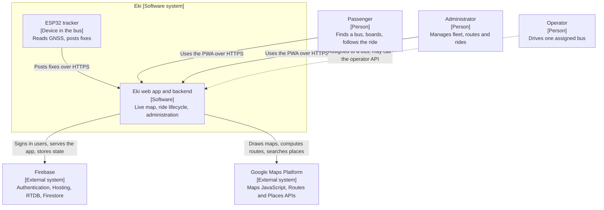
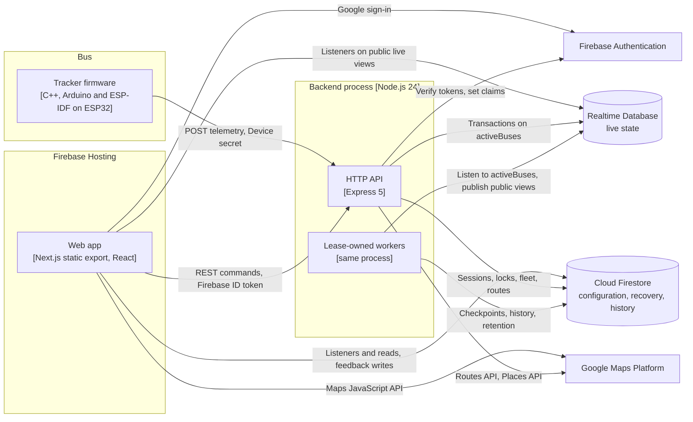
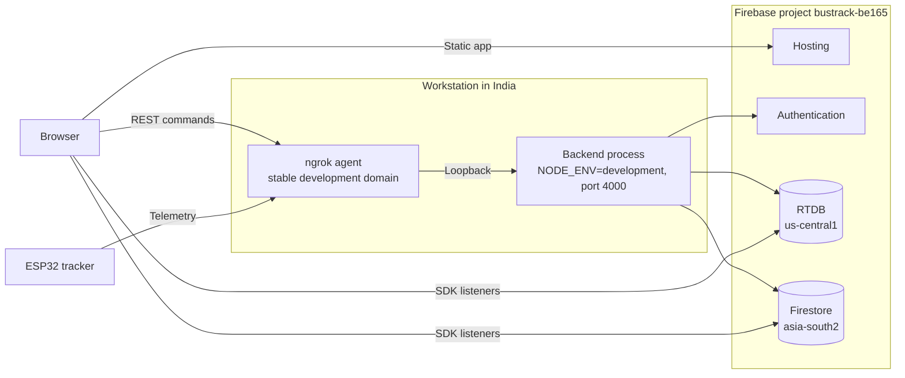
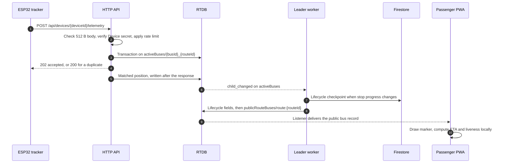
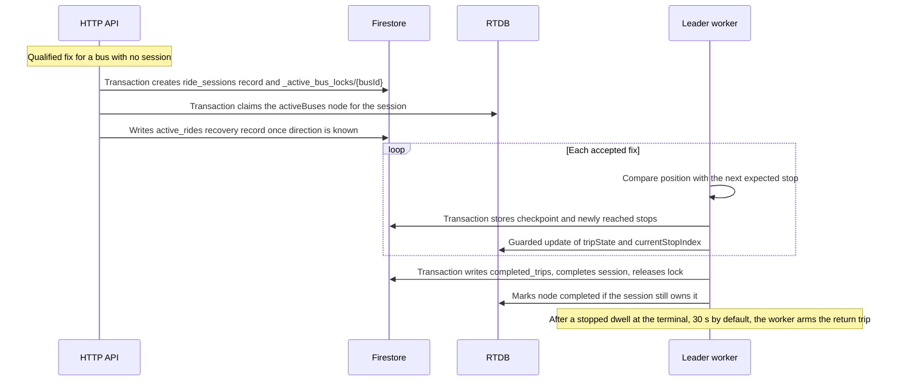
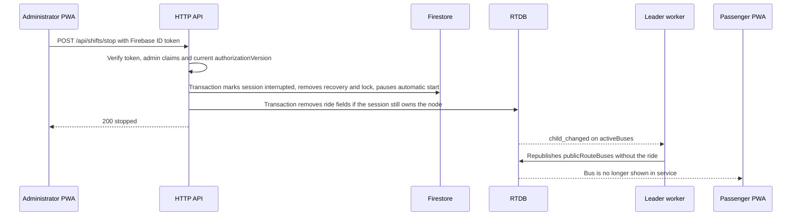

# Eki Architecture

| Document ID | Version | Status | Last updated |
|---|---|---|---|
| EKI-ARC-001 | 2.2 | Current | 2026-11-02 |

## 1. Introduction

### 1.1 Purpose and scope

This document is the architecture description of Eki, a campus bus tracking system, in the style of ISO/IEC/IEEE 42010 [1]. It names the stakeholders and their concerns and describes the system through context, container, deployment and runtime views. The context and container views follow the C4 model [2].

Detail lives in other documents:

| Topic | Document |
|---|---|
| Subsystems, ride lifecycle, roles, failure handling | [High-level design](HIGH_LEVEL_DESIGN.md) |
| Modules and source files | [Low-level design](LOW_LEVEL_DESIGN.md) |
| Map matching, stop progression, liveness | [Tracking algorithms](TRACKING_ALGORITHMS.md) |
| Which store holds what | [Storage architecture](../data/STORAGE_ARCHITECTURE.md) |
| Fields and access rules | [Firebase data model](../data/FIREBASE_DATA_MODEL.md) |
| Requirements | [Software requirements specification](../requirements/SOFTWARE_REQUIREMENTS_SPECIFICATION.md) |
| Trust boundaries | [Security architecture](../security/SECURITY_ARCHITECTURE.md) |
| Terms | [Glossary](../GLOSSARY.md) |

### 1.2 System summary

An ESP32 tracker in each bus reads a NEO-M8N GNSS (satellite positioning) receiver and posts a fix over HTTPS about once per second to an Express backend. The backend authenticates the device, writes the fix to Firebase Realtime Database (RTDB) and matches it to the bus route. A background worker, which runs in exactly one backend process at a time, advances the ride through its ordered stops and records ride history in Cloud Firestore. Passengers and administrators use a Next.js progressive web app (PWA) served by Firebase Hosting. The PWA receives live bus state through Firebase SDK listeners and sends commands to the backend over HTTPS. Terms are defined in the [glossary](../GLOSSARY.md).

Current state: every green push to `main` deploys the web app and database rules to the staging Firebase project. The backend runs on one workstation behind an ngrok tunnel (Section 5.2), and no production environment exists yet. Stop progress is validated on simulated rides only, and fleet firmware security is not yet proven on hardware. The [cost model](../cost/COST_MODEL.md#11-summary) estimates USD 80 to 87 a month for a three-bus pilot and USD 443 to 556 a month for a ten-bus campus service with today's hosting. The [risk register](../operations/ARCHITECTURE_RISK_REGISTER.md#11-summary) lists what remains open.

## 2. Stakeholders and concerns

| Stakeholder | Concerns | Views |
|---|---|---|
| Passenger | Where the bus is, when it arrives, whether the position is live, boarding and ride messages | Sections 3, 6.1, 7 |
| Administrator (transport office) | Fleet, device and route configuration; ending and resuming rides; feedback and ride history; who may do what | Sections 3, 6.3 |
| Operator (bus driver, role `driver`) | Assignment to a bus; rides that start without manual steps | Sections 3, 6.2 |
| Deployment owner (university IT) | Hosting, availability, database region, credentials, cost, data retention | Sections 5, 7 |
| Developer | Container boundaries, technology versions, recorded decisions | Sections 4, 8, 9 |
| Device provisioner | Device credentials, signed firmware, trusted root certificate, backend origin | Sections 4, 5 |

## 3. System context view

Figure 1. System context (C4 level 1).

Passengers and administrators sign in with Google through Firebase Authentication and use the PWA. Operators are the bus drivers. Each has a record in the `drivers` collection and the `driver` role: automatic service start requires exactly one operator assigned to the bus, and the operator API accepts an operator's commands for that bus. The web app has no operator workspace; a signed-in operator opens the passenger workspace. The tracker firmware is part of Eki and is maintained in `hardware/`. Firebase and Google Maps Platform are external services operated by Google.

## 4. Container view

Figure 2. Containers (C4 level 2).

| Container | Responsibility | Technology and location |
|---|---|---|
| Tracker firmware | Parses NMEA from the NEO-M8N at 9,600 baud, filters fixes by age and HDOP, classifies motion, queues up to 100 samples, posts telemetry over Wi-Fi with a pinned root certificate | `hardware/`, PlatformIO, ESP32 |
| Web app | Passenger workspace (`/passenger`), administrator workspace (`/admin`), feedback review (`/feedback`); live map, ETA and liveness computed in the browser; Workbox service worker that never caches authenticated responses | `frontend/`, static export to `frontend/out` |
| HTTP API | Device telemetry, diagnostics and firmware endpoints; ride session, fleet, route, settings, messaging and privacy endpoints; `/live`, `/health` and admin-only `/api/health` | `backend/src/server.ts`, container image `backend/Dockerfile` |
| Lease-owned workers | Trip-state engine with stale presence sweep, public live projection, retention sweeper, privacy deletion, abandoned-ride reconciler, fleet authorization reconciliation. They run only in the process that holds the Firestore lease `_worker_leases/trip-state-worker` | `backend/src/services/workerCoordinator.ts` |
| Firebase Authentication | Google sign-in; custom claims `role`, `admin`, `driverId`, `assignedBusId`, `authorizationVersion` set only by the backend | Managed |
| Realtime Database | Latest live state per bus and route (`activeBuses`, backend-only), browser projections (`publicRouteBuses`, `liveRouteCatalog`, `activeRouteGeometry`) and internal nodes | Managed |
| Cloud Firestore | Fleet and route configuration, ride sessions and history, recovery records, locks, messages, feedback, operation records | Managed |

Every backend process serves HTTP and processes the telemetry it receives, including map matching and automatic ride admission. Lifecycle and cleanup work runs in exactly one process at a time; see [worker leadership](../operations/WORKER_LEADERSHIP.md). Devices hold no Firebase credentials, and browsers cannot write live state.

## 5. Deployment view

### 5.1 Environments

| Environment | Firebase project | Deployed by | What is deployed | Web origin |
|---|---|---|---|---|
| Staging (GitHub environment `staging`) | `bustrack-be165`, also the `.firebaserc` default | `.github/workflows/deploy.yml` after a successful "Production verification" run on a push to `main`, or a manual dispatch from `main` | Hosting, Firestore rules and indexes, RTDB rules | `https://bustrack-be165.web.app` |
| Production (GitHub environment `production`) | `eki-production`, named in the workflow but not yet provisioned | Manual dispatch from `main`. Approval depends on required reviewers on the `production` environment, which does not exist yet ([CI, deployment and releases](../operations/CI_CD_AND_RELEASES.md#55-repository-settings)) | Same as staging | `https://eki-production.web.app` |
| Local development | A developer's own Firebase project; emulators for rules and browser suites | `npm run dev` | Frontend on port 3000, backend on port 4000 | `http://localhost:3000` |

The deploy workflow uses Node.js 24 and `firebase-tools@15.14.0`, verifies that the backend and frontend RTDB URLs name the same instance, builds the web app in strict production mode, checks the live backend contract, and turns off App Check enforcement. It then deploys the Firestore indexes, waits for them to build, and deploys Hosting and the rules. It deploys the backend only through the optional manual job `deploy-backend-staging`, which deployed the staging service on 2026-11-01. The CI job `backend-image` in `.github/workflows/ci.yml` builds the container image and boot-tests `/live` and `/health`. The recorded field tests use `bustrack-be165` [3].

| Store | Instance | Location | Evidence |
|---|---|---|---|
| RTDB | `bustrack-be165-default-rtdb` | `us-central1` (Iowa) | [RTDB region decision](RTDB_REGION_LATENCY_DECISION.md), instance listing of 2026-09-10 |
| Firestore | Default database | `asia-south2` (Delhi) | [Non-motion inventory of 2026-10-11](../testing/LIVE_NON_MOTION_INVENTORY_2026_10_11.md) |

### 5.2 Current backend hosting

Figure 3. Current deployment.

The backend runs as one Node.js process on a workstation, reached through an ngrok tunnel with a fixed domain ([ngrok tunnel](../operations/NGROK_TUNNEL.md)). The process trusts forwarded addresses only from loopback (`TRUST_PROXY=loopback`). The backend origin is compiled into both clients: `NEXT_PUBLIC_BACKEND_URL` in the web build and `BACKEND_URL` in the ignored `hardware/include/secrets.h`. Moving the backend therefore requires a web rebuild and a reflash of every tracker. While the workstation or tunnel is down, trackers queue and retry, Firebase listeners keep serving the last published state, and the PWA marks buses as delayed and then lost (Section 7).

### 5.3 Proposed managed backend

Not implemented. The target is to run the existing container on Cloud Run in the Google Cloud project behind `bustrack-be165`, reach it through Firebase Hosting rewrites for `/api/**`, `/health` and `/live` or through a stable API domain, and keep the existing Authentication, Firestore and RTDB. The workers run outside request lifetimes, so the service needs CPU allocated outside requests and at least one minimum instance. Cloud Run needs a billing account linked to the Firebase project, which moves it to the Blaze plan [4]. Before the tunnel can be retired, the project needs a backend release workflow with rollback, a staged handoff of the worker lease, and trackers reflashed with the new origin. Production hosting is tracked in [issue #122](https://github.com/notnamansinha/Eki/issues/122).

## 6. Runtime views

### 6.1 Telemetry to the passenger map

Figure 4. Telemetry path.

The registry in Firestore, not the device, decides which bus and route a device serves. The RTDB transaction rejects older or duplicate timestamp and sequence pairs. Map matching, rerouting and automatic ride admission run after the response, so a slow Google or Firestore call does not delay the tracker. The public projection copies an allow-listed subset of fields; passengers read only their route's projection.

### 6.2 Ride start, progress and completion

Figure 5. Ride lifecycle at runtime.

A ride starts automatically from the first qualified fix ([automatic GNSS service](../operations/AUTOMATIC_GNSS_SERVICE.md)). The same internal operation serves the protected ride-session API, which an administrator uses for Resume tracking. The worker always commits progress to Firestore before it publishes the new stop index to RTDB. States and transitions are in the [high-level design](HIGH_LEVEL_DESIGN.md#4-ride-lifecycle).

### 6.3 Administrator ends a ride early

Figure 6. Administrator command.

Ride commands follow this pattern: bearer-token verification, a fresh check of the caller's authority, a Firestore transaction guarded by the session ID, then a guarded RTDB transaction. The pause stops further fixes from starting a new ride until an administrator (Resume tracking) or the assigned operator starts the ride again.

## 7. Quality attributes

The repository defines no end-to-end service level. The [test strategy](../testing/TEST_STRATEGY.md) leaves acceptance targets to the university owners. The table lists the targets and bounds that the code and decision records state.

| Attribute | Target or bound | Source | Status |
|---|---|---|---|
| Live position latency | Moving sample to first marker paint: p95 at most 2 s, p99 at most 5 s | [Realtime transport decision](REALTIME_TRANSPORT_DECISION.md) | Preregistered experiment target; not yet measured on a moving bus |
| Reconnect | Connected and fresh painted sample, each within 5 s of network restoration | Same | Not yet measured |
| Chat delivery | Send to listener: p95 at most 1 s, p99 at most 3 s | Same | Not yet measured |
| Liveness | "GPS signal lost" on the firmware loss packet; "Updates delayed" after 12 s; "Live tracking lost" after 30 s; last known point dropped after 300 s by default (`NEXT_PUBLIC_BUS_EXPIRY_MS`) | [Tracking algorithms](TRACKING_ALGORITHMS.md#9-live-bus-health) | Implemented; evaluated in the browser on the server timeline |
| Device timing | 1 s evaluation and heartbeat; 1 s connect, 1.5 s request and 10 s TLS handshake timeouts; retries from 1 to 30 s with jitter | `hardware/include/telemetry_policy.h` | Implemented; see [telemetry deadlines](../operations/TELEMETRY_DEADLINES.md) |
| Ingestion bounds | 512 B telemetry body; 8 s response budget; 5 s per dependency | `backend/src/server.ts`, `backend/src/lib/executionDeadline.ts` | Implemented |
| Worker failover | Lease of 45 s renewed every 15 s; graceful shutdown within 10 s | `backend/src/services/workerCoordinator.ts`, `backend/src/server.ts` | Implemented; see [worker leadership](../operations/WORKER_LEADERSHIP.md) |
| Readiness | Firestore and RTDB probes every 30 s, 5 s timeout, results expire after 65 s | `backend/src/server.ts`, `backend/src/lib/healthState.ts` | Implemented |
| Region move | Singapore median and p95 at least 30% better than Iowa before cutover | [RTDB region decision](RTDB_REGION_LATENCY_DECISION.md) | Proposed |
| Retention | Terminal ride sessions, completed trips and feedback 180 days; operation records 90 days | `backend/src/services/retentionSweeper.ts` | Implemented; see [storage architecture](../data/STORAGE_ARCHITECTURE.md) |
| Cost | No Google Maps call per fix; at most one Dynamic Maps load per page load that shows a map; Firestore written on lifecycle and presence changes, not per fix; ETA computed in the browser | [Cost model](../cost/COST_MODEL.md), [EKI-ADR-004](GOOGLE_MAP_REUSE_DECISION.md) | Implemented; the billing effect of map reuse is not yet confirmed in the Cloud Console |

## 8. Technology stack

Declared versions come from the `package.json` files and `hardware/platformio.ini`; locked versions come from `package-lock.json`.

| Layer | Technology | Declared | Locked |
|---|---|---|---|
| Runtime | Node.js | `node-version: 24` in the CI, QA and deploy workflows; image `node:24.21.0-alpine3.23` | 24.21.0 in the image |
| Language | TypeScript | backend `^5.4.5`, frontend `^5` | 5.9.3 |
| Web framework | Next.js | `^16.4.1` | 16.4.3 |
| UI library | React, React DOM | `19.2.4` | 19.2.4 |
| Styling | Tailwind CSS | `^4` | 4.2.2 |
| Maps in the browser | `@vis.gl/react-google-maps` | `^1.9.0` | 1.9.0 |
| Firebase web SDK | `firebase` | `^12.16.0` | 12.16.0 |
| Service worker | Workbox | `^7.4.1` | 7.4.1 |
| HTTP server | Express | `^5.2.1` | 5.2.1 |
| Firebase server SDK | `firebase-admin` | `^14.2.0` | 14.2.0 |
| Security middleware | Helmet, `express-rate-limit` | `^8.1.0`, `^8.6.0` | 8.1.0, 8.6.0 |
| Logging and tracing | Pino, OpenTelemetry Node SDK | `^10.3.1`, `^0.222.0` | 10.3.1, 0.222.0 |
| Unit and component tests | Vitest | `^4.1.12` | 4.1.12 |
| Browser tests | Playwright | `^1.63.0` | 1.63.0 |
| Firmware platform | PlatformIO `espressif32`, board `esp32dev` | `espressif32@7.0.1`; CI installs `platformio==6.2.0` | Pinned |
| Firmware libraries | TinyGPSPlus, ArduinoJson | `1.1.0`, `7.4.3` | Pinned |
| Deployment CLI | Firebase CLI | `firebase-tools@15.14.0` | Pinned |

## 9. Key decisions

| Decision | Reason | Record |
|---|---|---|
| Deliver live state through Firebase SDK listeners; add no SSE, WebSocket, GraphQL or webhook interface | Firebase already supplies authentication, reconnection and fan-out; no client needs another transport | [EKI-ADR-001](REALTIME_TRANSPORT_DECISION.md), Accepted |
| Keep RTDB in `us-central1` until a Singapore instance passes a measured cutover gate | Front-door probes favour Singapore, but database and listener gains are unproven | [EKI-ADR-002](RTDB_REGION_LATENCY_DECISION.md), Proposed |
| Keep `activeBuses/{busId}_{routeId}` as the single atomic live record; browsers read a projection | No measurement shows single-node transaction contention | [EKI-ADR-003](TELEMETRY_STATE_PARTITION_DECISION.md), Accepted |
| Reuse one Google map instance per page with `reuseMaps`; keep React keys and mount gates; keep the Google basemap for passengers for now | Each constructed map is a billed Dynamic Maps load; reuse removes the load on every route, direction, bus, tab and editor change without changing per-ride state | [EKI-ADR-004](GOOGLE_MAP_REUSE_DECISION.md), Accepted |
| Trackers push HTTPS to the backend; no message broker; no Firebase credentials on devices | One observable trust boundary for a small fleet | [High-level design](HIGH_LEVEL_DESIGN.md#7-design-rationale) |
| One lease-owned worker owns lifecycle and cleanup | Prevents duplicate stop progression and deletion across processes | [Worker leadership](../operations/WORKER_LEADERSHIP.md) |
| Stored route geometry and browser-side ETA | No routing call per fix | [Tracking algorithms](TRACKING_ALGORITHMS.md) |

## 10. Constraints and risks

- The backend depends on one workstation and a tunnel (Section 5.2). Production hosting is not in place.
- RTDB is in Iowa while users, trackers and Firestore are in India, which adds a transcontinental hop to every live write and read.
- The 15 m arrival corridor and the matcher's speed check are validated on synthetic tracks only ([field-ride repairs of 2026-10-29](../testing/PASSENGER_FIELD_RIDE_REPAIRS_2026_10_29.md)). Moving-bus acceptance is open.
- Retention periods need approval by the university's data owner before production use.

Open risks with closure conditions are in the [architecture risk register](../operations/ARCHITECTURE_RISK_REGISTER.md); deployment prerequisites are in the [university deployment checklist](../operations/UNIVERSITY_DEPLOYMENT_CHECKLIST.md).

## 11. References

[1] ISO/IEC/IEEE 42010:2022, "Software, systems and enterprise: Architecture description."

[2] S. Brown, "The C4 model for visualising software architecture," c4model.com. Accessed: 2026-10-30.

[3] Eki, "Live non-motion inventory, 2026-10-11," [docs/testing/LIVE_NON_MOTION_INVENTORY_2026_10_11.md](../testing/LIVE_NON_MOTION_INVENTORY_2026_10_11.md).

[4] Google, "Serve dynamic content and host microservices with Cloud Run," firebase.google.com/docs/hosting/cloud-run. Accessed: 2026-10-30.
