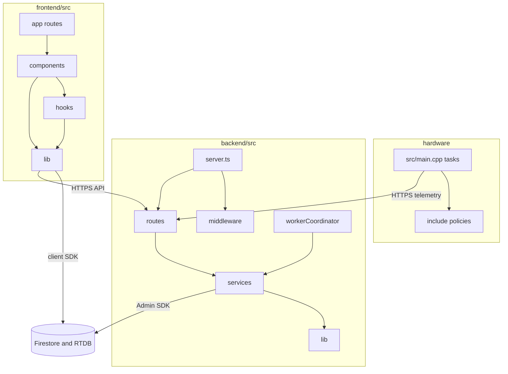
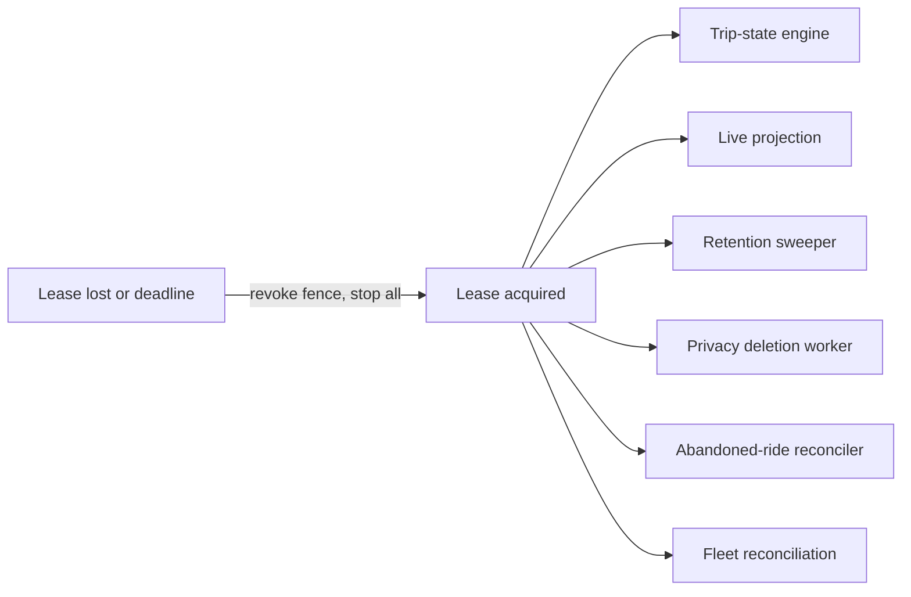

# Low-Level Design

| Document ID | Version | Status | Last updated |
|---|---|---|---|
| EKI-ARC-003 | 3.0 | Current | 2026-10-30 |

## 1. Introduction

### 1.1 Purpose

This document describes the modules of the backend, the web frontend and the bus firmware: what each module does, what it exports, which modules it works with, how the backend runs its continuous workers, and how errors, retries and repeated requests are handled. It follows the design-view structure of IEEE 1016 [1]. A developer uses it to find the module that owns a behaviour before changing it.

### 1.2 Scope

| Package | Directories covered |
|---|---|
| Backend | `backend/src` and its `lib`, `middleware`, `routes`, `services`, `types` and `test-support` directories |
| Frontend | `frontend/src` and its `app`, `components`, `config`, `hooks` and `lib` directories |
| Firmware | `hardware/src`, `hardware/include`, `hardware/scripts`, `hardware/keys`, `hardware/test`, `hardware/test-support` and the build files in `hardware` |

The system context and containers are in the [architecture](ARCHITECTURE.md) and the [high-level design](HIGH_LEVEL_DESIGN.md). Tracking thresholds are specified in [tracking algorithms](TRACKING_ALGORITHMS.md), stored fields in the [Firebase data model](../data/FIREBASE_DATA_MODEL.md), and HTTP endpoints in the [API reference](../../backend/API.md). Environment variables are listed in [configuration](../CONFIGURATION.md).

### 1.3 Conventions

- Paths are relative to the repository root; a `path:line` reference points at the defining line.
- A group row covers every file named in it. Tests (`*.test.ts`, `*.test.tsx`) sit beside the module they test and are described in the [test strategy](../testing/TEST_STRATEGY.md).
- **Leader** is the backend replica that holds the worker lease (Section 4.1). Work marked "every replica" runs on all backend processes.

## 2. Module decomposition

Figure 1. Packages and their dependencies. Arrows point from the caller to the module it uses.

## 3. Backend logical view

### 3.1 Entry points

| Module | Responsibility | Key exports | Collaborators |
|---|---|---|---|
| `bootstrap.ts` | Loads `.env`, starts optional OpenTelemetry, installs the structured log bridge, then imports `server.ts` so instrumentation patches dependencies first | None (entry point) | `instrumentation.ts`, `lib/logger.ts` |
| `server.ts` | Validates boolean flags and production settings, builds the Express app (Helmet, CORS, body parsers, rate limiters, route mounts, health endpoints), starts the HTTP listener, the route watcher and the worker coordinator, and drains everything on `SIGTERM` or `SIGINT` | None | All routers, `services/workerCoordinator.ts`, `lib/healthState.ts`, `lib/booleanEnv.ts` |
| `instrumentation.ts`, `telemetrySdk.ts` | OpenTelemetry setup, span URL redaction, trace sampling, background-failure spans | `startTelemetry`, `shutdownTelemetry`, `createTelemetrySdk` | `server.ts` |
| `seed.ts`, `seedEnvironment.ts` | `npm run seed`: writes predefined routes only after Google Routes returns geometry | None | `lib/googleMaps.ts` |
| `provisionDevice.ts` | CLI that creates or rotates a device credential with registry conflict checks | None | `devices` collection |
| `syncRoleClaims.ts` | CLI that publishes Auth claims and authorization mirrors from Firestore roles | `syncRoleClaimsChunk` | `services/userAuthorization.ts` |
| `rtdbRetentionCli.ts` | CLI for a dry-run or applied RTDB retention sweep | None | `services/rtdbRetention.ts` |
| `measureRtdbLatency.ts` | CLI that times `RTDB_LATENCY_SAMPLES` small RTDB reads and prints percentiles | None | `lib/firebaseAdmin.ts` |
| `testSetup.ts` | Vitest setup: keeps unit tests independent of a local `.env` and checks the emulator environment when `FIREBASE_RULES_TEST=1` | None | `test-support/emulatorIsolation.ts` |

### 3.2 Request pipeline

`server.ts` applies middleware in this order:

1. Helmet with a deny-all content security policy, then CORS for the origins in `CORS_ORIGIN` (`server.ts:116`, `server.ts:134`).
2. Browser ingress guard: 1000 requests per minute per IP. `OPTIONS`, `/health`, `/live` and device paths are exempt (`server.ts:135`, `backend/src/lib/browserAdmission.ts:19`). `TRACE` and `CONNECT` get `405`.
3. Body parsers: 512 bytes for telemetry, 1 KiB for diagnostics, 64 KiB for route saves, 16 KiB for everything else (`server.ts:168`, `server.ts:172`, `server.ts:179`, `backend/src/lib/routeSaveBody.ts:12`).
4. Browser admission on `/api`: Firebase token verification, then 200 reads and 30 mutations per minute per verified UID (`server.ts:180`, `browserAdmission.ts:26`). Device paths skip it and use their own limiters (Section 4.2).
5. Route-specific limiters: route computation and Places per verified UID, route planning 30 per minute (`server.ts:148`).
6. Routers (Section 3.4).
7. Terminal handlers: JSON `404` for unmatched paths, fixed `400`, `413` or `415` messages for parser and path errors, and an opaque logged `500` (`backend/src/lib/requestErrors.ts`).

All request budgets are divided by the replica shard factor (`backend/src/lib/rateLimitShard.ts`). The HTTP server allows 15 s per request and 65 s keep-alive (`server.ts:107`).

### 3.3 Middleware (`backend/src/middleware`)

| Module | Responsibility | Key exports | Collaborators |
|---|---|---|---|
| `requireAuth.ts` | Reads `Authorization: Bearer`, verifies the Firebase ID token with revocation checks, attaches claims to `req.user` | `requireAuth` | `services/authTokenVerifier.ts` |
| `requireAdmin.ts` | Requires `admin: true`, `role: admin` and a current `authorizationVersion` | `requireAdmin` | `services/userAuthorization.ts` |
| `adminAuthority.ts` | Applies the `requireAdmin` policy inside handlers shared with operators and passengers; one authorization read per request | `hasCurrentAdminAuthority` | `services/userAuthorization.ts`, `routes/shifts.ts`, `routes/sessions.ts` |
| `verifiedRequest.ts` | Reuses one verification per request and token | `verifyRequestToken` | `authTokenVerifier.ts` |

### 3.4 Routes (`backend/src/routes`)

| Module | Mount points | Responsibility | Collaborators |
|---|---|---|---|
| `devices.ts` | `/api/devices`, `/api/v2/devices` | Device telemetry and diagnostics ingestion, signed firmware manifest and install reservation, admin registry update and disable | `deviceTelemetryService`, `deviceDiagnostics`, `firmwareRelease` |
| `shifts.ts` | `/api/shifts`, `/api/v2/ride-sessions` | Ride start and resume, delay, End ride early, message clear, terminal history deletion | `rideSessionStart`, `rideHistoryDeletion`, `userAuthorization` |
| `sessions.ts` | `/api/sessions`, `/api/v2/ride-sessions` | Ride status for members, boarding code issue for operators, passenger boarding (no code needed; the passenger must be within 150 m of a fresh bus fix), chat messages | `boardingPolicy`, `chatRateLimit` |
| `fleet.ts` | `/api/fleet`, `/api/v2/fleet-reconciliation-jobs` | Bus and driver administration with Auth claims and RTDB mirrors; fleet reconciliation and lock recovery | `fleetMutationLock`, `httpOperations`, `userAuthorization` |
| `polyline.ts` | `/api/routes`, `/api/v2/routes`, `/api/v2/route-geometry-previews` | Route save with geometry, deletion, geometry read and preview operations | `lib/googleMaps`, `lib/routeSaveContract`, `routeGeometryReads`, `httpOperations` |
| `plan.ts` | `/api/plan`, `/api/v2/routes/{routeId}/segments` | Route segment between two stops from stored geometry; no Google call | `lib/routeSegment` |
| `routesList.ts` | `/api/routes-list`, `/api/v2/routes` | Cached route list | `apiReadCache` |
| `buses.ts` | `/api/buses` | Current live bus snapshots for signed-in users | RTDB |
| `places.ts` | `/api/places` | Admin place search proxy | Google Places |
| `analytics.ts` | `/api/analytics` | Admin fleet summary from `bus_locations` and `completed_trips` | Firestore |
| `feedback.ts` | `/api/feedback`, `/api/v2/feedback` | Legacy feedback endpoints, not called by the browser | `feedbackService` |
| `requests.ts` | `/api/requests` | Admin update and removal of legacy passenger requests | Firestore |
| `privacy.ts` | `/api/privacy`, `/api/v2/privacy-deletion-requests` | Passenger deletion request, admin list and recovery | `privacyDeletionRequests` |
| `settings.ts` | `/api/settings`, `/api/v2/settings/global`, `/api/v2/settings/passenger-routes` | Admin update of `settings/global`; admin full replacement of `settings/passengerRoutes` after reading every named route in one `getAll` and checking its stop IDs and `HH:mm` times. Request stop times stay in a `Map`, and the stored object is built from the route document's own stop IDs (`backend/src/routes/settings.ts:162`, `settings.ts:192`) | Firestore, `lib/documentId.ts` |
| `users.ts` | `/api/users` | Profile bootstrap as `passenger` | Firestore |
| `operationRecovery.ts` | Shared by `fleet.ts` and `polyline.ts` | Recovery and listing handlers for long-running operations | `httpOperations` |

### 3.5 Services (`backend/src/services`)

**Telemetry ingestion** (every replica):

| Module | Responsibility | Key exports | Collaborators |
|---|---|---|---|
| `telemetryPayload.ts` | Closed schema and range validation | `parseTelemetryValue` | `routes/devices.ts` |
| `deviceTelemetryService.ts` | Device credential cache and scrypt verification, rate-limit check, the ordered RTDB transaction with plausibility filter, metrics, scheduling of matching, recovery and automatic start | `ingestDeviceTelemetry`, `nextTelemetryValue`, `telemetrySampleIsNewer`, `publishDeviceCredentialInvalidation`, `getHttpsTelemetryStatus` | `lib/telemetryMotion`, `deviceRateLimiter`, `telemetryRouteService`, `durableRideRecovery`, `automaticServiceAdmission` |
| `deviceRateLimiter.ts` | Per-device one-minute budget, local or leased from RTDB | `AuthenticatedDeviceRateLimiter`, `reserveRateLimitTokens` | `_deviceRateLimits` |
| `deviceDiagnostics.ts` | Diagnostics payload validation and storage | `ingestDeviceDiagnostics` | `_device_diagnostics` |
| `firmwareRelease.ts` | Fail-closed parsing of the signed release descriptor | `readFirmwareRelease` | `routes/devices.ts` |
| `deviceAssignmentRetirement.ts` | Tombstone on the old live node when a device is reassigned | `retireDeviceAssignment` | RTDB |
| `telemetryDiagnosticCounters.ts` | Rejection reason and schema counters | `recordDiagnosticRejection` | `/api/health` |

**Tracking and ride lifecycle:**

| Module | Responsibility | Key exports | Runs on |
|---|---|---|---|
| `telemetryRouteService.ts` | Route catalog watcher, direction resolution, map matching, route adherence, rerouting and departure routes | `scheduleTelemetryRouteProcessing`, `startTelemetryRouteWatcher`, `drainTelemetryRouteProcessing` | Every replica |
| `routeMatching.ts` | Pure projection, scoring, confidence and adherence | `matchRoutePosition`, `evaluateRouteAdherence`, `plausibleProgressBound` | Every replica |
| `departureDirection.ts` | Direction from a departure trajectory | `inferDepartureDirection`, `departureSamples` | Every replica |
| `rerouteRetry.ts` | Per-ride backoff and process-wide provider circuit | `rerouteBackoffMs`, `RerouteProviderCircuit` | Every replica |
| `rideSessionStart.ts` | Idempotent ride start and resume, bus lock, live claim | `startAssignedService`, `RideSessionStartError` | Every replica |
| `automaticServiceAdmission.ts` | Automatic ride start from telemetry | `scheduleAutomaticServiceAdmission` | Every replica |
| `durableRideRecovery.ts`, `durableRideRecoveryPolicy.ts` | Restore a lock-owned ride onto a live node that lost its lifecycle | `restoreDurableRide` | Every replica and leader |
| `tripStateEngine.ts` | Listens to `activeBuses`, runs the reducer, persists progress, completion, automatic turnaround, stale sweep and lifecycle replay | `startTripStateEngine` | Leader |
| `tripStateReducer.ts` | Pure stop progression and current-stop decision | `reduceTripState`, `visitedStopIndex` | Leader |
| `tripStateLifecycle.ts` | Identifier and live-record normalization, shutdown draining | `normalizeLiveBusData`, `drainDynamicPromises` | Leader |
| `rideProgressHistory.ts` | `stopsReached` entries with evidence | `missingStopHistory` | Leader |
| `lifecycleIntake.ts` | Fingerprint of lifecycle fields for event filtering | `lifecycleIntakeFingerprint` | Leader |
| `pagedLifecycleReplay.ts` | Paged re-read of live and fleet state after a missed event | `createPagedLifecycleReplay` | Leader |
| `staleBusSweeper.ts` | Paged removal or offline marking of silent nodes | `createStaleBusSweeper` | Leader |
| `serializedChangeWriter.ts` | Per-key serialized writes with fingerprint deduplication | `SerializedChangeWriter` | Leader |
| `journeyLocation.ts` | Raw fix record for ride history | `journeyLocation`, `newerJourneyLocation` | Leader |
| `liveBusProjection.ts` | Public projection, route catalog and readiness status | `startLiveBusProjection`, `publicLiveBus` | Leader |
| `abandonedRideReconciler.ts`, `abandonedRideReconciliationLogic.ts` | Hourly interruption of inactive rides | `startAbandonedRideReconciler`, `reconciliationDecision` | Leader |

**Riders, routes and fleet:**

| Module | Responsibility | Key exports | Collaborators |
|---|---|---|---|
| `boardingPolicy.ts` | Boarding code format, stop order, passenger position and 150 m join radius | `validateStopSelection`, `validateLiveBoardingProjection`, `JOIN_RADIUS_M` | `routes/sessions.ts` |
| `chatRateLimit.ts` | Message limits and moderation | `evaluateChatRate`, `moderateChatText` | `routes/sessions.ts` |
| `feedbackService.ts` | Legacy feedback validation and cooldown | `evaluateFeedback` | `routes/feedback.ts` |
| `routeGeometryReads.ts` | Bounded cached route geometry reads | `readRouteGeometryDocument`, `invalidateRouteGeometryRead` | `routes/polyline.ts`, `telemetryRouteService` |
| `apiReadCache.ts` | Bounded cache for list endpoints | `createApiReadCache`, `routeListCache` | `routes/routesList.ts` |
| `userAuthorization.ts` | Authorization version publication and checks in Firestore and RTDB | `publishUserAuthorization`, `authorizationIsCurrent` | `requireAdmin`, `adminAuthority`, `fleet.ts` |
| `authTokenVerifier.ts` | Coalesced, cached revocation-aware token verification | `verifyRevocationAwareIdToken` | `requireAuth` |
| `fleetMutationLock.ts` | Non-expiring mutex for fleet and privacy Auth mutations | `withFleetLock` | `fleet.ts`, privacy worker |
| `fleetReconciliationCache.ts` | Per-scan cache of bus routes and RTDB mirrors | `FleetReconciliationCache` | `fleet.ts` |
| `httpOperations.ts` | Durable long-running operations with executor identity, generation fencing and recovery | `submitOperation`, `readOperation`, `OPERATION_EXECUTOR_ID` | `polyline.ts`, `fleet.ts` |

**Privacy and retention** (leader):

| Module | Responsibility | Key exports |
|---|---|---|
| `privacyDeletionRequests.ts` | Request, list and recover passenger deletions | `requestPrivacyDeletion`, `recoverPrivacyDeletion` |
| `privacyDeletionWorker.ts` | Queue processing every 60 s | `startPrivacyDeletionWorker` |
| `retentionSweeper.ts` | Daily age-based deletion of Firestore records, then the RTDB sweep | `startRetentionSweeper`, `runRetentionSweep` |
| `rtdbRetention.ts`, `firebaseRtdbRetention.ts` | RTDB retention policy and its Firebase store | `runRtdbRetentionSweep`, `firebaseRtdbRetentionStore` |
| `rideHistoryDeletion.ts` | Admin deletion of a terminal ride and its projections | `deleteTerminalRideHistory` |

### 3.6 Libraries (`backend/src/lib`)

| Group | Modules | Responsibility |
|---|---|---|
| Firebase and Google | `firebaseAdmin.ts`, `googleMaps.ts`, `orderedRouteGeometry.ts` | One Admin app with `db`, `rtdb` and `auth`; Routes API calls with timeouts; chunking of more than 25 intermediates |
| Geometry | `geo.ts`, `polylineUtils.ts`, `routeSegment.ts`, `routeGeometrySignature.ts`, `rideDirection.ts`, `automaticRideDirection.ts`, `endpointSnapshotVersion.ts`, `telemetryMotion.ts`, `liveRouteContext.ts` | Haversine distance, polyline codec, segment slicing, signatures, stop order by direction, endpoint direction and turnaround readiness, GNSS error budget and plausibility, route-context field reset |
| Route save | `routeSaveContract.ts`, `routeSaveBody.ts`, `routeComputeLimiter.ts` | Save payload hash and version rules, 64 KiB parser, Google call limiter |
| Admission and limits | `browserAdmission.ts`, `rateLimitIdentity.ts`, `rateLimitShard.ts`, `deviceIngressPolicy.ts`, `trustProxy.ts` | Rate-limit keys and budgets, device path detection, proxy trust |
| Concurrency | `boundedKeyedExecutor.ts`, `latestPendingScheduler.ts`, `boundedSingleFlight.ts`, `concurrency.ts`, `executionDeadline.ts`, `reconciliationPages.ts` | Bounded queues, newest-wins scheduling, coalesced fills, deadlines, paged scans |
| Leadership | `workerFence.ts` | Lease generation fencing of Firestore and RTDB writes |
| Operations | `healthState.ts`, `metrics.ts`, `logger.ts`, `backgroundFailureTracker.ts`, `apiCompatibilityTraffic.ts` | Cached readiness probes, OpenTelemetry counters and gauges, structured logs, sustained-failure tracking, counters of legacy and v2 endpoint traffic |
| Requests | `requestErrors.ts`, `requestParams.ts`, `documentId.ts`, `booleanEnv.ts`, `lruCache.ts` | Error mapping, path parameters, ID validation, boolean flags, LRU cache |

### 3.7 Types and test support

| Module | Responsibility |
|---|---|
| `types/index.ts` | `MotionState`, `TripState`, `LegacyTripState` |
| `types/express.d.ts` | `req.user` augmentation |
| `test-support/emulatorIsolation.ts` | Refuses emulator tests unless the environment points at the disposable demo emulators and holds no real credentials |
| `test-support/routeMatchingBaseline.ts` | Frozen copy of the matcher used as a regression baseline |

## 4. Process view

### 4.1 Worker leadership

The worker coordinator (`backend/src/services/workerCoordinator.ts:19`) runs on every replica unless `WORKER_ENABLED` is `false`, `0`, `no` or `off` (`backend/src/lib/booleanEnv.ts:10`). It acquires or renews `_worker_leases/trip-state-worker` in a Firestore transaction every 15 s with a 45 s lease (`workerCoordinator.ts:15`). Acquisition increments `generation`; renewal keeps it. The local deadline is the lease end minus twice the 2 s clock-skew allowance (`backend/src/lib/workerFence.ts:6`), measured on the monotonic clock. When renewal fails or the deadline passes, the coordinator revokes the fence and stops every leader job before another replica can take over. Details and limits are in [worker leadership](../operations/WORKER_LEADERSHIP.md).

Figure 2. Jobs that run only while a replica holds the lease.

Leader writes go through `workerTransaction` and `workerRtdbTransaction` (`workerFence.ts:83`). They abort when the fence has expired, and RTDB writes carry `_workerGeneration` so a deposed leader cannot overwrite a newer leader's value.

### 4.2 Telemetry ingestion

Every replica handles `POST /api/devices/{deviceId}/telemetry` (`backend/src/routes/devices.ts:85`):

1. Per-IP ingress limit: 15 requests per device per 10 s for `HTTPS_INGRESS_DEVICES_PER_IP` devices (default 100) (`devices.ts:60`).
2. Payload validation ([tracking algorithms](TRACKING_ALGORITHMS.md#31-payload-validation)).
3. Credential check before the request takes an ingestion slot. Cached credentials live 60 s, rejections 5 s, at most 1,000 of each; a verified entry may be served up to 10 min past expiry while its refill lane is saturated (`backend/src/services/deviceTelemetryService.ts:49`). Misses run scrypt with at most 4 concurrent derivations, plus a separate lane of 2 for refills of known devices (`deviceTelemetryService.ts:38`). A write to `_deviceCredentialVersions/{deviceId}` evicts the entry on every replica.
4. Ingestion executor: 8 running, 32 waiting, 1 waiting per device, 2 s queue age (`deviceTelemetryService.ts:43`).
5. Per-device rate limit: 90 per minute by default, with leases of 5 tokens from RTDB in replicated mode (`backend/src/services/deviceRateLimiter.ts:3`).
6. RTDB transaction on the live node (ordering, plausibility, derived fields).
7. Without awaiting: matching, durable ride recovery or automatic start.

The whole request has an 8 s response deadline and 5 s per dependency stage (`backend/src/lib/executionDeadline.ts:25`). See [telemetry deadlines](../operations/TELEMETRY_DEADLINES.md).

### 4.3 Continuous work and timers

| Work | Runs on | Schedule | Bound | Source |
|---|---|---|---|---|
| Health probes of Firestore and RTDB | Every replica | 30 s | 5 s per probe; result fresh for 65 s | `server.ts:227`, `backend/src/lib/healthState.ts:39` |
| Route catalog watcher | Every replica | Firestore listener | Entries cached 5 min, 1,000 routes | `backend/src/services/telemetryRouteService.ts:54` |
| Matching scheduler | Every replica | Per accepted fix | 1 running and 1 newest waiting per node; 8 running, 256 waiting nodes, 5 s queue age | `telemetryRouteService.ts:1290`, `backend/src/lib/boundedKeyedExecutor.ts:43` |
| Reroute scheduler | Every replica | On confirmed deviation | 2 running, 64 waiting nodes | `telemetryRouteService.ts:1335` |
| Automatic start | Every replica | Per eligible fix | 8 running, 128 waiting, 10 s queue age; 30 s retry | `backend/src/services/automaticServiceAdmission.ts:14` |
| Durable ride recovery | Every replica | On a node without a ride | 16 running, 1,000 queued; a miss is cached 30 s, or 1 s while a turnaround claim exists | `backend/src/services/durableRideRecovery.ts:12`, `durableRideRecovery.ts:95` |
| Trip-state engine | Leader | `activeBuses` child events | One event at a time per node; durable writes 8 running, 256 waiting, 5 s | `backend/src/services/tripStateEngine.ts:59`, `tripStateEngine.ts:1277` |
| Lifecycle replay | Leader | 1 s tick, on request | Pages of 25 live nodes then `bus_locations` | `tripStateEngine.ts:848` |
| Stale sweep | Leader | 1 s tick | 25 nodes per page, 4 writes at once, failure backoff up to 30 s | `tripStateEngine.ts:1350`, `backend/src/services/staleBusSweeper.ts:4` |
| Completed ride retirement | Leader | 30 s after completion | One timer per node | `tripStateEngine.ts:1262` |
| Route watcher reconnect | Leader | On listener error | 1 s doubling to 30 s | `tripStateEngine.ts:118` |
| Public projection readiness and repair | Leader | 1 s and 60 s | One readiness write at a time | `backend/src/services/liveBusProjection.ts:315` |
| Abandoned-ride reconciliation | Leader | Startup and every hour | Pages of 100 | `backend/src/services/abandonedRideReconciler.ts:18`, `backend/src/lib/reconciliationPages.ts:2` |
| Fleet authorization reconciliation | Leader | Startup and every 10 min | 30 s budget per page; cursor persisted | `workerCoordinator.ts:147`, `workerCoordinator.ts:171` |
| Privacy deletion queue | Leader | Startup and every 60 s | Pages of 20 requests | `backend/src/services/privacyDeletionWorker.ts:126` |
| Retention sweep | Leader | Startup and every 24 h | Batches of 200 | `backend/src/services/retentionSweeper.ts:187` |

Admission limits and their evidence are in [work admission](../operations/WORK_ADMISSION.md).

### 4.4 Shutdown

On `SIGTERM` or `SIGINT`, `server.ts` stops the health timer and the route watcher, closes the HTTP server, and stops the workers and HTTP operations in parallel. It then drains matching, durable recovery, automatic start and telemetry export, and deletes the Firebase app (`server.ts:317`). The engine gives handlers 6 s and lifecycle writes 8 s in total (`tripStateEngine.ts:120`). A 10 s backstop forces exit, and the process exits 500 ms after the drains settle (`server.ts:315`, `server.ts:321`). An orderly shutdown releases the lease and keeps its generation (`workerCoordinator.ts:216`).

## 5. Frontend logical view

The frontend is a Next.js App Router project built as a static export.

### 5.1 App routes (`frontend/src/app`)

| Module | Responsibility | Collaborators |
|---|---|---|
| `layout.tsx`, `globals.css` | Root metadata, service worker registration, providers; design tokens and responsive layout | `components/Providers.tsx`, `ServiceWorkerRegistrar.tsx` |
| `page.tsx` | Public landing page, Google sign-in and routing to a workspace. The sign-in button reads "Preparing sign-in…" until sign-in is usable; a slow restoration shows "Still checking your sign-in" with **Reload** instead of an access error | `hooks/useAuth.ts`, `lib/googleSignInFlow.ts` |
| `passenger/` (`layout.tsx`, `loading.tsx`, `page.tsx`) | Passenger workspace behind `RoleGuard` for passenger, driver and admin roles | `components/passenger/PassengerWorkspace.tsx` |
| `admin/` (`layout.tsx`, `loading.tsx`, `page.tsx`) | Admin shell with tabs: operations, routes, fleet, history, feedback, settings; `RoleGuard` for admin | `components/admin/*` |
| `feedback/` (`layout.tsx`, `page.tsx`) | Stand-alone admin feedback review | `components/admin/FeedbackPanel.tsx` |
| `manifest.ts`, `robots.ts`, `sitemap.ts`, `icon.png`, `apple-icon.png` | Web app manifest and indexing metadata | `lib/siteMetadata.ts` |

`RoleGuard` controls presentation only; the security boundary is the Firebase rules and the backend.

### 5.2 Components (`frontend/src/components`)

| Group | Modules | Responsibility |
|---|---|---|
| Root | `Providers.tsx`, `MapProviders.tsx`, `ServiceWorkerRegistrar.tsx`, `TelemetryTraceControls.tsx` | Auth provider; Maps API provider for the admin layout and the passenger tracking view, whose SDK script loads once per page; service worker update and one-time reload; opt-in telemetry trace controls |
| `admin/` | `DashboardPanel.tsx`, `FleetManagementPanel.tsx`, `RouteManagementPanel.tsx`, `RideHistoryPanel.tsx`, `SettingsPanel.tsx`, `PassengerRoutesSettings.tsx`, `SettingsSection.tsx`, `FeedbackPanel.tsx`, `AdminPanelErrorBoundary.tsx` | Live Ops map and ride cards (delay, boarding code, chat, End ride in the card and the live-details drawer); bus and driver administration; route editor; ride history with stop evidence; settings; passenger route schedules with their own save button and unsaved-change guard; shared settings field and section header; feedback review; per-panel error isolation |
| `maps/` | `PassengerMap.tsx`, `PassengerTrackingMap.tsx`, `DirectionsRoute.tsx`, `BusPositionGlyph.tsx`, `TrafficLayer.tsx` | Passenger map with live health, arrival estimates and stop progress; route drawing from stored or reroute geometry; bus glyph; traffic layer. Every `<GoogleMap>` (passenger, Live Ops, route editor) sets `reuseMaps` with the shared map ID and `MAP_OPTIONS`, so a remount reattaches one cached `google.maps.Map`: one map construction per page load, not per tracking open, route, direction, bus, tab or editor change ([EKI-ADR-004](GOOGLE_MAP_REUSE_DECISION.md)) |
| `passenger/` | `PassengerWorkspace.tsx`, `PassengerBoardingView.tsx`, `RouteTimelineSheet.tsx`, `RoutesTab.tsx`, `AccountTab.tsx`, `PassengerLoadingShell.tsx`, `passengerFrame.ts` | Route selection, boarding, ride card and header, stop timeline, published route schedules (the **Routes** tab), account and deletion request, loading shell, layout frame. The bottom navigation has **Map**, **Routes** and **Profile**; Routes and Profile mount on first visit and stay mounted |
| `passenger/ui/` | `BottomSheet.tsx`, `RouteCarousel.tsx` | Draggable sheet and route carousel |
| `shared/` | `RoleGuard.tsx`, `MessagingPanel.tsx`, `FeedbackModal.tsx`, `WorkspaceLink.tsx`, `WorkspaceLoading.tsx`, `WorkspacePrefetch.tsx` | Role-based presentation, ride chat (latest 200 messages), feedback submission, workspace navigation and prefetch. `RoleGuard` mounts nothing protected while verification runs, and after a slow restoration or 10 s of loading shows "Still signing you in" with **Reload** |
| `ui/` | `AlertModal.tsx`, `ConfirmModal.tsx`, `CustomSelect.tsx`, `InAppSelect.tsx` | Accessible dialogs and listboxes |

### 5.3 Hooks (`frontend/src/hooks`)

| Group | Modules | Responsibility |
|---|---|---|
| Authentication | `useAuth.ts` | Sign-in state, role verification (10 s timeout, access retries at 1, 2, 4, 8, 16 and 30 s), profile bootstrap, sign-out cleanup (`frontend/src/hooks/useAuth.ts:24`). It loads the sign-in code one attempt at a time and retries a failed load after 2, 5, 10, 20 and then every 30 s, or at once on `online` (`useAuth.ts:30`). It enables sign-in as soon as that code loads unless a Google redirect is pending, and reports `restoreSlow` when Firebase has not reported the first auth state after 8 s, keeping the user state unknown (`useAuth.ts:27`). A sign-in tap during restoration or role verification verifies the restored account instead of starting another Google sign-in |
| Firestore subscriptions | `useCollection.ts`, `collectionCache.ts`, `useBuses.ts`, `useRoutes.ts`, `useDrivers.ts`, `useSettings.ts`, `usePassengerRouteConfig.ts`, `useBusLocations.ts` | Shared listeners that start only after authentication is verified. `usePassengerRouteConfig` listens to `settings/passengerRoutes` and saves through `PUT /api/v2/settings/passenger-routes` (administrators only) |
| Live data | `useActiveBuses.ts`, `useLiveRouteCatalog.ts`, `useDynamicRouteGeometries.ts`, `useRTDBResume.ts`, `rtdbResumeState.ts` | Live bus subscriptions, route catalog and readiness, reroute geometry, reconnect after a 30 s suspension or a confirmed disconnect with a 1 to 1.5 s debounce and 5 s cooldown (`frontend/src/hooks/useRTDBResume.ts:14`) |
| Presentation timing | `useLiveHealthClock.ts`, `useLiveBusMarkerPosition.ts`, `useSmoothPosition.ts` | Live health deadline clock; marker selection; animation frame interpolation, skipped for reduced motion |
| UI and diagnostics | `useDialogFocus.ts`, `useTelemetryRenderTrace.ts` | Dialog focus trap and restoration; render timing trace |

### 5.4 Libraries (`frontend/src/lib`)

| Group | Modules | Responsibility |
|---|---|---|
| Firebase and sign-in | `firebaseCore.ts`, `firebaseAuth.ts`, `firebaseDatabase.ts`, `firebaseFirestore.ts`, `firebaseAuthDomain.ts`, `googleSignInFlow.ts`, `authState.ts` | Split SDK initialization; auth domain selection; popup or redirect sign-in; auth readiness generations. `firebaseAuth.ts` installs the popup and redirect resolver at startup only on popup platforms or while a Google redirect is pending, so a phone reports its first auth state without loading Google's sign-in frame; redirect sign-in passes the resolver per call (`frontend/src/lib/firebaseAuth.ts:17`). `googleSignInFlow.ts` detects a pending redirect from the app's marker or Firebase's `firebase:pendingRedirect:<apiKey>:[DEFAULT]` session flag, and clears both when a redirect fails before leaving the page |
| HTTP | `apiClient.ts`, `errors.ts`, `promiseTimeout.ts`, `placeSearchErrors.ts` | Backend requests with a 10 s timeout and response validation (`frontend/src/lib/apiClient.ts:1`); error text |
| Live bus pipeline | `createLiveBusStore.ts`, `liveBusStore.ts`, `liveBusSnapshot.ts`, `liveBusDelivery.ts`, `liveBusRetry.ts`, `activeBusEntries.ts`, `passengerLiveBus.ts`, `passengerBusAvailability.ts`, `serverClock.ts`, `serverClockSync.ts` | One shared RTDB subscription per path with initial snapshot then child deltas; expiry pruning; retry with equal jitter from 1 s to 30 s; server clock offset |
| Live health | `liveBusFreshness.ts`, `liveBusHealth.ts`, `passengerAvailability.ts` | Freshness thresholds, health states, boarding eligibility ([tracking algorithms](TRACKING_ALGORITHMS.md#9-live-bus-health)) |
| Map position and geometry | `liveBusMarkerPosition.ts`, `telemetryMarkerPosition.ts`, `markerHeading.ts`, `mapUtils.ts`, `polyline.ts`, `polylineDistance.ts`, `snapToPolyline.ts`, `activeRouteGeometry.ts`, `busRouteGeometry.ts`, `mapRouteGeometry.ts`, `routeDisplayPath.ts`, `routeLegPaths.ts`, `routeProgressPaths.ts` | Matched or raw marker choice with a 2 s hold; heading; path decoding, distance index and snapping; reroute geometry fetch and cache; drawn route and progress paths |
| Ride progress and estimates | `busEta.ts`, `etaConstants.ts`, `passengerStopEstimates.ts`, `publishedStopIndex.ts`, `stopProgress.ts`, `stopLabel.ts`, `rideDirection.ts`, `passengerRouteStatus.ts`, `joinedRidePointer.ts`, `joinedRideStatus.ts` | Arrival estimates, per-stop states, direction handling, deviation notice, the joined ride kept for 24 h in local storage |
| History and feedback | `rideHistory.ts`, `rideFeedbackEligibility.ts`, `feedback.ts`, `feedbackStore.ts` | Ride history normalization and observed-arrival test; feedback eligibility; direct Firestore feedback create, list and review |
| Administration | `adminValidation.ts`, `routeSaveClient.ts`, `routeStopPayload.ts`, `unsavedChanges.ts`, `predefinedRoutes.ts` | Form validation, including the passenger route schedule rules that mirror the backend (at most 50 routes, each existing once, a valid time for every stop); idempotent route save; unsaved-change guard; seed route definitions |
| Route schedules | `passengerRouteSchedule.ts` | Normalizes the untrusted `settings/passengerRoutes` document, joins approvals with route documents in approval order and the route's stop order, and formats `HH:mm` as "7:05 am" |
| Site and diagnostics | `siteMetadata.ts`, `serviceMessages.ts`, `telemetryTrace.ts` | Origin and indexing flags, service message text, opt-in browser telemetry trace ([browser telemetry trace](../operations/BROWSER_TELEMETRY_TRACE.md)) |

### 5.5 Configuration and service worker

| Module | Responsibility |
|---|---|
| `config/maps.ts` | Maps API key and map ID from public environment variables, default map center, map options shared by every map, and the map reuse policy |
| `config/passenger.ts` | Service start time text and the 200-word feedback limit |
| `sw.js` | Workbox service worker: network-first navigation (10 entries, 7 days) that waits at most 2.5 s for Hosting and then serves the HTML shell precached by this worker, or else the cached copy (`frontend/src/sw.js:77`); cache-first hashed chunks; network-only Google Maps, Firebase, Auth and backend traffic |

## 6. Firmware logical view

The firmware runs on an ESP32 with a u-blox GNSS receiver on UART. Behaviour and setup are documented in [hardware telemetry](../hardware/HARDWARE_TELEMETRY.md) and the [hardware guide](../../hardware/README.md).

### 6.1 Tasks (`hardware/src/main.cpp`)

| Task | Core | Responsibility | Source |
|---|---|---|---|
| Arduino `loop()` | Arduino loop task | Reads NMEA bytes, evaluates telemetry every 1 s, queues fixes and the single GNSS-loss packet, writes the encrypted checkpoint at most every 10 s when it queues a fix, drives the status LED and feeds the 25 s watchdog | `hardware/src/main.cpp:2266`, `main.cpp:508`, `main.cpp:108` |
| `telemetry-publisher` | 0 | Sends the newest fresh queued fix over HTTPS, compacts acknowledged fixes and schedules retries | `main.cpp:2251` |
| `diagnostic-http` | 0 | Diagnostics report 30 s after boot and every 5 min | `main.cpp:2246`, `main.cpp:120` |
| `firmware-maintenance` | 0 | Signed firmware checks and installation; fleet builds only | `main.cpp:2237` |

The fix queue holds 100 entries in RTC memory that survives warm resets (`main.cpp:119`, `main.cpp:261`).

### 6.2 Modules

| Module | Responsibility | Key constants |
|---|---|---|
| `src/main.cpp` | Tasks, Wi-Fi, clock discipline, HTTPS publishing, OTA validation | Section 6.1 |
| `src/tls_profile.cpp` | Restricts TLS to ECDHE-RSA with AES-GCM and the P-256 curve by wrapping `mbedtls_ssl_config_defaults`; wraps `mbedtls_ecdh_make_public` so each network task can use an ephemeral key prepared before the handshake | 3 key slots |
| `include/telemetry_policy.h` | Capture thresholds, motion hysteresis, HTTP timeouts and retry policy | 1 s evaluation and heartbeats, 3-reading motion confirmation, 1 s connect and 1.5 s request timeout, 10 s TLS handshake, retry 1 to 30 s, 55 s freshness margin (`hardware/include/telemetry_policy.h:48`) |
| `include/telemetry_queue.h` | Fixed-capacity ordered ring with newest-first delivery and acknowledgement compaction | Capacity set in `main.cpp` |
| `include/clock_policy.h` | GNSS and NTP clock discipline | 60 s GNSS refresh, 1.5 s correction threshold |
| `include/connectivity_policy.h` | Wi-Fi retry and fault codes | Retry 5 to 60 s |
| `include/dns_resolution_policy.h`, `include/bounded_dns_resolver.h` | One-slot DNS with a 1 s caller wait ([DNS cold connect](../hardware/DNS_COLD_CONNECT.md)) | 1 s budget |
| `include/http_response.h` | Bounded response draining for connection reuse ([HTTPS response reuse](../hardware/HTTPS_RESPONSE_REUSE.md)) | 1024-byte body, 1 s drain |
| `include/json_payload.h` | Complete-payload check before send | None |
| `include/checkpoint_journal.h`, `include/encrypted_checkpoint.h` | Encrypted flash checkpoint for cold power loss ([cold power recovery](../hardware/COLD_POWER_RECOVERY.md)) | 128-byte records, 4096-byte pages |
| `include/firmware_update_policy.h` | Signed OTA scheduling and rollback validation | First check 2 min, interval 6 h, retry 15 min, validation 5 min |
| `include/reset_stats.h` | Reset counters in RTC memory | None |
| `include/firmware_config.h`, `include/secrets.example.h` | Compile-time validation of `secrets.h` and its template ([include guide](../../hardware/include/README.md)) | ID and secret at most 128 characters |

### 6.3 Build, scripts and test support

| Path | Responsibility |
|---|---|
| `platformio.ini` | Environments: `esp32dev` (development, OTA disabled), `esp32dev-quiet` (fleet traces off), `esp32dev-journal` (app-only build for boards with the original partition table), `esp32dev-secure` (the only fleet build: Secure Boot V2, flash encryption, signed OTA) and `native` (host unit tests) |
| `CMakeLists.txt`, `src/CMakeLists.txt`, `sdkconfig.defaults`, `sdkconfig.journal.defaults` | ESP-IDF project and component definitions and SDK configuration for the IDF-based builds |
| `partitions_development.csv`, `partitions_secure.csv` | Flash partition tables for the development and secure builds |
| `scripts/verify_secure_fleet.py` | Pre-build check for `esp32dev-secure`: positive `EKI_FIRMWARE_SEQUENCE`, signed OTA enabled, an explicit `PROJECT_VER`, and the required Secure Boot V2 and flash-encryption settings in `sdkconfig.defaults` |
| `scripts/test_verify_secure_fleet.py`, `scripts/test_signed_image.py`, `scripts/test_host_protocols.py` | Host tests of the fleet verifier, Secure Boot V2 signature checks, and checkpoint cryptography, TLS wrapper and NMEA parsing |
| `keys/` | Location of the Secure Boot V2 signing key, which is never committed ([fleet signing keys](../../hardware/keys/README.md)) |
| `test/test_*/test_main.cpp`, `test/test_bounded_dns_resolver/stubs/` | Unity tests for the `include/` policies, run with `platformio test --project-dir hardware -e native`, and stubs for the DNS resolver test |
| `test-support/crypto`, `test-support/nmea`, `test-support/tls` | Host stand-ins for ESP-IDF, Arduino and FreeRTOS headers used by `scripts/test_host_protocols.py` |

Native tests are described in the [hardware test guide](../../hardware/test/README.md).

## 7. Error handling

| Layer | Failure | Handling | Source |
|---|---|---|---|
| HTTP | Unmatched path, parser error, unexpected exception | `404` JSON; fixed `400`, `413` or `415`; opaque `500`, logged | `backend/src/lib/requestErrors.ts` |
| Telemetry | Invalid payload, credentials, assignment, rate | `400` or `413`, `401`, `403`, `429` with `Retry-After` | `backend/src/routes/devices.ts:114` |
| Telemetry | Dependency failure or deadline | `503`, `Retry-After: 1`, `commitState` `not_dispatched` or `unknown` | `devices.ts:162` |
| Background work | Matching, rerouting, recovery, admission, projection failures | `recordBackgroundFailure` counts per source and flags sustained failures in `/api/health` without failing readiness | `backend/src/lib/backgroundFailureTracker.ts` |
| Leader writes | Lost lease during a write | The fence aborts the transaction; the job stops | `backend/src/lib/workerFence.ts:83` |
| Lifecycle persistence | Firestore write fails or lock check fails | The fingerprint is released for retry and a paged replay is requested | `backend/src/services/tripStateEngine.ts:770` |
| RTDB transactions | Cold local cache returns `null` | The update returns `null` so the SDK retries against the server value | `backend/src/routes/shifts.ts:400` |
| Reroute | Provider error, bad geometry, lost publication | Node back to `OFF_ROUTE` with persisted backoff; circuit counts provider failures only | `backend/src/services/telemetryRouteService.ts:991` |
| Browser | RTDB disconnect, listener error | "Live tracking paused" notice, cache invalidation, jittered resubscription | `frontend/src/hooks/useRTDBResume.ts`, `frontend/src/lib/liveBusRetry.ts` |
| Browser | Admin panel exception | Isolated by `AdminPanelErrorBoundary` | `frontend/src/components/admin/AdminPanelErrorBoundary.tsx` |
| Firmware | `401` | Credential fault latched; publishing stops until restart | `hardware/include/telemetry_policy.h:403` |
| Firmware | `403`, `404` | Retry after 60 s with Wi-Fi kept on | `telemetry_policy.h:460` |
| Firmware | `429` | `Retry-After`, at most 5 min, else 60 s | `telemetry_policy.h:455` |
| Firmware | Transport error, `408`, `5xx` | Retry the newest fix with backoff of 1 to 30 s | `telemetry_policy.h:62` |

## 8. Idempotency and concurrency control

| Operation | Mechanism | Source |
|---|---|---|
| Telemetry retry | Fix ordering by time and sequence; a repeat returns `200 duplicate` | `backend/src/services/deviceTelemetryService.ts:246` |
| Ride start | `Idempotency-Key` header (16 to 128 characters) bound in `_ride_session_creation_keys`; the bus lock admits one non-terminal ride per bus; the RTDB claim admits one live session per node | `backend/src/routes/shifts.ts:476`, `backend/src/services/rideSessionStart.ts:138` |
| Automatic start | Key `automatic-service-v1` scoped to device, assignment revision and `automaticServiceEpoch` | `backend/src/services/automaticServiceAdmission.ts:103` |
| Boarding | Firestore transaction updates only the caller's manifest entry | `backend/src/routes/sessions.ts:256` |
| Chat message | Document ID from UID and client `requestId`; message and rate record in one transaction | `sessions.ts:366` |
| Feedback | Document ID from UID and client `requestId`; cooldown in the same transaction | `frontend/src/lib/feedbackStore.ts:76` |
| Route save | `saveId` with payload hash and lease in `_route_save_operations`, committed with the route | `backend/src/routes/polyline.ts:700` |
| Geometry preview, fleet reconciliation | `Idempotency-Key` operation records with executor identity and generation | `backend/src/services/httpOperations.ts:124` |
| Delay update | `delayUpdatedAt` revision increases monotonically; the durable mirror ignores older revisions | `shifts.ts:187` |
| Stop progress | `active_rides.currentStopIndex` never decreases; existing `stopsReached` entries are not rewritten | `backend/src/services/tripStateEngine.ts:727`, `backend/src/services/rideProgressHistory.ts:38` |
| Completion | One transaction writes history and deletes only the lock and recovery record of the completing session | `tripStateEngine.ts:1071` |
| Turnaround | RTDB claim plus a Firestore transaction that checks the lock and `terminalJourney.consumedBy` | `tripStateEngine.ts:213` |

RTDB holds the latest state and Firestore the durable record; no transaction spans both. Each cross-store sequence is ordered so that a retry or the paged replay converges, and session IDs guard every write against a newer ride. Recovery limits across stores are in [reconciliation](../operations/RECONCILIATION.md).

## 9. Configuration constants

Environment variables and their defaults are listed in [configuration](../CONFIGURATION.md). Tracking thresholds are listed in [tracking algorithms](TRACKING_ALGORITHMS.md). The remaining fixed constants are:

| Constant | Value | Source |
|---|---|---|
| Worker lease duration and renewal | 45 s, 15 s | `backend/src/services/workerCoordinator.ts:15` |
| Worker clock-skew allowance | 2 s | `backend/src/lib/workerFence.ts:6` |
| Telemetry response and dependency deadline | 8 s, 5 s | `backend/src/lib/executionDeadline.ts:25` |
| Device credential cache | 60 s valid, 5 s rejected, 1,000 entries, 10 min stale grace | `backend/src/services/deviceTelemetryService.ts:49` |
| Device rate limit default | 90 per minute, leases of 5, 1,000 tracked devices | `backend/src/services/deviceRateLimiter.ts:3` |
| Auth revocation cache | 15 s default, 60 s maximum | `backend/src/services/authTokenVerifier.ts:5` |
| Browser API budgets | 1000 per IP, 200 reads and 30 mutations per UID, per minute | `backend/src/lib/browserAdmission.ts:19` |
| Body limits | 512 B, 1 KiB, 64 KiB, 16 KiB | `backend/src/server.ts:168` |
| Google Routes timeouts | 10 s for saves, 3.5 s for live reroutes | `backend/src/lib/googleMaps.ts:23` |
| Route stops per route | 2 to 100 | `backend/src/lib/orderedRouteGeometry.ts:3` |
| Stale node threshold | `BUS_STALE_MS`, 300 s, minimum 90 s | `backend/src/services/tripStateEngine.ts:110` |
| Reconciliation page size | 100 | `backend/src/lib/reconciliationPages.ts:2` |
| Browser API timeout | 10 s | `frontend/src/lib/apiClient.ts:1` |
| Passenger route schedules | At most 50 routes; times match `^([01]\d\|2[0-3]):[0-5]\d$` | `backend/src/routes/settings.ts:100`, `frontend/src/lib/passengerRouteSchedule.ts:12` |
| Slow sign-in restoration notice | 8 s | `frontend/src/hooks/useAuth.ts:27` |
| Navigation network budget in the service worker | 2.5 s | `frontend/src/sw.js:77` |
| Browser live retry | 1 s to 30 s, equal jitter | `frontend/src/lib/liveBusRetry.ts:1` |
| Firmware fix queue | 100 fixes | `hardware/src/main.cpp:119` |
| Firmware watchdog | 25 s | `hardware/src/main.cpp:108` |

## 10. Design rationale

| Decision | Reason |
|---|---|
| Ingestion and matching on every replica; lifecycle on one leader | Fix acceptance must not wait for leadership, while stop progression and history need one ordered writer per node. |
| Pure reducer and matcher modules | Thresholds can be tested on recorded and synthetic tracks without Firebase. |
| Bounded executors with queue age limits everywhere | A slow dependency degrades into rejected or expired work instead of unbounded memory growth. |
| Separate public projection | Browsers never read anchors, claims, retry state or worker metadata from the authoritative node. |
| Browser writes only feedback | Every other write needs server-side checks that rules cannot express, such as proximity and rate limits. |

## 11. Constraints and risks

- The design has no cross-store transaction between RTDB and Firestore; it depends on ordered writes, guards and replay.
- Leader fencing cannot recall an Auth call or a recursive deletion that was already dispatched ([worker leadership](../operations/WORKER_LEADERSHIP.md)).
- In-process metrics and caches reset on restart and are per replica.
- Known architectural risks are tracked in the [risk register](../operations/ARCHITECTURE_RISK_REGISTER.md).

## 12. References

[1] IEEE, "IEEE Standard for Information Technology: Systems Design, Software Design Descriptions," IEEE Std 1016-2009, 2009.
