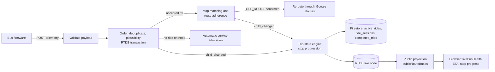
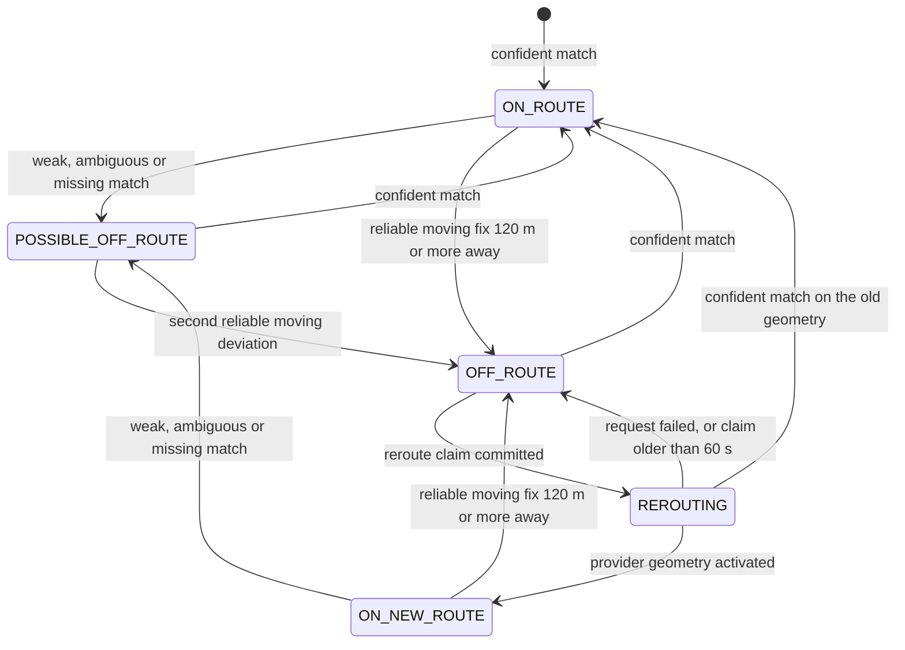
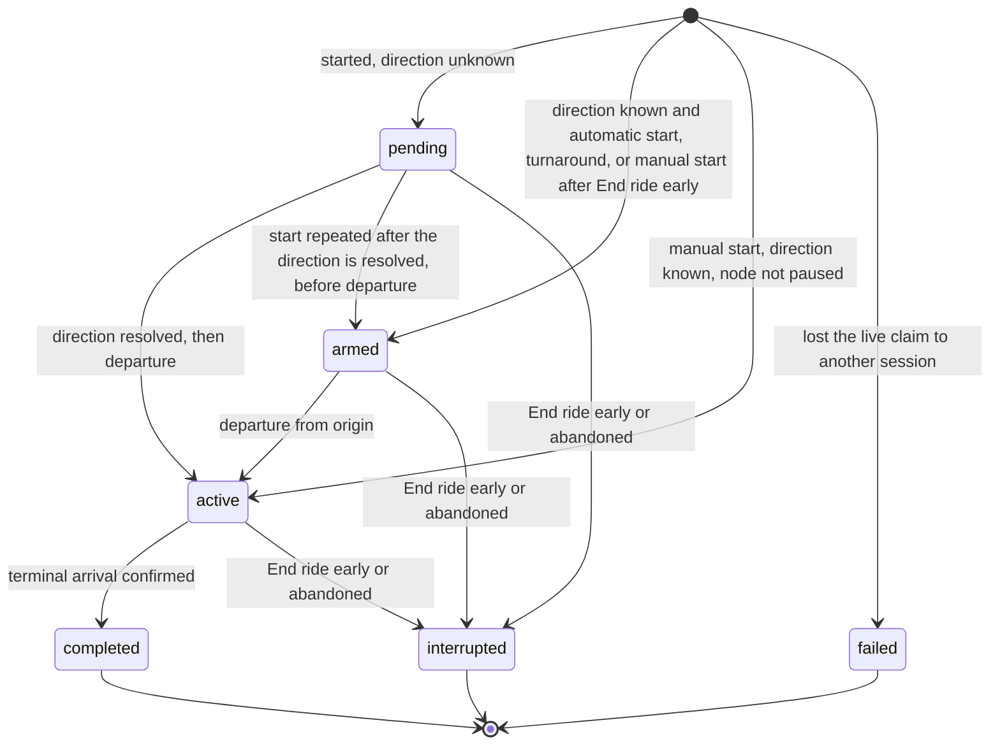
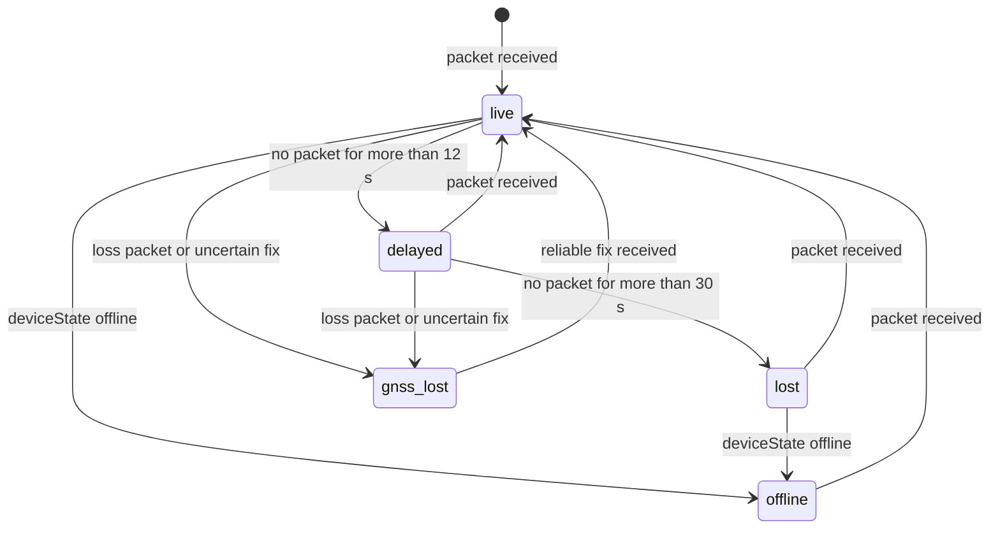

# Tracking Algorithms

| Document ID | Version | Status | Last updated |
|---|---|---|---|
| EKI-ARC-004 | 1.0 | Current | 2026-10-30 |

## 1. Introduction

### 1.1 Purpose

This document specifies how Eki turns GNSS fixes from a bus into a matched map position, an off-route decision, ride progress, arrival times and a live or degraded status. It gives every threshold with the source line that defines it, so that a reviewer can check a behaviour against the code and a developer can change a value knowingly. It follows the design-description structure of IEEE 1016 [1]. Terms such as fix, HDOP, live record and arrival corridor are defined in the [glossary](../GLOSSARY.md).

### 1.2 Scope

The document covers the backend telemetry path (`backend/src/services`, `backend/src/lib`) and the browser logic that decides what a passenger or administrator sees (`frontend/src/lib`, `frontend/src/hooks`, `frontend/src/components`). Module structure, workers and leases are in the [low-level design](LOW_LEVEL_DESIGN.md). Field definitions are in the [Firebase data model](../data/FIREBASE_DATA_MODEL.md). Firmware capture and publishing rules are in [hardware telemetry](../hardware/HARDWARE_TELEMETRY.md).

### 1.3 Conventions

- Source references have the form `path:line`, relative to the repository root.
- A **fix** is one GNSS sample sent by the bus. The **live node** is the RTDB record `activeBuses/{busId}_{routeId}`. A **ride** is one `ride_sessions` document and its live projection. A **stop index** is zero-based and counts in the ride's travel direction.
- HDOP is the receiver's horizontal dilution of precision. A fix is **reliable** when `motionState` is not `uncertain` and HDOP, when present, is between 0 and 4 (`backend/src/services/tripStateReducer.ts:21`).
- Speeds are in km/h, distances in metres, times in milliseconds unless a unit is written.

## 2. Context

Figure 1 shows where each algorithm runs. Ingestion and matching run on every backend replica. The trip-state engine and the public projection run only on the replica that holds the worker lease (see [worker leadership](../operations/WORKER_LEADERSHIP.md)).



Figure 1. Telemetry path from the bus to the browser.

## 3. Telemetry validation, ordering and plausibility

### 3.1 Payload validation

`parseTelemetryValue` (`backend/src/services/telemetryPayload.ts:63`) accepts exactly one of three closed key sets and rejects any extra or missing key.

| Schema | Keys | Source |
|---|---|---|
| Current | `deviceSentAt`, `gpsHdop`, `heading`, `lat`, `lng`, `motionState`, `seq`, `speed`, `timestamp` | `telemetryPayload.ts:1` |
| Previous sequenced | Current keys without `gpsHdop` (HDOP stored as `null`) | `telemetryPayload.ts:13` |
| Legacy | `heading`, `lat`, `lng`, `motionState`, `speed`, `timestamp` (`seq` set to 1) | `telemetryPayload.ts:27` |

| Field | Accepted range | Source |
|---|---|---|
| Body size | 1 to 512 bytes, checked on the encoded body | `telemetryPayload.ts:172`, `backend/src/routes/devices.ts:107` |
| `lat`, `lng` | -90 to 90, -180 to 180 | `telemetryPayload.ts:86` |
| `speed` | 0 to 200 km/h | `telemetryPayload.ts:92` |
| `heading` | 0 to less than 360 degrees | `telemetryPayload.ts:95` |
| `gpsHdop` | 0 to 99 | `telemetryPayload.ts:103` |
| `motionState` | `moving`, `stopped`, `uncertain` | `telemetryPayload.ts:61` |
| `seq` | Integer 1 to 4294967295 | `telemetryPayload.ts:115` |
| `timestamp` | Integer, from 60 s before to 10 s after server receipt | `telemetryPayload.ts:123` |
| `deviceSentAt` | Not earlier than `timestamp`, at most 10 s after receipt | `telemetryPayload.ts:131` |

A `timestamp` ahead of the server clock is clamped to the server time; the raw value is kept as `deviceTimestamp` only for ordering (`telemetryPayload.ts:140`). The device is authenticated after validation; credential and rate-limit rules are in the [low-level design](LOW_LEVEL_DESIGN.md#42-telemetry-ingestion).

### 3.2 Ordering and deduplication

All ordering happens inside one RTDB transaction on the live node (`backend/src/services/deviceTelemetryService.ts:764`). `telemetrySampleIsNewer` (`deviceTelemetryService.ts:246`) decides whether a fix replaces the stored one:

1. A node without a valid stored `timestamp` accepts the fix.
2. A fix whose `seq` and raw capture time are both lower than the stored fix is a late delivery and is rejected. Requiring both lets a reboot (sequence restarts) or a clock correction (time goes back) through.
3. Otherwise a later `timestamp` wins; on an equal `timestamp` a higher `seq` wins.

A rejected fix aborts the transaction and the endpoint answers `200` with `duplicate: true`; a committed fix answers `202` (`backend/src/routes/devices.ts:153`). The firmware treats both as acknowledged.

### 3.3 Plausibility filter

The filter compares the fix with `plausibilityAnchor`, the last physically accepted fix, not with the newest stored fix (`deviceTelemetryService.ts:667`).

The horizontal error budget for one fix is (`backend/src/lib/telemetryMotion.ts:26`):

```text
quality   = 15 + 7 * HDOP            (50 when HDOP is missing or invalid)
multipath = 10 when both speeds <= 2.5 km/h, else 0
gap       = clamp((elapsed - 10 s) / 2 s, 0, 10)
error     = clamp(quality + multipath + gap, 15, 50) metres
```

| Rule | Value | Source |
|---|---|---|
| Error budget bounds | 15 to 50 m | `telemetryMotion.ts:8` |
| Stationary speed | 2.5 km/h | `telemetryMotion.ts:10` |
| Maximum HDOP for a usable fix | 4 | `telemetryMotion.ts:11` |
| Travel envelope | distance <= max(error budgets of both fixes) + max(speed of both fixes) * min(gap, 60 s) | `telemetryMotion.ts:72` |
| Gap after which any fix re-anchors | more than 5 min | `telemetryMotion.ts:13`, `telemetryMotion.ts:64` |
| Reacquisition after a 60 s to 5 min gap | three coherent fixes, HDOP <= 4, each 0.5 to 5 s after the previous, all inside the full-gap travel envelope | `telemetryMotion.ts:113` |

An implausible fix is not dropped. The node keeps the previous accepted coordinates with `speed: 0` and `motionState: uncertain`, and stores the raw fix in `rawLocation` (`deviceTelemetryService.ts:691`). Reacquisition progress is kept in `plausibilityReacquisition` until the third fix is accepted.

When GNSS is lost, the firmware sends one packet at the last position with HDOP 99 and `motionState: uncertain` (`hardware/src/main.cpp:2015`). The backend accepts it so that browsers learn of the loss, but it never becomes the anchor (`deviceTelemetryService.ts:709`). Otherwise the first good fixes after GNSS returns would be held as jumps from a stationary, untrusted point.

### 3.4 Derived fields

| Field | Rule | Source |
|---|---|---|
| `signalState` | `gnss_lost` when the accepted fix is `uncertain`, else `connected`. The stale sweep sets `lost`. | `deviceTelemetryService.ts:755`, `backend/src/services/staleBusSweeper.ts:58` |
| `deviceState` | `online` on every accepted fix; `offline` from the stale sweep or ride retirement | `deviceTelemetryService.ts:754` |
| `backendReceivedAt` | Request receipt time on the server, used by browsers for freshness | `deviceTelemetryService.ts:759` |

## 4. Map matching

Every committed fix schedules `processTelemetryRoute` (`backend/src/services/telemetryRouteService.ts:1069`) on a latest-pending scheduler: one running and one newest waiting task per live node (`telemetryRouteService.ts:1290`). Matching runs only after the ride direction is resolved (Section 6.4).

### 4.1 Inputs

| Input | Rule | Source |
|---|---|---|
| Geometry | The stored `forwardPolyline` or `reversePolyline` for the direction, or the reroute polyline from `activeRouteGeometry` when `routeSource` is `dynamic-reroute` | `telemetryRouteService.ts:633` |
| Route context version | `routeVersion` increases when direction, session or `routeGeometryVersion` changes, and when reroute geometry is missing | `telemetryRouteService.ts:1105` |
| Point | The accepted coordinates on the live node, so a held implausible fix is matched at the held position | `telemetryRouteService.ts:1128` |
| Heading | Trajectory heading of the last four accepted points when they span at least 8 m, else the receiver heading. Used only when `speed >= 3` and `motionState` is `moving` | `telemetryRouteService.ts:1151`, `backend/src/services/routeMatching.ts:78` |
| Position uncertainty | The error budget of Section 3.3 for this fix | `telemetryRouteService.ts:1159` |
| Previous match (anchor) | `routeMatchAnchor`, else `matchedLocation` unless it is marked `uncertain`, if it has the same `routeVersion` and is at most 5 min old. Discarded on a context change or when the plausibility anchor is more than 5 min old | `telemetryRouteService.ts:1124`, `telemetryRouteService.ts:701`, `telemetryRouteService.ts:296` |

### 4.2 Candidates

Each polyline segment yields one candidate: the projection of the fix onto the segment, with its along-route distance. With a previous match, only segments inside a progress window are projected (`routeMatching.ts:202`):

```text
speed  = max(speed of the accepted fix, speed stored with the anchor)
window = (speed + 15) / 3.6 * elapsed_s + 2 * uncertainty      (only when 0 < elapsed <= 60 s)
keep candidates with |along - anchor.along| <= window
```

The window comes from `telemetryRouteService.ts:1176`. Without an anchor, or after a longer gap, every segment is a candidate.

### 4.3 Candidate score

The lowest score wins (`routeMatching.ts:270`):

```text
score = distance_to_segment
      + 0.28 * heading_difference_deg
      + 2 * max(0, anchor.along - along - 15)          backward travel beyond 15 m
      + 3 * max(0, |segment - anchor.segment| - 25)    segment jump beyond 25
      + unexplained_forward                            speed-plausibility penalty
```

The speed-plausibility penalty (`routeMatching.ts:266`) applies only when the anchor is fresh and the candidate is a shortcut:

```text
plausible = (speed + 15) / 3.6 * elapsed_s + uncertainty     (undefined when elapsed > 10 s)
progress  = along - anchor.along
unexplained_forward = max(0, min(progress - plausible,
                                 progress - straight_line(anchor point, candidate) - ambiguity_window))
```

| Constant | Value | Source |
|---|---|---|
| Maximum anchor age for the penalty | 10 s | `routeMatching.ts:15` |
| Speed slack | 15 km/h | `routeMatching.ts:16` |
| Ambiguity window | max(6, min(12, 0.25 * uncertainty)) m | `routeMatching.ts:218` |

On an ordinary road the along-route progress equals the straight-line displacement, so the second term of the `min` is zero or negative and the penalty never applies. On an out-and-back road both carriageways lie inside the progress window near the U-turn. A candidate on the far carriageway has much more along-route progress than straight-line displacement, and more than the bus speed explains, so it is penalised. A stale anchor bounds nothing, so after a gap longer than 10 s the penalty is off.

### 4.4 Ambiguity and confidence

A competing candidate is one that is not continuous with the best segment (adjacent, or joined only by zero-length segments) and whose along-route distance differs from the best by more than their straight-line distance plus the ambiguity window: a loop, crossing or out-and-back leg (`routeMatching.ts:301`). The match is ambiguous when such a candidate scores within the ambiguity window of the best.

```text
distance_conf   = clamp(1 - distance / 60)
heading_conf    = clamp(1 - heading_difference / 120)       0.65 without a heading
continuity_conf = clamp(1 - |segment jump| / 30), times 0.25 if moving backward > 15 m
                  0.65 without an anchor
confidence      = (0.55 * distance_conf + 0.25 * heading_conf + 0.2 * continuity_conf)
                  * (0.55 if ambiguous)
```

Source: `routeMatching.ts:314`.

### 4.5 Turnaround leg after a long gap

When the anchor is older than 10 s and its stored speed is higher than the current speed, the faster old speed only widens the window. The service then matches again with the current speed alone. If that second match lies on another leg (along-route difference greater than straight-line difference plus 10 m), the first match is marked ambiguous and its confidence multiplied by 0.55 (`telemetryRouteService.ts:1185`, `telemetryRouteService.ts:320`).

### 4.6 Outputs

The match is written in a transaction that aborts when the fix is no longer the newest, the session or direction changed, or a reroute changed `routeVersion` meanwhile (`telemetryRouteService.ts:1204`).

| Field | Written when | Source |
|---|---|---|
| `matchedLocation` | Match is not ambiguous and confidence >= 0.45; otherwise `null`. A match made from an `uncertain` fix carries `uncertain: true` and is displayed but never used as the progress anchor | `telemetryRouteService.ts:1248` |
| `routeMatchAnchor` | Same condition and the fix is not `uncertain`; otherwise the previous anchor is kept | `telemetryRouteService.ts:1237` |
| `matchConfidence`, `distanceToActiveRoute`, `mapMatchSeq`, `mapMatchSampledAt` | Every pass | `telemetryRouteService.ts:1245` |
| `routeState`, `offRouteSampleCount` | Every pass (Section 5) | `telemetryRouteService.ts:1232` |

The 0.45 threshold is `MATCHED_POSITION_CONFIDENCE` (`telemetryRouteService.ts:56`). Browsers draw the matched position while it belongs to the current fix, hold the previous match for up to 2 s while matching is pending, and otherwise draw the raw fix marked uncertain (`frontend/src/lib/liveBusMarkerPosition.ts:13`).

## 5. Route adherence and rerouting

### 5.1 States

`evaluateRouteAdherence` (`routeMatching.ts:347`) classifies each matched fix. A context change resets the previous state and the sample count.



Figure 2. Route adherence states of a live node.

### 5.2 Transition rules

| Condition, checked in order | Resulting state | Sample count | Source |
|---|---|---|---|
| Match not ambiguous, distance <= 45 m, confidence >= 0.45 | `ON_ROUTE`, or stays `ON_NEW_ROUTE` | 0 | `routeMatching.ts:353` |
| Match ambiguous | `POSSIBLE_OFF_ROUTE`, or stays `REROUTING` | unchanged | `routeMatching.ts:370` |
| Fix not reliably moving | `POSSIBLE_OFF_ROUTE`, or stays `REROUTING` | unchanged | `routeMatching.ts:379` |
| Reliably moving, match distance >= 120 m | `OFF_ROUTE` (or stays `REROUTING`) | 2 | `routeMatching.ts:390` |
| Reliably moving, any other deviation, including no match | `POSSIBLE_OFF_ROUTE` at count 1, `OFF_ROUTE` at count 2 | +1, capped at 2 | `routeMatching.ts:393` |

A fix is reliably moving when `motionState` is `moving`, `speed >= 3` and HDOP is a number from 0 to 4 (`telemetryRouteService.ts:1279`). A fix without HDOP (older schemas) can never confirm a deviation. A `REROUTING` state whose `lastRerouteAttemptAt` is more than 60 s old counts as `OFF_ROUTE` (`telemetryRouteService.ts:288`). Constants: `ROUTE_MATCH_DISTANCE_M` 45, `OFF_ROUTE_CONFIRMATION_SAMPLES` 2, `STRONG_OFF_ROUTE_DISTANCE_M` 120 (`routeMatching.ts:8`).

Passengers are told about a deviation only for `OFF_ROUTE` and `REROUTING`, never for `POSSIBLE_OFF_ROUTE` (`frontend/src/lib/passengerRouteStatus.ts:9`).

### 5.3 Reroute trigger and request

A reroute is scheduled each time the matching transaction commits a confirmed deviation (`shouldReroute`: sample count 2 and a previous state other than `REROUTING`) on a node with `status: active` and `tripState: in_service` (`telemetryRouteService.ts:1259`). While the node stays `OFF_ROUTE`, every further deviating fix schedules again; the persisted backoff of Section 5.4 decides whether a request is sent. A separate latest-pending scheduler runs at most 2 reroutes at once with 64 waiting nodes (`telemetryRouteService.ts:1328`).

`requestReroute` (`telemetryRouteService.ts:938`):

1. Acquires the process-wide provider circuit (Section 5.4). If it is open, the request is skipped.
2. Claims the node in an RTDB transaction. The claim requires `routeState: OFF_ROUTE`, the same `routeVersion`, session and direction, `in_service`, and no retry backoff in progress. It sets `routeState: REROUTING`, a new `rerouteRequestId`, `lastRerouteAttemptAt`, and reserves the next backoff in `rerouteRetry` before any billable call.
3. Builds the itinerary: the remaining stops from `currentStopIndex`, skipping the origin when the index is 0, at most 100 stops (`telemetryRouteService.ts:706`, `telemetryRouteService.ts:1025`).
4. Calls Google Routes `computeRoutes` [2] from the bus fix to the last remaining stop through the others, with `routingPreference: TRAFFIC_AWARE`, a 3.5 s timeout and the fix heading when `speed >= 3` and moving (`telemetryRouteService.ts:1032`, `backend/src/lib/googleMaps.ts:24`). More than 25 intermediates are split into chained requests (`googleMaps.ts:51`).
5. Activates the result (`telemetryRouteService.ts:742`). The polyline must have at least 2 points and the triggering fix must match it within 45 m, or the attempt fails. The geometry is written once to `activeRouteGeometry/{busId}_{routeId}/{version}` with `version = max(previous + 1, now)`. A second transaction then publishes `routeSource: dynamic-reroute`, the new `routeVersion` and `routeState: ON_NEW_ROUTE`, but only if the request ID, version, session, direction and `currentStopIndex` are unchanged and the geometry is less than 24 h old.
6. On any failure, the node returns to `OFF_ROUTE` with `rerouteError` and `rerouteFailedAt`; the reserved backoff stays (`telemetryRouteService.ts:991`).

### 5.4 Retry and provider circuit

| Rule | Value | Source |
|---|---|---|
| Per-ride backoff | min(300 s, 10 s * 2^(failures - 1)), times a random factor from 0.5 to 1 | `backend/src/services/rerouteRetry.ts:10` |
| Failure counter cap | 32 | `telemetryRouteService.ts:983` |
| Backoff scope | One route context: session, direction, route version, route config version, geometry signature | `telemetryRouteService.ts:952` |
| Circuit opens | After 5 consecutive provider failures, or a failed probe | `rerouteRetry.ts:47` |
| Circuit open time | min(300 s, 60 s * 2^(openings - 1)), times 0.5 to 1 | `rerouteRetry.ts:49` |
| Half-open | One probe request at a time | `rerouteRetry.ts:33` |

The full policy and its evidence are in the [reroute retry policy](../operations/REROUTE_RETRY_POLICY.md).

### 5.5 Departure route

Unless `LIVE_DEPARTURE_ROUTES_ENABLED` is `false`, `0`, `no` or `off` (trimmed, case-insensitive; any other value stops the backend at startup, `backend/src/lib/booleanEnv.ts:23`), an active ride with a resolved direction also gets a traffic-aware route through the same scheduler, circuit and activation path (`telemetryRouteService.ts:861`). Before departure the route runs from the origin through every stop; at departure a preview computed within the last 5 min is reused, otherwise the route is computed from the bus position. Both use `TRAFFIC_AWARE_OPTIMAL`. Each context gets at most 3 attempts: a claimed attempt holds off the next for 60 s, and a failed attempt waits the retry backoff of Section 5.4 (`telemetryRouteService.ts:878`, `telemetryRouteService.ts:905`).

## 6. Ride lifecycle

### 6.1 States

A ride has a durable `status` in `ride_sessions` and a live `tripState` on the node.



Figure 3. Durable ride status. `pending` and `armed` have `tripState: pre_departure`; `active` has `in_service`; `completed` has `completed`.

### 6.2 Manual start

`POST /api/shifts/start` and `POST /api/v2/ride-sessions` call `startAssignedService` (`backend/src/services/rideSessionStart.ts:129`) for the assigned driver or an administrator ([ride session contract](../api/RIDE_SESSION_CONTRACT.md)).

| Step | Rule | Source |
|---|---|---|
| Resume | An active node for the same driver returns its session and repairs the lock and projections | `rideSessionStart.ts:183` |
| Route check | At least 2 valid ordered stops | `rideSessionStart.ts:281` |
| Fresh fix | Node fix at most 60 s old and at most 10 s in the future | `rideSessionStart.ts:287` |
| Direction | Endpoint rule of Section 6.4; otherwise `pending` | `rideSessionStart.ts:302` |
| Lock | Firestore transaction creates the session and `_active_bus_locks/{busId}`, re-reading the route version and endpoints | `rideSessionStart.ts:322` |
| Live claim | RTDB transaction claims the node unless another active, non-completed session holds it; a lost race marks the new session `failed` and releases its lock in one commit | `rideSessionStart.ts:487`, `rideSessionStart.ts:551` |
| Initial trip state | `in_service` when the direction is known and the node is not paused by End ride early, else `pre_departure`. An `in_service` start records stop 0 in `stopsReached` | `rideSessionStart.ts:453`, `rideSessionStart.ts:587` |
| Pause release | Clears `automaticServicePaused` and increments `automaticServiceEpoch` on `bus_locations/{busId}` | `rideSessionStart.ts:430` |

### 6.3 Automatic start

A committed fix on a node that has no session and is not paused, or that has `serviceSetupPending`, first restores any durable ride and otherwise schedules `scheduleAutomaticServiceAdmission` (`backend/src/services/deviceTelemetryService.ts:845`, `backend/src/services/automaticServiceAdmission.ts:125`).

| Gate | Rule | Source |
|---|---|---|
| Fix | At most 60 s old, at most 10 s in the future, HDOP 0 to 4, not `uncertain` | `automaticServiceAdmission.ts:127` |
| Driver | Exactly one driver has `assignedBusId` equal to the bus | `automaticServiceAdmission.ts:68` |
| Pause | `bus_locations.automaticServicePaused` is not `true` | `automaticServiceAdmission.ts:71` |
| Terminal journey | No `terminalJourney` checkpoint on `bus_locations` (a completed ride awaiting its automatic return blocks with `awaiting_return`). If the return session that consumed it ended `failed` or `interrupted` without an operator pause, the epoch is incremented, the checkpoint deleted and admission retried, at most 2 times | `automaticServiceAdmission.ts:72`, `automaticServiceAdmission.ts:47` |
| Transaction checks | Device enabled with the same assignment revision; bus not inactive, assigned the route and without `automaticServiceEnabled: false`; driver not disabled; route endpoints and epoch unchanged | `automaticServiceAdmission.ts:87` |

The start uses idempotency key `automatic-service-v1` scoped to the device, assignment revision and epoch, so one epoch creates at most one ride. An automatic ride starts in `pre_departure` even when its direction is known. A blocked attempt publishes `automaticServiceState` (`assignment_required`, `paused`, `awaiting_return` or `setup_pending`) on the node and backs off 30 s (`automaticServiceAdmission.ts:138`). The operating procedure is in [automatic GNSS service](../operations/AUTOMATIC_GNSS_SERVICE.md).

### 6.4 Direction selection

A route has forward and reverse directions; reverse visits the stops in the opposite order. Direction is chosen once per ride and never changes after departure (`telemetryRouteService.ts:375`).

**Endpoint fix** (`backend/src/lib/automaticRideDirection.ts:67`): the fix is `stopped`, HDOP 0 to 4, at most 60 s old and at most 10 s in the future, and lies within 10 m of exactly one endpoint. Within 10 m of the first stop gives `forward`; of the last stop, `reverse`.

**Departure trajectory** (`backend/src/services/departureDirection.ts:13`), used while the direction is pending:

| Rule | Value | Source |
|---|---|---|
| Sample admission | `moving`, HDOP 0 to 4, at most 60 s old, within 15 m of either direction's path, not ambiguous | `telemetryRouteService.ts:512` |
| Sample spacing and retention | At least 2 s apart; at most 8 kept (the first and the latest 7); any fix that fails admission clears the list | `departureDirection.ts:57`, `departureDirection.ts:65` |
| Minimum evidence | 3 samples spanning at least 2 s, consecutive samples at most 250 m apart | `departureDirection.ts:21` |
| Trajectory heading | Displacement of at least 30 m | `departureDirection.ts:27` |
| Per-direction match | Next stop within 20 m of that path; every sample within 15 m, confidence >= 0.7, heading difference <= 35 degrees, not beyond the next stop plus 10 m | `departureDirection.ts:33` |
| Progress | Never more than 2.5 m behind the furthest sample; net progress >= 30 m | `departureDirection.ts:7`, `departureDirection.ts:47` |
| Decision | Exactly one direction qualifies | `departureDirection.ts:49` |

A resolved direction on a session-bound node is written to the session and lock before matching continues. If Firestore refuses it, the provisional live direction is cleared (`telemetryRouteService.ts:1097`).

### 6.5 Automatic turnaround

After completion (Section 7.7) the engine arms the opposite direction when `automaticTurnaroundIsReady` holds (`backend/src/lib/automaticRideDirection.ts:104`, `backend/src/services/tripStateEngine.ts:174`):

| Rule | Value | Source |
|---|---|---|
| Dwell after completion | `AUTOMATIC_TURNAROUND_DWELL_MS`, default 30 s | `tripStateEngine.ts:111` |
| Fix | Taken after the dwell, at most 60 s old, `stopped`, HDOP 0 to 4 | `automaticRideDirection.ts:108` |
| Position | Within 75 m of the completed destination | `automaticRideDirection.ts:14` |
| Cross-replica claim | `turnaroundClaimId` on the node; a claim older than 60 s is ignored | `tripStateEngine.ts:116` |
| Durable checks | No bus lock, completed predecessor with `terminalArrivalConfirmedAt`, unconsumed `terminalJourney` for the same endpoints, driver and bus still assigned | `tripStateEngine.ts:267` |

The new session is created `armed` with `automaticTurnaround: true` and `previousSessionId`, and the node is reset to `pre_departure` at stop 0.

### 6.6 Early end, abandonment and failure

| Cause | Trigger | Effect | Source |
|---|---|---|---|
| End ride early | `POST /api/shifts/stop` by the assigned driver, or by an administrator with current authority (`role: admin`, `admin: true`, and an `authorizationVersion` matching `_userAuthorization`) even if the operator was reassigned | Session `interrupted`, `interruptionReason: manual_end_early`, `interruptedBy`; lock and `active_rides` removed; `automaticServicePaused: true`; node retired to `status: offline` without lifecycle fields | `backend/src/routes/shifts.ts:276`, `shifts.ts:290`, `shifts.ts:23` |
| Abandoned ride | Hourly scan finds a `pending`, `armed` or `active` session with no activity for 12 h (`ABANDONED_RIDE_THRESHOLD_HOURS`); an unused automatic return gets 24 h | Session `interrupted`, `interruptionReason: abandoned_session_timeout` | `backend/src/services/abandonedRideReconciliationLogic.ts:1`, `backend/src/services/abandonedRideReconciler.ts:18` |
| Start conflict | Another session won the live claim | Session `failed`, `failureReason: shift_conflict` | `rideSessionStart.ts:557` |

A completed session is never interrupted; the stop endpoint reports `alreadyCompleted`. Resuming automatic service after an early end needs a manual start (Section 6.2).

## 7. Stop progression

### 7.1 Processing order

The trip-state engine handles live-node events one at a time per node (`tripStateEngine.ts:1277`). Events that change no lifecycle field are skipped (`backend/src/services/lifecycleIntake.ts:2`). For a node with a resolved direction and a fix newer than the last one processed for the same session and direction, the engine calls the pure reducer `reduceTripState` (`backend/src/services/tripStateReducer.ts:301`) with the previous fix as segment start (`tripStateEngine.ts:952`). It then:

1. writes the result to `active_rides` and missing `stopsReached` entries to the session in one Firestore transaction, guarded by the bus lock (`tripStateEngine.ts:654`). The stop index never moves backward;
2. computes `atStopIndex` and the unobserved stop list (Sections 7.8 and 7.5);
3. writes `tripState`, `currentStopIndex`, `hasDepartedOrigin`, `terminalArrival`, `gnssGap`, `atStop` and `unobservedStops` to the node in a transaction guarded by session and direction (`tripStateEngine.ts:1015`).

`currentStopIndex` is the next stop expected while in service and the terminal stop once completed.

### 7.2 Arrival corridor and offside gate

A stop is reached when the fix lies within 15 m of the stop, or when the straight segment from the previous reliable fix (at most 250 m long and at most 10 s earlier) passes within 15 m of it (`tripStateReducer.ts:225`, `tripStateReducer.ts:345`). The 15 m corridor covers a stop pin placed a few metres off the lane plus receiver error, and stays inside the median of a divided road.

A moving bus does not reach a stop that lies more than 6 m to its offside (`tripStateReducer.ts:431`). Traffic keeps left in India, so the near kerb is on the left (`tripStateReducer.ts:104`). The direction of travel comes from the last two fixes when they are at least 2 m apart, else from the receiver heading when speed is at least 5 km/h; with neither, the gate does not apply (`tripStateReducer.ts:188`).

| Constant | Value | Source |
|---|---|---|
| `STOP_ARRIVAL_GEOFENCE_M` | 15 m | `tripStateReducer.ts:75` |
| `MAX_TELEMETRY_SEGMENT_M` | 250 m | `tripStateReducer.ts:111` |
| `MAX_OFFSIDE_ARRIVAL_M` | 6 m | `tripStateReducer.ts:108` |
| `MIN_OFFSIDE_TRAVEL_M` | 2 m | `tripStateReducer.ts:109` |
| `MIN_HEADING_SPEED_KMH` | 5 km/h | `tripStateReducer.ts:110` |

### 7.3 Origin departure

The departure radius is `min(50 m, max(10 m, half the distance from stop 0 to stop 1))` (`tripStateReducer.ts:219`). A `pre_departure` ride departs when a `moving` fix is at least that far from the origin, or when it has crossed stop 1 and is farther from the origin than stop 1 is (`tripStateReducer.ts:353`). An `in_service` ride started at stop 0 sets `hasDepartedOrigin` once a fix is that far from the origin or has crossed stop 1. Leaving the origin moves the index to at least 1; stops crossed by the departure segment are consumed in the same update, but never the terminal.

### 7.4 Ordered consumption

Only the next expected stop can advance the ride (`tripStateReducer.ts:547`). The loop advances while:

- the next stop is reached (Section 7.2);
- the bus is at least as close to the next stop as to the stop just reached, so a dwell at one stop cannot credit a close neighbour;
- crossings along the segment occur in travel order;
- a U-turn pair is told apart. Two consecutive stops 2.5 to 30 m apart on a route that reverses between them (opposite kerbs) count for the later stop only after a moving pass of at least 3 m along its own leg, within 70 degrees, or, for a terminal, a fix within 8 m (`tripStateReducer.ts:535`).

### 7.5 Passed but not observed

With continuous telemetry a bus can still miss a corridor (a detour, or a pin off the travelled road). When no GNSS gap is open and the next stop is not reached, the reducer checks the following 2 stops (`MAX_UNOBSERVED_RECOVERY_STOPS`, `tripStateReducer.ts:89`). The first one that is reached **and** travelled through in the route's direction credits every stop before it as `passed_unobserved` (`tripStateReducer.ts:517`).

"Travelled through" means: the previous fix is reliable and `moving`, this fix is `moving`, the bus moved at least 4 m, and the movement lies within 70 degrees of the leg arriving at or leaving that stop (`tripStateReducer.ts:440`, `tripStateReducer.ts:166`). A target within 30 m of a stop already passed (an out-and-back copy) is never credited this way. A `passed_unobserved` stop is never an arrival.

### 7.6 GNSS gaps

A gap opens at the time of the previous fix when this fix or the previous fix is unreliable, the segment is longer than 250 m, or more than 10 s (`GNSS_GAP_MS`, ten missed 1 Hz heartbeats) passed between them (`tripStateReducer.ts:284`). A gap also opens when the engine has no earlier fix for an in-service ride, for example after a restart or leadership change (`tripStateEngine.ts:967`). A fix more than 60 s old or more than 10 s in the future changes nothing and opens no gap (`tripStateReducer.ts:324`). The open gap is stored as `gnssGap: {sessionId, since}` on the node and `gnssGapSince` in `active_rides`.

While a gap is open and the next stop is not reached, the reducer looks at later stops in order and credits the stops before the first one that is (`tripStateReducer.ts:496`):

1. **Feasible**: route distance to it, minus 15 m, is coverable at 25 m/s (90 km/h) within the gap (`tripStateReducer.ts:447`). The search stops at the first infeasible stop.
2. **Strongly observed**: reached and either travelled through or within 8 m (`tripStateReducer.ts:444`).
3. **Not a revisit too soon**: a stop sharing a passed stop's location (within 30 m) needs a gap at least as long as max(10 s, route distance from the last passed stop / 25 m/s) (`tripStateReducer.ts:473`).
4. **Shared locations resolved**: if a later copy of the stop lies within 30 m (out-and-back), the copy is chosen by gap length, by a fix within 8 m of exactly one pin, or by the direction of travel; a terminal copy defaults to the later one. If none decides, nothing is credited and the gap stays open (`tripStateReducer.ts:449`).

Credited stops are recorded as `skipped_gnss_gap`. Observing any stop closes the gap. While a fix still sits at a passed location that a later stop shares, the gap start is moved to the current fix (at most every half revisit time), so a long dwell cannot age into a revisit (`tripStateReducer.ts:479`). The cost is linear in the number of stops (`tripStateReducer.ts:420`).

### 7.7 Terminal arrival and completion

The terminal stop requires `hasDepartedOrigin`, a `stopped` fix with HDOP 0 to 4, speed at most 2.5 km/h and a position within 15 m (`tripStateReducer.ts:562`). The first such fix starts `terminalArrival: {startedAt, lastSampledAt}`. A later qualifying fix no more than 60 s after the previous one extends it, and completion is confirmed when the evidence spans `TERMINAL_ARRIVAL_CONFIRMATION_MS`, default 2 s, minimum 1 s (`tripStateReducer.ts:121`).

On completion one Firestore transaction (`tripStateEngine.ts:1071`):

- merges `completed_trips/{sessionId}`;
- sets the session `completed` with `terminalArrivalConfirmedAt`, `endTime` and missing `stopsReached`;
- deletes the matching `active_rides` document and bus lock;
- writes the `terminalJourney` checkpoint on `bus_locations/{busId}` for the automatic turnaround.

The node then gets `tripState: completed`, `completedAt`, `turnaroundEligibleAt` and `lastCompleted*`. After 30 s it is retired to `status: offline` (`tripStateEngine.ts:1262`).

### 7.8 Current stop (`atStopIndex`)

`visitedStopIndex` (`tripStateReducer.ts:616`) gives the stop the bus is at now, so passengers see "At B" on arrival rather than at the next stop. It needs a reliable fix at most 60 s from the server time (`tripStateEngine.ts:999`).

| Ride position | `atStopIndex` |
|---|---|
| `completed` | Terminal index |
| Index 0, not departed, within 15 m of the origin | 0 |
| Index is the terminal, departed, within 15 m of it | Terminal index (completion being confirmed) |
| Otherwise, within 15 m of the stop just reached and that stop was not credited unobserved | Index minus 1 |
| Any other case | `null` |

The node stores `atStop: {sessionId, index}`; the public projection exposes `atStopIndex` only when `sessionId` matches (`backend/src/services/liveBusProjection.ts:57`).

### 7.9 Durable progress evidence

`missingStopHistory` (`backend/src/services/rideProgressHistory.ts:12`) adds a `stopsReached.{index}` entry for every passed stop that has none. Existing entries are never rewritten.

| `evidence` | Meaning | Passenger label |
|---|---|---|
| `gnss_progress` | Observed in the arrival corridor | `Passed` |
| (absent) | Legacy entry, or stop 0 recorded at an `in_service` start | `Passed` |
| `recovered_checkpoint` | Index restored from `active_rides` after a restart; the time is the repair time | `Passed` |
| `skipped_gnss_gap` | Credited after a GNSS gap; not observed | `Passed · not confirmed` |
| `passed_unobserved` | Missed with telemetry running; credited by a later stop | `Passed · not confirmed` |

The live node also carries `unobservedStops: {sessionId, indices}` with both unobserved kinds, published as `unobservedStopIndices` (at most 500 entries) (`tripStateEngine.ts:996`, `liveBusProjection.ts:62`). Browsers derive the per-stop state `passed`, `unobserved`, `at`, `next` or `upcoming` from `currentStopIndex`, `atStopIndex` and `unobservedStopIndices` only, never from proximity (`frontend/src/lib/stopProgress.ts:25`).

### 7.10 Reducer outline

```text
reduce(fix, previous, ride):
  if fix unreliable or stale: keep state; carry or open gap; return
  segment_start = previous if previous is at most 10 s old
  if pre_departure:
    if not departed(fix): return pre_departure
    leaving_origin = true
  if in_service or leaving_origin:
    next = max(1, index) if departed else index
    if gap open and next stop not reached: credit later stop after gap   (7.6)
    elif gap open: resolve shared copy of next stop                      (7.6)
    if no gap and next stop not reached: credit passed_unobserved        (7.5)
    while next stop reached in order:                                    (7.4)
      if next is terminal: confirm terminal arrival or return            (7.7)
      next += 1
    close gap if any stop was observed
  return state
```

## 8. Arrival time estimates

The passenger map computes estimates in the browser (`frontend/src/components/maps/PassengerMap.tsx:405`, `frontend/src/lib/busEta.ts:93`). For each bus whose health is `live` or `delayed` (Section 9), and for each stop from `currentStopIndex` onward:

```text
distance = |stop position - bus position| along the bus's own path
           (straight line when either projection fails)
speed    = max(bus speed, 25 km/h)
eta      = now + distance / speed + 45 s * (stops before it) + delayMinutes
```

| Rule | Value | Source |
|---|---|---|
| Speed floor | 25 km/h | `frontend/src/lib/etaConstants.ts:1` |
| Dwell per intermediate stop | 45 s | `busEta.ts:127` |
| Several buses | Earliest estimate per stop | `PassengerMap.tsx:476` |
| Display | Whole minutes, rounded up | `PassengerMap.tsx:487` |
| Recalculation | On each new snapshot, every 15 s, and when a bus becomes or stops being trackable | `PassengerMap.tsx:387`, `PassengerMap.tsx:508` |
| Rerouted bus | Skipped until its reroute geometry has loaded | `PassengerMap.tsx:428` |

Estimates are heuristic. They use no traffic data and no historical speeds.

## 9. Live bus health

### 9.1 States

`liveBusHealth` (`frontend/src/lib/liveBusHealth.ts:42`) gives one answer, shared by the header, map notice, marker, estimates and boarding, to the question of whether the shown location is live. Transport freshness and GNSS validity are separate inputs; ride lifecycle is not one.



Figure 4. Live health of one bus as seen by a browser.

| State, checked in order | Condition | Title shown | Source |
|---|---|---|---|
| `offline` | `deviceState` is `offline` | Bus offline | `liveBusHealth.ts:48` |
| `gnss_lost` | `signalState` is `gnss_lost` or `motionState` is `uncertain` | GPS signal lost | `liveBusHealth.ts:38` |
| `lost` | No valid receipt time, or age more than `SIGNAL_LOST_MS` | Live tracking lost | `liveBusHealth.ts:51` |
| `delayed` | Age more than `LIVE_DELAYED_MS` | Updates delayed | `liveBusHealth.ts:54` |
| `live` | Otherwise | Live | `liveBusHealth.ts:54` |

`gnss_lost` holds through the silence after a loss packet, because the cause is known.

| Constant | Value | Source |
|---|---|---|
| `BUS_EXPIRY_MS` | `NEXT_PUBLIC_BUS_EXPIRY_MS`, default 300 s: retention of a last known point | `frontend/src/lib/liveBusFreshness.ts:11` |
| `SIGNAL_LOST_MS` | min(30 s, half of `BUS_EXPIRY_MS`) | `liveBusFreshness.ts:21` |
| `LIVE_DELAYED_MS` | min(12 s, `SIGNAL_LOST_MS`) | `liveBusFreshness.ts:22` |
| Accepted receipt skew | `backendReceivedAt` is used when it lies from 10 s before to 60 s after the fix time, else the fix time | `liveBusFreshness.ts:28` |
| Future tolerance | A receipt more than 10 s ahead of the server clock is invalid | `liveBusFreshness.ts:44` |

Age is measured on the server timeline: `serverNow()` is the device clock corrected by the RTDB `.info/serverTimeOffset` estimate (`frontend/src/lib/serverClock.ts:16`).

### 9.2 Deadline clock

`useLiveHealthClock` (`frontend/src/hooks/useLiveHealthClock.ts:16`) sets one timer to the next instant at which any watched bus can change state without new data: receipt plus 12 s, plus 30 s, or plus `BUS_EXPIRY_MS` (`liveBusHealth.ts:61`). While a bus is degraded it also refreshes every 5 s so that the age text keeps counting. It re-evaluates on tab focus, visibility and network return. The browser therefore degrades a silent bus on time even when the backend has stopped and no snapshot arrives.

### 9.3 What the passenger interface withholds

| Item | `live` | `delayed` | `gnss_lost` | `lost` or `offline` | Source |
|---|---|---|---|---|---|
| Arrival estimates | Shown | Shown, with "ETAs may be late" | Withheld | Withheld | `PassengerMap.tsx:419` |
| "Bus is here" (`atStopIndex`) | Shown | Shown | Withheld | Withheld | `PassengerMap.tsx:529` |
| Marker | Live | Live | Marked GPS lost | Marked signal lost | `PassengerMap.tsx:681` |
| New boarding (bus selectable) | Allowed | Allowed | Withheld | Withheld | `frontend/src/lib/passengerAvailability.ts:10` |
| Ride chat | Available | Available | Available | Withheld | `frontend/src/components/passenger/PassengerWorkspace.tsx:351` |

Boarding is also withheld while `automaticServicePaused` is `true` or the browser's RTDB connection is down. The map notice shows the worst state among the route's buses (`PassengerMap.tsx:523`). Stop progress from `currentStopIndex` stays visible in every state.

### 9.4 What the administrator interface withholds

The Live Ops dashboard uses the 30 s threshold only, re-evaluated every 15 s (`frontend/src/components/admin/DashboardPanel.tsx:701`). A ride whose node is `offline` or silent for more than 30 s shows **Service paused** instead of its trip state (`DashboardPanel.tsx:76`) and is left out of the in-service, awaiting-start and direction-pending counts (`DashboardPanel.tsx:706`). **End ride early** stays available for such a ride.

### 9.5 Backend staleness

The leader's stale sweep reads one page of 25 nodes ordered by `timestamp` each second until it has covered every node older than the cutoff, then waits `BUS_STALE_MS` before the next pass (`tripStateEngine.ts:1350`, `staleBusSweeper.ts:4`, `staleBusSweeper.ts:79`). A node silent for longer than `BUS_STALE_MS` (default 300 s, minimum 90 s, `tripStateEngine.ts:110`) is marked `deviceState: offline`, `signalState: lost` when it carries an active ride, and removed otherwise. The browser thresholds of Section 9.1 do not depend on this sweep.

## 10. Design rationale

| Decision | Reason |
|---|---|
| 15 m arrival corridor | Stop pins sit a few metres off the lane and receiver error is several metres. In the field ride of 2026-10-29 a 2.5 m corridor was never entered ([evidence](../testing/PASSENGER_FIELD_RIDE_REPAIRS_2026_10_29.md)). Ordered consumption and the offside gate prevent early or far-kerb credit. |
| Unobserved credits never count as arrivals | A passenger or report must be able to tell an observed arrival from an inference. |
| Speed-plausibility penalty limited to shortcut candidates and fresh anchors | A global penalty pulled a braking bus backward after a gap and caused a false reroute; on ordinary roads along-route and straight-line progress agree. |
| Only `OFF_ROUTE` and `REROUTING` are announced | Ambiguous junction matches produced flapping notices. |
| Browser-side deadline clock for health | Silence carries no event. A server-side signal cannot reach the browser when the backend or network is the failed part. |
| Pure reducer with persisted evidence | `terminalArrival`, `gnssGapSince` and the stop index survive restarts and leadership changes because the caller persists them. |

## 11. Constraints and risks

- The corridor, offside gate and matcher penalty are validated on synthetic tracks only; a field ride on a divided road with a U-turn is still required ([evidence](../testing/PASSENGER_FIELD_RIDE_REPAIRS_2026_10_29.md)).
- The offside gate assumes left-hand traffic (`tripStateReducer.ts:104`).
- On side-road spurs where both directions share one road and identical pins, a stop can still be credited early.
- Straight legs between stops stand in for road geometry in the direction tests of Sections 7.5 and 7.6, so a strongly curved road between two stops weakens them.
- Fixes without HDOP (older firmware schemas) never confirm a deviation and never complete a ride.
- Arrival estimates ignore traffic and assume a 25 km/h floor.

## 12. References

[1] IEEE, "IEEE Standard for Information Technology: Systems Design, Software Design Descriptions," IEEE Std 1016-2009, 2009.

[2] Google, "Method: computeRoutes," Routes API reference, developers.google.com/maps/documentation/routes/reference/rest/v2/TopLevel/computeRoutes. Accessed: 2026-10-30.
