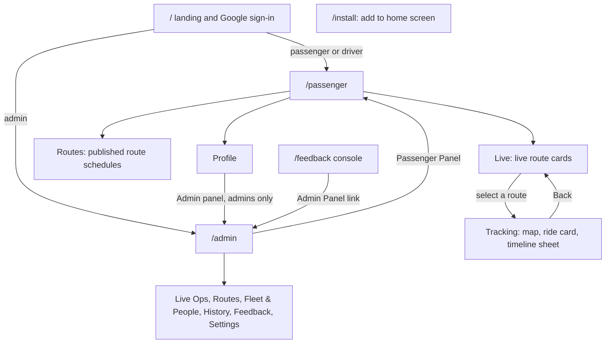

# Eki UI Design System

| Document ID | Version | Status | Last updated |
|---|---|---|---|
| EKI-UIX-001 | 3.1 | Current | 2026-11-11 |

## 1. Purpose

This reference lists the visual tokens, semantic colours, layout rules, screens, components and accessibility behaviour of the Eki web client in `frontend/`. Every value is copied from the source file named beside it; paths are relative to `frontend/src/` unless stated. Build, data access and sign-in are described in the [frontend package guide](../../frontend/README.md). Terms such as `liveBusHealth`, `atStopIndex` and `passed_unobserved` are defined in the [glossary](../GLOSSARY.md).

### 1.1 How styles are defined

| Mechanism | Detail |
|---|---|
| Tailwind CSS 4.3.3 | Loaded through `@tailwindcss/postcss` (`frontend/postcss.config.mjs`). `app/globals.css` begins with `@import "tailwindcss"` and then `@import "./brand-theme.css"`. |
| Design tokens | CSS custom properties on `:root` in `app/globals.css` (Section 2), re-tokened for the workspaces by `app/brand-theme.css` (Section 2.9). Components read them through inline styles, for example `style={{ color: "var(--text-secondary)" }}`, arbitrary values such as `bg-[var(--surface-0)]`, or the theme aliases. |
| Theme aliases | A `@theme inline` block maps the tokens to Tailwind utility names (Section 2.7). Admin components use the `ui-*` and `brand-*` utilities. |
| Workspace style sheets | `app/passenger/layout.tsx` imports `app/passenger/theme.css`, which defines the passenger `--pp-*` tokens (Section 2.10) and the semantic `pp-*` classes. `app/admin/layout.tsx` imports `app/admin/theme.css`, which holds the admin surface, dialog, Live Ops (Section 2.8) and corner rules. These rules are unlayered, so they outrank Tailwind utilities on the same element. |
| Palette classes and hex values | A few components keep Tailwind palette classes (`text-red-400` in the default `ConfirmModal` variants, `text-zinc-900` in the bus glyph) and literal colours for map markers and polylines (Section 3). |
| Themes | `app/globals.css` defines the original dark tokens on `:root`. The landing page, `/install` and the standalone `/feedback` console render neither workspace layout, so they keep them. `app/brand-theme.css` re-tokens the Passenger and Admin workspaces with the light Ahmedabad University palette (`:root:has(.passenger-layout, .admin-layout)`). The one dark exception inside those workspaces is Admin Live Ops (Section 2.8). There is no `prefers-color-scheme` rule. |
| `frontend/tailwind.config.ts` | Not loaded. Tailwind 4 reads a JavaScript configuration only through an `@config` directive [2], and `globals.css` has none. Its values (`brand.primary` `#0F4C81`, `brand.accent` `#F5A623`, the `transit` and `status` colours, the `glass`, `glow` and `premium` shadows, the `pulse-slow` animation and the font `var(--font-sora)`) do not reach the compiled CSS. |

## 2. Colour tokens

All tokens are defined in `app/globals.css`; Sections 2.1 to 2.6 list those default values, which render on the landing page, `/install` and the `/feedback` console. `app/brand-theme.css` overrides them for the Passenger and Admin workspaces (Section 2.9), `app/passenger/theme.css` adds the passenger surface tokens (Section 2.10), and Section 2.8 lists the Admin Live Ops dark scope. The Use columns give each token's role, which is the same under every palette.

### 2.1 Surfaces

| Token | Value | Use |
|---|---|---|
| `--surface-0` | `#09090b` | Page background (`body`, `bg-brand-dark`), map containers, `RoleGuard` screens, dark text on `.btn-primary`. |
| `--surface-1` | `#0f0f12` | Cards and dialogs (`ui-paper`), select fields and listboxes, the chat panel, the admin bus marker border and ID chip. |
| `--surface-2` | `#16161a` | Chat header and composer bars, `bg-brand-surface`. |
| `--surface-3` | `#1c1c21` | Soft and hover fills (`ui-soft`), other people's chat bubbles. |
| `--surface-4` | `#26262c` | Pressed fills (`ui-hover`), active listbox option, scrollbar thumb. |

### 2.2 Text

| Token | Value | Use |
|---|---|---|
| `--text-primary` | `#ECECEF` | Headings and body text (`ui-ink`); background of `.btn-primary`. |
| `--text-secondary` | `#94949C` | Supporting text (`ui-muted`), icons in neutral buttons. |
| `--text-tertiary` | `#8A8A93` | Metadata and labels (`ui-quiet`), field placeholders in the admin. |
| `--text-ghost` | `#8C8C96` | Chat timestamps and sender labels, the `RoleGuard` role line. It is slightly lighter than `--text-tertiary`, so size and weight carry the distinction. |

### 2.3 Accent

| Token | Value | Use |
|---|---|---|
| `--accent` | `#FA5D29` | Keyboard focus outline, the `brand-accent` utilities (buttons, active admin tab, links), own chat bubble, the `RoleGuard` **Return home** link. |
| `--accent-subtle` | `rgba(250, 93, 41, 0.12)` | Soft accent fills (`ui-accent-soft`), such as the active admin tab. |
| `--accent-glow` | `rgba(250, 93, 41, 0.25)` | Focus glow on fields. |

`globals.css` defines no `--accent-hover` or `--accent-contrast`; the `ui-accent-hover` and `ui-on-accent` aliases fall back to `--accent` and `#fff` (Section 2.7).

### 2.4 Borders

| Token | Value | Use |
|---|---|---|
| `--border-subtle` | `rgba(255, 255, 255, 0.06)` | Default border colour of every element (`* { border-color }`), `ui-line`. |
| `--border-default` | `rgba(255, 255, 255, 0.10)` | Field and control edges (`ui-control`), `border-thin`. |
| `--border-hover` | `rgba(255, 255, 255, 0.18)` | Only in `.eki-card:hover`; no component uses `.eki-card`. |

### 2.5 Status

| Token | Value | Use |
|---|---|---|
| `--status-live` | `#34D399` | Live and in-service text (`ui-success`), next-stop and at-stop markers, **On board**, the chat live dot. |
| `--status-live-bg` | `rgba(52, 211, 153, 0.10)` | "Waiting for the next bus" pill, live chips. |
| `--status-warning` | `#FBBF24` | Delayed and GPS-lost states (`ui-warning`), reroute notice, boarding check in progress, feedback word limit reached. |
| `--status-warning-bg` | `rgba(251, 191, 36, 0.10)` | Warning banners, chat-unavailable notice. |
| `--status-danger` | `#F87171` | Tracking lost, bus offline, errors (`ui-danger`), **Sign out** and **Delete account**. |
| `--status-danger-bg` | `rgba(248, 113, 113, 0.10)` | Danger banners, the icon tile of the unauthorized screen. |

### 2.6 Other properties

| Property | Value | Use |
|---|---|---|
| `--route-color` | `#3B82F6` | Declared for per-route colouring; no component reads it. |
| `--safe-area-top`, `--safe-area-bottom` | `env(safe-area-inset-top, 0px)`, `env(safe-area-inset-bottom, 0px)` | `.pt-safe`, `.pb-safe` and the bottom navigation clearance. |
| `--safe-area-left`, `--safe-area-right` | `env(safe-area-inset-left, 0px)`, `env(safe-area-inset-right, 0px)` | Keeps touch controls and text clear of landscape cut-outs. The artwork, map, sheets and tab bar still paint to the screen edges. |
| `--passenger-nav-height` | `81px`; `69px` on touch screens | Height of the passenger navigation above the safe area (Section 6.1). |
| `--transit-maroon`, `--transit-charcoal`, `--transit-gold`, `--transit-gray`, `--transit-paper` | `#801214`, `#434747`, `#ae9562`, `#939598`, `#f2efec` | Routes tab and passenger navigation base rules in `globals.css`. |
| `--schedule-canvas` to `--schedule-muted` | Dark greys from `#111113` to `#b6b5bc` | Routes tab base surfaces; `app/passenger/theme.css` maps them to the brand tokens (Section 2.10). |
| `--tracking-controls-inset` | Set at runtime by `components/maps/PassengerMap.tsx` | Height of the tracking header over the map; positions map notices and camera controls. |
| `--home-peek` | Set at runtime by `components/passenger/PassengerWorkspace.tsx` | Height of the phone Live routes sheet peek (Section 7.6). |

Radius tokens are listed in Section 6.2.

### 2.7 Tailwind theme aliases

The `@theme inline` block in `app/globals.css` defines:

| Theme variable | Resolves to | Example utility |
|---|---|---|
| `--color-ui-ink` | `var(--text-primary)` | `text-ui-ink` |
| `--color-ui-muted` | `var(--text-secondary)` | `text-ui-muted` |
| `--color-ui-quiet` | `var(--text-tertiary)` | `text-ui-quiet` |
| `--color-ui-paper` | `var(--surface-1)` | `bg-ui-paper` |
| `--color-ui-soft` | `var(--surface-3)` | `bg-ui-soft` |
| `--color-ui-hover` | `var(--surface-4)` | `bg-ui-hover` |
| `--color-ui-line` | `var(--border-subtle)` | `border-ui-line` |
| `--color-ui-control` | `var(--border-default)` | `border-ui-control` |
| `--color-ui-accent-soft` | `var(--accent-subtle)` | `bg-ui-accent-soft` |
| `--color-ui-accent-hover` | `var(--accent-hover, var(--accent))` | `hover:bg-ui-accent-hover` |
| `--color-ui-on-accent` | `var(--accent-contrast, #fff)` | `text-ui-on-accent` |
| `--color-ui-success`, `--color-ui-warning`, `--color-ui-danger` | `var(--status-live)`, `var(--status-warning)`, `var(--status-danger)` | `text-ui-success`, `bg-ui-warning/10`, `text-ui-danger` |
| `--color-brand-primary` | `var(--text-primary)` | `text-brand-primary` |
| `--color-brand-accent` | `var(--accent)` | `bg-brand-accent`, `focus-visible:outline-brand-accent` |
| `--color-brand-dark` | `var(--surface-0)` | `bg-brand-dark` |
| `--color-brand-surface` | `var(--surface-2)` | `bg-brand-surface/40` |
| `--color-brand-muted` | `var(--text-secondary)` | `text-brand-muted` |
| `--color-border-thin` | `var(--border-default)` | `border-border-thin` |
| `--color-status-active` | `var(--status-live)` | `bg-status-active` |
| `--color-status-idle` | `var(--status-warning)` | `bg-status-idle` |
| `--font-sans`, `--font-display` | `system-ui, -apple-system, "Segoe UI", sans-serif` | `font-sans` |
| `--radius-xl` | `var(--radius-lg)` | `rounded-xl` |

### 2.8 Admin Live Ops dark scope

Live Ops uses the original Eki warm blacks so that the panel separates clearly from the light Google Map; every other Admin tab keeps the light Ahmedabad University palette. `app/admin/theme.css` re-tokens the shared palette under `.admin-layout :is(.admin-live-ops, [data-tone="dark"])` and sets `color-scheme: dark`; the `brand-*` and `ui-*` utilities read the new values through `@theme inline`.

| Part | Hook | Dark when |
|---|---|---|
| Live Ops panel: map overlays, side column, fleet cards, bus markers, live details drawer and chat overlay | `.admin-live-ops` on the root of `components/admin/DashboardPanel.tsx` (`DashboardPanel.tsx:787`) | Always |
| Admin tab panel frame, including its loading and error states | `[role="tabpanel"][data-tone="dark"]` (`app/admin/page.tsx:130`) | Live Ops is the active tab |
| Admin tab bar | `.admin-navigation[data-tone="dark"]` (`app/admin/page.tsx:76`), a solid `#0f0f12` with no backdrop blur | Live Ops is the active tab |

| Token | Live Ops value | Note |
|---|---|---|
| `--surface-0` | `#09090b` | Panel and tab panel background |
| `--surface-1`, `--surface-2` | `#16161a` | Cards, map overlays, marker border and bus ID chip |
| `--surface-3`, `--surface-4` | `#1c1c21`, `#26262c` | Soft and hover fills |
| `--text-primary` | `#ececef` | 16.87:1 on `#09090b` |
| `--text-secondary` | `#c9c9cf` | Brighter than the default `#94949C` for readability |
| `--text-tertiary`, `--text-ghost` | `#b1b1b9` | Brighter than the default values |
| `--border-subtle`, `--border-default`, `--border-hover` | White at 12, 24 and 36 % | `--hairline` is white at 12 % |
| `--accent`, `--accent-hover` | `#b3262a`, `#9a1f23` | Buttons keep an AU Red fill at `#b3262a`, lighter than `#801214`, so the fill reaches 3.06:1 against `#09090b`; white text on it is 6.51:1 |
| `--accent-subtle`, `--accent-glow` | `--accent-text` at 12 % and 30 % | Selected tab and soft accent fills |
| `--accent-text` | `#f3a4a5` | AU Red tint for `text-brand-accent` text, the active-tab underline, the selected fleet card border, the `brand-accent` focus rings and outlines, and focused field borders and outlines; 10.10:1 on `#09090b`, 9.72:1 on `#0f0f12`, 9.16:1 on `#16161a`. AU Red `#801214` is 1.91:1 on `#09090b`, too dark for text, thin rules or focus indicators. |
| `--status-live`, `--status-warning`, `--status-danger` | `#34d399`, `#fbbf24`, `#f87171` | The default status colours; their `-bg` tokens are the same colours at 12 % |

`--accent-text` exists only inside this scope. Inside it, the global `:focus-visible` outline also takes `--accent-text`. `components/shared/MessagingPanel.tsx` reads `var(--accent-text, var(--accent))` for its sender labels, so the chat overlay uses the tint on black and AU Red elsewhere. Google's own map UI keeps its light scheme (`.admin-live-ops .gm-style { color-scheme: light; }`), and the map tiles stay light. The **End ride early?** confirmation is portalled outside the panel, so it keeps the light admin dialog style.

### 2.9 Ahmedabad University brand tokens

`app/brand-theme.css` sets these values on `:root:has(.passenger-layout, .admin-layout)` with `color-scheme: light`. Because the selector matches the root element, dialogs portalled to `document.body` inherit them. The file marks the status colours as outside the brand palette, pending sign-off by University Communications.

| Token | Value | Role |
|---|---|---|
| `--surface-0` | `#f2efec` | Off-white page (`bg-brand-dark`) |
| `--surface-1`, `--surface-2` | `#ffffff` | Cards, dialogs and fields (`ui-paper`) |
| `--surface-3` | `#f8f6f3` | Soft and hover fills (`ui-soft`) |
| `--surface-4` | `#ece8e3` | Pressed fills (`ui-hover`), avatar and chip backgrounds |
| `--accent` | `#801214` | AU Red: actions, links, the passenger route line, the active tab |
| `--accent-hover` | `#6a0f11` | Hover fill of AU Red buttons |
| `--accent-subtle` | `#f7e9e9` | The "Selected" route chip and accent timeline chips, the active admin tab, the **Center on bus** active fill, the route-ended icon tile |
| `--accent-glow` | `rgba(128, 18, 20, 0.18)` | 3 px focus glow on the feedback text box; the Routes search field sits on the AU Red header and takes a white glow instead (Section 4) |
| `--accent-contrast` | `#ffffff` | Text and glyphs on AU Red |
| `--decor-gold` | `#ae9562` | The short rule under the desktop Live routes heading; decoration only |
| `--announcement-bg` | `#f4eee2` | Declared; no rule reads it |
| `--text-primary` | `#434747` | Dark Grey headings and body text |
| `--text-secondary` | `#5c6060` | Supporting text |
| `--text-tertiary`, `--text-ghost` | `#626666` | Metadata; the lightest text colour in the palette |
| `--border-subtle` | `#e2ddd6` | Card edges and separators |
| `--border-default` | `#858789` | Field and control edges |
| `--border-hover` | `#5c6060` | Read only by `.eki-card:hover` |
| `--hairline` | `rgb(67 71 71 / 0.18)` | Half-pixel separators in grouped lists |
| `--status-live`, `--status-live-bg` | `#256b42`, `#e6f2ea` | Live and in-service states |
| `--status-warning`, `--status-warning-bg` | `#8c5a0b`, `#fbf0df` | Delayed, GPS-lost and reconnecting states |
| `--status-danger`, `--status-danger-bg` | `#b42318`, `#fbe9e7` | Lost and offline states, errors, destructive actions |
| `--route-color` | `#801214` | Declared; no rule reads it |
| `--route-passed` | `#939598` | AU Grey for passed stops and rail on the route timeline |
| `--font-ui` | `var(--font-roboto, "Roboto"), system-ui, -apple-system, "Segoe UI", sans-serif` | UI face (Section 5) |
| `--font-heading` | `var(--font-playfair, "Playfair Display"), Georgia, "Times New Roman", serif` | Heading face |
| `--brand-surface-gradient` | `linear-gradient(180deg, rgb(242 239 236 / 0.9), rgb(242 239 236 / 0))` | Admin tab bar and the passenger tracking header scrim |

`app/admin/theme.css` adds `--alert-surface: var(--surface-1)` for `AlertModal`.

### 2.10 Passenger surface tokens

`app/passenger/theme.css` defines these on `:root:has(.passenger-layout)`. Touch-only windows use the first value; `@media (any-pointer: fine)` sets the second where it differs.

| Token | Touch screens | Pointer devices | Use |
|---|---|---|---|
| `--pp-page` | `#f2efec` | Same | Workspace, tracking view and Profile background |
| `--pp-panel-bg`, `--pp-panel-border` | `#f2efec`, `0` | `#ffffff`, `1px solid #e2ddd6` | Live routes panel |
| `--pp-panel-radius` | `22px` (top corners) | `24px` | Live routes panel |
| `--pp-title-size` | `2.125rem` | `2rem` | `.pp-title` screen titles |
| `--pp-card-bg`, `--pp-card-border`, `--pp-card-radius` | `#ffffff`, `0`, `12px` | `#ffffff`, `1px solid #e2ddd6`, `14px` | Route cards, announcement and empty state |
| `--pp-group-radius` | `12px` | Same | The grouped route list on phones |
| `--pp-route-font`, `--pp-route-weight`, `--pp-route-size` | `var(--font-ui)`, `500`, `1.0625rem` | `var(--font-heading)`, `600`, `1.375rem` | Route card title (Section 5) |
| `--pp-nav-bg`, `--pp-nav-border`, `--pp-nav-filter` | `rgb(249 248 246 / 0.94)`, `0.5px solid rgb(67 71 71 / 0.3)`, `blur(20px) saturate(180%)` | Same | Tab bar |
| `--pp-nav-fg`, `--pp-nav-active-fg` | `#5c6060`, `#801214` | Same | Tab labels and icons |
| `--pp-float-bg`, `--pp-float-border`, `--pp-float-radius` | `rgb(255 255 255 / 0.92)`, `0.5px solid rgb(67 71 71 / 0.18)`, `14px` | Same | Ride card, map notices, back, map and chat buttons |
| `--pp-sheet-bg`, `--pp-sheet-radius` | `rgb(249 248 246 / 0.96)`, `14px` | Same | Route timeline sheet |
| `--pp-dialog-bg`, `--pp-dialog-radius` | `#f2efec`, `14px` | `#ffffff`, `20px` | Feedback and confirmation dialogs |
| `--pp-scrim` | `rgb(0 0 0 / 0.32)` | `rgb(67 71 71 / 0.4)` | Dialog and sheet backdrops |
| `--pp-art-scrim` | `linear-gradient(180deg, rgb(0 0 0 / 0) 45%, rgb(0 0 0 / 0.18) 100%)` | Same | Shade over the passenger artwork |
| `--pp-button-radius`, `--pp-input-bg` | `12px`, `#ffffff` | Same | `.pp-btn-primary`, `.pp-btn-secondary`, text fields |

The same file maps the Routes tab tokens to the palette: `--schedule-canvas` and `--schedule-page` to `--pp-page`, `--schedule-surface` to `--surface-1`, `--schedule-raised` to `--surface-3`, `--schedule-border` to `#434747`, `--schedule-badge-border` to `--accent`, `--schedule-control-border` to `--border-default` and `--schedule-muted` to `--text-secondary`.

The two passenger buttons are `.pp-btn-primary` (AU Red fill, white text, `--accent-hover` on hover) and `.pp-btn-secondary` (white fill with a 1 px `--text-primary` border); both are at least 44 px high with 15 px Bold text and a 12 px radius.

## 3. Semantic colours

Values in this section are those of the Passenger and Admin workspaces, which use the tokens in Sections 2.8 to 2.10.

### 3.1 Live bus health

`lib/liveBusHealth.ts` gives each bus one `liveBusHealth` state. The tracking header, map notice, bus marker, ETAs and boarding all read it. The states, thresholds (12 s and 30 s) and the deadline clock are specified in [tracking algorithms](TRACKING_ALGORITHMS.md#9-live-bus-health); this section gives their presentation.

| State | Condition, checked in this order | Title | Tone | Map notice | Passenger bus marker |
|---|---|---|---|---|---|
| `offline` | `deviceState` is `offline`. | Bus offline | danger | Title and icon `--status-danger`, border `--status-danger` at 35 % | `#8c5a0b`, no heading pointer, grey edge `#626666` |
| `gnss_lost` | `signalState` is `gnss_lost` or `motionState` is `uncertain`. | GPS signal lost | warning | Title and icon `--status-warning`, border `--status-warning` at 35 % | Same as `offline` |
| `lost` | No valid receipt, or the last receipt is more than 30 s old. | Live tracking lost | danger | As `offline` | Same as `offline` |
| `delayed` | The last receipt is more than 12 s old. | Updates delayed | warning | As `gnss_lost` | `#8c5a0b` with heading pointer |
| `live` | Otherwise. | Live | live | None | Colour by motion (Section 3.5) |

The map notice (`.pp-notice`) shows the worst state among the displayed buses: a `WifiOff` icon, the title in weight 500 and a one-line summary in `--text-secondary`, on the translucent `--pp-float-bg` surface. A bus is trackable only in `live` or `delayed` while live data is connected. For any other state the map hides that bus's heading pointer and never shows "Bus is here" for it. When no displayed bus is trackable, stop estimates read "GPS signal lost" or "Live tracking lost" instead of minutes.

### 3.2 Tracking header

The ride card at the top of the tracking view (`components/passenger/PassengerBoardingView.tsx`, `components/passenger/PassengerWorkspace.tsx`) is a `.pp-float-card`: `--pp-float-bg`, a 0.5 px hairline border, a 14 px radius and a 20 px backdrop blur. It shows these texts:

| Element | Text | Colour |
|---|---|---|
| Status line, in service and `live` | `Ride in service · Live` | `--status-live` |
| Status line, `delayed` | `Ride in service · Updates delayed · 14 s ago` | `--status-warning` |
| Status line, `gnss_lost` | `Ride in service · GPS signal lost` | `--status-warning` |
| Status line, `lost` or `offline` | `Ride in service · Live tracking lost` or `· Bus offline` | `--status-danger` |
| Status line, armed before stop 1 | `Ride armed · awaiting stop 1 · <title>` | `--status-warning`, or `--status-danger` for `lost` and `offline` |
| Progress line | `At <stop> · Next: <stop>`; a part is left out when unknown | `--text-primary` |
| Boarding blocked notice | Health title, "Tracking paused" or "Live tracking paused", with a detail line | Title `--status-danger` for danger tone, otherwise `--status-warning`; detail `--text-secondary` |
| Live location without ride direction | "Direction pending" or "Bus online · service not started" | `--accent` |
| No live bus | "Waiting for live bus data…" above the route name (Playfair Display, 18 px, weight 600) | `--accent` |

The status line (`.pp-status-title`) and the progress line are 13 px; the status line has weight 500. Both sit in a `role="status"` region with `aria-live="polite"`.

The blocked notice names the connection only while the realtime socket is disconnected ("This device is reconnecting to live bus data. The last known location is shown; live ETAs and boarding resume when the connection returns."). While the client is connected but waiting for the live projection, or after a data error, it reads "Live bus data is not available right now." The reconnect banner likewise appears only while the socket is disconnected, and the empty Live routes panel says "Unable to reach live data. Check your connection." only then. While connected but resuming, or after a data error, the panel shows the same "not available" text, and otherwise the configured service start message.

### 3.3 Stop states

`lib/stopProgress.ts` derives each stop's state from backend progress only (`currentStopIndex`, `atStopIndex`, `unobservedStopIndices`); proximity, ETA or the animated marker never mark a stop. The backend rules are in [tracking algorithms](TRACKING_ALGORITHMS.md#7-stop-progression). Map markers are drawn in `components/maps/PassengerMap.tsx` with the `.pp-stop-dot` class; the timeline in `components/passenger/RouteTimelineSheet.tsx`.

| State | Meaning | Map marker | Timeline | Label |
|---|---|---|---|---|
| `at` | The bus is at this stop now. | Fill `--status-live`, z-index 30, label chip `At <stop>` | Dot `--status-live` with a 3 px ring of `--status-live` at 25 %, row on `--status-live-bg` with a 2 px `--status-live` left border | "Bus is here" |
| `next` | The stop the bus reaches next. | Fill `--accent`, label chip with the stop name | As `at` | "Next stop" |
| `upcoming` | A later stop. | Fill `--accent` | Dot `#801214` on a rail of `#801214` at 25 % alpha | none |
| `passed` | Passed with an observed arrival. | Fill `--text-tertiary` with a white tick badge, label chip `<stop> · Passed` | Dot and rail `--route-passed`, stop name `--text-tertiary` | "Passed" |
| `unobserved` | Passed without the bus being seen there. | As `passed`, with a dashed white border | As `passed` | "Passed · not confirmed" |

Each map marker is a 24 px circle with a 2 px white border and the stop letter (`lib/stopLabel.ts`: A to Z, then AA) in 12 px bold white, inside a 44 px button. The selected destination has a 2 px `--text-primary` outline. On the timeline its dot gets a 3 px `--accent-subtle` ring and the row carries a "Selected stop", "Boarding stop" or "Destination" chip in `--accent` on `--accent-subtle`. Map label chips (`.pp-stop-label`) are white with a `--border-subtle` border, an 8 px radius and 12 px `--text-primary` text. An ETA above 0 and at most 2 min is shown in `--status-live`; 0 reads "Due".

### 3.4 Route polylines

`components/maps/DirectionsRoute.tsx` draws each road as stacked Google Maps polylines. The passenger map passes the Ahmedabad University palette (`ROUTE_PALETTE` in `PassengerMap.tsx`); the admin route editor uses the default palette.

| Layer | Colour | Weight with buses / without | Opacity with / without | z-index |
|---|---|---|---|---|
| Casing | Passenger `#ffffff`; route editor `#09090b` | 9 / 7 px | Passenger 0.95; default 0.72 / 0.5 | 20 |
| Road | Passenger `#801214`; route editor the route colour, default `#3b82f6` | 5 / 3 px | 1 / 0.8 | 21 |
| Covered road | Passenger `#939598`; default `#71717a` | 5 / 3 px | 1 | 22 |
| Active leg to the next stop | Passenger `#801214`; default `#3b82f6` | 5 / 3 px | 1 | 23 |

The live view is the passenger map during a ride, which passes backend stop indices; the admin Live Ops map draws no route. With one bus and a confident match (confidence at least 0.7 on the current geometry version), the active leg is split at the bus, so road behind it is AU Grey and road ahead is AU Red. A fleet with several buses shows each active leg without a covered section.

The route editor offers eight route colours (`components/admin/RouteManagementPanel.tsx`): `#3B82F6`, `#10B981`, `#F59E0B`, `#EF4444`, `#8B5CF6`, `#EC4899`, `#14B8A6`, `#F97316`. New routes start with `#3B82F6`. The route colour appears in the admin route list swatch, editor stop markers, the editor road and the admin Passenger Routes cards. The passenger workspace draws every route, timeline and line badge in AU Red.

### 3.5 Bus markers

Passenger marker (`components/maps/BusPositionGlyph.tsx`, colour chosen in `components/maps/PassengerMap.tsx`): a 44 px container holding a 32 px white rounded box with a `zinc-300` border, a `BusFront` icon in `zinc-900` and a 3 px coloured bottom edge. A triangular heading pointer (fill colour, 2 px white stroke) rotates around the box. The heading updates only while the bus is moving at 3 km/h or more and the device is online.

| Condition | Colour | Pointer | Bottom edge |
|---|---|---|---|
| Live, moving | `#801214` | Shown | `#801214` |
| Live, stopped | `#8c5a0b` | Shown | `#8c5a0b` |
| `delayed` | `#8c5a0b` | Shown | `#8c5a0b` |
| Not trackable, approximate position, or device not online | `#8c5a0b` | Hidden | `#626666` |

The glyph has `role="img"` and an `aria-label` made of the bus ID and its state, for example "GPS signal lost, last known location" or "updates delayed". The marker sits at z-index 40 and animates between fixes (Section 8.3).

Admin marker (`components/admin/DashboardPanel.tsx`): a 36 px circle with a 3 px `--surface-1` border (`#16161a` in the Live Ops dark scope, Section 2.8), dashed when the position is approximate, a `Navigation2` icon in `#09090b` rotated to the heading, and a 12 px bold bus ID chip below in `--text-primary` on `--surface-1`.

| Condition | Fill |
|---|---|
| In live service and moving | `#34D399` |
| In live service and not moving | `#FBBF24` |
| Paused (session kept, receiver offline or silent for more than 30 s), device not online, or motion uncertain | `#FB923C` |
| Otherwise | `#94949C` |

### 3.6 Admin ride states

Fleet cards in Live Ops (`components/admin/DashboardPanel.tsx`) show a status tile, dot and label. The utilities resolve to the Live Ops dark scope (Section 2.8), where `text-brand-accent` takes `--accent-text`.

| Label | Text | Tile | Dot |
|---|---|---|---|
| In Service | `text-ui-success` | `bg-ui-success/10` | `bg-ui-success` |
| Awaiting Stop 1 | `text-ui-muted` | `bg-ui-soft` | `bg-ui-hover` |
| Direction Pending | `text-ui-warning` | `bg-ui-warning/10` | `bg-ui-warning` |
| Service paused, Tracking paused, Assignment required, Awaiting return service | `text-ui-warning` | `bg-ui-warning/10` | `bg-ui-warning` |
| Completed | `text-brand-accent` | `bg-brand-accent/10` | `bg-brand-accent` |
| Service setup pending | `text-ui-quiet` | `bg-ui-soft` | `bg-ui-hover` |
| Offline | `text-ui-quiet` | `bg-ui-soft` | `bg-ui-hover` |

The dot pulses while an online bus is moving. "Service paused" replaces the trip state when a ride's device is offline or its last receipt is more than 30 s old. Motion chips: Moving `text-ui-success`; Stopped and Motion uncertain `text-ui-warning`. "Live location updates delayed", "Last seen <age>" and `+<n>m delay` use `text-ui-warning`. The stats row uses `text-ui-success` (In Service), `text-ui-muted` (Awaiting Start), `text-ui-warning` (Direction Pending), `text-brand-accent` (Devices Online) and `text-ui-warning` (Offline / Unknown). The route progress bar is `bg-ui-success` on `bg-ui-soft`.

### 3.7 Alerts, dialogs and results

| Element | Colours | Source |
|---|---|---|
| Passenger reconnect banner | `.pp-banner` with warning tone: `--status-warning-bg` fill, border `--status-warning` at 30 %, `WifiOff` in `--status-warning`, text `--text-primary`. It reads "Connecting to live bus data…" before the first connection and "Reconnecting to live bus data…" after a drop. | `components/passenger/PassengerWorkspace.tsx`, `app/passenger/theme.css` |
| Passenger ride-recovery notice | `.pp-banner` with warning tone and an `Info` icon | same |
| Passenger error banner | `.pp-banner` with danger tone: `--status-danger-bg` fill, border `--status-danger` at 30 %, title in weight 500 ("Routes could not be loaded." or "Live bus data is unavailable."), detail in `--text-secondary`, **Retry** as `.pp-btn-secondary` | same; the Routes tab error "Route schedules could not be loaded." has its own **Retry** (`components/passenger/RoutesTab.tsx`) |
| Admin Passenger Routes notices | Deleted-route notice `text-ui-warning` on `bg-ui-warning/10` with `border-ui-warning/20`; load errors `text-ui-danger`; an invalid stop time gives the input a `--status-danger` border and a `text-ui-danger` message ("Time required" or "Enter a valid time") | `components/admin/PassengerRoutesSettings.tsx` |
| Reroute notice | `.pp-notice` with warning tone: title and icon `--status-warning`, border `--status-warning` at 35 % | `components/maps/PassengerMap.tsx` |
| Location notices | `.pp-notice` without tone: `--text-primary` on `--pp-float-bg`, icon `--text-secondary`. Before the browser prompt, "Show your walking time?" explains location use and offers **Allow location** (`.pp-btn-primary`) and **Not now** (`.pp-btn-secondary`). | same |
| Announcement | `.pp-announcement`: `--text-primary` on the white card surface, a `Megaphone` on a 30 px AU Red tile, `role="note"`; a `--border-subtle` border on pointer devices | `components/passenger/PassengerWorkspace.tsx`, `app/passenger/theme.css` |
| Admin map overlays | `text-ui-warning` or `text-ui-danger` on `bg-ui-paper` with a matching `/20` border, in the Live Ops dark scope | `components/admin/DashboardPanel.tsx` |
| `ConfirmModal` in the workspaces | Both `theme.css` files restyle the dialog: an `--accent` icon tile with a white glyph (`--status-danger` for the danger variant), an `--accent` confirm button (`--status-danger` for danger) and a **Cancel** button with a 1 px `--text-primary` border, both at least 44 px high. Passenger: `--pp-dialog-bg`, `--pp-scrim` backdrop, title in the UI face at 17 px Bold. Admin: a white dialog with a 20 px radius, title in Playfair Display 600 at 20 px. | `app/passenger/theme.css`, `app/admin/theme.css` |
| `ConfirmModal` default style | Outside the workspaces, for example the `/feedback` unauthorized screen: danger icon `text-red-400` on `bg-red-500/10` with a `bg-red-500` button and white text; warning `text-amber-400` with `bg-amber-500` and `text-slate-950`; info `text-blue-400` with `bg-blue-500`. Dialog surface `rgba(18, 20, 29, 0.98)`, `border-white/10`, backdrop `bg-black/70` with `backdrop-blur-sm`. | `components/ui/ConfirmModal.tsx` |
| `AlertModal` | Admin only. `app/admin/theme.css` gives it the admin dialog style with an AU Red **OK** button and icon colours `--status-danger`, `--status-warning` and `--accent` for error, warning and info. | `components/ui/AlertModal.tsx`, `app/admin/theme.css` |
| Success | **On board** in `--status-live`; "Messages cleared" in `text-ui-success` | boarding card, live details drawer |
| Inline errors | `--status-danger` with `role="alert"`; the Profile sign-in error uses a danger `.pp-banner` | boarding card, profile |
| Feedback console cards | Same patterns as History, Fleet and Live Ops: separate `rounded-2xl` `bg-ui-paper` cards (`border-brand-accent/40` when new) with a whole-row toggle (`hover:bg-ui-soft`), a 36 px status-tinted icon tile (new AU Red, reviewed `ui-warning`, resolved `ui-success` at 10 to 15 %), tinted `rounded-full` status pills, a `bg-ui-soft` expanded body with `rounded-xl` detail tiles, and **reviewed** (secondary) / **resolved** (primary AU Red) buttons | `components/admin/FeedbackPanel.tsx` |

### 3.8 Other literal colours

| Value | Use | Source |
|---|---|---|
| `rgb(0 0 0 / 40%)` | Shade over the landing artwork | `app/globals.css` (`.transit-artwork-shade`) |
| `--pp-art-scrim` | Shade over the passenger artwork: clear to 45 %, then black at up to 18 % | `app/passenger/theme.css` |
| `rgba(22, 22, 26, 0.98)`, border `rgba(255, 255, 255, 0.15)` | Base passenger navigation frame in `globals.css`; inside the passenger layout `--pp-nav-bg` and `--pp-nav-border` replace it | `app/globals.css` |
| `#c9c3bb` | Grabbers on the phone Live routes sheet, the route timeline sheet and phone dialogs | `app/passenger/theme.css` |
| `#e3dfda`, `#d6d1ca` on hover, icon `#5c6060` | 30 px circle inside the 44 px dialog close button | same |
| White, white at 86 % | Text on AU Red: Routes headers, the Profile account card and its email, the Routes header description | same |
| `#434747`, `#ffffff` | Routes timetable rail (4 px) and stop circles; first and last stops are filled `--accent` | same |
| `--accent-contrast, #1a1a1a` on `--accent` | Own chat bubble text: white in the workspaces, `#1a1a1a` only if `--accent-contrast` is undefined | `components/shared/MessagingPanel.tsx` |
| `--accent` | Filled rating stars; empty stars are outlined in `--border-default` | `app/passenger/theme.css` (`.pp-star`) |
| `#94a3b8` | Route colour shown when a route has none, admin Passenger Routes | `components/admin/PassengerRoutesSettings.tsx` |
| `accent-emerald-500` | Route checkboxes in admin Passenger Routes | same |
| `#b3262a` | **Install Eki** and **Copy link** buttons | `app/install/InstallClient.tsx` |
| `#f2efec` | Passenger map background colour while tiles load | `components/maps/PassengerMap.tsx` |
| `bg-black`, `text-white` | Landing page | `app/page.tsx` |

## 4. Contrast

Ratios follow the WCAG 2.2 relative luminance formula [1]. Tailwind palette colours were converted from the OKLCH values in `node_modules/tailwindcss/theme.css` to sRGB, and translucent colours were composited over the stated background. AA requires 4.5:1 for text, 3:1 for large text (24 px, or 18.66 px bold) under SC 1.4.3, and 3:1 for user-interface graphics under SC 1.4.11. The first group uses the default tokens (landing page, `/install`, `/feedback`); the second uses the Ahmedabad University tokens of the Passenger and Admin workspaces. Live Ops ratios are in Section 2.8.

| Foreground on background | Where | Ratio | AA |
|---|---|---|---|
| `--text-primary` on `--surface-0` | Default palette body text | 16.87 | Pass |
| `--text-secondary` on `--surface-0` | `/install` description, supporting text | 6.61 | Pass |
| `--text-secondary` on `--surface-1` | `/feedback` supporting text (`ui-muted` on `ui-paper`) | 6.36 | Pass |
| `--text-tertiary` on `--surface-1` | `/feedback` metadata (`ui-quiet` on `ui-paper`) | 5.59 | Pass |
| `--surface-0` on `--text-primary` | `.btn-primary` | 16.87 | Pass |
| `--accent` outline on `--surface-0` | Default focus outline | 6.31 | Pass (non-text) |
| `white` on `#b3262a` | `/install` buttons, 16 px semibold | 6.51 | Pass |
| `white` on `red-500` | Default danger dialog button, 12 px semibold | 3.82 | Fail |
| `--text-primary` on `--pp-page` (`#f2efec`) | Passenger page text, Live routes title | 8.22 | Pass |
| `--text-primary` on `#ffffff` | Card and admin body text, map stop label chip | 9.41 | Pass |
| `--text-primary` on `--pp-float-bg` over black | Ride card and notices, worst case | 7.87 | Pass |
| `--text-primary` on `--status-warning-bg` | Reconnect banner text | 8.35 | Pass |
| `--text-secondary` on `#f2efec` | Live routes date and subtitle | 5.56 | Pass |
| `--text-secondary` on `#ffffff` | Card details, dialog text | 6.37 | Pass |
| `--text-tertiary` on `#ffffff` | Route card metadata, admin labels (`ui-quiet`), placeholders | 5.81 | Pass |
| `--text-tertiary` on `#f2efec` | Worst case for metadata text on the off-white page | 5.08 | Pass |
| `--pp-nav-fg` on the tab bar (`#f9f8f6`) | Inactive passenger tab, inactive admin tab (`ui-muted`) | 6.00 | Pass |
| `--accent` on `#ffffff` | Links, route card action | 10.42 | Pass |
| `--accent` on the tab bar (`#f9f8f6`) | Active passenger tab | 9.82 | Pass |
| `--accent` on `--accent-subtle` | "Selected" route chip, accent timeline chips, active admin tab label | 8.83 | Pass |
| `white` on `--accent` | Buttons, Routes headers, Profile card, upcoming stop letters (12 px bold) | 10.42 | Pass |
| White at 86 % on `--accent` | Routes header description, Profile email | 7.99 | Pass |
| `--status-live` on `#ffffff` | Live status line, **On board**, ETA due soon | 6.44 | Pass |
| `--status-live` on `--status-live-bg` | "Waiting for the next bus" pill, live chips | 5.60 | Pass |
| `--status-warning` on `#ffffff` | Warning status lines and notice titles | 5.86 | Pass |
| `ui-warning` on `ui-warning/10` | Admin deleted-route notice | 5.10 | Pass |
| `--status-danger` on `#ffffff` | Errors, **Sign out** and **Delete account** labels | 6.57 | Pass |
| `--status-danger` on `--status-danger-bg` | Error banner icon | 5.61 | Pass (non-text) |
| `--text-primary` on `--status-danger-bg` | Error banner text | 8.03 | Pass |
| `white` on `--status-danger` | Danger glyph tiles, danger confirm button | 6.57 | Pass |
| `white` on `--status-live` | At-stop letter, 12 px bold | 6.44 | Pass |
| `white` on `--text-tertiary` | Passed-stop letter, 12 px bold | 5.81 | Pass |
| `--border-default` on `#ffffff` | Field and control edges | 3.61 | Pass (non-text) |
| `--border-default` on `#f2efec` | Control edges on the page | 3.15 | Pass (non-text) |
| `--accent` outline on `#f2efec` | Focus outline | 9.10 | Pass (non-text) |
| White at 45 % ring on `--accent` | Focused search field on the Routes header | 3.12 | Pass (non-text) |
| `#801214` and `#8c5a0b` pointer on its white stroke | Bus heading pointer | 10.42, 5.86 | Pass (non-text) |
| `#801214` and `#939598` road on the white casing | Road and covered road | 10.42, 3.00 | Pass (non-text) |

## 5. Typography

| Property | Value | Source |
|---|---|---|
| Web fonts | Roboto (weights 400, 500 and 700) and Playfair Display (600 and 700), loaded with `next/font/google` and self-hosted at build time, so the CSP needs no font origin. The root `<html>` element carries their variables `--font-roboto` and `--font-playfair`. | `app/layout.tsx` |
| Workspace faces | `--font-ui` (Roboto, then the system stack) for body text and controls; `--font-heading` (Playfair Display, then Georgia) for screen titles, Routes headers, the desktop route card title, the tracking route name and admin `h1` to `h3`. Letter spacing is `normal`. | `app/brand-theme.css`, `app/passenger/theme.css`, `app/admin/theme.css` |
| Default face | `system-ui, -apple-system, "Segoe UI", sans-serif` (`--font-sans` and `--font-display`) on the landing page, `/install` and `/feedback`, with `letter-spacing: -0.01em`. The "TYPOGRAPHY SYSTEM (SORA)" comment in `globals.css` is not backed by a loaded Sora font. | `app/globals.css` |
| Body | Antialiased, Tailwind default line height 1.5 | `app/globals.css` |
| Numerals | `tabular-nums` for ETAs, speeds, counts, delays, dates, stop times and coordinates | components, `app/passenger/theme.css` |
| Weights | Passenger labels and Profile rows use Roboto Medium (500); the Profile name, the role chip and the `.pp-btn-*` buttons use Bold (700), the heaviest Roboto weight loaded. Admin components also request 600 (`font-semibold`) and 800 (`font-extrabold`), which the browser renders with the 700 face. | `app/passenger/theme.css`, components |

Tailwind size utilities keep their defaults: `text-xs` 12/16 px, `text-sm` 14/20 px, `text-lg` 18/28 px, `text-xl` 20/28 px, `text-2xl` 24/32 px, `text-3xl` 30/36 px. The passenger theme keeps text at 12 px or larger, and the admin components use no size below `text-xs`.

| Role | Face | Size | Weight | Line height | Example |
|---|---|---|---|---|---|
| Landing headline | System | 28 to 96 px, sized by viewport width and height | 900 | 1.05 | "Track your campus bus" |
| Passenger screen title (`.pp-title`) | Playfair Display | 34 px on touch screens, 32 px on pointer devices; the Live routes title is 24 px on touch screens at most 480 px tall | 700 | 1.08 | "Live routes", "Profile" |
| Routes headers | Playfair Display | 30 px list title, 22 px timetable title | 700 | 1.2 | "Routes", route name |
| Routes rows and stops | UI | 14 px route name, 15 px stop name, 13 px time with `tabular-nums` | 650 / 600 / 400 | 1.5 | "Central Library", "Scheduled 7:38 am" |
| Route card title, touch screens | UI | 17 px | 500 | 1.25 | Route name |
| Route card title, pointer devices | Playfair Display | 18 px (`globals.css` `.passenger-live-route-card h3` outranks `--pp-route-size`) | 600 | 1.25 | Route name |
| Body and descriptions | UI | 15 px | 400 | 1.4 to 1.45 | Live routes subtitle, route endpoints |
| Date kicker and metadata | UI | 13 px | 500 | 1.5 | "Saturday, 7 November", "6 stops · 18 min route" |
| Profile rows | UI | 16 px | 500 | 1.5 | "Send feedback" |
| Profile name | UI | 20 px | 700 | 1.25 | Account name |
| Buttons (`.pp-btn-*`) | UI | 15 px; 17 px for the feedback submit button | 700 | 1.2 | **Board** |
| Bottom navigation label | UI | 12 px | 500, active 700 | 1.5 | "Live", "Routes", "Profile" |
| Tracking status line | UI | 13 px | 500 | 1.5 | `Ride in service · Live` |
| Timeline stop name | UI | 15 px (next or selected), otherwise 14 px | 500 / 400 | 1.5 | Stop name |
| ETA | UI | 18 px with `tabular-nums` | 700 | 1.5 | Minutes, or "Due" |
| Admin section heading | Playfair Display | 18 to 20 px | 600 | 28 px | "Ride History", "Settings" |
| Admin labels | UI | 12 px uppercase, `tracking-wide` to `tracking-widest` | 700 | 16 px | "Live Fleet", "Next stop" |
| Passenger dialog title | UI | 17 px; 24 px Playfair Display 600 for the feedback confirmation | 500; 700 for confirmation dialogs | 1.25; 1.375 for confirmation dialogs | "Send feedback", "Sign out?" |
| Admin dialog title and text | Playfair Display / UI | 20 px / 14 px | 600 / 400 | 1.375 / 1.625 | "End ride early?" |

`app/globals.css` also defines named text classes (`.text-display-hero`, `.text-title-screen`, `.text-heading-section`, `.text-route-name`, `.text-station-name`, `.text-important-number`, `.text-card-title`, `.text-body-primary`, `.text-body-secondary`, `.text-label`, `.text-btn-primary`, `.text-btn-secondary`, `.text-nav-active`, `.text-nav-inactive`, `.text-chip`, `.text-metadata`). No component uses them.

## 6. Spacing, radii, elevation and layers

### 6.1 Spacing and layout constants

Spacing uses the Tailwind 4 default unit `--spacing: 0.25rem` (4 px); the project defines no custom scale. Common values: a 16 px side gutter (`px-4`, `mx-4`, `left-4`), 12 px card padding (`p-3`), 8 px gaps (`gap-2`) and a 24 px admin gutter from `sm` (`sm:px-6`).

| Constant | Value | Source |
|---|---|---|
| `--passenger-nav-height` | 81 px on pointer devices (the floating dock: a 64 px bar 16 px above the edge, plus 1 px); 69 px on touch screens (a 68 px bar plus a 1 px edge) | `app/globals.css` |
| `PASSENGER_NAV_HEIGHT_PX` | 81, the fallback for `--passenger-nav-height` | `components/passenger/passengerFrame.ts` |
| `passengerNavClearance` | `calc(var(--passenger-nav-height, 81px) + var(--safe-area-bottom))`; bottom of the timeline sheet and chat overlay | same |
| Live routes panel bottom | Touch screens: on the tab bar (`--passenger-home-panel-bottom` is the navigation height plus the safe area). Pointer devices: 0, inside the `calc(97px + var(--safe-area-bottom))` bottom padding of `.passenger-home`. `PASSENGER_PANEL_NAV_GAP_PX` (29) and `--passenger-panel-nav-gap` apply only when `--passenger-home-panel-bottom` is unset. | `app/passenger/theme.css`, `app/globals.css`, `passengerFrame.ts` |
| Home top spacer (artwork band) | `34vh`, at least `min(250px, 20dvh)`; pointer devices `clamp(24px, calc(22dvh - 64px), 144px)` with no minimum; touch screens at most 480 px tall 1 rem, at most 360 px tall 0.5 rem | `passengerFrame.ts`, `app/globals.css` |
| Phone sheet peek | Measured `--home-peek` (panel top to the end of the heading); fallback `--home-peek-fallback` 7.375 rem | `PassengerWorkspace.tsx`, `app/passenger/theme.css` |
| Desktop Live routes panel | `min(42rem, calc(100% - 2rem))` wide, at least 12 rem tall | `app/globals.css` |
| Desktop dock | At most 28 rem wide, 1 rem from each side, 16 px above the bottom edge | same |
| Profile column | At most 32 rem wide, 24 px between blocks, 20 px side padding | `app/passenger/theme.css` |
| Routes tab | At most 70 rem wide; from 64 rem on pointer devices a 21 rem list beside the timetable | `app/globals.css` |
| App shell height | `100dvh` for passenger and admin | `app/passenger/layout.tsx`, `app/admin/page.tsx` |
| Tracking header width | At most 512 px (`max-w-lg`), centred | `components/passenger/PassengerWorkspace.tsx` |
| Admin tab bar width | At most 1280 px (`max-w-7xl`) | `app/admin/page.tsx` |
| Map fit padding | Top: the larger of 32 px and header height plus 24 px. Bottom: timeline sheet overlap plus 24 px, at most 65 % of the map height. Sides: 32 px. | `components/maps/PassengerMap.tsx` |
| Map zoom | Passenger default 15, following a bus 16; admin default 12, 15 when centring a bus | `PassengerMap.tsx`, `DashboardPanel.tsx` |

Short touch screens, at most 480 px tall without a fine pointer (landscape phones), get a compact home in `app/globals.css` and `app/passenger/theme.css`. Besides the spacer above, the panel's top padding drops to 1 rem, the title to 24 px and the date and subtitle to 13 px, hidden at 360 px tall or less. The route list's bottom padding drops from 128 px to 8 px. Together these leave room in the panel for at least one route card. Pointer-equipped `(any-pointer: fine)` windows keep their own centred desktop layout at every height. On any screen at most 480 px tall, the tracking header (back button, ride card and chat button) is hidden while the route timeline sheet is open, because the open sheet reaches it and the header would cover the sheet's handle.

### 6.2 Radii

`app/globals.css` defines radius tokens on `:root` outside any cascade layer. Tailwind writes its own defaults inside `@layer theme`, and unlayered declarations win, so the project values replace the Tailwind defaults.

| Token | Value | Utilities that resolve to it |
|---|---|---|
| `--radius-sm` | 8 px | `rounded-sm` |
| `--radius-md` | 12 px | `rounded-md` |
| `--radius-lg` | 16 px | `rounded-lg`, and `rounded-xl` through the `--radius-xl` alias |
| `--radius-xl` | 20 px | `.eki-card` only (unused) |
| `--radius-2xl` | 24 px | `rounded-2xl` |
| `--radius-pill` | 999 px | `.btn-primary` |

`rounded-3xl` keeps the Tailwind default of 1.5 rem (24 px). Passenger radii come from `app/passenger/theme.css`: the Live routes panel 22 px at the top on touch screens and 24 px on pointer devices; route cards 14 px on pointer devices, while on phones the grouped route list rounds at 12 px and the cards inside it are square; the announcement and empty state 12 px on phones and 14 px on pointer devices; the ride card, notices, map buttons and timeline sheet 14 px; buttons 12 px; dialogs 14 px on touch screens and 20 px on pointer devices; navigation buttons 16 px. The navigation frame is square on touch screens and has a 22 px radius in the desktop dock.

**Admin continuous corners.** The admin panel and its dialogs use Apple's continuous corner curve (`CALayer` `.continuous`, the SwiftUI default) instead of circular arcs. Inside `@supports (corner-shape: superellipse(1.7))`, `app/admin/theme.css` multiplies the radius tokens (and the fixed 20 px dialog, 12 px dialog-button and 24 px `.panel-rc` radii) by 1.528665, the distance at which Apple's curve leaves each edge, and sets `corner-shape: superellipse(1.7)` on every `rounded-*` element except `rounded-full`. That keeps the same visual corner size, follows Apple's outline to within about 0.013r and eases in from zero curvature. Circles, dots, switches and pills stay round because Apple draws capsule ends as circular arcs. Browsers without `corner-shape` support keep plain round corners at the original radius. Inline radii (map markers, chat bubbles) are unchanged.

**Passenger continuous corners.** Profile, the feedback dialog and the passenger confirmation dialog use iOS radii: grouped sections (the Profile account card and row groups) round at 10 px and glyph tiles at 22.37 % of their size, and the feedback text box at 10 px. Inside `@supports (corner-shape: squircle)`, `app/passenger/theme.css` switches these corners to `corner-shape: squircle` at 1.6 times the nominal radius, the distance that a 60 % smoothed iOS curve runs along each edge: 16 px for the grouped sections and the text box, 35.8 % for glyph tiles, 1.6 times `--pp-dialog-radius` for the dialogs and 1.6 times `--pp-button-radius` for their buttons, and 19.2 px for the rating stars. Close buttons stay circular and grabbers stay capsules. Without `corner-shape` the nominal circular radius remains.

### 6.3 Shadows and elevation

In the workspaces, elevation is shown by white cards on the off-white page and then by shadow; in the default palette, by surface lightness (`--surface-0` to `--surface-4`). Tailwind's default `shadow-sm` to `shadow-2xl` are used unchanged outside the admin. Literal shadows:

| Shadow | Use |
|---|---|
| `0 -1px 0 rgb(255 255 255 / 0.6), 0 -16px 40px -20px rgb(0 0 0 / 0.45)` | Phone Live routes sheet (`--pp-panel-shadow`) |
| `0 1px 2px rgb(67 71 71 / 0.06), 0 32px 64px -32px rgb(67 71 71 / 0.5)` | Desktop Live routes panel |
| `0 14px 28px -18px rgb(67 71 71 / 0.45)` | Desktop route card on hover |
| `0 12px 32px -16px rgb(0 0 0 / 0.35)` | Desktop navigation dock |
| `0 8px 24px -12px rgb(0 0 0 / 0.3)` | Ride card, map notices, map and chat buttons (`--pp-float-shadow`) |
| `0 -16px 40px -20px rgb(67 71 71 / 0.45)` | Timeline sheet |
| `0 -10px 40px -10px rgb(0 0 0 / 0.35)`; `0 40px 80px -32px rgb(67 71 71 / 0.6)` on pointer devices | Passenger dialogs (`--pp-dialog-shadow`) |
| `0 40px 80px -32px rgb(67 71 71 / 0.6)` | Admin dialogs |
| `0 1px 2px rgb(67 71 71 / 0.06), 0 14px 28px -18px rgb(67 71 71 / 0.25)` | Admin `.panel-rc` panels |
| `0 8px 24px -12px rgb(67 71 71 / 0.25)` | Admin `shadow-lg` and `shadow-xl` |
| `0 0 0 2px <colour>40, 0 4px 12px rgba(0,0,0,0.5)` | Admin bus marker |
| `0 4px 12px rgba(0,0,0,0.4)` | Route editor stop markers |

### 6.4 Z-index layers

| Value | Layer | Source |
|---|---|---|
| 0 | Map and hero image | several |
| 10 | Landing content, in-panel overlays, loading-shell placeholder | several |
| 20 | Passenger home and tracking views | `PassengerWorkspace.tsx` |
| 30 | Passenger Routes and Profile views, route-ended screen, passenger app above its loading shell | `PassengerWorkspace.tsx`, `app/passenger/layout.tsx` |
| 40 | Tracking header, map notices and camera controls, timeline sheet backdrop | `PassengerWorkspace.tsx`, `PassengerMap.tsx`, `BottomSheet.tsx` |
| 50 | Status banners, chat overlay, timeline sheet, open listbox, route search results | several |
| 100 | Passenger bottom navigation, feedback console header | `PassengerWorkspace.tsx`, `FeedbackPanel.tsx` |
| 200 | Admin live details drawer | `DashboardPanel.tsx` |
| 250 | `ConfirmModal`, `AlertModal`, admin chat overlay, telemetry trace button | several |
| 999 | `FeedbackModal` backdrop (`.pp-dialog-backdrop`) | `app/passenger/theme.css` |

Inside the Google map, polylines use z-index 20 to 23 (Section 3.4), the At-stop marker 30 and bus markers 40.

### 6.5 Breakpoints and test viewports

Breakpoints are the Tailwind 4 defaults: `sm` 640 px, `md` 768 px, `lg` 1024 px, `xl` 1280 px, `2xl` 1536 px. Components use `sm`, `md` and `lg` only.

| Breakpoint | Layout change |
|---|---|
| `sm` (640 px) | Admin live details drawer changes from a bottom sheet to a centred dialog; fleet card metrics change from two to four columns; admin gutters grow to 24 px. |
| `md` (768 px) | Landing headline and subtitle grow (`min-width: 48rem` in `globals.css`). |
| `lg` (1024 px) | Live Ops changes from map above fleet list (list at most 55 % of the height) to map beside a 360 px fleet column; the route editor gains a 300 px side column. |

The passenger workspace switches structure by input device and height rather than by width. These media queries are in `app/globals.css` and `app/passenger/theme.css`:

| Query | Layout change |
|---|---|
| `not all and (any-pointer: fine)` | Touch layout: the phone Live routes sheet (Section 7.6), grouped route list and full-width tab bar. `PassengerWorkspace.tsx` reads the same query. |
| `(any-pointer: fine)` | Centred Live routes panel with paper cards and the floating dock. |
| `(any-pointer: fine) and (min-height: 44rem)` | Adds the route line code to each card and the gold rule under the heading. |
| `(any-pointer: fine) and (max-height: 40rem)` | Hides the date above the title. |
| `(any-pointer: fine)` with `(max-width: 36rem)` | Desktop route cards stack into one column. |
| `(min-width: 64rem) and (any-pointer: fine)` | Routes tab shows the list and timetable side by side. |
| `(min-width: 40rem)` | Feedback dialog changes from a bottom sheet to a centred 28 rem dialog. |
| `(max-height: 480px)` | Compact home on touch screens (Section 6.1); on any input, the tracking header hides while the timeline sheet is open. |
| `(not (any-pointer: fine)) and (orientation: portrait)` | Artwork slides up 30 % while the phone sheet is raised. |
| `(forced-colors: active)` | Routes headers regain a `CanvasText` bottom edge. |

Playwright viewports (`playwright*.config.ts` and `e2e/`):

| Width × height (px) | Suites |
|---|---|
| 320 × 568 | Passenger video audit, Routes tab navigation fit |
| 375 × 812 | Routes tab navigation fit |
| 568 × 320, 844 × 390 | Passenger video audit short screens (touch, and 844 × 390 also with a mouse); 844 × 390 also in the artwork rotation check |
| 320 × 640, 1024 × 600 | Production audit resilience |
| 360 × 800 | Default suite, passenger layout (`narrow`), production audit, live-maps in-app |
| 390 × 844 | Admin access, landing layout, emulator, passenger layout (`mobile`), passenger progress, production audit, artwork rotation at 3x density |
| 440 × 956 | Passenger layout (`reported-phone`) |
| 1280 × 585 | Passenger layout (`short-desktop`), landing layout (also at 1.5x device scale) |
| 1280 × 720, 1920 × 878 | Landing layout |
| 1280 × 800 | Desktop project of the default, admin access, emulator, passenger layout, passenger progress and production audit suites |
| 1920 × 1080 | Routing with live maps |

The passenger layout projects `narrow`, `mobile` and `reported-phone` set `hasTouch: true`.

## 7. Screens by role

### 7.1 Navigation

Figure 1. Navigation between routes and views for each role.

A signed-in user leaves `/` for the saved workspace or the default for the role. In `/passenger`, the navigation switches between Live (home and tracking), Routes and Profile; it writes `#routes` or `#profile` to the URL, so browser Back and Forward move between the sections. Administrators switch between `/admin` and `/passenger` with **Passenger Panel** and **Profile > Admin panel**. `/install` is a public page outside the sign-in flow (Section 7.7).

### 7.2 Landing page

`app/page.tsx` and the persistent passenger shell share `components/shared/TransitArtwork.tsx`: a responsive WebP picture of the two tree-view paintings in `docs/design/transit-artwork/` (841x1870 portrait and 1672x941 landscape), with a full-size landscape WebP fallback. The landing adds a 40 % black shade and a centred 1.3x scale on portrait viewports; the passenger shell uses the gradient shade in Section 3.8. PNG masters are archived in `docs/design/transit-artwork/`, outside the deployed app. Viewport orientation selects the composition; `object-fit: cover` fills other ratios with proportional cropping and no empty borders or stretching. The landing has no AU logo or logo header and keeps the default palette and system font. Headline, description and spacing respond to both viewport width and height so the sign-in button and footer fit at 1280x585 CSS pixels, including a desktop scaled to 150 % at 100 % browser zoom. Safe-area insets protect the content and footer. The fixed background fills the screen while the document can grow for enlarged text or additional auth notices. Asset provenance and regeneration are in [Transit artwork delivery](../context-docs/TRANSIT_ARTWORK.md). The white **Continue with Google** button carries the Google mark (`frontend/public/google-g.svg`); until sign-in is usable it shows a spinner and "Preparing sign-in…", and "Opening Google…" while sign-in starts. A Campus Operations link sits below it. The footer carries an underlined **Install the app** link to the `/install` guide (`components/shared/InstallGuideLink.tsx`, at least 24 px tall) between the copyright and location lines. The full-page sign-in link ("Continue with full-page Google sign-in"), a sign-in error (`role="alert"`) and a status line with **Reload** appear below the button when relevant: "Sign-in is still loading." after 10 s without sign-in, or "Still checking your sign-in. The connection looks slow; this continues on its own." when restoring a saved session takes more than 8 s. A signed-in user sees a spinner with "Finishing your sign-in…" or "Opening your workspace…". An access error replaces the page with **Try again**, **Sign out** and **Reload**.

### 7.3 Passenger workspace

`components/passenger/PassengerWorkspace.tsx` stacks four absolutely positioned views above a bottom navigation that is absolutely positioned at the foot of the 100dvh workspace (`passengerNavFrameClassName` in `passengerFrame.ts`). Hidden views are `inert` and `aria-hidden`; the Routes and Profile views mount on their first visit and then stay mounted. Reconnect, ride-recovery and error banners appear above the views. The workspace uses the Ahmedabad University palette (Sections 2.9 and 2.10), the semantic `pp-*` classes in `app/passenger/theme.css` and the Roboto and Playfair Display faces.

Layout follows the input device. On pointer-equipped `(any-pointer: fine)` windows, the Live routes panel is centred over the artwork, capped at 42 rem, with a shallow artwork band, compact paper route cards, a visible list scrollbar and a "Scroll for more routes" hint while the list overflows; a floating dock centres the Live, Routes and Profile tabs beneath the panel. Touch-only windows use a full-width translucent tab bar and show Live routes as a sheet (Section 7.6). All three tabs share this placement. The schedule clears the bar using `passengerNavClearance` (Section 6.1). Side insets keep the Live routes panel, tab bar, timeline, chat, tracking controls, notices and schedule content clear of landscape cut-outs. The Profile column also adds the side insets to its gutters. Keyboard selection moves focus into tracking and Back restores it to the selected route or the list heading if the route has disappeared.

| View | Structure |
|---|---|
| Live (home) | Artwork above a panel headed by today's date (`components/passenger/ui/PassengerDate.tsx`, for example "Saturday, 7 November"), the title "Live routes", the route count and "Select a route to view the live bus location."; pointer windows at least 44 rem tall add a short gold rule. The panel scrolls the announcement (when active) and one card per route with an active or available bus: route name, first and last stop joined by an arrow (or a direction or vehicle-available message), stop count and duration, and an `--accent` action ("Track route", "View status" or "<n> available"); the selected route carries a "Selected" chip. Pointer windows at least 44 rem tall add the route's line code (`lib/routeLineLabel.ts`). On pointer devices the action ends in a circled arrow that fills AU Red on hover, and the selected card carries a 3 px AU Red inset bar. Touch screens group the cards into one inset white list with hairline separators. Without routes the panel shows the configured no-buses message and service start time, or a connection message. |
| Tracking | Full-bleed map on `--pp-page`. Over it, at the top: a 44 px round back button and the ride card (bus picker when several buses are selectable, status and progress lines, boarding and destination pickers, **Board**, hints and results), then the 48 px chat button with an AU Red unread badge ("9+" above nine). Map notices sit at the top left and the **Center on bus** and **Show route overview** buttons (48 px) at the top right. The route timeline sheet is collapsed to a 56 px handle above the navigation. Chat opens as an overlay between the header and the navigation. |
| Route ended | Replaces the tracking view when the tracked ride completes: a flag on a 64 px `--accent-subtle` tile, "Route ended" (Playfair Display, 28 px), "The bus has reached the terminus.", a "Waiting for the next bus" pill in `--status-live` on `--status-live-bg` and **Return to live routes**. After 10 s an eligible passenger sees the feedback modal and the view returns to the live route list. |
| Routes | `components/passenger/RoutesTab.tsx` shows published schedules as a line diagram, in the order the administrator selected them. The list header is a solid AU Red band with the white title "Routes", "Stops and scheduled times for each route." and, when more than one route is published, a white "Search routes or stops" field that matches route names, line labels and stop names locally. Each row (56 px; 52 px on wide pointer windows) shows an AU Red line badge (a white front-facing bus glyph and the label from `routeLineLabel`: "Line 7" for numbered routes, otherwise initials), the route name, the first and last stop and a chevron. The timetable has an AU Red header band with **Back to all routes** (44 px, narrow layouts only), a white line badge and the route name; a summary with the end stops, "Scheduled stops · <n> stops" and "Scheduled times only"; then the stops on a 4 px Dark Grey rail with white stop circles, AU Red at the first and last stop, each with "Scheduled 7:30 am" or "Time not set". From 64 rem on pointer devices the list and timetable sit side by side, the first matching route shows until another is chosen, and the selected row carries a 3 px AU Red inset bar; narrower windows show one at a time and Back returns focus to the row. States: "Loading routes…" with three skeleton rows, "No routes published yet", "No routes match your search.", "This route is no longer published. Choose another route." and "Route schedules could not be loaded." with **Retry**. The tab renders no map and computes no live ETAs. |
| Profile | `components/passenger/AccountTab.tsx`: an AU Red title "Profile" over a 40 px AU Red rule, then an AU Red account card (`aria-label="Account"`) with a 60 px photo in a white ring, the name (20 px Bold, white), the email (white at 86 %) and a white role chip with AU Red text, or "Guest" and "Sign in to save preferences" when signed out; at large text sizes the details wrap below the photo. Below it, grouped rows with 32 px AU Red glyph tiles and chevrons, at least 56 px high: **Admin panel** (`ShieldUser`, administrators, AU Red label) and **Send feedback** (`MessageSquareText`). A separate group holds **Sign out** (`LogOut`) and, for passengers, **Delete account** (`UserRoundX`), both with `--status-danger` labels and tiles; signed out, it offers **Sign in with Google** (`LogIn`) in `--accent`. Sign-out and deletion ask for confirmation through `ConfirmModal` with the matching icon. A footer lists the University links whose URL is set in `config/university.ts` and "Eki", followed by the build version and date from `NEXT_PUBLIC_BUILD_VERSION` and `NEXT_PUBLIC_BUILD_DATE` when present. The tracked config supplies empty link URLs, and repository workflows supply neither build value. |
| Bottom navigation | Three buttons, **Live**, **Routes** and **Profile**, each at least 44 × 44 px and at most 9 rem wide, sharing the bar so they fit a 320 px screen. Touch screens: a full-width translucent bar on the bottom edge. Pointer devices: the floating dock (22 px radius). Labels are `--pp-nav-fg`; the active button is marked with `aria-current="page"` and drawn in AU Red Bold. **Live** stays active during tracking. |

### 7.4 Administrator workspace

`app/admin/page.tsx` renders a tab bar and one panel at a time inside `AdminPanelErrorBoundary`. Leaving a tab with unsaved route or settings edits opens "Discard unsaved changes?". The admin layout uses the Ahmedabad University palette with the `ui-*` and `brand-*` utilities, Roboto for text and Playfair Display 600 for `h1` to `h3`; fields are white with a `--border-default` edge, at least 44 px high, and show a 2 px AU Red outline when focused.

| Area | Structure |
|---|---|
| Tab bar | `role="tablist"` with Live Ops, Routes, Fleet & People, History, Feedback and, after a divider, Settings, on a translucent bar (`--brand-surface-gradient` over `rgb(249 248 246 / 0.94)` with a backdrop blur). The active tab is `text-brand-accent` on `bg-ui-accent-soft` with a 2 px `bg-brand-accent` underline; others are `text-ui-muted`. **Passenger Panel** follows the tabs; on narrow screens the row scrolls horizontally. While Live Ops is active the bar is dark and the active label and underline use `--accent-text` (Section 2.8). |
| Live Ops: map | Google map with the traffic layer and bus markers; it draws no route lines, which appear only in the route editor. A top-left stack holds data-error, reconnect and "<n> devices online · <m> services" overlays. The map and Google's own controls stay light; the side column, overlays and markers use the dark scope (Section 2.8). |
| Live Ops: side column | "Automatic service" explanation with **Resume tracking** buttons for paused buses, a five-column stats row, and the "Live Fleet" list of fleet cards. |
| Fleet card | Header button (status tile, bus name, state, delay, motion and speed chips) that expands the card, an eye button for live details and a chat button. Expanded: speed, heading, last update and next stop; route progress with next and following stop; driver and route; delay buttons (-2, -1, +1, +2); **End ride early**; coordinates. |
| Live details drawer | Modal dialog: trip state, signal, next stop, delay, route matching, match confidence, route context, distance to route, raw and matched location diagnostics, **Clear Messages** and **End ride early**. |
| End ride | `ConfirmModal`, warning variant: "End ride early?", **End ride** and **Keep running**. |
| Routes | Route list with colour swatches, and an editor with a map, place search, draggable lettered stops, per-stop rename, reorder and remove buttons, and the colour picker. |
| Fleet & People | "Fleet Vehicles" and "Driver Personnel" lists with add, edit and delete. |
| History | "Ride History" list with chat history, deletion and **Load older rides**. |
| Settings | A header save button that reads **No changes** until something changes, then **Save changes**, **Saving…** or **Saved!**. The **Service Hours & No-Bus Message** card edits the service start time, the no-buses headline and the subtext (`{time}` is replaced with the start time) together, and its **Passengers see** preview shows the headline and subtext with the same fallbacks as the passenger empty state. The **Live Announcement Banner** card follows with the text, the visibility switch and a banner preview. Below them, the **Passenger Routes** section ("Choose which routes passengers can browse and set the time at each stop") has its own save button: a checkbox list of every route sorted by name (colour dot, name, stop count), then, for each selected route in selection order, a card with a 4 px left border in the route colour, numbered stop circles in the route colour and a 44 px typed 24-hour `HH:MM` text field per stop. Leaving a field tidies the entry to `HH:MM` (for example `0945`, `9:45`, `9:45 pm` or `09:45:00`); text that is not a time of day is flagged ("Enter a valid time"), and **Save routes** then stops with an alert until it is fixed. The button reads **Save routes**, **No route changes**, **Saving…** or **Saved!**. A notice in `ui-warning` counts previously published routes that were deleted and will be removed on save. |

### 7.5 Feedback

| Screen | Structure |
|---|---|
| Feedback modal | `components/shared/FeedbackModal.tsx`, portalled to `document.body` with the passenger `.pp-dialog` style. Below 40 rem (640 px) it is a bottom sheet with a grabber; from 40 rem a centred dialog at most 28 rem (448 px) wide. The header has an AU Red glyph tile (`BusFront` for a ride rating, otherwise `MessageSquareText`), the title "Rate your ride" with "Bus <id>" or "Send feedback", and a 44 px close button. A ride rating adds "How was your experience?" and five 48 px rating stars (`aria-pressed`). The comment field is labelled "Comments (optional)" for a ride or "Comments and suggestions" otherwise, with a live "<n> / 200 words" count; the status line beside the count speaks only for an error or the cooldown and is otherwise empty. The 50 px **Submit feedback** button stays disabled during a cooldown, when it reads "Wait <time>". Success shows a centred confirmation that closes after 2 s. |
| `/feedback` console | `components/admin/FeedbackPanel.tsx`. A sticky header ("Feedback Console", "Admin Only", **← Admin Panel**), a search field, type and status filters, and expandable feedback cards (status-tinted icon tile, status pill, comment preview) with **reviewed** and **resolved** actions. The page renders outside `.admin-layout`, so it uses the default dark tokens. Embedded in the admin page it adds the usual title row ("Feedback") and `max-w-4xl` column. The admin Feedback tab shows the same panel without the header. |

### 7.6 Phone Live routes sheet

On touch-only windows (`not all and (any-pointer: fine)`), the Live routes panel is a sheet that rests on the tab bar so the passenger artwork shows in full. `PassengerWorkspace.tsx` reads the same media query through `useSyncExternalStore`, so switching between touch and pointer input updates the layout without a reload.

| State | Behaviour |
|---|---|
| Lowered | Only the heading shows above the tab bar: date, "Live routes", route count and subtitle. The whole peek is one button named "Show live routes" (`aria-expanded="false"`, `aria-controls` the route list) with a chevron. The route list is `inert`, and the panel is clipped so the lowered list cannot show through the translucent tab bar. |
| Raised | The panel rises over 450 ms; the button reads "Hide live routes" and the chevron turns over. In portrait the artwork slides up 30 % while the sheet is raised, so the band above it shows the passengers and trees. |
| Opening by itself | Until the passenger toggles the sheet, it opens when an announcement is active or when loaded live data leaves no route to choose, so the reason shows. The passenger's own choice then wins. Choosing a route leaves the sheet raised, so Back from tracking returns to the list. |
| Rise guard | Route taps are ignored for the 450 ms rise (`HOME_SHEET_RISE_MS`), so a second tap cannot open a route that slides under the finger. |
| Large text | The panel is a sheet only while at least 56 px of it (`HOME_SHEET_MIN_HIDDEN_PX`) would hide below the heading. With very large text the panel stays open with no toggle. |
| Pointer devices | The centred panel has no toggle and its list is never inert. |

`PassengerWorkspace` measures the heading before the first paint (a layout effect, then a `ResizeObserver` for text-size and window changes) and writes the result to `--home-peek` on the panel. Until then the CSS uses `--home-peek-fallback` (7.375 rem), the peek at default text size. Transitions start only after the first measurement has painted (`data-peek-ready`), so a cold load lands at the peek instead of sliding. `PassengerLoadingShell.tsx` renders its panel with `data-sheet="closed"`, so the loading screen rests at the same peek. Under reduced motion the sheet, artwork and chevron transitions are removed.

Unit tests in `components/passenger/PassengerWorkspace.test.tsx` ("phone Live routes sheet") cover the resting sheet, auto-open, the rise guard, the large-text fallback and live touch and pointer switching. `e2e/passenger-layout/home-sheet.spec.ts` checks the resting peek against the tab bar, the artwork shift, inert content and keyboard toggling; the other phone layout specs raise the sheet first through `e2e/passenger-layout/liveRoutes.ts`.

### 7.7 Install page

`app/install/page.tsx` (title "Install Eki") renders `InstallClient.tsx` outside the workspaces, with the default palette. `lib/installPlatform.ts` classifies the visitor; an iPad that reports itself as a Mac counts as iOS when it has more than one touch point.

| Platform | Content |
|---|---|
| Not yet known | "Checking your device…" until the client renders |
| Installed (standalone display mode or `navigator.standalone`) | "Eki is installed. Open it from your home screen." |
| Android | An **Install Eki** button when the browser has fired `beforeinstallprompt` ("Installing…" while the prompt is open); otherwise three steps for the Chrome menu, **Install app** or **Add to Home screen** |
| iOS Safari | Three steps: **Share**, **Add to Home Screen**, **Add** |
| iOS in another browser or an in-app view | Advice to open the page in Safari, with **Copy link** ("Link copied") |
| Desktop | "Open this link on your phone to install Eki." |

The page is a single column at most 28 rem wide with a 30 px bold title. The installed message appears after the browser's `appinstalled` event, not when the prompt closes. Its buttons are `#b3262a` with white 16 px semibold text, at 6.51:1 contrast (Section 4).

## 8. Components, icons and motion

### 8.1 Component inventory

Paths are relative to `frontend/src/components/`.

| Component | Path | Purpose |
|---|---|---|
| `ConfirmModal` | `ui/ConfirmModal.tsx` | Confirmation dialog with danger, warning and info variants; rendered in a portal on `document.body`. The optional `icon` prop (a Lucide icon) names the action and replaces the variant's alert icon, as with `LogOut` and `UserRoundX` in Profile; admin dialogs keep the variant icons. |
| `AlertModal` | `ui/AlertModal.tsx` | One-button dialog with error, warning and info variants. |
| `InAppSelect` | `ui/InAppSelect.tsx` | Combobox and listbox with a detail column (ETA) and a completed state for stops behind the bus. |
| `CustomSelect` | `ui/CustomSelect.tsx` | Styled native `<select>` for admin fleet and feedback filters. |
| `InstallGuideLink` | `shared/InstallGuideLink.tsx` | Landing footer link (**Install the app**) to the public `/install` guide. |
| `RoleGuard` | `shared/RoleGuard.tsx` | Loading, slow sign-in ("Still signing you in", with **Reload**), access-error and unauthorized screens; redirects signed-out users to `/`. |
| `TransitArtwork` | `shared/TransitArtwork.tsx` | Portrait and landscape WebP artwork with its shade, shared by the landing page and the passenger loading shell ([Transit artwork delivery](../context-docs/TRANSIT_ARTWORK.md)). |
| `WorkspaceLink` | `shared/WorkspaceLink.tsx` | Link between workspaces with an **Opening…** state. |
| `WorkspaceLoading` | `shared/WorkspaceLoading.tsx` | Full-screen loading status. |
| `WorkspacePrefetch` | `shared/WorkspacePrefetch.tsx` | Downloads the other workspace's code for verified administrators; renders nothing. |
| `MessagingPanel` | `shared/MessagingPanel.tsx` | Ride chat for passengers and administrators, 500 characters per message. |
| `FeedbackModal` | `shared/FeedbackModal.tsx` | Rating and comment dialog. |
| `PassengerWorkspace` | `passenger/PassengerWorkspace.tsx` | Passenger shell: banners, views, the phone Live routes sheet and bottom navigation. |
| `PassengerBoardingView` | `passenger/PassengerBoardingView.tsx` | Ride status, progress, stop pickers and **Board**. |
| `RouteTimelineSheet` | `passenger/RouteTimelineSheet.tsx` | Stop timeline with ETAs inside `BottomSheet`. |
| `RoutesTab` | `passenger/RoutesTab.tsx` | Published route schedules as a route list and timetable. |
| `AccountTab` | `passenger/AccountTab.tsx` | Profile, account actions and University links. |
| `PassengerLoadingShell` | `passenger/PassengerLoadingShell.tsx` | Static copy of the home layout shown while the session restores. |
| `PassengerDate` | `passenger/ui/PassengerDate.tsx` | Today's date above the Live routes title, refreshed every minute. |
| `BottomSheet` | `passenger/ui/BottomSheet.tsx` | Collapsible sheet above the bottom navigation. |
| `RouteCarousel` | `passenger/ui/RouteCarousel.tsx` | List of live route cards. |
| `PassengerMap` | `maps/PassengerMap.tsx` | Passenger map, bus and stop markers, notices, camera controls. |
| `PassengerTrackingMap` | `maps/PassengerTrackingMap.tsx` | Mounts the Maps provider only while a route is tracked; the map instance itself is reused (Section 9.2). |
| `DirectionsRoute` | `maps/DirectionsRoute.tsx` | Road polylines from stored geometry, with an optional colour palette. |
| `BusPositionGlyph` | `maps/BusPositionGlyph.tsx` | Passenger bus glyph with heading pointer. |
| `TrafficLayer` | `maps/TrafficLayer.tsx` | Google traffic layer for the admin maps. |
| `DashboardPanel` | `admin/DashboardPanel.tsx` | Live Ops. |
| `RouteManagementPanel` | `admin/RouteManagementPanel.tsx` | Route list and editor. |
| `FleetManagementPanel` | `admin/FleetManagementPanel.tsx` | Vehicles and operators. |
| `RideHistoryPanel` | `admin/RideHistoryPanel.tsx` | Ride history and chat archive. |
| `FeedbackPanel` | `admin/FeedbackPanel.tsx` | Feedback console. |
| `SettingsPanel` | `admin/SettingsPanel.tsx` | Service hours, no-bus message, announcement and the separately saved Passenger Routes settings. |
| `PassengerRoutesSettings` | `admin/PassengerRoutesSettings.tsx` | Passenger route schedule editor inside Settings, saved separately. |
| `Field`, `SectionHeader` | `admin/SettingsSection.tsx` | Labelled control and icon header shared by the Settings sections. |
| `AdminPanelErrorBoundary` | `admin/AdminPanelErrorBoundary.tsx` | Contains a panel crash and offers **Try again**. |
| `TelemetryTraceControls` | `TelemetryTraceControls.tsx` | **Download telemetry trace** button when the URL has `telemetryTrace=1`; see [browser telemetry trace](../operations/BROWSER_TELEMETRY_TRACE.md). |

Shared CSS classes in `app/globals.css` that components use: `.btn-primary`, `.btn-rc-primary`, `.input-rc`, `.panel-rc`, `.hide-scrollbar`, `.pt-safe`, `.pb-safe`, the `.transit-artwork` and `.transit-landing` classes, the `.passenger-*` layout hooks and the Routes tab `.schedule-*` classes. The passenger semantic classes (`.pp-*`) are in `app/passenger/theme.css`. The classes `.eki-card`, `.eki-card-interactive`, `.eki-panel`, `.glass-panel`, `.btn-rc-outline`, `.btn-ghost`, `.label-xs`, `.micro-label`, `.status-live`, `.eta-number`, `.eta-unit`, `.skeleton`, `.noise-bg`, `.animate-count-in` and `.stagger-1` to `.stagger-4` are defined but unused.

### 8.2 Icons

Most icons come from `lucide-react` 1.62.0, imported per icon; `next.config.ts` lists the package in `optimizePackageImports`. Examples: `BusFront` (bus glyph, ride rating), `Navigation` (**Center on bus**), `Route` (route overview, timeline, the Passenger Routes settings header), `WifiOff` (health and reconnect notices), `MapPinned` (Live), `UserRound` (Profile), `ChevronUp` (phone sheet toggle), `Megaphone` (announcement), `ShieldUser` (**Admin panel**), `MessageSquareText` (**Send feedback** and the feedback dialog), `LogOut` (**Sign out**), `UserRoundX` (**Delete account**), `LogIn` (**Sign in with Google**), `MessageCircle` (chat), `Flag` (route ended), `ShieldAlert`, `AlertTriangle` and `Info` (dialog variants), `Loader2` (spinners). Common sizes: 16 px in admin tabs and lists, 18 px in Profile glyph tiles, 20 px in map controls, 24 px with stroke width 2 in the passenger navigation. Routes uses Eki's connected-dots SVG, and the Routes line badges use an inline front-facing bus SVG.

### 8.3 Motion

| Motion | Duration | Easing | Used by |
|---|---|---|---|
| `animate-fade-in` | 300 ms | `ease` | Boarding card, sheet backdrop, route-ended screen, feedback dialog backdrop, chat states |
| `animate-slide-up` (16 px rise) | 350 ms | `cubic-bezier(0.22, 1, 0.36, 1)` | Chat overlay, live details drawer, feedback dialog, admin panels |
| `animate-slide-down` | 300 ms | `ease` | Chat |
| `animate-scale-in` | 250 ms | `cubic-bezier(0.22, 1, 0.36, 1)` | Chat button |
| `animate-scale-up` | 400 ms | `cubic-bezier(0.22, 1, 0.36, 1)` | Feedback confirmation |
| Passenger view switch | 200 ms, opacity and 8 px rise | Tailwind default `cubic-bezier(0.4, 0, 0.2, 1)` | Home, tracking, Routes and Profile views |
| Phone Live routes sheet | 450 ms, `transform` and `clip-path` | `cubic-bezier(0.32, 0.72, 0, 1)` | Live routes panel on touch screens, after `data-peek-ready` |
| Portrait artwork slide | 450 ms, `translateY(-30%)` | `cubic-bezier(0.32, 0.72, 0, 1)` | Passenger artwork while the phone sheet is raised |
| Sheet chevron | 300 ms rotation | `ease` | Phone sheet toggle |
| Timeline sheet slide and clip | 500 ms | `cubic-bezier(0.32, 0.72, 0, 1)` | `BottomSheet` |
| Timeline sheet body fade | 200 ms | Tailwind default `cubic-bezier(0.4, 0, 0.2, 1)` | `BottomSheet` content on expand and collapse |
| Press feedback | 100 ms; 200 ms for desktop route cards | `ease`; `cubic-bezier(0.2, 0.8, 0.2, 1)` | `.pp-btn-*` scale to 0.98, map and icon buttons to 0.94, desktop route cards to 0.985 |
| Bus marker movement | 250 ms interpolation, at most one render every 50 ms | Cubic ease-out | `hooks/useSmoothPosition.ts` |
| Admin marker heading | 250 ms | `ease-out` | `DashboardPanel.tsx` |
| Admin fleet progress bar | 150 ms | Tailwind default `cubic-bezier(0.4, 0, 0.2, 1)` | `DashboardPanel.tsx` progress width |
| Next-stop dot pulse | 1.5 s, infinite | `pulse-dot` keyframes | Timeline |
| `animate-pulse`, `animate-spin` | 2 s, 1 s | Tailwind defaults | Admin moving-bus dot, spinners |

Under `prefers-reduced-motion: reduce`, `app/globals.css` sets every animation and transition duration to 0.01 ms with one iteration. `app/passenger/theme.css` also removes the press scales and the sheet, artwork and chevron transitions. `useSmoothPosition` then moves markers directly to the new fix, the chat scrolls without smoothing, and the workspace spinners stop (`motion-reduce:animate-none`).

## 9. PWA manifest and map styling

### 9.1 Web app manifest and icons

| Field | Value (`app/manifest.ts`) |
|---|---|
| `short_name` | `Eki` |
| `start_url` | `/` |
| `display` | `standalone` |
| `background_color` | `#09090b` (`--surface-0`) |
| `theme_color` | `#09090b` (`--surface-0`, the dark start page) |
| Icons | `/icon-192.png` 192 × 192 as `any` and as `maskable`; `/icon-512.png` 512 × 512 as `maskable` |

The root viewport sets `viewportFit: "cover"` and `themeColor: "#09090b"`. The Passenger and Admin layouts override the viewport theme colour with `#f2efec` (`app/layout.tsx`, `app/passenger/layout.tsx`, `app/admin/layout.tsx`).

On Android, an installed app that does not draw behind the gesture bar gets a strip there painted with the manifest `theme_color` saved at install time, whatever page is open (it does not follow `viewport.themeColor`). The old orange `#FA5D29` showed as an orange band under the sign-in page. `theme_color` therefore matches the dark start page and `background_color`; on Passenger and Admin the strip reads as an ordinary dark navigation bar. An installed copy picks up the new colour when Chrome next updates the WebAPK, or on reinstall.

`app/icon.png` (128 × 128) and `app/apple-icon.png` (180 × 180) supply the browser icon and the Apple touch icon through Next.js file conventions. The open-graph image is `/images/hero-background.webp`.

### 9.2 Google Maps

| Setting | Value | Source |
|---|---|---|
| Map ID | `NEXT_PUBLIC_GOOGLE_MAP_ID` | `config/maps.ts` |
| Basemap style | Associated with the Map ID in the Google Cloud console [3]; the repository holds no style array. | |
| Options | `disableDefaultUI: true`, `gestureHandling: "greedy"`, `backgroundColor: "#1a1a2e"` | `config/maps.ts` |
| Passenger background colour | `backgroundColor="#f2efec"`, passed after the shared options | `components/maps/PassengerMap.tsx` |
| Default centre | 23.0347, 72.5483 (Ahmedabad) | `config/maps.ts` |
| Markers | `AdvancedMarker` from `@vis.gl/react-google-maps` with HTML content | `PassengerMap.tsx`, `DashboardPanel.tsx`, `RouteManagementPanel.tsx` |
| Traffic layer | Admin Live Ops and route editor only | `TrafficLayer.tsx` |
| Instance reuse | Every map sets `reuseMaps` and shares the map ID, so the passenger map, Live Ops and the route editor can reuse a `google.maps.Map` within one page session. The Maps API sets `backgroundColor` at construction, so the first view to construct a shared map determines its colour while tiles load. Overlays detach on unmount ([EKI-ADR-004](GOOGLE_MAP_REUSE_DECISION.md)) | `config/maps.ts`, `config/maps.reuse.test.ts` |

## 10. Accessibility in code

### 10.1 Rules the code applies

| Rule | Implementation |
|---|---|
| Visible focus | `:focus-visible { outline: 2px solid var(--accent); outline-offset: 2px; }` in `app/globals.css`. The passenger theme draws some rings inside the control: navigation and Routes tab controls (`-2px`), the phone sheet toggle (`-4px`), Profile rows (`-3px`), the map sheet toggle (`-2px`); on the AU Red Routes headers rings are white, and the search field shows a 3 px glow. Admin fields show a 2 px `--accent` outline. Some controls replace the outline with a ring (`focus-visible:ring-ui-danger` on **End ride early**, `ring-brand-accent/50` on fleet cards) or their own outline (`outline-[var(--accent)]` on `InAppSelect`). Inside the Admin Live Ops dark scope the `brand-accent` rings and outlines use `--accent-text` (Section 2.8). |
| Dialogs | `hooks/useDialogFocus.ts` moves focus to `[data-autofocus]` or the first focusable element, keeps Tab inside the dialog, closes the top-most dialog on Escape, locks body scrolling and returns focus to the previous element. Dialogs set `role="dialog"`, `aria-modal="true"` and `aria-labelledby`. **Cancel** receives initial focus in `ConfirmModal`. |
| Tabs | The admin tab bar uses `role="tab"`, `aria-selected`, `aria-controls`, roving `tabIndex` and Left, Right, Home and End keys. |
| Listbox | `InAppSelect` uses `role="combobox"` with `aria-expanded`, `aria-controls` and `aria-activedescendant`; keys: Up, Down, Page Up and Page Down (10 options), Home, End, Enter, Space, Escape and Tab. |
| Disclosure | `BottomSheet`, the phone Live routes sheet toggle and the fleet and feedback rows set `aria-expanded` and `aria-controls`. The timeline sheet closes on Escape and returns focus to its handle; collapsed content of both sheets is `inert`. |
| Hidden content | Inactive passenger views are `inert` and `aria-hidden`. |
| Live regions | Health, boarding and reconnect messages use `role="status"` with `aria-live="polite"`; errors use `role="alert"`. The feedback status line speaks only for errors and the cooldown. |
| Names | Icon-only buttons carry `aria-label` (for example "Back to home", "Center on bus", "Show route overview", "Show live routes", "Back to all routes", "Open live details for <bus>"). Bus glyphs have `role="img"` with a status label; stop markers are buttons named "Show stop <name>", with the visit state appended when the stop is passed or the bus is there. |
| Colour is not the only signal | Health states, stop states and ride states always have a text label; passed stops also carry a tick badge and unconfirmed stops a dashed border. |
| Forced colours | Under `forced-colors: active` the Routes headers, which lose their AU Red band, regain a `CanvasText` bottom edge. |
| Touch targets | The convention is 44 px (`size-11`, `h-11`, `min-h-11`, and `min-height: 44px` on `.pp-btn-*` and admin fields): passenger back button, map stop buttons, select controls, dialog close buttons, navigation buttons; Profile rows are at least 56 px. `e2e/admin-responsive.spec.ts` asserts at least 44 × 44 px for the route editor's move and remove stop buttons, and `e2e/passenger-layout/routes-schedule.spec.ts` asserts at least 44 px high navigation buttons at 320 px and 375 px widths. |
| Reduced motion | Section 8.3. |
| Language and indexing | `<html lang="en">`; protected routes are `noindex`. |

### 10.2 Known gaps

| Gap | Location |
|---|---|
| Text contrast below AA for the default danger dialog button shown outside the workspaces (Section 4). | `ConfirmModal.tsx` |
| Controls below the 44 px convention: the fleet card eye button (36 px), delay buttons (36 px minimum) and **End ride early** in the card (40 px). All exceed the 24 px minimum of SC 2.5.8 [1]. | `DashboardPanel.tsx:473`, `:566`, `:578` |
| `html { scroll-behavior: smooth; }` and the smooth scrolling of the phone route list are not reset under reduced motion. | `app/globals.css` |
| `animate-in fade-in` on both dialogs produces no CSS, because no plugin defines these classes. | `ConfirmModal.tsx`, `AlertModal.tsx` |

## 11. References

[1] W3C, "Web Content Accessibility Guidelines (WCAG) 2.2," W3C Recommendation, 12 Dec. 2024, www.w3.org/TR/WCAG22/. Accessed: 2026-10-30.

[2] Tailwind Labs, "Upgrade guide: Using a JavaScript config file," tailwindcss.com/docs/upgrade-guide. Accessed: 2026-10-30.

[3] Google, "Map ID overview," Maps JavaScript API, developers.google.com/maps/documentation/javascript/map-ids/mapid-over. Accessed: 2026-10-30.
