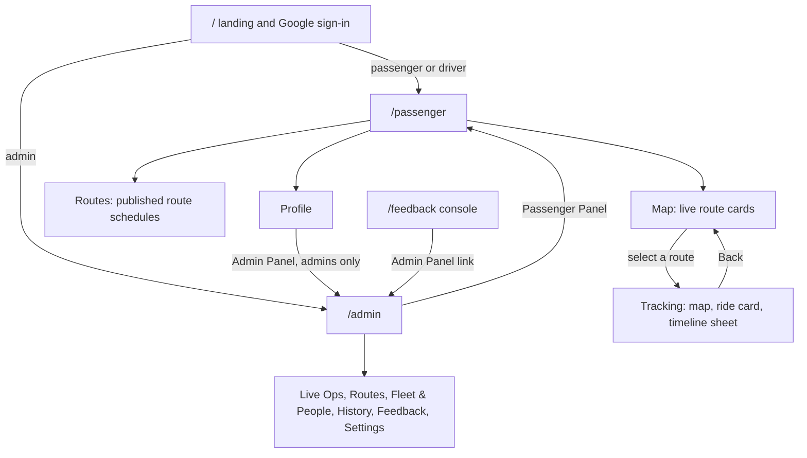

# Eki UI Design System

| Document ID | Version | Status | Last updated |
|---|---|---|---|
| EKI-UIX-001 | 2.0 | Current | 2026-11-01 |

## 1. Purpose

This reference lists the visual tokens, semantic colours, layout rules, screens, components and accessibility behaviour of the Eki web client in `frontend/`. Every value is copied from the source file named beside it; paths are relative to `frontend/src/` unless stated. Build, data access and sign-in are described in the [frontend package guide](../../frontend/README.md). Terms such as `liveBusHealth`, `atStopIndex` and `passed_unobserved` are defined in the [glossary](../GLOSSARY.md).

### 1.1 How styles are defined

| Mechanism | Detail |
|---|---|
| Tailwind CSS 4.2.2 | Loaded through `@tailwindcss/postcss` (`frontend/postcss.config.mjs`). `app/globals.css` begins with `@import "tailwindcss"`. |
| Design tokens | CSS custom properties on `:root` in `app/globals.css` (Section 2). Components read them through inline styles, for example `style={{ color: "var(--text-secondary)" }}`, or arbitrary values such as `bg-[var(--surface-0)]`. |
| Theme aliases | A `@theme inline` block maps some tokens to Tailwind utility names (Section 2.7). |
| Palette classes and hex values | Status, alert and map code also uses Tailwind palette classes (`text-amber-300`, `bg-red-500/10`) and literal colours (Section 3). |
| Themes | One dark theme. There is no light theme and no `prefers-color-scheme` rule. |
| `frontend/tailwind.config.ts` | Not loaded. Tailwind 4 reads a JavaScript configuration only through an `@config` directive [2], and `globals.css` has none. Its values (`brand.primary` `#0F4C81`, `brand.accent` `#F5A623`, the `transit` and `status` colours, the `glass`, `glow` and `premium` shadows, the `pulse-slow` animation and the font `var(--font-sora)`) do not reach the compiled CSS. |

## 2. Colour tokens

All tokens are defined in `app/globals.css`.

### 2.1 Surfaces

| Token | Value | Use |
|---|---|---|
| `--surface-0` | `#09090b` | Page background (`body`, `bg-brand-dark`), map containers, dark text on light buttons. |
| `--surface-1` | `#0f0f12` | Tracking ride card, route timeline sheet, feedback modal. |
| `--surface-2` | `#16161a` | Map notices, map and chat buttons, profile action list, `bg-brand-surface`. |
| `--surface-3` | `#1c1c21` | Route cards, back button, select controls, timeline chips, other people's chat bubbles. |
| `--surface-4` | `#26262c` | Pressed back button, active listbox option, dimmed timeline dot, empty rating star, scrollbar thumb. |

### 2.2 Text

| Token | Value | Use |
|---|---|---|
| `--text-primary` | `#ECECEF` | Headings and body text; background of `.btn-primary`. |
| `--text-secondary` | `#94949C` | Supporting text, notice summaries, icons in neutral buttons. |
| `--text-tertiary` | `#8A8A93` | Inactive bottom navigation items, "Passed · not confirmed" label, metadata. |
| `--text-ghost` | `#8C8C96` | Timeline badges, timestamps, sheet icons, "Time not set" in the Routes tab. It is slightly lighter than `--text-tertiary`, so size and weight carry the distinction. |

### 2.3 Accent

| Token | Value | Use |
|---|---|---|
| `--accent` | `#FA5D29` | Keyboard focus outline, upcoming stop markers, selected route card border, route card action text, own chat bubble, admin active-tab underline (`bg-brand-accent`), the line and stop dots of a route schedule timeline, the profile **Sign in with Google** row. |
| `--accent-subtle` | `rgba(250, 93, 41, 0.12)` | Background of the selected-stop badge and of the icon tile in the profile **Sign in with Google** row. |
| `--accent-glow` | `rgba(250, 93, 41, 0.25)` | Glow of the selected stop's timeline dot. |

### 2.4 Borders

| Token | Value | Use |
|---|---|---|
| `--border-subtle` | `rgba(255, 255, 255, 0.06)` | Default border colour of every element (`* { border-color }`), cards and selects. |
| `--border-default` | `rgba(255, 255, 255, 0.10)` | Ride card, map controls, timeline sheet edge, `border-thin`. |
| `--border-hover` | `rgba(255, 255, 255, 0.18)` | Only in `.eki-card:hover`; no component uses `.eki-card`. |

### 2.5 Status

| Token | Value | Use |
|---|---|---|
| `--status-live` | `#34D399` | Live and in-service text, **Board** button, At-stop marker, next-stop timeline dot, chat icon, **On board**, scheduled stop times in the Routes tab. |
| `--status-live-bg` | `rgba(52, 211, 153, 0.10)` | "Waiting for next bus" pill. |
| `--status-warning` | `#FBBF24` | Delayed and GPS-lost states, reroute notice, boarding check in progress, feedback word limit reached. |
| `--status-warning-bg` | `rgba(251, 191, 36, 0.10)` | Chat-unavailable notice. |
| `--status-danger` | `#F87171` | Tracking lost, bus offline, errors, **Sign Out** and **Delete Account**, unread badge. |
| `--status-danger-bg` | `rgba(248, 113, 113, 0.10)` | Icon tiles of the route-ended and unauthorized screens and of destructive profile actions. |

### 2.6 Other properties

| Property | Value | Use |
|---|---|---|
| `--route-color` | `#3B82F6` | Declared for per-route colouring; no component reads it. |
| `--safe-area-top`, `--safe-area-bottom` | `env(safe-area-inset-top, 0px)`, `env(safe-area-inset-bottom, 0px)` | `.pt-safe`, `.pb-safe` and the bottom navigation clearance. |
| `--tracking-controls-inset` | Set at runtime by `components/maps/PassengerMap.tsx` | Height of the tracking header over the map; positions map notices and camera controls. |

Radius tokens are listed in Section 6.2.

### 2.7 Tailwind theme aliases

The `@theme inline` block in `app/globals.css` defines:

| Theme variable | Resolves to | Example utility |
|---|---|---|
| `--color-brand-primary` | `var(--text-primary)` | `text-brand-primary` |
| `--color-brand-accent` | `var(--accent)` | `bg-brand-accent`, `focus-visible:outline-brand-accent` |
| `--color-brand-dark` | `var(--surface-0)` | `bg-brand-dark` |
| `--color-brand-surface` | `var(--surface-2)` | `bg-brand-surface/30` |
| `--color-brand-muted` | `var(--text-secondary)` | `text-brand-muted` |
| `--color-border-thin` | `var(--border-default)` | `border-border-thin` |
| `--color-status-active` | `var(--status-live)` | `bg-status-active` |
| `--color-status-idle` | `var(--status-warning)` | `bg-status-idle` |
| `--font-sans`, `--font-display` | `system-ui, -apple-system, "Segoe UI", sans-serif` | `font-sans` |
| `--radius-xl` | `var(--radius-lg)` | `rounded-xl` |

## 3. Semantic colours

### 3.1 Live bus health

`lib/liveBusHealth.ts` gives each bus one `liveBusHealth` state. The tracking header, map notice, bus marker, ETAs and boarding all read it. The states, thresholds (12 s and 30 s) and the deadline clock are specified in [tracking algorithms](TRACKING_ALGORITHMS.md#9-live-bus-health); this section gives their presentation.

| State | Condition, checked in this order | Title | Tone | Map notice | Passenger bus marker |
|---|---|---|---|---|---|
| `offline` | `deviceState` is `offline`. | Bus offline | danger | Text `--status-danger`, border `rgba(248, 113, 113, 0.3)` | `#b45309`, no heading pointer, grey edge `#71717a` |
| `gnss_lost` | `signalState` is `gnss_lost` or `motionState` is `uncertain`. | GPS signal lost | warning | Text `--status-warning`, border `rgba(251, 191, 36, 0.2)` | Same as `offline` |
| `lost` | No valid receipt, or the last receipt is more than 30 s old. | Live tracking lost | danger | As `offline` | Same as `offline` |
| `delayed` | The last receipt is more than 12 s old. | Updates delayed | warning | As `gnss_lost` | `#b45309` with heading pointer |
| `live` | Otherwise. | Live | live | None | Colour by motion (Section 3.5) |

The map notice shows the worst state among the displayed buses: a `WifiOff` icon, the title in semibold and a one-line summary in `--text-secondary` on `--surface-2`. A bus is trackable only in `live` or `delayed` while live data is connected. For any other state the map hides that bus's heading pointer and never shows "Bus is here" for it. When no displayed bus is trackable, stop estimates read "GPS signal lost" or "Live tracking lost" instead of minutes.

### 3.2 Tracking header

The ride card at the top of the tracking view (`components/passenger/PassengerBoardingView.tsx`, `components/passenger/PassengerWorkspace.tsx`) shows these texts:

| Element | Text | Colour |
|---|---|---|
| Status line, in service and `live` | `Ride in service · Live` | `--status-live` |
| Status line, `delayed` | `Ride in service · Updates delayed · 14 s ago` | `--status-warning` |
| Status line, `gnss_lost` | `Ride in service · GPS signal lost` | `--status-warning` |
| Status line, `lost` or `offline` | `Ride in service · Live tracking lost` or `· Bus offline` | `--status-danger` |
| Status line, armed before stop 1 | `Ride armed · awaiting stop 1 · <title>` | `--status-warning`, or `--status-danger` for `lost` and `offline` |
| Progress line | `At <stop> · Next: <stop>`; a part is left out when unknown | `--text-primary` |
| Boarding blocked notice | Health title, "Tracking paused" or "Live tracking paused", with a detail line | Title `text-red-300` for danger tone, otherwise `text-amber-300`; detail `--text-secondary` |
| Live location without ride direction | "Direction pending" or "Bus online · service not started" | `--accent` |
| No live bus | "Waiting for live bus data…" above the route name | `--accent` |

The status line is 10 px bold uppercase; the progress line is 12 px semibold. Both sit in a `role="status"` region with `aria-live="polite"`.

### 3.3 Stop states

`lib/stopProgress.ts` derives each stop's state from backend progress only (`currentStopIndex`, `atStopIndex`, `unobservedStopIndices`); proximity, ETA or the animated marker never mark a stop. The backend rules are in [tracking algorithms](TRACKING_ALGORITHMS.md#7-stop-progression). Map markers are drawn in `components/maps/PassengerMap.tsx`; the timeline in `components/passenger/RouteTimelineSheet.tsx`.

| State | Meaning | Map marker | Timeline | Label |
|---|---|---|---|---|
| `at` | The bus is at this stop now. | Fill `--status-live`, z-index 30, label chip `At <stop>` | Dot `--status-live` with glow `rgba(34, 197, 94, 0.7)`, row tinted `rgba(34, 197, 94, 0.06)` with a 2 px `--status-live` left border | "Bus is here" |
| `next` | The stop the bus reaches next. | Fill `--accent`, label chip with the stop name | As `at` | "Next Stop" |
| `upcoming` | A later stop. | Fill `--accent` | Dot in the route colour | none |
| `passed` | Passed with an observed arrival. | Fill `#71717a`, opacity 0.6 | Row opacity 0.25, dot `--surface-4` | "Passed" (marker title) |
| `unobserved` | Passed without the bus being seen there. | As `passed`, with a dashed white border | As `passed`, plus the label in `--text-tertiary` | "Passed · not confirmed" |

Each map marker is a 20 px circle with a 2 px white border and the stop letter (`lib/stopLabel.ts`: A to Z, then AA) in 10 px bold white, inside a 44 px button. The selected destination has a 2 px `#18181b` outline; on the timeline its dot is `--accent` with `--accent-glow` and it carries a badge in `--accent` on `--accent-subtle`. Label chips are white with `border-zinc-200` and `text-zinc-900` (`#18181b`). An ETA of 2 min or less is shown in `--status-live`.

### 3.4 Route polylines

`components/maps/DirectionsRoute.tsx` draws each road as stacked Google Maps polylines.

| Layer | Colour | Weight with buses / without | Opacity with / without | z-index |
|---|---|---|---|---|
| Casing | `#09090b` | 9 / 7 px | 0.72 / 0.5 | 20 |
| Road, live view | `#3b82f6` | 5 / 3 px | 1 / 0.8 | 21 |
| Road, preview and route editor | Route colour, default `#3b82f6` | 5 / 3 px | 1 / 0.8 | 21 |
| Covered road | `#71717a` | 5 / 3 px | 1 | 22 |
| Active leg to the next stop | `#3b82f6` | 5 / 3 px | 1 | 23 |

The live view is any map that passes backend stop indices: the passenger map during a ride and the admin Live Ops map. With one bus and a confident match (confidence at least 0.7 on the current geometry version), the active leg is split at the bus, so road behind it is grey and road ahead is blue. A fleet with several buses shows each active leg without a covered section.

The route editor offers eight route colours (`components/admin/RouteManagementPanel.tsx`): `#3B82F6`, `#10B981`, `#F59E0B`, `#EF4444`, `#8B5CF6`, `#EC4899`, `#14B8A6`, `#F97316`. New routes start with `#3B82F6`. The route colour appears in the route list swatch, editor stop markers, preview roads and the timeline rail (at 25 % alpha).

### 3.5 Bus markers

Passenger marker (`components/maps/BusPositionGlyph.tsx`, colour chosen in `components/maps/PassengerMap.tsx`): a 44 px container holding a 32 px white rounded box with a `zinc-300` border, a `BusFront` icon in `zinc-900` and a 3 px coloured bottom edge. A triangular heading pointer (fill colour, 2 px white stroke) rotates around the box. The heading updates only while the bus is moving at 3 km/h or more and the device is online.

| Condition | Colour | Pointer | Bottom edge |
|---|---|---|---|
| Live, moving | `#2563eb` | Shown | `#2563eb` |
| Live, stopped | `#b45309` | Shown | `#b45309` |
| `delayed` | `#b45309` | Shown | `#b45309` |
| Not trackable, approximate position, or device not online | `#b45309` | Hidden | `#71717a` |

The glyph has `role="img"` and an `aria-label` made of the bus ID and its state, for example "GPS signal lost, last known location" or "updates delayed". The marker sits at z-index 40 and animates between fixes (Section 8.3).

Admin marker (`components/admin/DashboardPanel.tsx`): a 36 px circle with a 3 px `#09090b` border, dashed when the position is approximate, a `Navigation2` icon in `#09090b` rotated to the heading, and a bus ID chip below.

| Condition | Fill |
|---|---|
| In service and moving | `#34D399` |
| In service and not moving | `#FBBF24` |
| Not in service, device not online or motion uncertain | `#FB923C` |
| Not in service, otherwise | `#94949C` |

### 3.6 Admin ride states

Fleet cards in Live Ops (`components/admin/DashboardPanel.tsx`) show a status tile, dot and label:

| Label | Text | Tile | Dot |
|---|---|---|---|
| In Service | `text-emerald-400` | `bg-emerald-500/10` | `bg-emerald-400` |
| Awaiting Stop 1 | `text-white/50` | `bg-white/5` | `bg-white/30` |
| Direction Pending | `text-amber-300` | `bg-amber-500/10` | `bg-amber-300` |
| Service paused, Tracking paused, Assignment required, Awaiting return service | `text-amber-300` | `bg-amber-500/10` | `bg-amber-300` |
| Completed | `text-blue-400` | `bg-blue-500/10` | `bg-blue-400` |
| Service setup pending | `text-white/40` | `bg-white/5` | `bg-white/20` |
| Offline | `text-white/40` | `bg-white/5` | `bg-white/30` |

The dot pulses while an online bus is moving. "Service paused" replaces the trip state when a ride's device is offline or its last receipt is more than 30 s old. Motion chips: Moving `text-emerald-400`; Stopped and Motion uncertain `text-amber-400`. "Live location updates delayed", "Last seen <age>" and `+<n>m delay` use `text-amber-400`. The stats row uses `text-emerald-400` (In Service), `text-white/50` (Awaiting Start), `text-amber-300` (Direction Pending), `text-blue-400` (Devices Online) and `text-amber-400` (Offline / Unknown). The route progress bar is `bg-emerald-500` on `bg-white/5`.

### 3.7 Alerts, dialogs and results

| Element | Colours | Source |
|---|---|---|
| Passenger reconnect banner | `text-amber-300`, `border-amber-400/20`, `bg-zinc-950` | `components/passenger/PassengerWorkspace.tsx` |
| Passenger error banner | `text-red-300` (detail `text-red-300/70`), `border-red-400/20`, `bg-zinc-950`; **Retry** on `bg-white/10` | same; the Routes tab error "Route schedules could not be loaded." uses the same colours (`components/passenger/RoutesTab.tsx`) |
| Admin Passenger Routes notices | Deleted-route notice `text-amber-300` on `bg-amber-500/10` with `border-amber-500/20`; load errors `text-red-300`; an invalid stop time gives the input a `rgba(248, 113, 113, 0.75)` border and a `text-red-300` message ("Time required" or "Enter a valid time") | `components/admin/PassengerRoutesSettings.tsx` |
| Reroute notice | `--status-warning` on `--surface-2`, border `rgba(251, 191, 36, 0.2)` | `components/maps/PassengerMap.tsx` |
| Location notice | `--text-secondary` on `--surface-2`, border `--border-default` | same |
| Announcement | Text `#fecdd3` on `#4c0519`, border `#881337`, 12 to 13 px uppercase black | `components/passenger/PassengerWorkspace.tsx` |
| Admin map overlays | `text-amber-300` or `text-red-300` on `bg-zinc-950/95` with a matching `/20` border | `components/admin/DashboardPanel.tsx` |
| `ConfirmModal` danger | Icon `text-red-400` on `bg-red-500/10`; button `bg-red-500`, white text | `components/ui/ConfirmModal.tsx` |
| `ConfirmModal` warning | Icon `text-amber-400` on `bg-amber-500/10`; button `bg-amber-500`, `text-slate-950` | same |
| `ConfirmModal` info | Icon `text-blue-400` on `bg-blue-500/10`; button `bg-blue-500`, white text | same |
| `AlertModal` | Icon colours as above for error, warning and info; **OK** on `bg-blue-600` | `components/ui/AlertModal.tsx` |
| Dialog surface | `rgba(18, 20, 29, 0.98)`, `border-white/10`, backdrop `bg-black/70` with `backdrop-blur-sm` | both dialogs |
| Success | **On board** in `--status-live`; "Messages cleared" in `text-emerald-400` | boarding card, live details drawer |
| Inline errors | `--status-danger` with `role="alert"` | boarding card, profile |
| Feedback console rows | New `bg-blue-500/[0.04]`, reviewed `bg-amber-500/[0.03]`, resolved transparent | `components/admin/FeedbackPanel.tsx` |

### 3.8 Other literal colours

| Value | Use | Source |
|---|---|---|
| `linear-gradient(180deg, #1c1c1e 0%, #151517 100%)` | Passenger home panel | `components/passenger/passengerFrame.ts` |
| `rgb(22, 22, 26)` (opaque), border `rgba(255, 255, 255, 0.15)` | Bottom navigation frame | same |
| `rgba(255, 255, 255, 0.08)` | Active bottom navigation item | `components/passenger/PassengerWorkspace.tsx` |
| `rgba(9, 9, 11, 0.92)` to transparent | Gradient behind the tracking header | same |
| `rgba(59, 130, 246, 0.15)`, `rgba(59, 130, 246, 0.3)`, `#60A5FA` | **Center on bus** control while following | `components/maps/PassengerMap.tsx` |
| `rgba(59, 130, 246, 0.10)`, `#60A5FA` | Walking-time badge | `components/passenger/RouteTimelineSheet.tsx` |
| `#1a1a1a` on `--accent` | Own chat bubble text | `components/shared/MessagingPanel.tsx` |
| `var(--danger, #f87171)` | Chat error; `--danger` is not defined, so the fallback applies | same |
| `#FBBF24`, `#F87171`, `linear-gradient(135deg, #6366f1 0%, #ec4899 100%)` | Filled rating stars, error text, submit button | `components/shared/FeedbackModal.tsx` |
| `#94a3b8` | Route colour shown when a route has none, admin Passenger Routes | `components/admin/PassengerRoutesSettings.tsx` |
| `accent-emerald-500` | Route checkboxes in admin Passenger Routes | same |
| `#e9bc55`, `#fbd66d`, `#e8ac37`, `#9a5d13` and related | Decorative profile coin | `app/globals.css` (`.profile-coin*`) |
| `#09090b`, `#0f0f12` | Admin inputs, menus and toolbars (`bg-[#09090b]`, `bg-[#0f0f12]`) | admin panels |
| `bg-black`, `bg-black/40`, `text-white` | Landing page and its hero overlay | `app/page.tsx` |

## 4. Contrast

Ratios follow the WCAG 2.2 relative luminance formula [1]. Tailwind palette colours were converted from the OKLCH values in `node_modules/tailwindcss/theme.css` to sRGB, and translucent colours were composited over the stated background. AA requires 4.5:1 for text, 3:1 for large text (24 px, or 18.66 px bold) under SC 1.4.3, and 3:1 for user-interface graphics under SC 1.4.11.

| Foreground on background | Where | Ratio | AA |
|---|---|---|---|
| `--text-primary` on `--surface-0` | Body text | 16.87 | Pass |
| `--text-primary` on `--surface-3` | Route card titles | 14.39 | Pass |
| `--text-secondary` on `--surface-0` | Supporting text | 6.61 | Pass |
| `--text-secondary` on `--surface-3` | Select details | 5.64 | Pass |
| `--text-tertiary` on `--surface-3` | Route card metadata | 4.96 | Pass |
| `--text-tertiary` on the navigation frame | Inactive navigation label | 5.29 | Pass |
| `--text-ghost` on `--surface-1` | Timeline badges | 5.75 | Pass |
| `--text-ghost` on `--surface-2` | Routes tab "Time not set" | 5.42 | Pass |
| `--text-tertiary` on `--surface-2` | Routes tab stop count | 5.27 | Pass |
| `--status-live` on `--surface-2` | Routes tab stop time | 9.39 | Pass |
| `--accent` on `--surface-2` | Profile **Sign in with Google** row | 5.72 | Pass |
| `--accent` on `--surface-3` | Route card action | 5.38 | Pass |
| `--status-live` on `--surface-1` | Status line, live | 9.95 | Pass |
| `--status-warning` on `--surface-1` | Status line, delayed or GPS lost | 11.46 | Pass |
| `--status-danger` on `--surface-1` | Status line, tracking lost | 6.92 | Pass |
| `--status-warning` on `--surface-2` | Map notice, warning | 10.81 | Pass |
| `--status-danger` on `--surface-2` | Map notice, danger | 6.52 | Pass |
| `--surface-0` on `--status-live` | **Board** button | 10.35 | Pass |
| `--surface-0` on `--text-primary` | `.btn-primary` | 16.87 | Pass |
| `#1a1a1a` on `--accent` | Own chat bubble | 5.52 | Pass |
| `#fecdd3` on `#4c0519` | Announcement | 11.08 | Pass |
| `#18181b` on white | Map stop label chip | 17.72 | Pass |
| `amber-300` on `zinc-950` | Reconnect banner | 13.75 | Pass |
| `red-300` on `zinc-950` | Error banner | 10.36 | Pass |
| `white/50` on `--surface-0` | Inactive admin tab | 5.32 | Pass |
| `slate-950` on `amber-500` | Warning dialog button | 9.40 | Pass |
| `white` on `blue-600` | Alert **OK** button | 5.26 | Pass |
| `white` on `--accent` | Stop letter, 10 px bold | 3.15 | Fail |
| `white` on `--status-live` | At-stop letter, 10 px bold | 1.92 | Fail |
| `white/40` on `--surface-0` | Admin "Offline" and "Service setup pending", 9 px | 3.76 | Fail |
| `white/30` on `--surface-0` | Admin field labels, 10 px | 2.58 | Fail |
| `white/25` on `--surface-0` | Admin micro labels, 8 px | 2.13 | Fail |
| `white/15` on `--surface-0` | `.input-rc` placeholder | 1.47 | Fail |
| `white` on `red-500` | Danger dialog button, 12 px semibold | 3.82 | Fail |
| `white` on `#6366f1` to `#ec4899` | Feedback submit, 14 px semibold | 4.47 to 3.53 | Fail |
| `#2563eb` and `#b45309` pointer on its white stroke | Bus heading pointer | 5.17, 5.02 | Pass (non-text) |
| `--accent` outline on `--surface-0` | Focus outline | 6.31 | Pass (non-text) |
| `#3b82f6` and `#71717a` on the `#09090b` casing | Road and covered road | 5.41, 4.12 | Pass (non-text) |

## 5. Typography

| Property | Value | Source |
|---|---|---|
| Family | `system-ui, -apple-system, "Segoe UI", sans-serif` (`--font-sans` and `--font-display`) | `app/globals.css` |
| Web fonts | None. No `next/font` import or font stylesheet exists; the "TYPOGRAPHY SYSTEM (SORA)" comment in `globals.css` is not backed by a loaded Sora font. | |
| Body | `letter-spacing: -0.01em`, antialiased, Tailwind default line height 1.5 | `app/globals.css` |
| Numerals | `tabular-nums` for ETAs, speeds, counts, delays and coordinates | components |
| Weights | 400, 500 (`font-medium`), 600 (`font-semibold`, the most common), 700, 800 (`font-extrabold`), 900 (`font-black`) | components |

Tailwind size utilities keep their defaults: `text-xs` 12/16 px, `text-sm` 14/20 px, `text-lg` 18/28 px, `text-xl` 20/28 px, `text-2xl` 24/32 px, `text-3xl` 30/36 px, `text-6xl` 60 px with line height 1. Components also use arbitrary sizes from 8 to 96 px.

| Role | Size | Weight | Line height | Example |
|---|---|---|---|---|
| Landing headline | 60 px, 80 px at `md`, 96 px at `lg` | 900 | 1.05 | "Campus routes and bus tracking" |
| Screen title | 32 px | 900 | 1 | "Live Routes", "Routes" |
| Route schedule card title | 17 px | 800 | 1.375 | Route name in the Routes tab |
| Route schedule stop and time | 14 px stop name, 12 px time with `tabular-nums` | 700 / 600 | 1.375 / 1.5 | "Central Library", "7:38 am" |
| Route card title | 22 px | 900 | 1.5 | Route name |
| Admin section heading | 18 to 20 px | 700 to 800 | 28 px | "Ride History", "Settings" |
| Body and descriptions | 13 to 15 px | 500 | 1.5 | Home subtitle |
| Controls (selects, small buttons) | 12 px | 600 to 700 | 16 px | Stop pickers, **Board** |
| Bottom navigation label | 13 px | 700 | 1 | "Map", "Routes", "Profile" |
| Tracking status line | 10 px uppercase, `tracking-wider` | 700 | 1.5 | `Ride in service · Live` |
| Timeline stop name | 14 px (next or selected), otherwise 13 px | 600 / 500 | 1.5 | Stop name |
| ETA | 18 px | 800 | 28 px | Minutes, or "Due" |
| Admin labels | 8 to 10 px uppercase, `tracking-wider` or `tracking-widest` | 900 | 1.5 | "Live Fleet", "Next stop" |
| Dialog title and description | 14 px / 12 px | 700 / 400 | 1.375 / 1.625 | Confirmation dialogs |

`app/globals.css` also defines named text classes (`.text-display-hero`, `.text-title-screen`, `.text-heading-section`, `.text-route-name`, `.text-station-name`, `.text-important-number`, `.text-card-title`, `.text-body-primary`, `.text-body-secondary`, `.text-label`, `.text-btn-primary`, `.text-btn-secondary`, `.text-nav-active`, `.text-nav-inactive`, `.text-chip`, `.text-metadata`). No component uses them.

## 6. Spacing, radii, elevation and layers

### 6.1 Spacing and layout constants

Spacing uses the Tailwind 4 default unit `--spacing: 0.25rem` (4 px); the project defines no custom scale. Common values: a 16 px side gutter (`px-4`, `mx-4`, `left-4`), 12 px card padding (`p-3`), 8 px gaps (`gap-2`) and a 24 px admin gutter from `sm` (`sm:px-6`).

| Constant | Value | Source |
|---|---|---|
| `PASSENGER_NAV_HEIGHT_PX` | 81 (1 px border plus an 80 px bar) | `components/passenger/passengerFrame.ts` |
| `PASSENGER_PANEL_NAV_GAP_PX` | 29 | same |
| `passengerNavClearance` | `calc(81px + var(--safe-area-bottom))`; bottom of the timeline sheet and chat overlay | same |
| Home top spacer | `34vh`, at least `min(250px, 20dvh)` | same |
| App shell height | `100dvh` for passenger and admin | `app/passenger/layout.tsx`, `app/admin/page.tsx` |
| Tracking header width | At most 512 px (`max-w-lg`), centred | `components/passenger/PassengerWorkspace.tsx` |
| Admin tab bar width | At most 1280 px (`max-w-7xl`) | `app/admin/page.tsx` |
| Map fit padding | Top: the larger of 32 px and header height plus 24 px. Bottom: timeline sheet overlap plus 24 px, at most 65 % of the map height. Sides: 32 px. | `components/maps/PassengerMap.tsx` |
| Map zoom | Passenger default 15, following a bus 16; admin default 12, 15 when centring a bus | `PassengerMap.tsx`, `DashboardPanel.tsx` |

### 6.2 Radii

`app/globals.css` defines radius tokens on `:root` outside any cascade layer. Tailwind writes its own defaults inside `@layer theme`, and unlayered declarations win, so the project values replace the Tailwind defaults.

| Token | Value | Utilities that resolve to it |
|---|---|---|
| `--radius-sm` | 8 px | `rounded-sm` |
| `--radius-md` | 12 px | `rounded-md` |
| `--radius-lg` | 16 px | `rounded-lg`, and `rounded-xl` through the `--radius-xl` alias |
| `--radius-xl` | 20 px | `.eki-card` only (unused) |
| `--radius-2xl` | 24 px | `rounded-2xl` |
| `--radius-pill` | 999 px | `.btn-primary` |

`rounded-3xl` keeps the Tailwind default of 1.5 rem (24 px). Arbitrary radii: 32 px for the home panel, 20 px for route cards and navigation items, 24 px for the top of the navigation frame.

### 6.3 Shadows and elevation

Elevation is shown first by surface lightness (`--surface-0` to `--surface-4`) and then by shadow. Tailwind's default `shadow-sm` to `shadow-2xl` are used unchanged. Literal shadows:

| Shadow | Use |
|---|---|
| `0 12px 48px rgba(0, 0, 0, 0.5), inset 0 1px 0 rgba(255,255,255,0.05)` | Passenger home panel |
| `0 -8px 32px rgba(0, 0, 0, 0.4)` | Timeline sheet |
| `0 4px 16px rgba(0,0,0,0.3)` | Map camera and chat buttons, `.btn-rc-primary` |
| `0 0 0 2px <colour>40, 0 4px 12px rgba(0,0,0,0.5)` | Admin bus marker |
| `0 4px 12px rgba(0,0,0,0.4)` | Route editor stop markers |
| `0 25px 50px -12px rgba(0, 0, 0, 0.5)` | Feedback success card |

### 6.4 Z-index layers

| Value | Layer | Source |
|---|---|---|
| 0 | Map and hero image | several |
| 10 | Landing content, in-panel overlays | several |
| 20 | Passenger home and tracking views | `PassengerWorkspace.tsx` |
| 30 | Passenger Routes and Profile views, route-ended screen, passenger app above its loading shell | `PassengerWorkspace.tsx`, `app/passenger/layout.tsx` |
| 40 | Tracking header, map notices and camera controls, timeline sheet backdrop | `PassengerWorkspace.tsx`, `PassengerMap.tsx`, `BottomSheet.tsx` |
| 50 | Status banners, chat overlay, timeline sheet, open listbox, route search results | several |
| 100 | Passenger bottom navigation, feedback console header | `PassengerWorkspace.tsx`, `FeedbackPanel.tsx` |
| 200 | Admin live details drawer | `DashboardPanel.tsx` |
| 250 | `ConfirmModal`, `AlertModal`, admin chat overlay, telemetry trace button | several |
| 999 | `FeedbackModal` | `components/shared/FeedbackModal.tsx` |

Inside the Google map, polylines use z-index 20 to 23 (Section 3.4), the At-stop marker 30 and bus markers 40.

### 6.5 Breakpoints and test viewports

Breakpoints are the Tailwind 4 defaults: `sm` 640 px, `md` 768 px, `lg` 1024 px, `xl` 1280 px, `2xl` 1536 px. Components use `sm`, `md` and `lg` only.

| Breakpoint | Layout change |
|---|---|
| `sm` (640 px) | Admin live details drawer and the feedback modal change from a bottom sheet to a centred dialog; fleet card metrics change from two to four columns; admin gutters grow to 24 px. |
| `md` (768 px) | Landing headline, subtitle and logo grow. |
| `lg` (1024 px) | Live Ops changes from map above fleet list (list at most 55 % of the height) to map beside a 360 px fleet column; the route editor gains a 300 px side column. |

The passenger workspace has no breakpoint-specific structure: the map is full-bleed and the header is centred at 512 px.

Playwright viewports (`playwright*.config.ts` and `e2e/`):

| Width × height (px) | Suites |
|---|---|
| 320 × 568, 320 × 640, 844 × 390 | Passenger video audit, production audit resilience |
| 360 × 800 | Default suite, passenger layout, production audit, live-maps in-app |
| 390 × 844 | Admin access, emulator, passenger layout, passenger progress, production audit |
| 440 × 956 | Passenger layout ("reported-phone") |
| 1024 × 600 | Production audit resilience |
| 1280 × 585 | Passenger layout ("short-desktop") |
| 1280 × 800 | Desktop project of the default, admin access, emulator, passenger layout, passenger progress and production audit suites |
| 1920 × 1080 | Routing with live maps |

## 7. Screens by role

### 7.1 Navigation

Figure 1. Navigation between routes and views for each role.

A signed-in user leaves `/` for the saved workspace or the default for the role. In `/passenger`, the bottom navigation switches between Map (home and tracking), Routes and Profile. Administrators switch between `/admin` and `/passenger` with **Passenger Panel** and **Profile > Admin Panel**.

### 7.2 Landing page

`app/page.tsx` shows a full-screen hero image (`/images/hero-background.webp`, JPEG fallback) under a `bg-black/40` overlay, the university logo at the top left, the headline and subtitle, a white pill **Sign In with Google** button and a footer. Until sign-in is usable the button shows a spinner and "Preparing sign-in…". The full-page sign-in link, a sign-in error (`role="alert"`) and a status line with **Reload** appear below the button when relevant: "Sign-in is still loading." after 10 s without sign-in, or "Still checking your sign-in. The connection looks slow; this continues on its own." when restoring a saved session takes more than 8 s. A signed-in user sees a spinner with "Finishing your sign-in…" or "Opening your workspace…". An access error replaces the page with **Try again**, **Sign out** and **Reload**.

### 7.3 Passenger workspace

`components/passenger/PassengerWorkspace.tsx` stacks four absolutely positioned views and a fixed bottom navigation. Hidden views are `inert` and `aria-hidden`; the Routes and Profile views mount on their first visit and then stay mounted. Views crossfade over 200 ms. Under Routes and Profile an opaque `--surface-0` floor stays solid while switching between those two, so the hero image never shows through mid-fade; it fades only when entering or leaving them. Reconnect, ride-recovery and error banners appear above the views.

| View | Structure |
|---|---|
| Map (home) | Hero image above a rounded panel titled "Live Routes". The panel scrolls the announcement (when active) and one card per route with an active or available bus: route name, first and last stop, stop count and duration, and an action in `--accent` ("TRACK ROUTE", "VIEW STATUS" or "<n> AVAILABLE"). Without routes it shows the configured no-buses message and service start time. |
| Tracking | Full-bleed map. Over it, at the top: a 44 px back button and the ride card (bus picker when several buses are selectable, status and progress lines, boarding and destination pickers, **Board**, hints and results), then the chat button with an unread badge. Map notices sit at the top left and the **Center on bus** and **Show route overview** buttons (48 px) at the top right. The route timeline sheet is collapsed to a 56 px handle above the navigation. Chat opens as an overlay between the header and the navigation. |
| Route ended | Replaces the tracking view when the tracked ride completes: flag icon, "Route ended", a "Waiting for next bus" pill and **Return to Live Routes**. After 10 s an eligible passenger sees the feedback modal and the view returns to the live route list. |
| Routes | `components/passenger/RoutesTab.tsx`: title "Routes" with "Stops and scheduled times for each route.", then one card for every route, most completed rides first (`settings/routeUsage`; ties keep the order the administrator set under **Passenger Routes**, then the name). The tab uses its own maroon accent instead of `--accent`: `--routes-accent` (#B0303F) for the rail and dots, `--routes-accent-text` (#E06A78, about 5.3:1 on `--surface-3`, where #B0303F reaches only about 2.7:1) for text, bus icons, the chevron and the focus ring. Each card is collapsible and sized for phones (a collapsed card is at most 130 px tall at 320 px wide): `--surface-3`, 20 px radius and a `--border-subtle` border that stays the same when the card opens. The whole header is one toggle (`aria-expanded`, labelled "<route> schedule") showing, in one column, a dot in the route colour and the route name (19 px, black weight), the first and last stop joined by an arrow, and a summary line with the stop count, the first-to-last configured time (the two times joined by an en dash, for example 7:30 to 8:05 am, with am/pm once when both share it; "Times not set" when none) and the ride count ("128 rides") when one is published; each separator dot wraps with the item after it. Beside the column sits a 20 px chevron in `--routes-accent-text`, with no background, that turns over when the card opens. Cards start collapsed, except a lone route, which starts open; each opens on its own. Open, the card drops down (300 ms, none under reduced motion) to one line per bus assigned to the route (`assignedRoutes` or the legacy `assignedRouteId`), sorted by bus number: a bus icon in `--routes-accent-text`, then "bus number - bus name" ("bus_03 - Campus Hopper"; the number alone when the bus has no name). A route without buses shows "No bus assigned to this route yet", and a read failure "Bus details could not be loaded.", each after a bus icon. Below them, one rail down the left: a 4 px `--routes-accent` line that runs from the first stop's dot to the last, a 14 px dot per stop (filled `--routes-accent` at the first and last stop, `--surface-3` with a `--routes-accent` ring otherwise) centred on the first line of the stop name, and one row of at least 56 px per stop with the name (black weight at the first and last stop) and, at the right, the time in `--status-live` ("7:30 am") or "Time not set" in `--text-ghost`, each in the same box as the open stop's pill so nothing shifts when it opens. Each stop row is a button (`aria-expanded`); tapping it opens that stop in place and closes any other in the card: a 20 px filled dot with a `--routes-accent-text` ring and a soft maroon halo, the name at 15.5 px, the time in a clock pill (`--surface-2`, `--border-default`), "Scheduled time" (or "No time scheduled for this stop yet"), and read-only maroon-tinted chips: the position ("Stop 2 of 5", "First stop", "Last stop"), the scheduled time from the first stop ("8 min from Main Gate", counted forward through midnight) and when the route reaches its last stop. Tapping the open stop closes it. Motion uses one ease-out curve (`cubic-bezier(0.22, 1, 0.36, 1)`, 300 ms), shared with the card drop-down and chevron: the details slide open from zero height (`@starting-style`) while the stop being left slides shut, inert, before it unmounts; the dot grows with a slight overshoot; the pill background, border and clock icon fade and widen in; and the chips fade up one after another (60 ms, then 50 ms apart). Once open, the stop scrolls into view above the navigation bar (instantly under reduced motion). Reduced motion turns every transition off. When the browser has already granted location access (the tab never asks), the stop nearest the passenger within 1.5 km is labelled "Closest stop" in `--routes-accent-text` and starts open. States: "Loading routes…" with a spinner until routes, times, ride counts and buses have loaded; "No routes yet" on a dashed `--border-default` card; and the passenger error banner with **Retry** when routes or times cannot be read. |
| Profile | `components/passenger/AccountTab.tsx`: photo, name and role; an action list with **Admin Panel** (administrators), **Send Feedback**, **Sign Out** and **Delete Account** (passengers). Sign-out and deletion ask for confirmation. Signed out, the list offers **Sign in with Google** in `--accent`. |
| Bottom navigation | Three 60 px high buttons, **Map**, **Routes** and **Profile**, that share the bar width up to 140 px each, so they fit a 320 px screen. The active button is marked with `aria-current="page"`; **Map** stays active during tracking. |

### 7.4 Administrator workspace

`app/admin/page.tsx` renders a tab bar and one panel at a time inside `AdminPanelErrorBoundary`. Leaving a tab with unsaved route or settings edits opens "Discard unsaved changes?".

| Area | Structure |
|---|---|
| Tab bar | `role="tablist"` with Live Ops, Routes, Fleet & People, History, Feedback and, after a divider, Settings. The active tab is white with a 2 px `--accent` underline; others are `text-white/50`. **Passenger Panel** follows the tabs; on narrow screens the row scrolls horizontally. |
| Live Ops: map | Google map with the traffic layer, live route overlays and bus markers. A top-left stack holds data-error, reconnect and "<n> devices online · <m> services" overlays. |
| Live Ops: side column | "Automatic service" explanation with **Resume tracking** buttons for paused buses, a five-column stats row, and the "Live Fleet" list of fleet cards. |
| Fleet card | Header button (status tile, bus name, state, delay, motion and speed chips) that expands the card, an eye button for live details and a chat button. Expanded: speed, heading, last update and next stop; route progress with next and following stop; driver and route; delay buttons (-2, -1, +1, +2); **Boarding code**; **End ride early**; coordinates. |
| Live details drawer | Modal dialog: trip state, signal, next stop, delay, route matching, match confidence, route context, distance to route, raw and matched location diagnostics, **Clear Messages** and **End ride early**. |
| End ride | `ConfirmModal`, warning variant: "End ride early?", **End ride** and **Keep running**. |
| Routes | Route list with colour swatches, and an editor with a map, place search, draggable lettered stops, per-stop rename, reorder and remove buttons, and the colour picker. |
| Fleet & People | "Fleet Vehicles" and "Driver Personnel" lists with add, edit and delete. |
| History | "Ride History" list with chat history, deletion and **Load older rides**. |
| Settings | Announcement toggle and text, no-buses message and sub-message, service start time, and a save button that reads **No changes** until something changes. Below it, the **Passenger Routes** section ("Set the time at each stop. Passengers see every route, most ridden first; this order breaks ties") has its own save button: a checkbox list of every route sorted by name (colour dot, name, stop count), then, for each selected route in selection order, a card with a 4 px left border in the route colour, numbered stop circles in the route colour and a 44 px `<input type="time">` per stop. The button reads **Save routes**, **No route changes**, **Saving…** or **Saved!**. A notice in amber counts previously published routes that were deleted and will be removed on save. |

### 7.5 Feedback

| Screen | Structure |
|---|---|
| Feedback modal | `components/shared/FeedbackModal.tsx`. A bottom sheet below `sm`, a centred 448 px dialog above. Header with close button, five rating stars (`aria-pressed`), a comment field with a live "<n> / 200 words" count, a status line, and a full-width 48 px submit button. A cooldown keeps submit disabled. Success shows a centred confirmation card. |
| `/feedback` console | `components/admin/FeedbackPanel.tsx`. A sticky header ("Feedback Console", "Admin Only", **← Admin Panel**), a search field, type and status filters, and expandable feedback rows with **reviewed** and **resolved** actions. The admin Feedback tab shows the same panel without the header. |

## 8. Components, icons and motion

### 8.1 Component inventory

Paths are relative to `frontend/src/components/`.

| Component | Path | Purpose |
|---|---|---|
| `ConfirmModal` | `ui/ConfirmModal.tsx` | Confirmation dialog with danger, warning and info variants; rendered in a portal on `document.body`. |
| `AlertModal` | `ui/AlertModal.tsx` | One-button dialog with error, warning and info variants. |
| `InAppSelect` | `ui/InAppSelect.tsx` | Combobox and listbox with a detail column (ETA) and a completed state for stops behind the bus. |
| `CustomSelect` | `ui/CustomSelect.tsx` | Styled native `<select>` for admin fleet and feedback filters. |
| `RoleGuard` | `shared/RoleGuard.tsx` | Loading, slow sign-in ("Still signing you in", with **Reload**), access-error and unauthorized screens; redirects signed-out users to `/`. |
| `WorkspaceLink` | `shared/WorkspaceLink.tsx` | Link between workspaces with an **Opening…** state. |
| `WorkspaceLoading` | `shared/WorkspaceLoading.tsx` | Full-screen loading status. |
| `WorkspacePrefetch` | `shared/WorkspacePrefetch.tsx` | Downloads the other workspace's code for verified administrators; renders nothing. |
| `MessagingPanel` | `shared/MessagingPanel.tsx` | Ride chat for passengers and administrators, 500 characters per message. |
| `FeedbackModal` | `shared/FeedbackModal.tsx` | Rating and comment dialog. |
| `PassengerWorkspace` | `passenger/PassengerWorkspace.tsx` | Passenger shell: banners, views and bottom navigation. |
| `PassengerBoardingView` | `passenger/PassengerBoardingView.tsx` | Ride status, progress, stop pickers and **Board**. |
| `RouteTimelineSheet` | `passenger/RouteTimelineSheet.tsx` | Stop timeline with ETAs inside `BottomSheet`. |
| `RoutesTab` | `passenger/RoutesTab.tsx` | Published route schedules as stop timelines. |
| `AccountTab` | `passenger/AccountTab.tsx` | Profile and account actions. |
| `PassengerLoadingShell` | `passenger/PassengerLoadingShell.tsx` | Static copy of the home layout shown while the session restores. |
| `BottomSheet` | `passenger/ui/BottomSheet.tsx` | Collapsible sheet above the bottom navigation. |
| `RouteCarousel` | `passenger/ui/RouteCarousel.tsx` | List of live route cards. |
| `PassengerMap` | `maps/PassengerMap.tsx` | Passenger map, bus and stop markers, notices, camera controls. |
| `PassengerTrackingMap` | `maps/PassengerTrackingMap.tsx` | Mounts the Maps provider only while a route is tracked; the map instance itself is reused (Section 9.2). |
| `DirectionsRoute` | `maps/DirectionsRoute.tsx` | Road polylines from stored geometry. |
| `BusPositionGlyph` | `maps/BusPositionGlyph.tsx` | Passenger bus glyph with heading pointer. |
| `TrafficLayer` | `maps/TrafficLayer.tsx` | Google traffic layer for the admin maps. |
| `DashboardPanel` | `admin/DashboardPanel.tsx` | Live Ops. |
| `RouteManagementPanel` | `admin/RouteManagementPanel.tsx` | Route list and editor. |
| `FleetManagementPanel` | `admin/FleetManagementPanel.tsx` | Vehicles and operators. |
| `RideHistoryPanel` | `admin/RideHistoryPanel.tsx` | Ride history and chat archive. |
| `FeedbackPanel` | `admin/FeedbackPanel.tsx` | Feedback console. |
| `SettingsPanel` | `admin/SettingsPanel.tsx` | Announcement and service messages. |
| `PassengerRoutesSettings` | `admin/PassengerRoutesSettings.tsx` | Passenger route schedule editor inside Settings, saved separately. |
| `Field`, `SectionHeader` | `admin/SettingsSection.tsx` | Labelled control and icon header shared by the Settings sections. |
| `AdminPanelErrorBoundary` | `admin/AdminPanelErrorBoundary.tsx` | Contains a panel crash and offers **Try again**. |
| `TelemetryTraceControls` | `TelemetryTraceControls.tsx` | **Download telemetry trace** button when the URL has `telemetryTrace=1`; see [browser telemetry trace](../operations/BROWSER_TELEMETRY_TRACE.md). |

Shared CSS classes in `app/globals.css` that components use: `.btn-primary`, `.btn-rc-primary`, `.input-rc`, `.panel-rc`, `.hide-scrollbar`, `.pt-safe`, `.pb-safe` and `.profile-coin*`. The classes `.eki-card`, `.eki-card-interactive`, `.eki-panel`, `.glass-panel`, `.btn-rc-outline`, `.btn-ghost`, `.label-xs`, `.micro-label`, `.status-live`, `.eta-number`, `.eta-unit`, `.skeleton`, `.noise-bg` and `.stagger-1` to `.stagger-4` are defined but unused.

### 8.2 Icons

All icons come from `lucide-react` 1.27.0, imported per icon; `next.config.ts` lists the package in `optimizePackageImports`. Examples: `BusFront` (bus glyph), `Navigation` (**Center on bus**), `Route` (route overview, timeline, the Passenger Routes settings header), `WifiOff` (health and reconnect notices), `MapPinned`, `ListOrdered` and `CircleUserRound` (bottom navigation), `MessageCircle` (chat), `Flag` (route ended), `ShieldAlert`, `AlertTriangle` and `Info` (dialog variants), `Loader2` (spinners). Common sizes: 16 px in admin tabs and lists, 20 px in map controls, 22 px with stroke width 2.5 in the bottom navigation.

### 8.3 Motion

| Motion | Duration | Easing | Used by |
|---|---|---|---|
| `animate-fade-in` | 300 ms | `ease` | Boarding card, sheet backdrop, route-ended screen, feedback modal backdrop, chat states |
| `animate-slide-up` (16 px rise) | 350 ms | `cubic-bezier(0.22, 1, 0.36, 1)` | Chat overlay, live details drawer, feedback modal, admin panels |
| `animate-slide-down` | 300 ms | `ease` | Chat |
| `animate-scale-in` | 250 ms | `cubic-bezier(0.22, 1, 0.36, 1)` | Chat button |
| `animate-scale-up` | 400 ms | `cubic-bezier(0.22, 1, 0.36, 1)` | Feedback success card |
| Passenger view switch | 200 ms, opacity and 8 px rise | Tailwind default `cubic-bezier(0.4, 0, 0.2, 1)` | Home, tracking, Routes and Profile views |
| Timeline sheet | 500 ms | `cubic-bezier(0.32, 0.72, 0, 1)` | `BottomSheet` |
| Bus marker movement | 250 ms interpolation, at most one render every 50 ms | Cubic ease-out | `hooks/useSmoothPosition.ts` |
| Admin marker heading | 250 ms | `ease-out` | `DashboardPanel.tsx` |
| Next-stop dot pulse | 1.5 s, infinite | `pulse-dot` keyframes | Timeline |
| `animate-pulse`, `animate-spin` | 2 s, 1 s | Tailwind defaults | Admin moving-bus dot, spinners |
| Profile coin flip | 1.1 s | `cubic-bezier(0.2, 0.75, 0.25, 1)` | Profile photo |

Under `prefers-reduced-motion: reduce`, `app/globals.css` sets every animation and transition duration to 0.01 ms with one iteration. `useSmoothPosition` then moves markers directly to the new fix, the chat scrolls without smoothing, and the workspace spinners stop (`motion-reduce:animate-none`).

## 9. PWA manifest and map styling

### 9.1 Web app manifest and icons

| Field | Value (`app/manifest.ts`) |
|---|---|
| `short_name` | `Eki` |
| `start_url` | `/` |
| `display` | `standalone` |
| `background_color` | `#09090b` (`--surface-0`) |
| `theme_color` | `#FA5D29` (`--accent`) |
| Icons | `/icon-192.png` 192 × 192 as `any` and as `maskable`; `/icon-512.png` 512 × 512 as `maskable` |

`app/icon.png` (128 × 128) and `app/apple-icon.png` (180 × 180) supply the browser icon and the Apple touch icon through Next.js file conventions. The open-graph image is `/images/hero-background.webp`.

### 9.2 Google Maps

| Setting | Value | Source |
|---|---|---|
| Map ID | `NEXT_PUBLIC_GOOGLE_MAP_ID` | `config/maps.ts` |
| Basemap style | Associated with the Map ID in the Google Cloud console [3]; the repository holds no style array. | |
| Options | `disableDefaultUI: true`, `gestureHandling: "greedy"`, `backgroundColor: "#1a1a2e"` | `config/maps.ts` |
| Default centre | 23.0347, 72.5483 (Ahmedabad) | `config/maps.ts` |
| Markers | `AdvancedMarker` from `@vis.gl/react-google-maps` with HTML content | `PassengerMap.tsx`, `DashboardPanel.tsx`, `RouteManagementPanel.tsx` |
| Traffic layer | Admin Live Ops and route editor only | `TrafficLayer.tsx` |
| Instance reuse | Every map sets `reuseMaps` and shares the map ID and options, so the passenger map, Live Ops and the route editor reattach one `google.maps.Map` per page load; overlays detach on unmount ([EKI-ADR-004](GOOGLE_MAP_REUSE_DECISION.md)) | `config/maps.ts`, `config/maps.reuse.test.ts` |

## 10. Accessibility in code

### 10.1 Rules the code applies

| Rule | Implementation |
|---|---|
| Visible focus | `:focus-visible { outline: 2px solid var(--accent); outline-offset: 2px; }` in `app/globals.css`. Some controls replace it with a ring (`focus-visible:ring-red-400` on **End ride early**, `ring-brand-accent/50` on fleet cards, `outline-blue-400` on `InAppSelect`). |
| Dialogs | `hooks/useDialogFocus.ts` moves focus to `[data-autofocus]` or the first focusable element, keeps Tab inside the dialog, closes the top-most dialog on Escape, locks body scrolling and returns focus to the previous element. Dialogs set `role="dialog"`, `aria-modal="true"` and `aria-labelledby`. **Cancel** receives initial focus in `ConfirmModal`. |
| Tabs | The admin tab bar uses `role="tab"`, `aria-selected`, `aria-controls`, roving `tabIndex` and Left, Right, Home and End keys. |
| Listbox | `InAppSelect` uses `role="combobox"` with `aria-expanded`, `aria-controls` and `aria-activedescendant`; keys: Up, Down, Page Up and Page Down (10 options), Home, End, Enter, Space, Escape and Tab. |
| Disclosure | `BottomSheet` and fleet and feedback rows set `aria-expanded` and `aria-controls`. The sheet closes on Escape and returns focus to its handle; collapsed content is `inert`. |
| Hidden content | Inactive passenger views are `inert` and `aria-hidden`. |
| Live regions | Health, boarding and reconnect messages use `role="status"` with `aria-live="polite"`; errors use `role="alert"`. |
| Names | Icon-only buttons carry `aria-label` (for example "Back to home", "Center on bus", "Show route overview", "Open live details for <bus>"). Bus glyphs have `role="img"` with a status label; stop markers are buttons named "Show stop <name>". |
| Colour is not the only signal | Health states, stop states and ride states always have a text label; unconfirmed stops also use a dashed border. |
| Touch targets | The convention is 44 px (`size-11`, `h-11`, `min-h-11`): passenger back button, map stop buttons, select controls, dialog close buttons. `e2e/admin-responsive.spec.ts` asserts at least 44 × 44 px for the route editor's move and remove stop buttons. |
| Reduced motion | Section 8.3. |
| Language and indexing | `<html lang="en">`; protected routes are `noindex`. |

### 10.2 Known gaps

| Gap | Location |
|---|---|
| Text contrast below AA for stop letters, admin labels at 25 to 40 % white, the `.input-rc` placeholder, the danger dialog button and the feedback submit button (Section 4). | `PassengerMap.tsx`, `DashboardPanel.tsx`, `app/globals.css`, `ConfirmModal.tsx`, `FeedbackModal.tsx` |
| Controls below the 44 px convention: the fleet card eye button (36 px), delay buttons (36 px minimum), **Boarding code** and **End ride early** in the card (40 px), and the passenger **Board** button (12 px text with 8 px vertical padding, 32 px high). All exceed the 24 px minimum of SC 2.5.8 [1]. | `DashboardPanel.tsx:463`, `:556`, `:568`, `:577`; `PassengerBoardingView.tsx` |
| `.input-rc` removes the outline and signals focus only by a border change from 10 % to 30 % white. | `app/globals.css` |
| `html { scroll-behavior: smooth; }` is not reset under reduced motion. | `app/globals.css` |
| `animate-in fade-in` on both dialogs produces no CSS, because no plugin defines these classes. | `ConfirmModal.tsx`, `AlertModal.tsx` |
| Timeline highlight colours use `rgba(34, 197, 94, …)` (green) instead of the `--status-live` value. | `RouteTimelineSheet.tsx` |

## 11. References

[1] W3C, "Web Content Accessibility Guidelines (WCAG) 2.2," W3C Recommendation, 12 Dec. 2024, www.w3.org/TR/WCAG22/. Accessed: 2026-10-30.

[2] Tailwind Labs, "Upgrade guide: Using a JavaScript config file," tailwindcss.com/docs/upgrade-guide. Accessed: 2026-10-30.

[3] Google, "Map ID overview," Maps JavaScript API, developers.google.com/maps/documentation/javascript/map-ids/mapid-over. Accessed: 2026-10-30.
