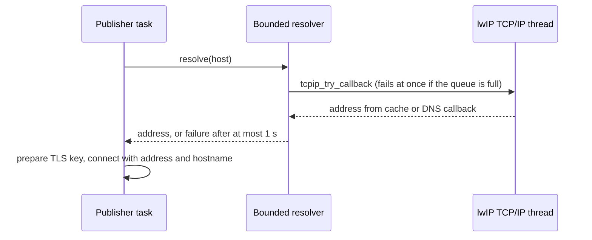

# DNS Cold Connect

| Document ID | Version | Status | Last updated |
|---|---|---|---|
| EKI-HW-003 | 1.0 | Current | 2026-10-30 |

## 1. Introduction

This document describes how the firmware bounds DNS resolution when the telemetry or diagnostics transport opens a new HTTPS connection. It applies to the publisher's telemetry client and the `diagnostic-http` client. The implementation is in [`bounded_dns_resolver.h`](../../hardware/include/bounded_dns_resolver.h) and [`dns_resolution_policy.h`](../../hardware/include/dns_resolution_policy.h).

## 2. Context

The pinned Arduino-ESP32 2.0.17 `WiFi.hostByName` waits up to 16 s for DNS ownership and then up to 15 s for completion [1]. That wait comes before the TLS handshake and exceeds the publisher's 25 s task watchdog, so a stalled lookup could reset the board. Telemetry and diagnostics therefore resolve hostnames through a bounded resolver instead.

## 3. Design

### 3.1 Ownership and deadlines

1. One fixed slot holds the hostname, a ticket and the network epoch of the query in progress. A new query enters lwIP through the non-blocking `tcpip_try_callback`. If the TCP/IP message queue is full, the call fails at once.
2. Only the TCP/IP thread calls `dns_gethostbyname_addrtype` (IPv4). Cache hits and literal IPv4 addresses complete on that thread; other lookups complete through the DNS callback. The lwIP cache keeps its own TTL policy, and the firmware adds no address cache and no resolver task.
3. A caller asking for the same hostname in the same network epoch joins the query in progress. A caller asking for a different hostname while the slot is busy is rejected.
4. Each caller polls with `delay(1)` until the query's 1 s budget, measured on the monotonic clock from the query start, expires. Expiry releases the caller but keeps the slot until the underlying lookup finishes, so retries cannot pile up orphaned lookups. A late address is discarded; a later call can use the lwIP cache through a new ticket.
5. A Wi-Fi disconnect or a new IP address starts a new network epoch. A lookup from an earlier epoch can never return an address into the new one.

### 3.2 Connection setup after DNS

TLS runs on the task that owns the client (publisher or `diagnostic-http`). The client passes the resolved address and the original hostname to the address-and-hostname `WiFiClientSecure::connect` overload, so SNI and certificate hostname validation still use the hostname. The firmware prepares the single-use TLS key only after DNS succeeds. Root CA, hostname and clock validation, the per-task key slots and the [response reuse guard](HTTPS_RESPONSE_REUSE.md) all stay in effect. A healthy existing telemetry socket skips DNS and TLS setup entirely.

Figure 1. Cold connection with a bounded DNS wait.

## 4. Budget

| Cold phase | Configured limit |
|---|---:|
| DNS caller wait | 1,000 ms |
| TCP connect | 1,000 ms |
| TLS handshake | 10,000 ms |
| HTTP request and read | 1,500 ms |
| Accepted-body drain | 1,000 ms |
| Publisher watchdog | 25,000 ms |

`main.cpp` asserts at compile time that the five network phase limits (14,500 ms in total) stay below the watchdog. They are not a measured end-to-end deadline: task scheduling, key preparation, SDK work, writes and flash contention need timing on the board. Diagnostics use 1,500 ms connect and read limits with the same DNS and handshake limits.

## 5. Constraints and risks

- A stalled TCP/IP thread can hold the single DNS slot indefinitely. Callers stay bounded, and the capture and publisher loops continue with their normal retry and freshness rules.
- The firmware-maintenance task (fleet builds) uses `WiFiClientSecure` with the library DNS path for release checks, reservations and image downloads. The bounded resolver does not cover it, and that task is subscribed to the 25 s watchdog.
- A development `http://` backend uses the plain `WiFiClient` and the library DNS path. Fleet telemetry always uses HTTPS.
- Native scheduling tests are not radio acceptance.

## 6. Verification

Run `platformio test --project-dir hardware -e native`.

| Suite | Covers |
|---|---|
| `test_dns_resolution_policy` | Slot sharing, deadlines, owner retention after timeout, stale completions, network epochs, failure, hostname bounds and `millis()` rollover |
| `test_bounded_dns_resolver` | The production resolver with native TCP/IP and radio adapters: cached completion, stalled DNS and TCP/IP queues, queue rejection, DNS failure, offline admission, and disconnect and reconnect |

CI builds the real SDK adapter in the `esp32dev`, `esp32dev-quiet`, `esp32dev-journal` and `esp32dev-secure` environments.

On the board, record cold and warm `[NetworkTiming]` and `[TelemetryTrace]` distributions against the installed image hash, together with GNSS UART, watchdog and reset evidence. On 5 October 2026 a stationary bench test passed blackholed DNS, timeout retries, Wi-Fi disconnect and reconnect, and wrong-hostname TLS rejection; the image-specific record is in the [priority verification evidence](../testing/ISSUE_246_PRIORITY_PARTS_2026_10_05.md). Long outages and moving behaviour need the [physical acceptance](HARDWARE_TELEMETRY.md#8-physical-acceptance) tests.

## 7. References

[1] Espressif Systems, "WiFiGeneric.cpp," arduino-esp32 release 2.0.17, github.com/espressif/arduino-esp32/blob/2.0.17/libraries/WiFi/src/WiFiGeneric.cpp. Accessed: 2026-10-30.
