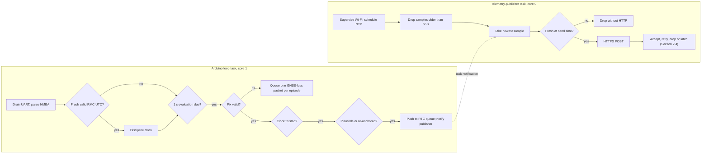

# Hardware Telemetry Contract

| Document ID | Version | Status | Last updated |
|---|---|---|---|
| EKI-HW-001 | 1.0 | Current | 2026-10-30 |

## 1. Introduction

### 1.1 Purpose

This document is the authoritative device-side contract for tracker telemetry. It states what the firmware captures, what it sends and when, how it authenticates, and how it reacts to each failure. The backend's acceptance rules for the same requests are in the [backend API reference](../../backend/API.md). Hardware, wiring, build environments and flashing are in the [hardware guide](../../hardware/README.md).

### 1.2 Scope

The contract covers the telemetry sample, the GNSS-loss packet and remote diagnostics. The device-side firmware update policy is in the [hardware guide](../../hardware/README.md#9-firmware-updates). The flash checkpoint used after complete power loss is in [cold power recovery](COLD_POWER_RECOVERY.md).

### 1.3 Source files

| Topic | Source |
|---|---|
| Tasks, payloads, requests and response handling | [`hardware/src/main.cpp`](../../hardware/src/main.cpp) |
| Fix quality, motion, capture, retry and status policies | [`hardware/include/telemetry_policy.h`](../../hardware/include/telemetry_policy.h) |
| Queue ordering, acknowledgement and expiry | [`hardware/include/telemetry_queue.h`](../../hardware/include/telemetry_queue.h) |
| UTC conversion and clock discipline | [`hardware/include/clock_policy.h`](../../hardware/include/clock_policy.h) |
| Wi-Fi retry and LED patterns | [`hardware/include/connectivity_policy.h`](../../hardware/include/connectivity_policy.h) |
| TLS cipher suites and prepared keys | [`hardware/src/tls_profile.cpp`](../../hardware/src/tls_profile.cpp) |

## 2. Conventions

### 2.1 Transport and authentication

The firmware builds each endpoint from `BACKEND_URL` (trailing `/` removed) and `DEVICE_ID`:

| Request | Method and path |
|---|---|
| Telemetry sample | `POST /api/devices/<DEVICE_ID>/telemetry` |
| Remote diagnostics | `POST /api/devices/<DEVICE_ID>/diagnostics` |
| Firmware release check (fleet builds) | `GET /api/devices/<DEVICE_ID>/firmware?sequence=<n>` |
| Firmware installation reservation (fleet builds) | `POST /api/devices/<DEVICE_ID>/firmware/installation` |

Every request to the backend carries `Authorization: Device <DEVICE_SECRET>`, and every POST carries `Content-Type: application/json`. Telemetry, diagnostics and the release check also send `Cache-Control: no-store`. The download of a firmware image from the artifact host carries no credential.

Messages are not signed. The firmware adds no per-message signature or MAC. Authenticity rests on two mechanisms:

1. TLS server authentication. The firmware validates the certificate chain against `BACKEND_ROOT_CA` and the hostname from `BACKEND_URL`, and does not follow redirects on telemetry requests.
2. The shared device secret. The backend compares it with a salted scrypt verifier in the device registry and takes the bus and route from the registry, never from the request body.

The TLS profile in `tls_profile.cpp` offers only `TLS_ECDHE_RSA_WITH_AES_128_GCM_SHA256` and `TLS_ECDHE_RSA_WITH_AES_256_GCM_SHA384` with curve P-256, for every TLS client in the firmware. The backend and the firmware artifact host must therefore present an RSA certificate that chains to `BACKEND_ROOT_CA`. Telemetry and diagnostics prepare a fresh, single-use P-256 key after DNS resolution and before they connect. The TLS handshake timeout is 10 s.

Development builds also accept an `http://` backend. The device secret then crosses the network unencrypted, so use `http://` only on a trusted bench network. Fleet builds reject `http://` at compile time and at boot.

### 2.2 Time and units

| Quantity | Unit |
|---|---|
| `timestamp`, `deviceSentAt`, diagnostics `timestamp` | Milliseconds since the Unix epoch, UTC, from the disciplined device clock (Section 4.5) |
| Coordinates | Decimal degrees, as reported by the receiver |
| Speed | km/h |
| Heading | Degrees, course over ground |
| HDOP | Dimensionless |
| Durations in diagnostics | Milliseconds |

### 2.3 Schema versions

The firmware sends the nine-field schema in Section 3.1. For staged rollouts the backend also accepts an eight-field schema without `gpsHdop` and a six-field legacy schema without `gpsHdop`, `seq` and `deviceSentAt`. Deploy a backend that accepts the nine-field schema before you flash this firmware.

### 2.4 Response handling

The firmware classifies each telemetry response as follows. A delay is the minimum wait before the next telemetry attempt.

| Response | Action on the sample | Delay before the next attempt |
|---|---|---|
| `200` or `202` | Accept: remove the sample and every older queued sample; reset the retry count; confirm a pending OTA image | None |
| Transport error (negative HTTPClient code), or `408` | Retry | First failure: 250 to 750 ms. Later failures: 1 to 2 s. |
| `404` with `Ngrok-Error-Code: ERR_NGROK_3200`, or `502` with `ERR_NGROK_8012` | Treated as `408` (offline tunnel) | As for `408` |
| `425` or `5xx` | Retry | 1 s doubled per consecutive failure, plus 0 to 1 s jitter, capped at 30 s |
| `429` | Retry | The `Retry-After` value in seconds (at most 300 s), or 60 s without the header |
| `403` | Retry; Wi-Fi stays on | 60 s |
| `401` | Latch a credential fault: stop publishing, disconnect, switch the Wi-Fi radio off, show three LED pulses. The sample stays queued. | No further attempts until the board restarts |
| `404` | Drop | 60 s |
| Any other status, for example `400`, `413` or `422` | Drop | 30 s |
| The firmware cannot serialize a complete payload | Drop | 30 s |

A retried sample stays queued only if it will still be fresh after the delay (Section 4.4); otherwise the firmware drops it and the next attempt sends the newest fresh sample. Each attempt always sends the newest fresh sample in the queue, which may be a capture made during the delay. The consecutive-failure count is capped at 6.

## 3. Operations

### 3.1 Telemetry sample

`POST <BACKEND_URL>/api/devices/<DEVICE_ID>/telemetry` with a closed JSON object of nine fields. The firmware refuses to send an object that is incomplete or that does not fit its 512-byte buffer; the backend limit is also 512 bytes.

| Field | Type | Unit | Values sent by the firmware | Meaning |
|---|---|---|---|---|
| `lat` | number | degrees | -90 to 90 | Latitude |
| `lng` | number | degrees | -180 to 180 | Longitude |
| `speed` | number | km/h | 0 to 200; 0 in the GNSS-loss packet | Speed over ground |
| `heading` | number | degrees | 0 or more, below 360; 0 when the receiver reports no course | Course over ground |
| `gpsHdop` | number | none | 0 to 4; 99 when the receiver omits HDOP and in the GNSS-loss packet | Horizontal dilution of precision |
| `motionState` | string | none | `moving`, `stopped` or `uncertain` | Confirmed motion state (Section 4.3) or GNSS loss |
| `seq` | integer | none | 1 to 4,294,967,295 | Queue sequence number, assigned at capture |
| `timestamp` | integer | ms | Epoch time | Capture time: the evaluation that accepted the fix |
| `deviceSentAt` | integer | ms | Epoch time, not earlier than `timestamp` | Device time read just before the request is serialized |

Example with synthetic values:

```json
{"deviceSentAt":1793333400850,"lat":12.345678,"lng":76.543210,"speed":18.4,"heading":92.5,"gpsHdop":0.9,"motionState":"moving","seq":4182,"timestamp":1793333400610}
```

`seq` increases by one per capture. It survives warm resets with the RTC queue, is restored from the flash checkpoint after complete power loss, and restarts at 1 when neither survives. The backend orders samples by capture time and uses `seq` to break ties and to reject a late-delivered older sample. The backend accepts `timestamp` from 60 s before to 10 s after its own clock, and `deviceSentAt` up to 10 s after its clock.

A successful response carries `X-Eki-Server-Received-At` and `X-Eki-Server-Responded-At` (epoch milliseconds). Development builds print them in the `device_http` trace for clock-offset estimates (Section 7.1).

### 3.2 GNSS-loss packet

When the evaluated fix becomes invalid (Section 4.2), the firmware queues one GNSS-loss packet if both conditions hold:

- at least one fix was captured since boot, and
- the clock is trusted (Section 4.5).

| Field | Value |
|---|---|
| `lat`, `lng` | Last captured position |
| `speed` | 0 |
| `heading` | Last captured heading |
| `gpsHdop` | 99 |
| `motionState` | `uncertain` |
| `timestamp` | Time of the evaluation that found the fix invalid |

The firmware sends one packet per loss episode and then no telemetry until a valid fix returns; the next loss starts a new episode. The packet follows the normal queue and expiry rules, so after 55 s without delivery it is discarded. The firmware never estimates or extrapolates a position.

The backend stores the packet with `signalState` `gnss_lost` so that clients can show the loss, and does not use it as the plausibility anchor for later fixes. Because a stopped bus also stops sending heartbeats during a loss, any backend operation that needs a stopped fix less than 60 s old waits until the fix returns.

### 3.3 Remote diagnostics

`POST <BACKEND_URL>/api/devices/<DEVICE_ID>/diagnostics` with a closed JSON object of 21 fields that fits the firmware's 1,024-byte buffer. The first report is due 30 s after boot and later reports every 5 min. The publisher sends a report only when Wi-Fi is up, the clock is trusted, no credential fault is latched, no earlier report is in flight and no fresh telemetry sample is waiting. A separate `diagnostic-http` task opens a new TLS connection for each report and closes it afterwards, so a diagnostics failure never delays or removes a telemetry sample.

| Field | Meaning |
|---|---|
| `firmwareVersion` | `development`, or the signed version (`PROJECT_VER`, for example `s1-gnss-v1`) in fleet builds |
| `uptimeMs` | Milliseconds since boot |
| `freeHeapBytes` | Free heap |
| `rssiDbm` | Wi-Fi signal strength |
| `queueDepth`, `queueHighWater` | Current and maximum queue occupancy |
| `queueOverflowDrops`, `queueStaleDrops` | Samples overwritten when the queue was full, and samples discarded as older than 55 s |
| `acceptedFixes`, `rejectedFixes` | Telemetry samples accepted, and samples dropped or refused, since boot |
| `nmeaChecksumFailures` | NMEA sentences with a bad checksum since boot |
| `uartBufferOverflows`, `uartFifoOverflows` | UART receive overflows since boot |
| `resetTotal` | Resets recorded in RTC memory since the last power loss or configuration change |
| `fault` | `none` or `credential-rejected` |
| `flashEncryption`, `secureBoot` | Whether each hardware protection is active |
| `timestamp` | Device time of the report |
| `gnssFixAvailable` | Whether the latest evaluated fix is valid |
| `gnssNoFixMs` | Milliseconds without a valid fix (since boot if no fix yet); 0 while a fix is available |
| `lastTelemetryResponseCode` | Status of the last telemetry attempt, a negative transport code, or 0 before the first attempt |

Connect and read timeouts are 1.5 s each. A `2xx` response counts as success and confirms a pending OTA image. `401` latches the credential fault. `403` schedules the next report in 60 s. Any other result retries after 5 s, doubled per consecutive failure, plus 0 to 5 s jitter, capped at 60 s. The backend keeps only the latest report; an administrator reads it with `GET /api/devices/<DEVICE_ID>/diagnostics`.

## 4. Capture and delivery

### 4.1 Runtime tasks

| Task | Core | Stack | Watchdog | Owns |
|---|---|---|---|---|
| Arduino loop task | 1 (Arduino default) | Arduino default | Yes | UART, NMEA parser, fix evaluation, capture, flash checkpoint writes, status LED |
| `telemetry-publisher` | 0 | 20,480 bytes | Yes | Wi-Fi, NTP, telemetry HTTPS, diagnostics scheduling, OTA validation deadline |
| `diagnostic-http` | 0 | 12,288 bytes | No | Diagnostics HTTPS |
| `firmware-maintenance` (fleet builds only) | 0 | 12,288 bytes | Yes | Release checks, installation reservation, image download |

All four tasks run at priority 1. The loop task and the publisher share only short critical sections around the queue and the health counters. A blocked TLS connection therefore never delays NMEA parsing, and the 8,192-byte UART buffer absorbs scheduling jitter.



Figure 1. Capture on the loop task and delivery on the publisher task.

### 4.2 Fix acceptance

Each RMC sentence with a valid checksum and status `A` produces a candidate fix. The candidate is valid only if all of these hold at evaluation:

| Check | Rule |
|---|---|
| Receiver silence | The latest RMC sentence is at most 2 s old. A stale fix stays invalid even after a `millis()` rollover. |
| Field age | Location at most 5 s old; HDOP, speed and course, when present, at most 5 s old |
| HDOP | When present, finite and from 0 to 4 |
| Coordinates | Latitude -90 to 90, longitude -180 to 180 |
| Speed | Finite and from 0 to 200 km/h |

A valid fix is captured only if it is plausible against the last captured fix. The firmware mirrors the backend rule in `backend/src/lib/telemetryMotion.ts`:

- Travel envelope: the distance must not exceed an error budget plus travel at the faster of the two reported speeds (capped at 200 km/h) over the whole gap. The error budget is 15 m plus 7 m per HDOP unit (50 m when HDOP is unknown), plus 10 m when both speeds are at most 2.5 km/h, plus 1 m per 2 s of gap beyond 10 s (at most 10 m), bounded to 15 to 50 m.
- Reacquisition: after 5 min without a capture, any valid fix is accepted.
- Re-anchoring: three consecutive rejected fixes re-anchor the reference (about 3 s). Each must have HDOP from 0 to 4, follow the previous one by 0.5 to 5 s, be plausible against it, and be reachable from the old reference at 200 km/h. A single outlier, or one sentence evaluated twice, never re-anchors.

A rejected fix produces no sample and the serial line `[GNSS] Ignoring implausible position jump (<distance>m from last fix).`

### 4.3 Capture cadence and motion state

The loop task evaluates the latest fix every 1 s. It captures the fix when the fix is valid, the clock is trusted, the fix is plausible, and at least 1 s has passed since the last capture. A change of at least 5 m, 15° or 5 km/h, or of motion state, also triggers a capture. The heartbeat is 1 s in both motion states, so in practice every evaluation with a valid fix produces a sample. The 1 s stopped heartbeat keeps a parked bus inside the backend's 60 s freshness requirement for endpoint arrival and automatic turnaround.

The motion state changes to `moving` after three consecutive evaluations at 2.5 km/h or more, and to `stopped` after three consecutive evaluations at 1.5 km/h or less. A reading between the two thresholds resets a pending change, so isolated noisy readings cannot complete one.

### 4.4 Queue, ordering and expiry

| Property | Value |
|---|---|
| Capacity | 100 samples, about 5.5 KiB. `main.cpp` asserts that the queue and the reset statistics fit in 6 KiB of the 8 KiB RTC slow memory. |
| Storage | RTC no-init memory. It survives software, panic, watchdog and brownout resets, and is lost on power loss. |
| Recovery check | Layout identifier, a configuration tag derived from `DEVICE_ID` and `BACKEND_URL`, and a checksum. Any mismatch resets the queue. |
| Overflow | The oldest sample is overwritten and counted in `queueOverflowDrops`. |
| Expiry | Before each send the publisher discards samples older than 55 s (`queueStaleDrops`). It also drops a sample whose age at the exact send time is negative or 55 s or more, without sending HTTP. |
| Order | The publisher always sends the newest sample, so live state recovers first after an outage. |
| Acknowledgement | `200` or `202` removes the sample and every older sample, and keeps samples captured during the request. |

The 55 s margin keeps every delivered sample inside the backend's 60 s acceptance window. At one capture per second the queue holds about 100 s of samples, of which only the newest 55 s are deliverable. After complete power loss the firmware can restore one sample from the flash checkpoint ([cold power recovery](COLD_POWER_RECOVERY.md)).

### 4.5 Clock discipline

The firmware sends telemetry only while its clock is trusted: no unresolved disagreement between sources, and a time at or after 2023-11-14 (epoch 1,700,000,000,000 ms).

1. GNSS time is the primary source. An RMC date and time at most 2 s old, with a valid calendar date from 2023 to 2099, is converted without time-zone functions. The firmware uses GNSS time only while the last three distinct RMC epochs advance with the monotonic clock: 0.5 to 3 s apart, each within 250 ms of the expected advance.
2. After the first application, the firmware corrects the system clock from GNSS at most once per minute and only when the difference is 1.5 s or more.
3. NTP (`pool.ntp.org`, `time.google.com`) starts when Wi-Fi connects and repeats every 6 h. The firmware vets each NTP result before it changes the time.
4. A correction of more than 10 s against an already trusted clock needs a fresh agreeing peer: an NTP result at most 10 min old, or a GNSS reference. If GNSS and NTP disagree by more than 1.5 s, the firmware pauses new TLS connections and telemetry instead of changing the certificate time, and retries NTP every 60 s.
5. Sample times come from the latest GNSS reference projected with the monotonic clock while that reference is less than 24 h old, and otherwise from the system clock.

These checks establish consistency between sources, not cryptographic authenticity of GNSS or NTP time.

## 5. Timing and limits

| Parameter | Value |
|---|---|
| Fix evaluation | Every 1 s |
| Moving and stopped heartbeat | 1 s and 1 s |
| Motion thresholds | Moving at 2.5 km/h or more, stopped at 1.5 km/h or less, 3 consecutive evaluations |
| Material change | 5 m, 15°, 5 km/h |
| Receiver silence limit | 2 s |
| Fix field age limit | 5 s |
| HDOP limit | 4 |
| Re-anchoring | 3 fixes, 0.5 to 5 s apart |
| Reacquisition after gap | 5 min |
| Queue | 100 samples |
| Delivery freshness margin | 55 s |
| DNS caller wait (telemetry and diagnostics) | 1 s ([DNS cold connect](DNS_COLD_CONNECT.md)) |
| Telemetry TCP connect | 1 s |
| Telemetry request and read | 1.5 s |
| Accepted-body drain | 1 s ([HTTPS response reuse](HTTPS_RESPONSE_REUSE.md)) |
| TLS handshake | 10 s |
| Diagnostics connect and read | 1.5 s each |
| Telemetry retry | Section 2.4 |
| Wi-Fi retry | First attempt at once, then 5, 10, 20, 40 and 60 s, repeating at 60 s |
| Task watchdog | 25 s, panic and restart |
| Diagnostics | First at 30 s, then every 5 min |
| NTP cross-check | At Wi-Fi connection, then every 6 h; every 60 s while sources disagree |
| GNSS clock correction | 1.5 s or more, at most once per minute |
| Flash checkpoint | First captured fix after boot, then at most every 10 s |

`main.cpp` asserts at compile time that the DNS, connect, TLS handshake, request and drain limits together (14.5 s) stay below the 25 s watchdog. These are separate phase limits, not an end-to-end deadline.

Wi-Fi runs in station mode only, with persistence off, automatic reconnection on, fast scan, strongest access point first and modem sleep off. The firmware treats the link as up only when the Arduino status reports a connection and the ESP32 driver still reports an associated access point, and each retry issues a new connect request. The firmware never starts an access point or an HTTP server.

## 6. Failure handling

| Failure | Detection | Firmware behaviour | Remaining action |
|---|---|---|---|
| Vehicle power or cabling | Resets, missing telemetry | Reset reason counted in RTC memory and reported as `resetTotal`; one checkpointed sample can survive power loss | Automotive wiring, spares |
| Receiver, antenna or UART | `[GNSS] Not connected`, `gnssFixAvailable` `false`, checksum or UART overflow counters | One GNSS-loss packet, then silence until a valid fix | Physical inspection, antenna placement |
| Wi-Fi or hotspot | `[WiFi]` lines, RSSI, transport errors | Indefinite bounded retry; samples queue and expire after 55 s | Coverage and hotspot redundancy |
| Clock | `[Clock]` rejection lines | No telemetry or TLS while untrusted | Check receiver time and NTP reachability |
| Backend or Firebase | `5xx`, transport errors | Exponential retry with jitter; newest sample first on recovery | Backend availability |
| Device credential | `401`, three LED pulses | Publishing stops and the radio switches off until restart | Repair the registry, reprovision or reflash, then restart |
| Device assignment | `403` | Wi-Fi stays on; retry every 60 s | Repair the bus and route assignment |
| Root CA rotation | TLS failure | Fails closed | Reflash with the new root CA before the old issuer expires |
| Hardware security (fleet) | Four LED pulses, diagnostics booleans | Halts after the `secrets.h` checks and before it starts networking | [Hardware security provisioning](../security/HARDWARE_SECURITY_PROVISIONING.md) |
| Task stall | Watchdog reset, `[Boot] Recovered from ... reset` | Restart; the RTC queue survives | Capture the serial log |

## 7. Diagnosis and evidence

### 7.1 Serial traces

Development builds print traces by default; fleet builds print them only when built with `EKI_ENABLE_FLEET_TRACES=1`. Health lines print in every build.

| Line | Content |
|---|---|
| `[TelemetryTrace]` `device_capture` (version 2) | Sequence, sample time, receiver UTC, RMC first-byte and checksum times, evaluation and enqueue monotonic times |
| `[TelemetryTrace]` `device_http` (version 1) | Sample, send and receive device times, server receive and respond times, HTTP duration, status, attempt |
| `[TelemetryTrace]` `device_http_complete` (version 2) | Send, header and body-drain monotonic times, whether the response completed |
| `[NetworkTiming]`, `[TlsResources]`, `[AllocationTiming]`, `[GnssTrace]` | DNS and TLS timing, heap and stack headroom, JSON preparation time, per-RMC receiver state |
| `[Telemetry] Evidence` (every diagnostics cycle) | Captures, attempts, retries, capture age, accepted age, queue depth, remaining retry delay |
| `[PowerCheckpoint]`, `[FirmwareResources]`, `[HTTPS]`, `[WiFi]`, `[GNSS]`, `[Clock]` | Health and failure lines |

`configuredHandshakeTimeoutMs` in `[NetworkTiming]` is the configured limit, not a measured handshake. The [telemetry latency baseline](../operations/TELEMETRY_LATENCY_BASELINE.md) and [field capture](../operations/FIELD_CAPTURE.md) procedures consume these lines.

### 7.2 Gap classification

Treat a gap in live updates as intentional only when the `[Telemetry] Evidence` line shows `captureSeen=1`, a `captureAgeMs` within the 1 s heartbeat, and no queue or retry delay. A `captureAgeMs` above the heartbeat points to GNSS capture or fix quality. A current capture with a growing `acceptedAgeMs`, a non-zero queue, a retry delay, stale drops, transport errors or rejections points to delivery.

### 7.3 Backend latency metrics

The admin-only `GET /api/health` response contains `telemetry` latency summaries over a rolling window of 512 samples per process; a backend restart resets them.

| Field | Measures |
|---|---|
| `deviceQueueLatencyMs` | `deviceSentAt` minus `timestamp`: time a sample spent on the device |
| `networkLatencyMs` | Server receipt minus `deviceSentAt` |
| `deviceToServerLatencyMs` | Server receipt minus `timestamp` |
| `processingLatencyMs`, `rtdbWriteLatencyMs` | Backend processing and Realtime Database transaction time |

The cross-clock values are valid only while the device clock is correct.

### 7.4 Recorded evidence

A capture on 20 October 2026 contained one payload whose `deviceSentAt` preceded its `timestamp` by 30 ms. Replaying that payload produces the backend rejection `invalid_device_sent_at`. The capture establishes the invalid ordering, not the physical cause of the clock adjustment. The send-time check in Section 4.4 drops such a sample before it is sent; the native test `test_send_boundary_rechecks_original_sample_after_clock_rewind` covers the check.

## 8. Physical acceptance

A successful build and native tests do not establish physical behaviour. Before fleet use, test on the target hardware:

- cold and warm GNSS acquisition, stationary drift, urban multipath and covered-road loss;
- Wi-Fi loss and recovery, backend outage and recovery, and power cycling during an active ride;
- credential rejection (`401` switches the radio off and shows three pulses) and assignment rejection (`403` keeps the radio on);
- that no access point or port 80 listener appears during outages, and that a reflash with a different `secrets.h` never reuses old Wi-Fi credentials;
- every route stop in order and the ride's completion.

Record p50, p95 and p99 display latency, serial reset and failure logs, the source commit, the firmware image hash, route and weather.
