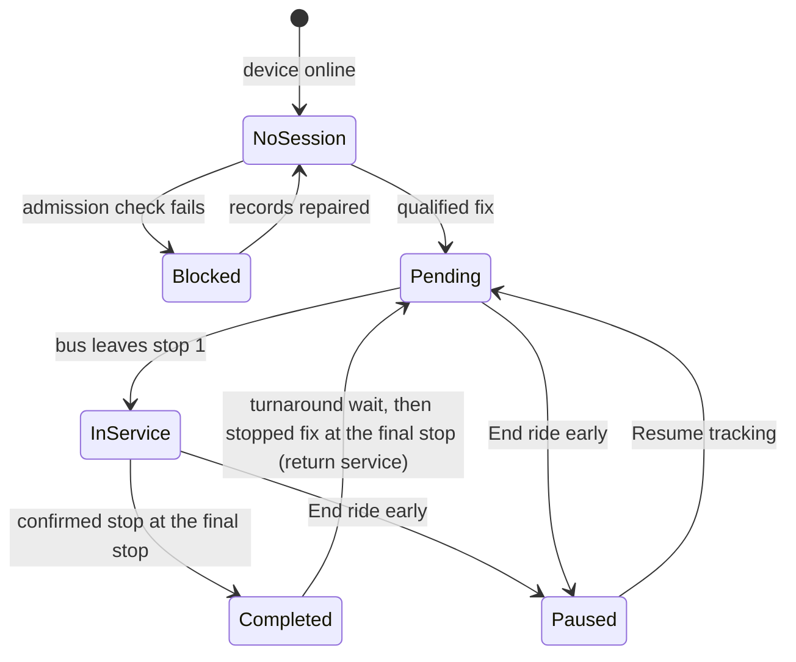

# Automatic GNSS Service

| Document ID | Version | Status | Last updated |
|---|---|---|---|
| EKI-OPS-009 | 1.0 | Current | 2026-10-30 |

## 1. Purpose

This document explains, for operators and administrators, how a ride session starts, progresses, survives outages, ends and resumes. The backend starts the service from the device's own GNSS fixes: no open admin tab and no start action are needed. The authenticated ride-session API remains for compatible clients and for `Resume tracking`.

The matching and stop algorithms are specified in [tracking algorithms](../design/TRACKING_ALGORITHMS.md); the session API in [ride-session contract](../api/RIDE_SESSION_CONTRACT.md).

## 2. Lifecycle

Figure 1. Service lifecycle. `NoSession` is `Service setup pending`, `Blocked` is `Assignment required` or `Awaiting return service`, and `Pending` covers `Direction Pending` and `Awaiting Stop 1`.

| Live Ops label | Meaning |
|---|---|
| `Service setup pending` | The device is online and no ride session exists yet (Fleet & People shows `Ride Not Armed`) |
| `Assignment required` | Device, bus, route or operator records do not satisfy Section 3 |
| `Direction Pending` | A session exists; the backend has not yet decided the direction of travel |
| `Awaiting Stop 1` | Direction known; the bus has not left stop 1 (trip state `pre_departure`) |
| `In Service` | The bus has left stop 1 (trip state `in_service`) |
| `Service paused` | A session exists but no location update arrived for 30 s, or the device is offline (Section 5) |
| `Completed` | The bus confirmed its stop at the final stop |
| `Awaiting return service` | The outbound ride completed; the return service has not started yet |
| `Tracking paused` | An administrator ended the ride early; no new service starts until `Resume tracking` |
| `Offline` | No session and no fresh location from the device |

## 3. Admission conditions

The backend starts a service when an accepted fix meets every condition below. It re-reads the records inside the session-creation transaction, so a change made while a start is in progress is honoured.

| Condition | Record |
|---|---|
| The device exists, is enabled, and is assigned to this bus and route at the current assignment revision | `devices/{deviceId}` |
| The bus exists, is not inactive, lists the route, and does not have `automaticServiceEnabled: false` | `buses/{busId}` |
| Exactly one operator record has `assignedBusId` equal to the bus, and it is neither disabled nor inactive | `drivers` |
| The route has a valid ordered stop list | `routes/{routeId}` |
| The bus is not paused and has no unfinished return journey | `bus_locations/{busId}` |
| The fix is at most 60 s old and at most 10 s in the future, has HDOP between 0 and 4, and is not marked `uncertain` | Telemetry |

Admission runs in a bounded per-bus queue outside the telemetry acknowledgement, so the device's request is answered without waiting for the session. A blocked bus is retried after 30 s; a failed attempt after 2 s. The backend uses the same session operation as the authenticated API, with a fixed idempotency key and the durable per-bus lock, so retries and several backend instances create one session. If a start is interrupted, the session carries `serviceSetupPending` and the next accepted fix completes it.

## 4. Direction and stop progress

The table lists the rules an operator needs when placing stops and reading Live Ops. The full rules are in [tracking algorithms](../design/TRACKING_ALGORITHMS.md#64-direction-selection) (direction) and [stop progression](../design/TRACKING_ALGORITHMS.md#7-stop-progression).

| Rule | Value |
|---|---|
| Direction from an endpoint | A stopped fix within 10 m of exactly one route endpoint |
| Direction from departure | At least three fresh reliable moving fixes, 30 m of net travel along one unambiguous first leg |
| Leaving stop 1 | 50 m from stop 1; between 10 m and half the distance to stop 2 when stop 2 is closer than 100 m |
| Stop arrival | A reliable fix, or the segment between two consecutive reliable fixes, within 15 m of the stop, in route order |
| Wrong side of a divided road | A stop more than 6 m to the right of a moving bus is not credited (traffic keeps left) |
| Stop missed with telemetry running | Credited `passed_unobserved` (`Passed · not confirmed`) when the bus reaches one of the next two stops in its direction of travel; never an arrival |
| GNSS gap | More than 10 s without a fix, an untrusted fix, or a segment longer than 250 m |
| After a gap | A reliably observed later stop credits the stops in between as `skipped_gnss_gap`, if the bus could have covered the distance at 25 m/s or less |
| Final stop | Speed of 2.5 km/h or less within 15 m, confirmed by fixes spanning 2 s (`TERMINAL_ARRIVAL_CONFIRMATION_MS`) |
| Return service | After a 30 s wait (`AUTOMATIC_TURNAROUND_DWELL_MS`), a fresh stopped fix at the final stop starts a new session in the opposite direction |

While the bus is at a stop, the live record publishes `atStopIndex`, and passengers see `At <stop>`. A device that boots mid-route does not claim the stops before its first observation. These rules have been validated on simulated tracks only ([risk TRK-01](ARCHITECTURE_RISK_REGISTER.md#37-trk-01-stop-progress-is-validated-on-simulated-tracks-only)).

## 5. Outages and liveness

The session survives GNSS, network, tunnel and backend outages. The passenger and admin views time the silence on the viewer's own clock, so they change state even when the backend is stopped. Live Ops re-checks every 15 s, so its states can lag the passenger view by up to 15 s. The state rules are specified in [live bus health](../design/TRACKING_ALGORITHMS.md#9-live-bus-health).

| Condition | Passenger view | Live Ops |
|---|---|---|
| Firmware sends its GNSS-loss packet | `GPS signal lost` at once | Marker drawn orange (uncertain fix) |
| No location update for 12 s | `Updates delayed` | No change |
| No location update for 30 s | `Live tracking lost`; ETAs, boarding and `Bus is here` are held back | `Service paused` and `Live location updates delayed` |
| No location update for 5 min | The ride leaves the map and the route list; it returns if the device reconnects while the session exists | `Last seen <time>`; the bus stays on the map at its last accepted position |
| Device reconnects | Same session and stop progress | Same session |
| No ride activity for 12 h | Session closed by the abandoned-ride reconciler; the next qualified fix starts a new service | Same |

The 5-minute browser limit is `NEXT_PUBLIC_BUS_EXPIRY_MS` (default `300000`); the backend's stale limit is `BUS_STALE_MS` (default `300000`, minimum `90000`); the 12-hour limit is `ABANDONED_RIDE_THRESHOLD_HOURS`. Keep the browser and backend values equal when overriding them ([configuration](../CONFIGURATION.md)).

## 6. Ending, pausing and resuming a service

### 6.1 End a ride early

1. In Live Ops, open the bus card or its live-details drawer and select `End ride early`. Expected: a confirmation dialog `End ride early?` appears.
2. Select `End ride`. Expected: the ride appears in History as `Ended early`, the bus leaves the passenger views, and the card shows `Tracking paused`.

The action requires a current administrator. It works even if the operator was reassigned. It releases only the lock that this session holds, and it pauses automatic starts only if that session still owns the bus, so retrying an old stop cannot pause a newer ride. Further fixes show the device online but do not restart the ended ride.

A ride that ends without this action (closed by the abandoned-ride reconciler, or a failed return) does not pause the bus: the next qualified fix starts a new service.

### 6.2 Resume tracking

1. Confirm that the bus has exactly one assigned operator and the device is online. Expected: Live Ops shows `Resume tracking · <bus-id>` under Automatic service.
2. Select it. Expected: `Automatic tracking resumed for <bus-id>.`, and the card shows `Direction Pending` or `Awaiting Stop 1`.

Resume uses the protected ride-session API with a stable retry key. It starts in `pre_departure` and never credits an origin arrival that was not observed.

## 7. Troubleshooting

| Symptom | Check | Action |
|---|---|---|
| Device online, no service, no label | Fix age and HDOP in the serial log | Move to open sky; wait for HDOP of 4 or less |
| `Assignment required` | Device registry, bus route list, operators assigned to the bus | Correct the records in Fleet & People; the next fix after 30 s retries |
| `Tracking paused` but no Resume button | Device offline, or not exactly one operator | Power the device; fix the operator assignment |
| `Direction Pending` for a long time | Bus started away from an endpoint, or the endpoint pin is more than 10 m from where the bus parks | Stop within 10 m of an endpoint, or drive the first leg from stop 1; move the pin if needed |
| A stop never marks | Pin more than 15 m from the lane, or on the far side of a divided road | Move the pin to the near kerb in the Routes tab |
| Fleet changes fail with a reconciliation lock error | The fleet-authorization lock is held | Follow the guarded recovery in [operation resources](../api/OPERATION_RESOURCES.md); do not delete the lock document |

## 8. Verification

The automated suites cover admission, lifecycle, stop progress and liveness: backend unit and emulator tests, passenger layout and progress Playwright suites, and the emulator-backed browser acceptance (see [CI, deployment and releases](CI_CD_AND_RELEASES.md#3-production-verification-ciyml)). The optional real Maps replay feeds simulated positions over cached route geometry; it is not physical movement acceptance. Its resource allowlist includes `mapsresources-pa.googleapis.com` [1].

Run destructive lifecycle scenarios only against the emulator or a disposable project. A stationary device can confirm freshness and connectivity. Stop accuracy, the divided-road behaviour and ETA accuracy need a moving device on the real route ([field capture](FIELD_CAPTURE.md)). The latest recorded field ride is in [passenger field ride repairs](../testing/PASSENGER_FIELD_RIDE_REPAIRS_2026_10_29.md).

## 9. References

[1] Google, "Google Maps Platform domains," developers.google.com/maps/domains. Accessed: 2026-10-30.
