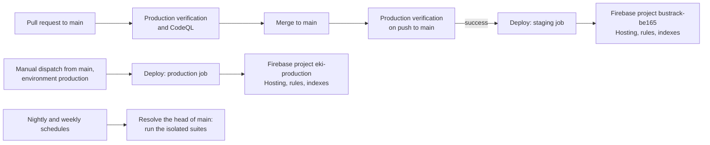

# CI, Deployment and Releases

| Document ID | Version | Status | Last updated |
|---|---|---|---|
| EKI-OPS-001 | 3.0 | Current | 2026-11-01 |

## 1. Purpose

This document describes the GitHub Actions workflows in `.github/workflows/`, what each one verifies or deploys, the branch flow they assume, and how to release and roll back. It names secrets and environments only; values belong in GitHub environment secrets or the owner's secret manager.

Readiness gates that sit outside the repository (infrastructure owners, privacy approval, field acceptance) are listed in the [deployment checklist](UNIVERSITY_DEPLOYMENT_CHECKLIST.md).

## 2. Branch and release flow

Pull requests target `main`, and the scheduled QA workflows test the head of `main` (Section 6).

Figure 1. Branch, verification and deployment flow.

A green push to `main` releases the frontend and security rules to `bustrack-be165` without further approval. That project is the default in `.firebaserc` and serves `https://bustrack-be165.web.app`, the site that field tests use. No separate staging project exists in the repository configuration. No workflow deploys the backend (Section 7).

| Workflow file | Name | Triggers | Deploys |
|---|---|---|---|
| `ci.yml` | Production verification | Every push to any branch; every pull request | Nothing |
| `codeql.yml` | CodeQL | Every push except `dependabot/**`; every pull request | Nothing |
| `deploy.yml` | Deploy | Completion of Production verification; manual dispatch | Hosting, Firestore rules, RTDB rules and Firestore indexes |
| `deep-qa.yml` | Isolated nightly QA | Daily at 20:17 UTC (01:47 IST); manual dispatch; pushes to six `codex/qa-*` branches | Nothing |
| `weekly-reliability.yml` | Isolated weekly reliability baseline | Saturdays at 20:41 UTC (Sundays 02:11 IST); manual dispatch; pushes to `codex/qa-nightly-reliability` | Nothing |

## 3. Production verification (`ci.yml`)

The workflow uses Ubuntu runners, Node.js 24, the runner's Java 21 (for Firebase emulators) and Python 3.12 with PlatformIO 6.2.0. It needs no secrets: every Firebase and Maps value it uses is a placeholder.

| Job | Timeout | Checks |
|---|---|---|
| `web` | 30 min | `npm ci`; QA catalog and safety checks (`qa:check`, `qa:catalog`, `qa:gnss`, `qa:unit:reviewed`, and `qa:budget` on pull requests); RTDB instance preflight; OpenAPI route coverage; `npm run lint`; `npm test`; Firestore and RTDB rules in emulators; bounded work admission under stalled dependencies; Playwright suites for admin access, passenger layout, passenger progress and production audit regressions; emulator-backed passenger browser and HTTP authorization suites; strict production build with CSP regeneration; canonical, social and crawler origins in the export; `npm audit` for runtime and for all dependencies; CycloneDX SBOM |
| `backend-image` | 20 min | Builds `backend/Dockerfile`, boots it with `NODE_ENV=production` and placeholder Firebase settings, requires `503` with `"status":"degraded"` from `/health`, `200` with `"status":"alive"` from `/live`, and a Docker health check on `/live`; Trivy fails on fixed `CRITICAL` or `HIGH` OS and library findings |
| `firmware` | 15 min | Secure-fleet JTAG configuration test; native firmware tests (`qa:native`); host protocol tests; builds `esp32dev`, `esp32dev-quiet` (trace strings must be absent) and `esp32dev-journal`; links the SNTP guard; builds `esp32dev-secure` with an ephemeral key generated in the job and checks that the signed image rejects modification and foreign keys |
| `qa-evidence` | 8 min | Runs after `web` and `firmware`, even when they fail; merges their evidence artifacts and runs `qa:report` |

The firmware job copies `hardware/include/secrets.example.h` to `secrets.h` and inserts a fake secret so that the network code is compiled. CI never handles a fleet signing key or produces a fleet artifact.

Artifacts are kept for 7 days, except the SBOM (`production-dependency-sbom`), which is kept for 30 days.

CI establishes that the source builds and that the automated suites pass. It does not establish GNSS reception, vehicle power, radio coverage, TLS against the deployed certificate chain, Secure Boot provisioning, stop accuracy on a real route, or the behaviour of the deployed backend. The Slow 3G and Offline browser checks remain manual (see the [deployment checklist](UNIVERSITY_DEPLOYMENT_CHECKLIST.md)).

## 4. CodeQL (`codeql.yml`)

The `analyze` job runs CodeQL with the `security-extended` query suite for `javascript-typescript` and `python`, on every pull request and on pushes except `dependabot/**`. Dependabot uses the PR upload path because its read-only push token cannot upload SARIF. The job requests `security-events: write` and needs no secrets. Findings appear in the repository's code scanning alerts and require triage.

## 5. Deploy (`deploy.yml`)

### 5.1 Triggers and conditions

| Job | Runs when | Environment | Firebase project | Checked-out commit |
|---|---|---|---|---|
| `deploy-staging` | Production verification completed with `success` for a `push` to `main` in this repository; or manual dispatch from `main` with `environment: staging` | `staging` | `bustrack-be165` | The verified commit (`workflow_run.head_sha`); on dispatch, the head of `main` |
| `deploy-production` | Manual dispatch from `main` with `environment: production` | `production` | `eki-production` | The head of `main` at dispatch |

Runs for pull requests, forks and other branches are skipped. A run waits while another run for the same environment is in progress, and GitHub keeps only the newest waiting run (`concurrency: deploy-<environment>`, `cancel-in-progress: false`). The Firebase CLI is pinned to `firebase-tools@15.14.0`.

### 5.2 Steps

Both jobs run the same steps against their own project. A failed step stops the job, so nothing after it is deployed.

1. `npm ci`.
2. `npm run verify:rtdb-instance`: the backend and frontend database URLs must name the same RTDB instance, and its region must equal `RTDB_EXPECTED_REGION` when that variable is set.
3. `npm run build:production`: strict build that fails when one of the ten `NEXT_PUBLIC_*` values is missing or when the RTDB or backend URL is not a non-local HTTPS URL (`frontend/next.config.ts`), then regenerates the service worker and the CSP in `firebase.json` with the backend origin.
4. `npm run verify:web-backend-contract` with `EKI_RUNTIME_SMOKE=1`: the live backend at `NEXT_PUBLIC_BACKEND_URL` must answer `/health` with `status: ok`, allow the frontend origin (`https://bustrack-be165.web.app` or `https://eki-production.web.app`) in CORS, and accept the preflight for `POST /api/users/bootstrap`.
5. `node scripts/disable-appcheck-enforcement.mjs --project <project> --disable`: sets App Check enforcement for Firestore and RTDB to `UNENFORCED` and verifies the result. The web app does not use App Check.
6. Deploy `firestore:indexes`, then wait up to 30 minutes for the deployed query shapes ([Firestore index deployment](FIRESTORE_INDEX_DEPLOYMENT.md)).
7. Deploy `hosting,firestore:rules,database:rules`.

Step 4 makes every Hosting release depend on a running, healthy backend. While the backend runs on a workstation (Section 7.1), a release fails if the workstation or tunnel is down.

### 5.3 Environments, secrets and variables

| Name | Kind | Used by | Purpose |
|---|---|---|---|
| `staging`, `production` | GitHub environments | Deploy jobs | Scope the secrets below |
| `FIREBASE_TOKEN` | Environment secret | Steps 5 to 7 | Firebase CLI token for that project |
| `FIREBASE_DATABASE_URL` | Environment secret | Step 2 | RTDB URL that the backend uses |
| `NEXT_PUBLIC_FIREBASE_API_KEY`, `NEXT_PUBLIC_FIREBASE_AUTH_DOMAIN`, `NEXT_PUBLIC_FIREBASE_DATABASE_URL`, `NEXT_PUBLIC_FIREBASE_PROJECT_ID`, `NEXT_PUBLIC_FIREBASE_STORAGE_BUCKET`, `NEXT_PUBLIC_FIREBASE_MESSAGING_SENDER_ID`, `NEXT_PUBLIC_FIREBASE_APP_ID`, `NEXT_PUBLIC_GOOGLE_MAPS_API_KEY`, `NEXT_PUBLIC_GOOGLE_MAP_ID`, `NEXT_PUBLIC_BACKEND_URL` | Environment secrets | Steps 2 to 4 | Values compiled into the static frontend |
| `RTDB_EXPECTED_REGION` | Variable (optional) | Step 2 | Expected RTDB region, for example `asia-southeast1`. Not set on 2026-10-30, so step 2 checks only that both URLs name one instance. |

The workflow passes no other build variables. `NEXT_PUBLIC_SITE_URL` and `NEXT_PUBLIC_SITE_INDEXING` are therefore unset in deployed builds: canonical and social URLs fall back to `https://bustrack-be165.web.app` and indexing is enabled. A custom domain or a production build needs those two values added to the workflow ([DNS and domains](DNS_AND_DOMAINS.md)). The meaning of each variable is in [configuration](../CONFIGURATION.md).

Browser values become public after bundling. Restrict the Firebase and Maps browser keys by referrer and API.

### 5.4 What is deployed where

| Artifact | Source | Deployed by |
|---|---|---|
| Static frontend (`frontend/out`), headers and CSP | `firebase.json` `hosting` | Deploy, step 7 |
| Firestore security rules | `firestore.rules` | Deploy, step 7 |
| RTDB security rules and indexes | `database.rules.json` | Deploy, step 7 |
| Firestore composite index and field overrides | `firestore.indexes.json` | Deploy, step 6 |
| App Check enforcement mode | Firebase App Check API | Deploy, step 5 |
| Backend (`backend/Dockerfile`) | Built and smoke-tested by CI only | No workflow |
| Firmware | `hardware/` | No workflow; flashed by hand ([hardware guide](../../hardware/README.md)) |
| Firebase data, Auth users, DNS, TLS, WAF | Not in the repository | No workflow |

`firebase.json` has no Hosting rewrites, so Hosting serves only static files.

### 5.5 Repository settings

These GitHub settings are not stored in the repository. They were read through the GitHub API on 2026-10-30:

| Setting | Value | Effect |
|---|---|---|
| Ruleset `main` (default and all branches) | Pull request with one approving review and code owner review (`* @notnamansinha`), stale approvals dismissed on push; no deletion or force push; merge or squash; maintainers and administrators may bypass | No status check is required, so reviewers confirm that CI passed before merging ([OPS-03](ARCHITECTURE_RISK_REGISTER.md#310-ops-03-the-main-ruleset-requires-no-status-checks)). Deploy still runs only after a green verification. |
| Environments | `staging` (no protection rules; the twelve secrets above plus an unused `NEXT_PUBLIC_RECAPTCHA_ENTERPRISE_SITE_KEY`) and `copilot`; no `production` | A job that names a missing environment creates it, so the first production dispatch would run without reviewers or secrets. Create `production` with required reviewers first. |
| Secret scanning and push protection | Enabled | Pushes containing recognised secrets are blocked |

## 6. Scheduled QA (`deep-qa.yml`, `weekly-reliability.yml`)

Both workflows start with a `resolve` job that pins one commit. On a schedule or manual dispatch (which must run from `main`) the job reads the head of `main` through the GitHub API; on a push to one of the listed `codex/qa-*` branches it uses the pushed commit. Neither workflow uses secrets, and both refuse to run outside `notnamansinha/Eki`.

| Workflow | Matrix suites | Report job |
|---|---|---|
| Isolated nightly QA | `gnss`, `emulator`, `browser`, `api`, `native`, `reviewedUnit`, each through `node scripts/qa/campaign.mjs <suite>` | `node scripts/qa/campaign-report.mjs` |
| Isolated weekly reliability baseline | `mutation` (`npm run qa:mutation`) and `soak` (`npm run qa:soak`) | `node scripts/qa/weekly-report.mjs` |

The `testing` branch was deleted on 2026-10-25; scheduled runs from then until the resolver was changed to `main` failed in `resolve` with `Not Found` and ran no suite. The last scheduled runs that executed suites were on 2026-10-24 (UTC). None of the listed `codex/qa-*` branches exists, so their push triggers never fire. The [risk register](ARCHITECTURE_RISK_REGISTER.md#36-ops-02-scheduled-qa-runs-no-suites) closes OPS-02 once a nightly and a weekly run are green on `main`. The campaigns are described in [scheduled reliability](../../qa/SCHEDULED_RELIABILITY.md).

## 7. Backend hosting

### 7.1 Current state

The repository builds and tests a backend container (`backend/Dockerfile`: Node.js 24 on Alpine, non-root user, port `8080`, Docker health check on `/live`), but no workflow publishes or runs it. The backend runs on a workstation and is reached through an ngrok tunnel ([ngrok tunnel](NGROK_TUNNEL.md)). A read-only assessment on 2026-10-21 found:

- The frontend build and the device firmware both use the tunnel origin as the backend URL.
- The workstation backend runs in development mode on port `4000`, as a single process that also runs the lease-owned workers ([worker leadership](WORKER_LEADERSHIP.md)).
- Firestore is in `asia-south2`; the configured RTDB instance is in `us-central1`.
- Cloud Billing and the Cloud Run API were disabled on `bustrack-be165`.

The service is available only while the workstation, the backend process and the ngrok agent are running.

### 7.2 Proposed migration to Cloud Run

Status: Proposed. Nothing below is implemented.

The proposal runs the existing container on Cloud Run in the same Firebase project and keeps Hosting, Authentication, Firestore and the existing RTDB instance unchanged. Cloud Run needs a Cloud Billing account on the project, which moves a Spark project to the Blaze plan [2].

- Prefer one public origin: Hosting rewrites for `/api/**`, `/health` and `/live` to the service. If the extra hop fails device latency acceptance, use a stable API hostname instead ([DNS and domains](DNS_AND_DOMAINS.md)).
- Run at least one instance with instance-based CPU, because the process runs continuous workers outside request handling.
- Run the service with `NODE_ENV=production`. Production startup requires `CORS_ORIGIN` and `RETENTION_SWEEPER_ENABLED=true`, which turns on retention deletion; review the retention policy before the first production start ([RTDB retention](RTDB_RETENTION.md), [privacy deletion](PRIVACY_DELETION.md)).
- Move worker leadership deliberately: stop the workstation coordinator, then confirm that the cloud instance holds the lease.
- Rebuild the frontend and reflash every device with the new origin and its root CA. Retire the tunnel only after the system works with the workstation disconnected.

The gate to make this current: a billing owner, a reviewed backend release workflow with image digest and rollback, a staging acceptance record, and a rehearsed rollback.

## 8. Release procedure

Prerequisites: the change has a pull request to `main`; the backend at `NEXT_PUBLIC_BACKEND_URL` is running and healthy.

1. Wait for Production verification and CodeQL on the pull request. Expected: all jobs green.
2. If the change alters an HTTP contract or a backend behaviour that the new frontend needs, update the backend first: on the backend host, stop the backend, check out the merge candidate, run `npm ci`, and start the backend again ([ngrok tunnel](NGROK_TUNNEL.md)). Expected: `/health` returns `status: ok`.
3. Obtain the approving review and code owner review, then merge. Expected: Production verification runs on the push to `main`.
4. Watch the Deploy run in the Actions tab. Expected: `deploy-staging` succeeds; `deploy-production` is skipped.
5. If the release changed firmware, build and flash it separately ([hardware guide](../../hardware/README.md)); vehicles use only the signed procedure in [hardware security provisioning](../security/HARDWARE_SECURITY_PROVISIONING.md).
6. Production: only after the `eki-production` project and a `production` environment with required reviewers exist, dispatch Deploy from `main` with `environment: production`. Expected: the run waits for approval, then succeeds.

## 9. Verification after a release

1. Open the site and confirm that the page loads the new build. Expected: no CSP errors in the browser console.
2. Run `node scripts/check-stationary-runtime.mjs --frontend https://bustrack-be165.web.app --backend <backend-origin>` from the repository root. Expected: every check passes (frontend `200`, backend health `200`, API preflight `204` and unauthenticated Places request `401`, each allowing the frontend origin).
3. Sign in as an administrator and open Live Ops. Expected: online devices appear and services start as described in [automatic GNSS service](AUTOMATIC_GNSS_SERVICE.md).
4. Record the release evidence in Section 11.

## 10. Rollback

| Component | Fast rollback | Complete rollback |
|---|---|---|
| Hosting | Firebase console, Hosting, Release history, Roll back on the previous release [1] | Revert the change on `main` through a pull request; the automatic Deploy run redeploys Hosting, rules and indexes from the reverted commit |
| Firestore and RTDB rules | None (a Hosting rollback leaves rules unchanged) | Revert on `main`, as above |
| Backend (workstation) | Check out the last known-good commit on the host and restart the backend | Same |
| Frontend configuration | Correct the environment secret and rerun Deploy by dispatch from `main` | Same; do not edit generated CSP hashes by hand |
| Firmware over the air | Unset all six `FIRMWARE_RELEASE_*` backend values to stop distribution | Bootloader rollback restores the previous slot for an unhealthy candidate; never publish an older sequence as a downgrade |
| Device credential or CA | Disable the device with `POST /api/devices/<device-id>/disable` (administrator) or rotate its secret with `npm run provision-device --workspace=backend -- --device-id <device-id> --bus-id <bus-id> --route-id <route-id>` (refused during an active ride) | Reflash a corrected device image |

The manual production dispatch always deploys the head of `main`, so a production rollback also goes through a revert on `main`.

## 11. Release evidence

For each release, record the commit SHA, the Production verification and Deploy run URLs, the environment name (not its secrets), the backend commit and host, the result of Section 9, any firmware image hash and flashed devices, the approver, the rollback target and known risks. Keep tokens, keys, device and Wi-Fi credentials, personal records and precise location traces out of the record.

## 12. Dependency Updates

### 12.1 Coverage and schedule

[Dependabot configuration](../../.github/dependabot.yml) schedules checks every weekday in `Asia/Kolkata`. The root npm job owns the shared lockfile and discovers the frontend and backend workspaces. The local lint helper needs a separate job because npm path dependencies are support files in the root Dependabot job.

| Ecosystem | Manifest location | Check time (IST) | Maximum open version PRs |
|---|---|---|---|
| npm workspaces | Root `package.json`, `package-lock.json`, frontend and backend manifests | 09:00 | 5 |
| Local lint helper | `tools/next-lint-glob/package.json` | 09:10 | 2 |
| GitHub Actions | `.github/workflows/` | 09:20 | 3 |
| Docker | `backend/Dockerfile`, builder and runtime Node/Alpine images | 09:30 | 2 |
| Python tooling | `hardware/requirements.txt`, used by regular and nightly firmware CI | 09:40 | 2 |

Routine npm releases wait 3 days for patches, 7 for minors and 14 for majors. Other ecosystems wait 7 days. Security updates use GitHub's separate alert-driven process and bypass these routine cooldowns and the version-update schedule. Enable both Dependabot alerts and Dependabot security updates in the repository security settings; committing the configuration alone does not enable security fixes.

Direct manifest dependencies receive version PRs; security updates also cover supported vulnerable transitive dependencies. Related React/Next.js packages, Workbox packages, OpenTelemetry packages, Stryker packages and Tailwind packages are grouped by family so related versions can be reviewed together. Other updates remain separate. Major versions are proposed rather than ignored.

### 12.2 Review and merge gates

Dependabot creates pull requests and does not approve, merge or deploy them. The existing CODEOWNERS entry requests the repository owner's review. Dependabot PR workflows use restricted tokens and no deployment secrets. A PR or fork run cannot pass the Deploy workflow's same-repository `push` to `main` gate.

The main branch rules require an owner approval and these GitHub Actions checks: `web`, `backend-image`, `firmware`, `qa-evidence`, `Analyze javascript-typescript` and `Analyze python`. The checks must pass against the current base before merging. Existing administrator bypass permissions remain available for explicit recovery; normal dependency updates shall not use a bypass or cancel required checks.

Before approving an update:

1. Read upstream release notes and migration instructions, check Node.js 24 support, and inspect the complete manifest and lockfile diff. Review new package sources, install scripts, license changes and unexpected transitive dependencies.
2. Keep React/React DOM and Next.js/its ESLint configuration compatible. Check OpenTelemetry's stable and experimental release lines together. A major version number alone does not establish compatibility.
3. Require the complete CI results from Sections 3 and 4, including both audits, the strict build, browser and emulator suites, container smoke boot and Trivy scan, and firmware builds. A failed job is a reason to investigate or close the update.
4. For an Actions update, retain full SHA pins and version comments. Updates to actions used by the isolated workflows also require reviewing the explicit allowlist in `scripts/qa/workflow-policy.mjs`; do not weaken that allowlist to make a PR pass.
5. For the local lint helper, regenerate and commit the shared root lockfile with `npm install --package-lock-only --ignore-scripts`, then verify `npm ci`, lint and the Next lint root-resolution tests. A separate helper update may not regenerate the parent lockfile automatically.
6. For a PlatformIO update, review the expected version in `scripts/qa/run-native.mjs` together with `hardware/requirements.txt`, and run native, protocol and all affected firmware builds. Hardware or runtime behaviour claims still need the field evidence described in Section 3.
7. Merge a Dependabot PR with **Create a merge commit**, using the maintainer as the merge author. Squashing a bot-authored commit can give the subsequent main CodeQL run a read-only token, as described in [GitHub's CodeQL permission guidance](https://docs.github.com/en/code-security/reference/code-scanning/troubleshoot-analysis-errors/resource-not-accessible). This does not require automatic merging.
8. Review staging after the successful merged main build. Production still requires the explicit approval-gated release in Section 5; use Section 10 if a regression appears.

Passing automated checks reduces risk; it cannot prove that a future upstream release has no defects. Do not add an automatic merge or approval workflow for dependency PRs.

### 12.3 Limits and maintenance

Dependabot does not support PlatformIO's `hardware/platformio.ini` platform and library pins. It also does not discover Firebase CLI versions embedded in workflow or JavaScript command strings, GitHub runner labels, or Node/Python versions supplied as action inputs. Review those pins manually against upstream releases and use the same verification and release gates. npm `overrides` remain deliberate compatibility and security decisions: review them when an update is blocked rather than removing them automatically.

If an update cannot be resolved, inspect the update job logs under the repository's dependency graph and Dependabot pages. Check registry access, the shared lockfile and local path dependency first. Close an incompatible PR with an explanation, or supply the required migration in that PR. To pause routine PRs for one ecosystem, set its `open-pull-requests-limit` to `0`; security updates have their own separate limit.

The configuration and these procedures follow GitHub's [Dependabot options reference](https://docs.github.com/en/code-security/reference/supply-chain-security/dependabot-options-reference), [supported ecosystems](https://docs.github.com/en/code-security/reference/supply-chain-security/supported-ecosystems-and-repositories), and [security-update setup](https://docs.github.com/en/code-security/how-tos/secure-your-supply-chain/secure-your-dependencies/configure-security-updates).

## 13. References

[1] Google, "Manage live and preview channels, releases, and versions for your site," firebase.google.com/docs/hosting/manage-hosting-resources. Accessed: 2026-10-30.

[2] Google, "Serve dynamic content and host microservices with Cloud Run," firebase.google.com/docs/hosting/cloud-run. Accessed: 2026-10-30.
