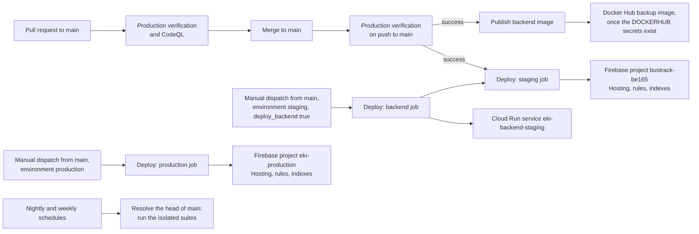

# CI, Deployment and Releases

| Document ID | Version | Status | Last updated |
|---|---|---|---|
| EKI-OPS-001 | 4.0 | Current | 2026-11-07 |

## 1. Purpose

This document describes the GitHub Actions workflows in `.github/workflows/`, what each one verifies or deploys, the branch flow they assume, and how to release and roll back. It names secrets and environments only; values belong in GitHub environment secrets or the owner's secret manager.

Readiness gates that sit outside the repository (infrastructure owners, privacy approval, field acceptance) are listed in the [deployment checklist](UNIVERSITY_DEPLOYMENT_CHECKLIST.md).

## 2. Branch and release flow

Pull requests target `main`, and the scheduled QA workflows test the head of `main` (Section 6).

Figure 1. Branch, verification and deployment flow.

A green push to `main` releases the frontend and security rules to `bustrack-be165` without further approval and without contacting the backend (Section 5.2, step 4). That project is the default in `.firebaserc` and serves `https://bustrack-be165.web.app`, the site that field tests use. No separate staging project exists in the repository configuration. The same green push starts Publish backend image (Section 7.3). Only a manual dispatch can deploy the backend; one deployed the staging service on 2026-11-01 (Section 7).

| Workflow file | Name | Triggers | Deploys |
|---|---|---|---|
| `ci.yml` | Production verification | Every push to any branch; every pull request | Nothing |
| `codeql.yml` | CodeQL | Every push except `dependabot/**`; every pull request | Nothing |
| `deploy.yml` | Deploy | Completion of Production verification; manual dispatch | Hosting, Firestore rules, RTDB rules and Firestore indexes; the staging backend to Cloud Run on manual dispatch with `deploy_backend: true` |
| `publish-backend-image.yml` | Publish backend image | Completion of Production verification on a push to `main`; manual dispatch from `main` | The backend image to Docker Hub as `<commit-sha>` and `latest`, once the `DOCKERHUB_*` secrets exist ([VPS backup path](../../deploy/vps/README.md)) |
| `deep-qa.yml` | Isolated nightly QA | Daily at 20:17 UTC (01:47 IST); manual dispatch; pushes to six `codex/qa-*` branches | Nothing |
| `weekly-reliability.yml` | Isolated weekly reliability baseline | Saturdays at 20:41 UTC (Sundays 02:11 IST); manual dispatch; pushes to `codex/qa-nightly-reliability` | Nothing |
| `footer.yml` | Remove footer | An issue or a pull request (`pull_request_target`) opened or edited; the job runs only for items that the account `suryaraj09` opened | Nothing; edits that item's description |

The `strip-footer` job in `footer.yml` removes a final "Generated with Claude Code" line, with or without a leading robot symbol or a link, from the description of an issue or pull request that `suryaraj09` opened, together with the blank lines around it. It keeps such a line when it sits inside a fenced code block, and it leaves every other line unchanged. The workflow grants no permissions at the workflow level and gives the job only `issues: write` and `pull-requests: write`. Because `pull_request_target` runs with a write token even for a fork, the job never checks out or runs pull request code: it runs one `actions/github-script` step. It reads the live description twice and writes only when both reads agree; after three disagreeing attempts it leaves the description unchanged. Runs for the same item do not overlap, and each run has a 2 min timeout. `scripts/footer-workflow.test.mjs` tests the triggers, the permissions and the footer rules.

## 3. Production verification (`ci.yml`)

The workflow uses Ubuntu runners, Node.js 24, the runner's Java 21 (for Firebase emulators) and Python 3.12 with PlatformIO 6.2.0 (pinned in `hardware/requirements.txt`). It needs no secrets: every Firebase and Maps value it uses is a placeholder.

| Job | Timeout | Checks |
|---|---|---|
| `web` | 30 min | `npm ci`; QA catalog and safety checks (`qa:check`, `qa:catalog`, `qa:gnss`, `qa:unit:reviewed`, and `qa:budget` on pull requests); RTDB instance preflight; OpenAPI route coverage; `npm run lint`; `npm test`; Firestore and RTDB rules in emulators; bounded work admission under stalled dependencies; Playwright suites for admin access, passenger layout, passenger progress and production audit regressions; emulator-backed passenger browser and HTTP authorization suites; strict production build with CSP regeneration; canonical, social and crawler origins in the export; `npm audit` for runtime and for all dependencies; CycloneDX SBOM |
| `backend-image` | 20 min | Builds `backend/Dockerfile`, boots it with `NODE_ENV=production` and placeholder Firebase settings, requires `503` with `"status":"degraded"` from `/health`, `200` with `"status":"alive"` from `/live`, and a Docker health check on `/live`; Trivy fails on fixed `CRITICAL` or `HIGH` OS and library findings |
| `firmware` | 15 min | Secure-fleet JTAG configuration test; native firmware tests (`qa:native`); host protocol tests; builds `esp32dev`, `esp32dev-quiet` (trace strings must be absent) and `esp32dev-journal`; links the SNTP guard; builds `esp32dev-secure` with an ephemeral key generated in the job and checks that the signed image rejects modification and foreign keys |
| `qa-evidence` | 8 min | Runs after `web` and `firmware`, even when they fail; merges their evidence artifacts and runs `qa:report` |

`npm test` runs every `scripts/*.test.mjs` file, including the workflow tests in Section 5.6 and the documentation quality test, then the OpenAPI and UI contract checks and the backend and frontend unit tests.

The firmware job copies `hardware/include/secrets.example.h` to `secrets.h` and inserts a fake secret so that the network code is compiled. CI never handles a fleet signing key or produces a fleet artifact.

Artifacts are kept for 7 days, except the SBOM (`production-dependency-sbom`), which is kept for 30 days.

CI establishes that the source builds and that the automated suites pass. It does not establish GNSS reception, vehicle power, radio coverage, TLS against the deployed certificate chain, Secure Boot provisioning, stop accuracy on a real route, or the behaviour of the deployed backend. The Slow 3G and Offline browser checks remain manual (see the [deployment checklist](UNIVERSITY_DEPLOYMENT_CHECKLIST.md)).

## 4. CodeQL (`codeql.yml`)

The `analyze` job runs CodeQL with the `security-extended` query suite for `javascript-typescript` and `python`, on every pull request and on pushes except `dependabot/**`. Dependabot uses the PR upload path because its read-only push token cannot upload SARIF. The job requests `security-events: write` and needs no secrets. Findings appear in the repository's code scanning alerts and require triage.

Each language runs as its own matrix job, `Analyze javascript-typescript` and `Analyze python`, with a 30 min timeout; the ruleset requires both (Section 5.5). The `init` and `analyze` steps are pinned to the same CodeQL Action release commit (v4.39.1), because `analyze` fails on a configuration that a different release wrote. Dependabot therefore proposes them as one group (Section 12.1).

## 5. Deploy (`deploy.yml`)

### 5.1 Triggers and conditions

| Job | Runs when | Environment | Firebase project | Checked-out commit |
|---|---|---|---|---|
| `deploy-staging` | Production verification completed with `success` for a `push` to `main` in this repository; or manual dispatch from `main` with `environment: staging` | `staging` | `bustrack-be165` | The verified commit (`workflow_run.head_sha`); on dispatch, the head of `main` at dispatch (`github.sha`), the same commit the backend job builds |
| `deploy-production` | Manual dispatch from `main` with `environment: production` | `production` | `eki-production` | The head of `main` at dispatch |
| `deploy-backend-staging` | Manual dispatch from `main` with `environment: staging` and `deploy_backend: true`, in the region chosen by `cloud_run_region`; never automatic | `staging` | `bustrack-be165` | The head of `main` at dispatch |

`deploy-staging` waits for `deploy-backend-staging`. A skipped backend job does not block the release, and a failed one does.

Runs for pull requests, forks and other branches are skipped. A run waits while another run for the same environment is in progress, and GitHub keeps only the newest waiting run (`concurrency: deploy-<environment>`, `cancel-in-progress: false`). The Firebase CLI is pinned to `firebase-tools@15.14.0`.

### 5.2 Steps

Both jobs run the same steps against their own project, except step 4, which `deploy-staging` runs only on a manual dispatch with `deploy_backend: true`. A failed step stops the job, so nothing after it is deployed.

Before these steps, `deploy-staging` refuses a commit that `main` does not contain: the GitHub compare API must answer `identical` or `ahead` for the commit against the branch ref `heads/main`. Without this check a tag named `main` would satisfy the job condition, because a tag push reports the tag name as `workflow_run.head_branch` and tags have no ruleset; naming the branch ref keeps such a tag from standing in for the branch in the comparison too. Every checkout in every workflow uses `persist-credentials: false`, so no job leaves the GitHub token in `.git/config` while `npm ci` runs third-party install scripts.

1. `npm ci`.
2. `node scripts/verify-rtdb-deploy-target.mjs --project <project>`, then `npm run verify:rtdb-instance -- --require-region`. The first requires `firebase.json` to declare the RTDB rules as deploy targets and `.firebaserc` to map each target to an instance for the project, so a project without the mapping, such as `eki-production`, stops here, before App Check or the index deploy run. The second requires the backend and frontend database URLs to name the same RTDB instance, in the region that `RTDB_EXPECTED_REGION` names; the release fails when that variable is unset.
3. `npm run build:production`: strict build that fails when one of the ten `NEXT_PUBLIC_*` values is missing or when the RTDB or backend URL is not a non-local HTTPS URL (`frontend/next.config.ts`), then regenerates the service worker and the CSP in `firebase.json` with the backend origin, and checks that the backend origin is in the CSP `connect-src` directive ([web and backend release check](../api/HTTP_CONTRACT.md#33-web-and-backend-release-check)).
4. `npm run verify:web-backend-contract` with `EKI_RUNTIME_SMOKE=1`, on every run of `deploy-production` and on a `deploy-staging` run only when the dispatch also sets `deploy_backend: true`: the live backend at `NEXT_PUBLIC_BACKEND_URL` must answer `/health` with `status: ok`, allow the frontend origin (`https://bustrack-be165.web.app` or `https://eki-production.web.app`) in CORS, and accept the preflight for `POST /api/users/bootstrap`. While `/health` answers 502, 503 or 504, or does not answer within 10 s, the check retries for up to 90 s, because a backend that scaled to zero answers 503 until its first Firestore and RTDB probes succeed. Any other failure stops the release at once. An automatic staging release and a staging dispatch without `deploy_backend` skip this step: the probe would wake the wake-on-traffic staging service and would fail whenever that service does not accept public requests.
5. `node scripts/disable-appcheck-enforcement.mjs --project <project> --disable`: sets App Check enforcement for Firestore and RTDB to `UNENFORCED` and verifies the result. The web app does not use App Check.
6. Deploy `firestore:indexes`, then wait up to 30 minutes for the deployed query shapes ([Firestore index deployment](FIRESTORE_INDEX_DEPLOYMENT.md)).
7. Deploy `hosting,firestore:rules,database:rtdb`. Because `firebase.json` declares the RTDB rules as an array entry with the deploy target `rtdb`, the Firebase CLI reads the text after `database:` as a target name; `.firebaserc` maps `rtdb` to `bustrack-be165-asia-rtdb` for `bustrack-be165`. Step 2 has already stopped a project without that mapping.

The optional job `deploy-backend-staging` runs before `deploy-staging`. Before it authenticates, it reads `FIREBASE_DATABASE_URL` from the exact entry in `deploy/cloud-run/staging.service.yaml` and runs the same instance and region check against the staging secret `NEXT_PUBLIC_FIREBASE_DATABASE_URL`, so a backend and a Hosting build that would use different RTDB instances stop before anything is built. Then:

1. Authenticate to Google Cloud as the deploy service account through workload identity federation. The workflow stores no key, and the job fixes the provider and the account. The provider `github-actions` accepts only tokens with `assertion.repository_id=='1270866720' && assertion.ref=='refs/heads/main'`; the account `eki-github-deployer` (project role `roles/run.admin`) trusts only `attribute.environment/staging`; the `staging` environment accepts deployments from `main` only; and `sts.googleapis.com` is enabled.
2. Stop when the service `eki-backend-staging` already exists in another region. The job queries each of the three regions on its own and also stops when any query fails, because a list across all regions can return a partial answer without an error. Every regional service is public and keeps its own in-memory rate limits, so a second region would double the request budget. The error message gives the `gcloud run services delete` command for the other region.
3. Build `backend/Dockerfile` from the repository root, push the image to the Artifact Registry repository `eki` in the region given by the `cloud_run_region` input, and record the image digest. The repository shall exist in that region, and the deploy service account needs `roles/artifactregistry.writer` on it. On 2026-11-07 `eki` existed in `asia-south2` and `us-central1` but not in `asia-southeast1`, so a dispatch for `asia-southeast1` fails at the push until the repository is created there.
4. Render `deploy/cloud-run/staging.service.yaml` with the digest and apply it as a new revision. When a revision already serves traffic, the new revision receives none until step 6. Only a missing service counts as a first deployment: there the revision receives all traffic at once and step 6 only reports the result. Any other failure to read the service stops the job. `gcloud run services replace` applies the whole manifest, so the render copies the live service-level minimum instances (`run.googleapis.com/minScale`, which the Cloud Scheduler jobs in Section 7.1 set) into it; a first deployment gets 0, and a value that is not a whole number stops the job.
5. Grant `allUsers` the Cloud Run invoker role. Firebase and device authentication remain the gate for every route.
6. Check that the candidate URL serves the revision this run created, then poll its `/health` for up to 3 minutes and promote that revision only when it reports `status: ok`. The candidate runs with `WORKER_ENABLED=true` while the gate calls it. When no serving instance holds the worker lease at that moment, for example overnight, the candidate can take the lease before it passes the gate and keeps it until it idles; lease fencing prevents duplicate work ([worker leadership](WORKER_LEADERSHIP.md)).
7. Write the image digest, the previous revision and the rollback command to the job summary.

The job therefore deploys one region at a time. To compare regions, dispatch the first region, measure it, delete its service, then dispatch the next. Each region has its own service URL, `https://eki-backend-staging-449313371438.<region>.run.app`. Set the staging secret `NEXT_PUBLIC_BACKEND_URL` to the new URL before the dispatch; otherwise `deploy-staging` in the same run checks the deleted service and fails. A new region is a first deployment (step 4): its first revision serves all traffic before `/health` is checked, and there is no earlier revision to roll back to.

Step 4 makes a production release, and a staging dispatch that deploys the backend, depend on a running, healthy backend. An automatic staging release does not contact the backend: it succeeds while the staging service is scaled to zero or closed to public requests, and it does not show that the released frontend can reach the backend, which Section 9 checks after the release. While the Cloud Scheduler jobs run, the staging service keeps one instance from 06:00 to 22:00 IST and scales to zero overnight; while they are paused, as on 2026-11-07, it scales to zero whenever it is idle (Section 7.1). The first request after an idle period starts an instance. On 2026-11-01 such an instance answered `/health` with 503 about 2 s after the request; the retry in step 4 waits that out.

### 5.3 Environments, secrets and variables

| Name | Kind | Used by | Purpose |
|---|---|---|---|
| `staging`, `production` | GitHub environments | Deploy jobs | Scope the secrets below |
| `FIREBASE_TOKEN` | Environment secret | Steps 5 to 7 | Firebase CLI token for that project |
| `FIREBASE_DATABASE_URL` | Environment secret | Step 2 | RTDB URL that the backend uses |
| `NEXT_PUBLIC_FIREBASE_API_KEY`, `NEXT_PUBLIC_FIREBASE_AUTH_DOMAIN`, `NEXT_PUBLIC_FIREBASE_DATABASE_URL`, `NEXT_PUBLIC_FIREBASE_PROJECT_ID`, `NEXT_PUBLIC_FIREBASE_STORAGE_BUCKET`, `NEXT_PUBLIC_FIREBASE_MESSAGING_SENDER_ID`, `NEXT_PUBLIC_FIREBASE_APP_ID`, `NEXT_PUBLIC_GOOGLE_MAPS_API_KEY`, `NEXT_PUBLIC_GOOGLE_MAP_ID`, `NEXT_PUBLIC_BACKEND_URL` | Environment secrets | Steps 2 to 4; `NEXT_PUBLIC_FIREBASE_DATABASE_URL` also in the RTDB check of `deploy-backend-staging` | Values compiled into the static frontend |
| `RTDB_EXPECTED_REGION` | Environment variable | Step 2; the RTDB check in `deploy-backend-staging` | Expected RTDB region. Set to `asia-southeast1` in the `staging` environment on 2026-11-02. Every release fails when it is unset; the CI preflight, which runs without `--require-region`, compares only the instances. |

The workflow passes no other build variables. `NEXT_PUBLIC_SITE_URL` and `NEXT_PUBLIC_SITE_INDEXING` are therefore unset in deployed builds: canonical and social URLs fall back to `https://bustrack-be165.web.app` and indexing is enabled. A custom domain or a production build needs those two values added to the workflow ([DNS and domains](DNS_AND_DOMAINS.md)). The meaning of each variable is in [configuration](../CONFIGURATION.md).

Browser values become public after bundling. Restrict the Firebase and Maps browser keys by referrer and API. The Maps browser key (`NEXT_PUBLIC_GOOGLE_MAPS_API_KEY`, project `bustrack-501917`) accepts only the referrers `https://bustrack-be165.web.app/*`, `https://bustrack-be165.firebaseapp.com/*`, `http://localhost:3000/*` and `http://localhost:3001/*`, and only the Maps JavaScript API. The backend uses a separate server key ([configuration](../CONFIGURATION.md)).

### 5.4 What is deployed where

| Artifact | Source | Deployed by |
|---|---|---|
| Static frontend (`frontend/out`), headers and CSP | `firebase.json` `hosting` | Deploy, step 7 |
| Firestore security rules | `firestore.rules` | Deploy, step 7 |
| RTDB security rules and indexes | `database.rules.json` | Deploy, step 7 |
| Firestore composite index and field overrides | `firestore.indexes.json` | Deploy, step 6 |
| App Check enforcement mode | Firebase App Check API | Deploy, step 5 |
| Backend (staging Cloud Run service) | `backend/Dockerfile`, `deploy/cloud-run/staging.service.yaml` | Deploy, `deploy-backend-staging`, on manual dispatch only |
| Backend image on Docker Hub (backup path) | `backend/Dockerfile` | Publish backend image, once the `DOCKERHUB_*` secrets exist (Section 7.3) |
| Firmware | `hardware/` | No workflow; flashed by hand ([hardware guide](../../hardware/README.md)) |
| Firebase data, Auth users, DNS, TLS, WAF | Not in the repository | No workflow |

`firebase.json` has no Hosting rewrites, so Hosting serves only static files. `npm run verify:hosting-rewrites` checks a Hosting site that does rewrite to the backend; no workflow runs it (Section 7.2).

### 5.5 Repository settings

These GitHub settings are not stored in the repository. They were read through the GitHub API on 2026-11-07:

| Setting | Value | Effect |
|---|---|---|
| Ruleset `main` (the default branch and all branches, except `refs/heads/dependabot/**/*`) | Pull request with one approving review and code owner review (`* @notnamansinha` in `.github/CODEOWNERS`), stale approvals dismissed on push; no deletion or force push; merge or squash; the administrator role and the account `suryaraj09` may bypass | A change reaches `main` only through a pull request that the code owner approved, unless a bypass actor bypasses the ruleset. The same rules cover every other branch except Dependabot's. |
| Ruleset `Require verified changes on main` (`refs/heads/main`) | Required status checks `web`, `backend-image`, `firmware`, `qa-evidence`, `Analyze javascript-typescript` and `Analyze python`, with branches up to date before merging; the maintainer and administrator roles and the account `suryaraj09` may bypass | A pull request merges only after these six checks pass on a branch that is up to date with `main`, unless a bypass actor merges it with a bypass, which also skips the up-to-date requirement. Deploy still runs only after a green verification. |
| Environments | `staging` (deployments from `main` only, no required reviewers; the twelve secrets above plus an unused `NEXT_PUBLIC_RECAPTCHA_ENTERPRISE_SITE_KEY`, and the variable `RTDB_EXPECTED_REGION`) and `copilot`; no `production` | A job that names a missing environment creates it, so the first production dispatch would run without reviewers or secrets. Create `production` with required reviewers first. |
| Repository secrets and variables | None; `DOCKERHUB_USERNAME` and `DOCKERHUB_TOKEN` are absent | Publish backend image skips its build and push (Section 7.3) |
| Secret scanning and push protection | Enabled | Pushes containing recognised secrets are blocked |
| Dependabot alerts and security updates | Enabled | Alert-driven security pull requests (Section 12.1) |

### 5.6 Workflow tests

`npm test` runs these tests in the CI `web` job (Section 3). Most of them read the workflow and configuration files directly, so a change that breaks a release rule fails CI before it reaches `main`.

| Test | Covers |
|---|---|
| `scripts/deploy-workflow-main-only.test.mjs` | Every deploying job is gated on `main`; `deploy-staging` runs the compare check first, against `heads/main`, and accepts only `identical` or `ahead`; every checkout in every workflow sets `persist-credentials: false` |
| `scripts/deploy-workflow-regions.test.mjs` | The region guard of `deploy-backend-staging` lists exactly the `cloud_run_region` options, queries each region on its own and refuses any other region |
| `scripts/deploy-backend-manifest.test.mjs` | The RTDB URL comes only from the exact `FIREBASE_DATABASE_URL` entry of the manifest; the job renders every manifest placeholder; the applied manifest keeps the live service-level minimum instances, a first deployment gets 0, and a value that is not a whole number stops the job |
| `scripts/verify-rtdb-deploy-target.test.mjs` | `bustrack-be165` resolves to `bustrack-be165-asia-rtdb`; a project without a mapping, a single-object `database` configuration and an invalid project are refused; both release jobs check the deploy target and the RTDB region before App Check |
| `scripts/verify-firestore-indexes.test.mjs` | The index readiness gate ([Firestore index deployment](FIRESTORE_INDEX_DEPLOYMENT.md)), the order of index deploy, gate and Hosting release in both release jobs, and the `database:rtdb` release target |
| `scripts/verify-web-backend-contract.test.mjs` | The CSP check of step 3 and the live readiness, CORS and preflight checks of step 4, including the retry window |
| `scripts/disable-appcheck-enforcement.test.mjs` | The App Check change of step 5 and the token exchange that steps 5 and 6 use |
| `scripts/publish-backend-image-workflow.test.mjs` | Publish backend image (Section 7.3) |

## 6. Scheduled QA (`deep-qa.yml`, `weekly-reliability.yml`)

Both workflows start with a `resolve` job that pins one commit. On a schedule or manual dispatch (which must run from `main`) the job reads the head of `main` through the GitHub API; on a push to one of the listed `codex/qa-*` branches it uses the pushed commit. Neither workflow uses secrets, and both refuse to run outside `notnamansinha/Eki`.

| Workflow | Matrix suites | Report job |
|---|---|---|
| Isolated nightly QA | `gnss`, `emulator`, `browser`, `api`, `native`, `reviewedUnit`, each through `node scripts/qa/campaign.mjs <suite>` | `node scripts/qa/campaign-report.mjs` |
| Isolated weekly reliability baseline | `mutation` (`npm run qa:mutation`) and `soak` (`npm run qa:soak`) | `node scripts/qa/weekly-report.mjs` |

`npm run qa:check`, which every suite job and the CI `web` job run, includes `scripts/qa/workflow-policy.mjs`. The policy requires both workflows to keep read-only `contents` permission and a concurrency group that never cancels a run in progress; to use only the schedule, the dispatch and the listed push triggers; to keep the `resolve`, `suites` and `report` jobs with at most two suites in parallel; to give every job a timeout from 1 to 15 min and no environment or job permissions; to use only actions from a pinned allowlist; to check out the resolved commit without credentials; to keep artifacts for 7 days; and to use no secrets, model API keys or deploy commands. `scripts/qa-workflow-policy.test.mjs` tests the policy.

Every scheduled nightly run from 2026-10-30 to 2026-11-07 (UTC) and the scheduled weekly run of 2026-10-31 resolved `main` and passed every suite (GitHub Actions history, read 2026-11-07). These runs meet the closing gate that the [risk register](ARCHITECTURE_RISK_REGISTER.md#36-ops-02-scheduled-qa-runs-no-suites) sets for OPS-02. None of the listed `codex/qa-*` branches exists, so their push triggers never fire. The campaigns are described in [scheduled reliability](../../qa/SCHEDULED_RELIABILITY.md).

## 7. Backend hosting

### 7.1 Current state

The repository builds and tests a backend container (`backend/Dockerfile`: Node.js 26.13.0 on Alpine 3.23, pinned by digest, non-root user, port `8080`, Docker health check on `/live`), and `deploy-backend-staging` publishes and deploys it on manual dispatch. The staging service `eki-backend-staging` runs in `asia-south2` at `https://eki-backend-staging-449313371438.asia-south2.run.app`, and the staging secret `NEXT_PUBLIC_BACKEND_URL` has named that origin since 2026-11-01, so the staging web app calls Cloud Run. Trackers post telemetry to the backend origin compiled into their firmware; a device flashed with another origin needs the Cloud Run origin and its root CA ([hardware guide](../../hardware/README.md)).

| Resource | State |
|---|---|
| Firestore | `asia-south2` |
| RTDB instance | `bustrack-be165-asia-rtdb` in `asia-southeast1` ([RTDB region decision](../design/RTDB_REGION_LATENCY_DECISION.md)) |
| Cloud Billing, Cloud Run API, `sts.googleapis.com` | Linked and enabled on `bustrack-be165` (checked on 2026-11-01) |
| Artifact Registry repository `eki` | `asia-south2` and `us-central1` (read 2026-11-07) |

The manifest runs the service with `WORKER_ENABLED=true`, revision-level `minScale` 0 and `maxScale` 1 ([issue #374](https://github.com/notnamansinha/Eki/issues/374)). Two Cloud Scheduler jobs own its service-level minimum instances: `eki-workers-up` sets it to 1 hourly from 06:00 to 21:00 IST, and `eki-workers-down` sets it to 0 at 22:00 IST. While they run, the lease-owned workers run on Cloud Run from 06:00 to 22:00 IST; overnight the service scales to zero, and a request that wakes an instance makes it the worker leader until it idles ([worker leadership](WORKER_LEADERSHIP.md)). Local backends that use the same project shall run with `WORKER_ENABLED=false`, because the variable defaults to true and an idle lease goes to whichever process asks first.

Both Scheduler jobs have been paused since 19:07 UTC on 2026-11-02. The serving revision `eki-backend-staging-00009-7sh`, deployed with `gcloud` outside this workflow on 2026-11-03, runs with `WORKER_ENABLED=true` and no minimum instance, the same values as the manifest, and the service accepts public requests (ingress `all`, `allUsers` as invoker). These values were read from Cloud Run and Cloud Scheduler on 2026-11-07. Staging therefore runs in wake-on-traffic mode: the workers run only while an instance is up, which is while a bus-powered tracker sends and for 15 to 17 minutes afterwards. A `deploy_backend` run keeps this state, because the manifest also sets `WORKER_ENABLED=true` and the job copies the live service-level minimum (Section 5.2).

A workstation backend behind an ngrok tunnel remains an option for bench tests and demonstrations ([ngrok tunnel](NGROK_TUNNEL.md)). The staging web app does not depend on it.

### 7.2 Proposed migration to Cloud Run

Status: Proposed. The manual deployment job described in Section 5.2 deployed the staging service on 2026-11-01. Hosting rewrites were evaluated and not adopted (below). The worker handoff was rehearsed and switched on on 2026-11-02, then paused the same day (Section 7.1); production is not implemented.

The proposal runs the existing container on Cloud Run in the same Firebase project and keeps Hosting, Authentication, Firestore and the existing RTDB instance unchanged. Cloud Run needs a Cloud Billing account on the project, which moves a Spark project to the Blaze plan [2].

- One public origin through Hosting rewrites for `/api/**`, `/health` and `/live` was evaluated on a preview channel on 2026-11-02 and not adopted ([issue #372](https://github.com/notnamansinha/Eki/issues/372)). Hosting added p50 313 ms and p95 493 ms to `GET /live` over the direct service (p50 55 ms, p95 69 ms), and the backend saw a Google egress pool instead of the caller, which would merge the per-IP rate-limit buckets. Clients call the backend origin directly; a stable API hostname ([DNS and domains](DNS_AND_DOMAINS.md)) remains the option for a fixed origin. `npm run verify:hosting-rewrites -- --hosting <origin> --direct <service-origin>` (`scripts/verify-hosting-rewrites.mjs`) checks such rewrites with GET requests only and reports the latency that Hosting adds ([Hosting rewrite check](../api/HTTP_CONTRACT.md#34-hosting-rewrite-check)).
- Run at least one instance with instance-based CPU, because the process runs continuous workers outside request handling.
- Run the service with `NODE_ENV=production`. Production startup requires `CORS_ORIGIN` and `RETENTION_SWEEPER_ENABLED=true`, which turns on retention deletion; review the retention policy before the first production start ([RTDB retention](RTDB_RETENTION.md), [privacy deletion](PRIVACY_DELETION.md)).
- Move worker leadership deliberately: stop the workstation coordinator, then confirm that the cloud instance holds the lease.
- Rebuild the frontend and reflash every device with the new origin and its root CA. Retire the tunnel only after the system works with the workstation disconnected.

The backend release workflow with image digest and rollback exists (Section 5.2). The remaining gate to make this current: a billing owner, a staging acceptance record, a rehearsed rollback, the worker handoff in effect and reflashed devices.

### 7.3 Backup image on Docker Hub (`publish-backend-image.yml`)

Publish backend image pushes the backend container to Docker Hub so that any Docker host can run it ([VPS backup path](../../deploy/vps/README.md)). It does not change the Cloud Run service.

| Item | Value |
|---|---|
| Triggers | Completion of Production verification (`workflow_run`, filtered to `main`); manual dispatch |
| Job condition | A `workflow_run` that concluded `success` for a `push` to `main` whose head repository is this repository, or a dispatch from `main`. A pull request from a fork branch named `main` also reports `main` as its head branch, so the branch filter alone does not suffice. |
| Permissions and limits | `contents: read`; job timeout 20 min; concurrency group `publish-backend-image`, which never cancels a run in progress |
| Secrets | Repository secrets `DOCKERHUB_USERNAME` and `DOCKERHUB_TOKEN`, passed only to the credential check (step 1) and the push (step 5) |

1. Check for the Docker Hub secrets. When either is empty, the job prints a notice and skips every later step, and the run succeeds.
2. Refuse a commit that `main` does not contain, with the same compare check as `deploy-staging` (Section 5.2).
3. Check out the verified commit (`workflow_run.head_sha`, or the head of `main` at dispatch) and build `backend/Dockerfile`.
4. Scan the image with the same Trivy action and policy as the CI `backend-image` job: a fixed `CRITICAL` or `HIGH` OS or library finding fails the run before anything is pushed.
5. Push `<user>/eki-backend:<commit-sha>`, where `<user>` is the Docker Hub account. Move `latest` to that image only while the commit is still the head of `main`, so a run that finishes after a newer one never moves `latest` back. The job summary lists the pushed tags.

The repository had no `DOCKERHUB_*` secrets on 2026-11-07, so every run ended after step 1 (GitHub API and Actions history, read 2026-11-07). `scripts/publish-backend-image-workflow.test.mjs` tests the job condition, the order of the guard and the checkout, the scan policy, the `latest` rule and which steps receive the secrets.

## 8. Release procedure

Prerequisites: the change has a pull request to `main`; the backend at `NEXT_PUBLIC_BACKEND_URL` is deployed and healthy. A backend that scaled to zero starts an instance on the first request. Deploy checks the backend only in a production release and in a staging dispatch with `deploy_backend: true` (Section 5.2, step 4); after an automatic staging release, Section 9 checks it.

1. Wait for Production verification and CodeQL on the pull request. Expected: all jobs green.
2. If the change alters an HTTP contract or a backend behaviour that the new frontend needs, first merge a backend change that accepts both the old and the new form ([compatibility rules](../api/HTTP_CONTRACT.md#4-compatibility-rules)), then dispatch Deploy from `main` with `environment: staging` and `deploy_backend: true`, and merge the frontend change after that run succeeds. Expected: `/health` returns `status: ok`.
3. Obtain the approving review and code owner review, then merge. Expected: Production verification runs on the push to `main`.
4. Watch the Deploy run in the Actions tab. Expected: `deploy-staging` succeeds with its live backend check skipped; `deploy-backend-staging` and `deploy-production` are skipped.
5. If the release changed firmware, build and flash it separately ([hardware guide](../../hardware/README.md)); vehicles use only the signed procedure in [hardware security provisioning](../security/HARDWARE_SECURITY_PROVISIONING.md).
6. Production: only after the `eki-production` project and a `production` environment with required reviewers exist, dispatch Deploy from `main` with `environment: production`. Expected: the run waits for approval, then succeeds.

## 9. Verification after a release

1. Open the site and confirm that the page loads the new build. Expected: no CSP errors in the browser console.
2. Run `node scripts/check-stationary-runtime.mjs --frontend https://bustrack-be165.web.app --backend <backend-origin>` from the repository root. Expected: every check passes (frontend `200`, backend health `200`, API preflight `204` and unauthenticated Places request `401`, each allowing the frontend origin).
3. Sign in as an administrator and open Live Ops. Expected: online devices appear and services start as described in [automatic GNSS service](AUTOMATIC_GNSS_SERVICE.md).
4. Record the release evidence in Section 11.

## 10. Rollback

| Component | Fast rollback | Complete rollback |
|---|---|---|
| Hosting | Firebase console, Hosting, Release history, Roll back on the previous release [1] | Revert the change on `main` through a pull request; the automatic Deploy run redeploys Hosting, rules and indexes from the reverted commit |
| Firestore and RTDB rules | None (a Hosting rollback leaves rules unchanged) | Revert on `main`, as above |
| Backend (Cloud Run staging) | Move traffic back with `gcloud run services update-traffic eki-backend-staging --project bustrack-be165 --region <region> --to-revisions <previous-revision>=100`. The job summary of each release prints the previous revision. | Revert the change on `main` and dispatch the backend job again |
| Backend (workstation, bench only) | Check out the last known-good commit on the host and restart the backend | Same |
| Backend (VPS backup host) | Set `EKI_BACKEND_IMAGE` to an earlier `<user>/eki-backend:<commit-sha>` tag and run `docker compose up -d` ([VPS backup path](../../deploy/vps/README.md)) | Revert the change on `main`; once Publish backend image has pushed the reverted commit, set `EKI_BACKEND_IMAGE` to its tag and run `docker compose up -d` |
| Frontend configuration | Correct the environment secret and rerun Deploy by dispatch from `main` | Same; do not edit generated CSP hashes by hand |
| Firmware over the air | Unset all six `FIRMWARE_RELEASE_*` backend values to stop distribution | Bootloader rollback restores the previous slot for an unhealthy candidate; never publish an older sequence as a downgrade |
| Device credential or CA | Disable the device with `POST /api/devices/<device-id>/disable` (administrator) or rotate its secret with `npm run provision-device --workspace=backend -- --device-id <device-id> --bus-id <bus-id> --route-id <route-id>` (refused during an active ride) | Reflash a corrected device image |

The manual production dispatch always deploys the head of `main`, so a production rollback also goes through a revert on `main`.

## 11. Release evidence

For each release, record the commit SHA, the Production verification and Deploy run URLs, the environment name (not its secrets), the backend commit and host, the result of Section 9, any firmware image hash and flashed devices, the approver, the rollback target and known risks. Keep tokens, keys, device and Wi-Fi credentials, personal records and precise location traces out of the record.

## 12. Dependency updates

### 12.1 Coverage and schedule

[Dependabot configuration](../../.github/dependabot.yml) schedules checks every weekday in `Asia/Kolkata`. The root npm job owns the shared lockfile and discovers the frontend and backend workspaces. The local lint helper needs a separate job because npm path dependencies are support files in the root Dependabot job.

| Ecosystem | Manifest location | Check time (IST) | Maximum open version PRs |
|---|---|---|---|
| npm workspaces | Root `package.json`, `package-lock.json`, frontend and backend manifests | 09:00 | 5 |
| Local lint helper | `tools/next-lint-glob/package.json` | 09:10 | 2 |
| GitHub Actions | `.github/workflows/` | 09:20 | 3 |
| Docker | `backend/Dockerfile`, builder and runtime Node/Alpine images | 09:30 | 2 |
| Python tooling | `hardware/requirements.txt`, used by regular and nightly firmware CI | 09:40 | 2 |

Routine npm releases wait 3 days for patches, 7 for minors and 14 for majors. Other ecosystems wait 7 days. Security updates use GitHub's separate alert-driven process and bypass these routine cooldowns and the version-update schedule. Enable both Dependabot alerts and Dependabot security updates in the repository security settings; committing the configuration alone does not enable security fixes. Both are enabled (Section 5.5).

Dependabot can propose version updates for SHA-pinned Actions, but GitHub does not generate Actions vulnerability alerts for full SHA references. Monitor [GitHub Actions advisories](https://github.com/advisories?query=ecosystem%3Aactions) separately and update affected pins promptly when fixes are released. Keep the full SHA pins; do not treat a clean alert list as proof that those actions have no known advisories.

Direct manifest dependencies receive version PRs; security updates also cover supported vulnerable transitive dependencies. Related React/Next.js packages, Workbox packages, OpenTelemetry packages, Stryker packages, Tailwind packages and the CodeQL Action steps (`init` and `analyze` must run the same release) are grouped by family so related versions can be reviewed together. Other updates remain separate. Major versions are proposed rather than ignored.

### 12.2 Review and merge gates

Dependabot creates pull requests and does not approve, merge or deploy them. The existing CODEOWNERS entry requests the repository owner's review. Dependabot PR workflows use restricted tokens and no deployment secrets. A PR or fork run cannot pass the Deploy workflow's same-repository `push` to `main` gate.

The main branch rules require an owner approval and these GitHub Actions checks: `web`, `backend-image`, `firmware`, `qa-evidence`, `Analyze javascript-typescript` and `Analyze python`. The checks must pass against the current base before merging. The bypass actors listed in Section 5.5 remain available for explicit recovery; normal dependency updates shall not use a bypass or cancel required checks.

The all-branches ruleset excludes `refs/heads/dependabot/**/*` so the bot can update, rebase and retire its own PR branches. Main retains its owner-review and CI rules; the bot receives no bypass permission on main. Other feature-branch rules are unchanged.

Before approving an update:

1. Read upstream release notes and migration instructions, check support for Node.js 24, which CI and the release jobs use, and for the Node.js 26 base image in `backend/Dockerfile`, and inspect the complete manifest and lockfile diff. Review new package sources, install scripts, license changes and unexpected transitive dependencies.
2. Keep React/React DOM and Next.js/its ESLint configuration compatible. Check OpenTelemetry's stable and experimental release lines together. A major version number alone does not establish compatibility.
3. Require the complete CI results from Sections 3 and 4, including both audits, the strict build, browser and emulator suites, container smoke boot and Trivy scan, and firmware builds. A failed job is a reason to investigate or close the update.
4. For an Actions update, retain full SHA pins and version comments. Updates to actions used by the isolated workflows also require reviewing the explicit allowlist in `scripts/qa/workflow-policy.mjs`; do not weaken that allowlist to make a PR pass. Keep the Trivy action pin in `publish-backend-image.yml` equal to the one in `ci.yml`; `scripts/publish-backend-image-workflow.test.mjs` fails otherwise.
5. For the local lint helper, regenerate and commit the shared root lockfile with `npm install --package-lock-only --ignore-scripts`, then verify `npm ci`, lint and the Next lint root-resolution tests. A separate helper update may not regenerate the parent lockfile automatically.
6. For a PlatformIO update, review the expected version in `scripts/qa/run-native.mjs` together with `hardware/requirements.txt`, and run native, protocol and all affected firmware builds. Hardware or runtime behaviour claims still need the field evidence described in Section 3.
7. Merge a Dependabot PR with **Create a merge commit**, using the maintainer as the merge author. Squashing a bot-authored commit can give the subsequent main CodeQL run a read-only token, as described in [GitHub's CodeQL permission guidance](https://docs.github.com/en/code-security/reference/code-scanning/troubleshoot-analysis-errors/resource-not-accessible). This does not require automatic merging.
8. Review staging after the successful merged main build. Production still requires the explicit approval-gated release in Section 5; use Section 10 if a regression appears.

Passing automated checks reduces risk; it cannot prove that a future upstream release has no defects. Do not add an automatic merge or approval workflow for dependency PRs.

### 12.3 Limits and maintenance

Dependabot does not support PlatformIO's `hardware/platformio.ini` platform and library pins. It also does not discover Firebase CLI versions embedded in workflow or JavaScript command strings, GitHub runner labels, or Node/Python versions supplied as action inputs. Review those pins manually against upstream releases and use the same verification and release gates. npm `overrides` remain deliberate compatibility and security decisions: review them when an update is blocked rather than removing them automatically.

If an update cannot be resolved, inspect the update job logs under the repository's dependency graph and Dependabot pages. Check registry access, the shared lockfile and local path dependency first. Close an incompatible PR with an explanation, or supply the required migration in that PR. To pause routine PRs for one ecosystem, set its `open-pull-requests-limit` to `0`; security updates have their own separate limit.

The configuration and these procedures follow GitHub's [Dependabot options reference](https://docs.github.com/en/code-security/reference/supply-chain-security/dependabot-options-reference), [supported ecosystems](https://docs.github.com/en/code-security/reference/supply-chain-security/supported-ecosystems-and-repositories), and [security-update setup](https://docs.github.com/en/code-security/how-tos/secure-your-supply-chain/secure-your-dependencies/configure-security-updates).

## 13. References

[1] Google, "Manage live and preview channels, releases, and versions for your site," firebase.google.com/docs/hosting/manage-hosting-resources. Accessed: 2026-10-30.

[2] Google, "Serve dynamic content and host microservices with Cloud Run," firebase.google.com/docs/hosting/cloud-run. Accessed: 2026-10-30.
