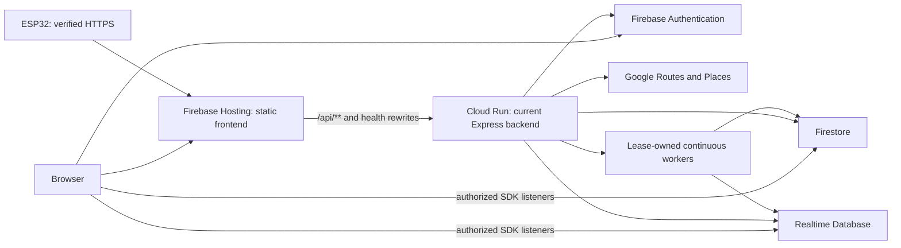

# ngrok removal and managed Firebase backend migration

| Document ID | Version | Status | Last updated |
|---|---|---|---|
| EKI-OPS-028 | 1.0 | Proposed | 2026-11-01 |

Assessment date: 2026-10-21, Asia/Kolkata. Source baseline: `testing` at `a523731`, including the existing uncommitted RTDB readiness change in `backend/src/server.ts`.

Status: **analysis complete; migration has not been executed. Do not retire the tunnel yet.** No billing, API enablement, IAM, deployed configuration, device firmware, or application data was changed for this assessment.

## Repository notes (2026-10-24)

- Line references were re-checked against `main` at `2fdbedd` on 2026-10-31 (earlier against `testing` at `6b2d8e4`, 44 commits past the assessed baseline); the uncommitted RTDB readiness edit mentioned above is not in that checkout.
- `bustrack-be165` (display name `Eki-AhdUni`, number `449313371438`) is a single Firebase project with two registered web apps. It currently holds test data only and is used as **staging**. Which web app ID the frontend build uses comes from the GitHub environment secret and has not been verified.
- `eki-production`, the production target in `deploy.yml`, is not visible to the Firebase CLI login used for this work. Treat production as not set up until its owner confirms.
- Work is tracked in issues #365 to #379. The host decision (Cloud Run versus a VPS) remains open.
- On 2026-11-01 Cloud Billing was linked to `bustrack-be165` and the Cloud Run and Artifact Registry APIs were enabled (read-only `gcloud billing projects describe` and `gcloud services list`). The billing and API rows in Section 2 record the state at the assessment date.

## 1. Recommendation (pending owner approval)

Section 1 is a recommendation, not an approved decision. It does not authorize provisioning Cloud Run until the owner records the host decision.

Deploy the existing Express container to **Cloud Run in the Firebase project's underlying Google Cloud project**, retain Firebase Hosting for the exported frontend, and retain Firebase Authentication, Firestore, and RTDB. Prefer a stable Hosting origin with explicit `/api/**`, `/health`, and `/live` rewrites to that service, subject to device latency acceptance. This preserves the current HTTP contracts and continuous workers with substantially less change than porting the application to Functions.

Firebase Hosting alone does not execute this Express server. Its supported Cloud Run integration requires Cloud Billing; linking billing upgrades a Spark Firebase project to Blaze. Hosting's proxy has a 60-second request limit. [Firebase Hosting and Cloud Run](https://firebase.google.com/docs/hosting/cloud-run)

For the initial move, keep the existing database instances and Auth project. Treat any move to a separate production project, RTDB region change, schema migration, or transport redesign as a separate release. Separating these changes makes rollback possible without copying live state between databases.

There is no evidence supporting a promise of zero errors or zero lost GNSS fixes. The practical acceptance standard is preserved persisted state and authorization, successful feature acceptance, measured latency/recovery, and an exercised rollback. Firmware already uses bounded queues and may discard expired fixes; a backend outage cannot be made lossless by configuration alone.

## 2. Verified current state

| Finding | Evidence and significance |
|---|---|
| The current project is `bustrack-be165` | `.firebaserc`; local frontend and backend database settings agree on its existing RTDB instance. |
| Billing is disabled | Read-only `gcloud billing projects describe bustrack-be165 --format='value(billingEnabled)'` returned `False`. Cloud Run deployment is blocked until billing is linked. |
| Cloud Run API is disabled | Read-only service listing returned `SERVICE_DISABLED` for `run.googleapis.com`. This did not enumerate services and does not establish that no historical service exists. |
| Firestore is in Delhi | Read-only `gcloud firestore databases list` returned the default native database in `asia-south2`. |
| The configured RTDB is in Iowa | The configured instance has the `*.firebaseio.com` URL form, which maps to `us-central1`; the existing region decision records that same instance. Its current location was inferred from the configured URL, not newly enumerated through the Firebase API. |
| The frontend still selects ngrok | Both local `.env.local` and `.env.production` set `NEXT_PUBLIC_BACKEND_URL` to the tunnel. GitHub environment secrets were not inspected and remain an independent release check. |
| The device still selects ngrok | The ignored `hardware/include/secrets.h` compiles the tunnel origin into `BACKEND_URL`. Only the origin setting was inspected; secrets were not reproduced. |
| The current backend is configured for development | Local backend settings select `NODE_ENV=development` and port 4000. They are not a production runtime manifest. |
| Hosting deployment does not deploy the backend | `.github/workflows/deploy.yml:129,206` deploys Hosting and rules to staging and production, with separate index deployment at lines 115 and 192. There is no backend container deployment step. |
| Hosting currently has no backend rewrite | `firebase.json` serves `frontend/out` and headers. Building `backend/dist` does not provision an executing service. |
| A suitable container already exists | `backend/Dockerfile` builds from the workspace root, starts `dist/bootstrap.js`, listens on port 8080, and uses a non-root runtime. `.dockerignore` excludes environment files, including backups. |
| Current public path is functioning at assessment time | Hosting returned 200; tunnel `/health` returned JSON/200; an unauthenticated Places request returned JSON/401; its browser preflight returned 204. Tunnel responses allowed the actual Hosting origin. The served Hosting CSP included the configured tunnel origin. These are point-in-time probes, not authenticated feature or load acceptance. |

RTDB and Firestore locations are independent. An existing RTDB instance cannot be relocated by changing its location setting. [Firebase RTDB locations](https://firebase.google.com/docs/database/locations)

## 3. Architecture and deployment alternatives

| Option | Effect on this repository | Assessment |
|---|---|---|
| Hosting plus Cloud Run in the same Firebase project | Keeps the current container, middleware, REST routes, SDK listeners, device auth and worker lease. Adds deployment/IAM/runtime configuration and optionally Hosting rewrites. | Recommended first migration. Cloud Run is a Google Cloud runtime integrated with Firebase, not code executed by static Hosting. |
| Firebase HTTP Functions plus separate event/task/scheduled workers | Requires exporting an HTTP handler instead of starting a listener, replacing process-lifetime workers, reviewing after-response work, and revalidating execution, ordering and retries. | Viable later if a Functions-only deployment is an explicit requirement; substantially wider scope. |
| Only deploy Hosting/rules and remove ngrok | Leaves the backend without a reachable executing host. | Breaks device ingestion and HTTP features. |
| Move trusted backend writes directly into browser/ESP32 Firebase access | Changes the trust model and bypasses existing device registry, trusted claims, lifecycle ordering and operational recovery. | Does not preserve current functionality/security. |

The current app depends on work outside HTTP response lifetimes. Firebase documents that background activity after a function finishes cannot make progress reliably. A thin HTTP Function wrapper around the existing startup code would therefore not complete this migration. [Firebase Functions execution guidance](https://firebase.google.com/docs/functions/tips)

### Public address choice

Use one durable origin, preferably an institution-owned domain connected to Hosting, or the existing `https://bustrack-be165.web.app` for the same-project move. Both the web build and firmware use the **origin only**, without `/api`; their callers append `/api/...` themselves.

Add narrow rewrites for `/api/**`, `/health`, and `/live` to the exact service and region. Preserve static role pages, `/_next`, and Firebase's reserved `/__/auth` handling. Do not replace the site with a catch-all backend rewrite. Validate dynamic responses' content type, authorization headers, cache policy and status codes through Hosting, not only the direct service URL.

If the extra Hosting hop fails the device latency gate, use a stable direct API domain instead. That alternative requires cross-origin CORS/CSP validation and independently coordinated backend/Hosting rollback. Decide before fleet flashing. A direct `run.app` address also works technically, but couples firmware to the service identity; a controlled stable name makes later runtime moves easier.

Hosting `pinTag` can couple static releases with a backend revision. It does not roll back database writes or devices calling a different origin. Old tagged revisions also need an explicit retirement policy. [Hosting revision pinning](https://firebase.google.com/docs/hosting/full-config)

## 4. Migration blockers and failure modes

| Priority | Risk | Required control |
|---|---|---|
| Blocker | Disabled billing and Cloud Run API | Establish the approved billing owner; enable required services in the explicit target project during implementation. No such changes were made here. |
| Blocker | No repeatable backend release | Add an immutable image build/deploy/readiness/rollback path before changing clients. |
| Blocker | Workers pause or disappear on request-only CPU/scale-to-zero | Use instance-based CPU allocation and minimum instances at least 1 for the current combined API/worker process. |
| Blocker | Firmware remains on the tunnel | Build and physically validate a correctly signed/configured image with the final origin and its actual trusted root chain. Track each device's installed version. |
| Blocker | Production startup rejects local settings | Explicitly provide production CORS/database/retention/runtime settings; do not upload the local `.env`. |
| High | Retention deletes old records immediately after activation | Inventory/dry-run and back up first; inspect all retention code/policies and approve current thresholds before enabling the production worker. |
| High | Project mismatch yields empty data or invalid identities | Keep runtime ADC, frontend Auth, Firestore, RTDB and deploy targets aligned. The workflow's `eki-production` target is not evidence that production data/accounts exist there. |
| High | Regional latency exceeds firmware limits | Benchmark candidate regions against both existing databases and actual campus/mobile device networks. |
| High | IAM-level 401/403 makes valid devices fail | Permit intended public invocation while retaining the app's Firebase/device authentication; never require browsers/devices to supply Google service identity tokens in place of their current credentials. |
| High | New cloud process becomes leader during a supposedly passive smoke test | Launch candidate against isolated staging data or with `WORKER_ENABLED=false`; startup alone otherwise attempts leadership. |
| High | Worker ownership remains on the laptop | Stop/disable the old coordinator deliberately and verify cloud acquisition and useful work. Healthy API responses do not prove cloud worker ownership. |
| High | Old browser tabs keep the old baked-in API origin | Rebuild/redeploy frontend, test installed PWA upgrade, and retain a controlled compatibility window before tunnel retirement. |
| High | IP-based limiters see proxy IPs or forged forwarded headers | Validate `trust proxy` for the deployed Hosting/Cloud Run/direct ingress paths and test client-IP spoof resistance and fleet NAT behavior. |
| High | Autoscaling multiplies local quotas/work admission | Set a measured initial replica/concurrency envelope, retain distributed device quota, and enforce aggregate edge/shared controls. Account for overlapping revisions. |
| High | Routes/Places stop working after egress IP changes | Review backend Maps key API and source restrictions; configure stable egress if its IP restrictions require it. Verify both Routes and Places (New), not only map rendering. |
| High | Restart interrupts a committed-but-unacknowledged operation | Preserve timestamps/sequences and durable operation IDs; reconcile uncertain outcomes instead of blindly repeating billable/Auth mutations. |
| Medium | API rewrite returns static HTML, redirects, or caches personalized data | Test exact paths and methods, assert JSON, verify no-store/private headers and retain service-worker NetworkOnly behavior. |
| Medium | Tunnel-specific cleanup removes retry/auth protections | Remove only ngrok-specific branches after acceptance; preserve generic backoff, timeout, validation and authorization behavior. |

### Continuous worker requirement

`backend/src/server.ts:307,311` starts the HTTP listener, the route-catalog watcher, and `startWorkerCoordinator`. The coordinator owns:

- Trip-state progression and recovery (`startTripStateEngine`).
- Live/public bus projections (`startLiveBusProjection`).
- Retention and privacy deletion.
- Abandoned-ride reconciliation.
- Fleet authorization reconciliation, initially and every ten minutes.

Its Firestore lease lasts 45 seconds and renews every 15 seconds; generation and local monotonic fencing protect takeover. See [worker leadership](WORKER_LEADERSHIP.md). Preserve `_worker_leases/trip-state-worker` and its generation; never delete it to force a cutover. A hung or late renewal may require natural expiry, skew allowance, and the next acquisition attempt, so failover is not instantaneous.

Use instance-based billing plus a nonzero minimum for this process. Minimum instances alone does not provide continuous request-independent CPU. Instances can still restart, so recovery/fencing remains necessary. [Cloud Run CPU and billing settings](https://docs.cloud.google.com/run/docs/configuring/billing-settings)

`WORKER_ENABLED=false` disables the coordinator, not the HTTP server, route watcher, or all asynchronous HTTP operations. It is a smoke-test control, not a guarantee that a service accepting mutation requests is read-only.

### Retention is a specific data-loss hazard

`backend/.env.example` intentionally has `NODE_ENV=production` with `RETENTION_SWEEPER_ENABLED=false`, and production startup refuses that combination. Copying it unchanged fails startup; changing retention to true without reviewing old records may activate deletions.

Before activation, review the [retention runbook](RTDB_RETENTION.md), current Firestore and RTDB policies, protected pointers and active ownership. The existing `retention:rtdb -- --dry-run` only inventories its documented RTDB scope; it is not a universal Firestore/retention dry-run. Keep `LEGACY_RTDB_RETIRED=false` unless all legacy consumers have independently been retired. Preserve the same policies during the backend move.

## 5. Runtime configuration contract

| Area | Required final configuration/check |
|---|---|
| Project/identity | Dedicated runtime service account in the intended project; ADC is already supported in `backend/src/lib/firebaseAdmin.ts:45`. Confirm Firestore, RTDB and Auth operations under that identity, including token revocation/claims and user deletion/reconciliation. Grant only the necessary permissions; do not assume read-only database access is sufficient. |
| Credentials | Prefer workload identity for CI and attached service identity for runtime. Store Maps/OTLP secrets in Secret Manager with explicit versioning/access. Never put backend secrets in `NEXT_PUBLIC_*`, image layers, reports or frontend artifacts. [Cloud Run secrets](https://docs.cloud.google.com/run/docs/configuring/services/secrets) |
| Process | `NODE_ENV=production`; platform-provided `PORT` (container defaults 8080); existing bootstrap and `0.0.0.0` binding. Use the repository-root Docker build context. |
| Databases | Exact existing `FIREBASE_DATABASE_URL`; matching frontend URL; correct default Firestore project/database; no emulator host overrides in the cloud runtime. |
| Browser origins | Exact Hosting/custom frontend origins in `CORS_ORIGIN`. Do not substitute the backend URL for the frontend origins. Keep localhost only for intended development. |
| Worker/retention | Production leader enabled after controlled handoff; approved retention explicitly enabled; current thresholds and legacy-retirement flag preserved. |
| Capacity | Instance-based CPU, minimum 1; begin with a small measured service/revision limit and concurrency. One replica is simpler but is not high availability. Select CPU/memory from measurements, not the platform's defaults. |
| Quotas | Preserve `HTTPS_DEVICE_RATE_LIMIT_MODE=distributed`; review shard factor against peak simultaneous serving processes, including old/new revisions and any old laptop backend. Static sharding may over-throttle when fewer instances run and cannot by itself enforce a precise autoscaled global quota. |
| Health | Configure platform startup/liveness checks explicitly using `/live`; Docker's `HEALTHCHECK` is not a substitute for platform configuration. Gate promotion and external monitoring on dependency-aware `/health`. A running process is not proof of healthy Firebase dependencies or worker progress. |
| Shutdown | Existing SIGTERM handling drains HTTP, workers, operations and Firebase, but the forced-exit backstop is exactly 10 seconds. Rehearse it and leave margin below the platform deadline; verify recovery after hard kill as well as graceful restart. |
| Maps | Separate browser and server keys; enable the APIs actually called by backend Routes and Places; verify quotas, billing and application restrictions from deployed egress. |
| Logging | Structured cloud logs, revision/environment identity, secret/header redaction, background failures and worker metrics. Move any OTLP endpoint from workstation/localhost to a reachable managed destination. |

Cloud Run gives a terminating container a ten-second SIGTERM grace period; minimum instances do not eliminate shutdowns. [Container runtime contract](https://docs.cloud.google.com/run/docs/container-contract)

An IP-restricted Maps server key must match the source Google actually observes; a workstation allowlist does not establish that cloud requests will work. [Google Maps security guidance](https://developers.google.com/maps/api-security-best-practices)

## 6. Region and performance decision

The present system has three different locations: devices/users in India, Firestore in Delhi, and RTDB in Iowa. Moving the backend to India improves proximity to Firestore/users but retains a transcontinental RTDB hop. Moving it near RTDB shifts latency toward devices and Firestore. Neither choice is proven optimal from metadata alone.

Measure Cloud Run candidates near Firestore (`asia-south2`), RTDB (`us-central1`), and, if useful, Singapore (`asia-southeast1`) against the **same existing data layout** using isolated test identities and a controlled workload. Include credential-cache cold/warm behavior, RTDB transactions, Firestore operations, route-catalog warmup, concurrency, TLS connection reuse, and public-origin overhead. Retire rejected candidate services after the experiment.

The firmware currently budgets a 1-second connection timeout and 1.5-second HTTP timeout, with a separately bounded TLS handshake. The browser API default is 10 seconds. Backend telemetry has its own 8-second response budget; that larger server budget does not prevent a device timeout. See [telemetry deadlines](TELEMETRY_DEADLINES.md).

Do not change timeouts or telemetry frequency just to hide a regional regression. Record p50/p95/p99, acceptance/retry/expiry rates, queue depth, and freshness under actual mobile/campus conditions. Use the [existing realtime targets](../design/REALTIME_TRANSPORT_DECISION.md) and preregister any revised acceptance criteria. Their moving-route and weak-network evidence remains pending, not satisfied by the health probes in this report.

The [earlier Singapore RTDB decision](../design/RTDB_REGION_LATENCY_DECISION.md) is preparation for a separate database migration. Its historical App Check-enabled wording differs from the current implementation/workflow, which does not send App Check and disables database enforcement. Use current auth/enforcement behavior for this migration; reconcile that old wording before reusing it as a release checklist.

## 7. Exact change inventory

| Surface | Necessary work and timing |
|---|---|
| New backend infrastructure/release manifest | Declare service, region, image digest, runtime identity, CPU/billing, min/max instances, concurrency, environment, secret versions and probes. Add repeatable verification and rollback. |
| `.github/workflows/deploy.yml` | Add backend image deployment before client promotion. Keep exact verified SHA/project/environment targeting, existing rules/index readiness and environment approval gates. Distinguish an isolated staging project from the currently named staging environment. |
| `firebase.json` | Add narrow rewrites if the common Hosting origin is selected; use the actual service/region and a reviewed pinning strategy. Verify deployment headers on both static and dynamic responses. |
| Frontend env and GitHub environment configuration | Change `NEXT_PUBLIC_BACKEND_URL` to the chosen stable origin and rebuild. Updating only backend env cannot change previously exported JavaScript. Local `.env.production` does not override GitHub environment settings. |
| `scripts/update-csp.mjs`, `scripts/csp-backend-origin.mjs`, `scripts/verify-web-backend-contract.mjs` | Preserve generated CSP and exact-origin checks. The verifier currently requires an explicit origin token even when it equals the Hosting origin; `'self'` alone does not satisfy its string check. The strict build regenerates that token. |
| `backend/src/server.ts` | Preserve current routes/body limits/security middleware; validate proxy trust, readiness and shutdown margin on the real ingress. The existing user readiness edit was left untouched. |
| Ignored `hardware/include/secrets.h` | Set final origin and correct PEM trust chain through controlled provisioning; preserve device ID/secret and assigned bus/route. A backend move does not require reprovisioning those identities. |
| Firmware build/release | Configuration is compiled in. Changing host/trust requires a new flashed image, potentially through the existing supported signed fleet OTA process where it is already provisioned and validated. Do not assume an old bench image supports OTA. Respect secure-boot sequence/anti-rollback constraints. |
| `frontend/src/lib/apiClient.ts:72` and associated component/client tests | Retain tunnel warning-header support during overlap. After old consumers are retired, remove ngrok branch/tests and use stable-host fixtures while preserving auth/error/timeout tests. |
| `hardware/src/main.cpp:1449,1527` and `hardware/include/telemetry_policy.h:419` | Retain tunnel error classification during overlap. Later remove ngrok header collection and special 404/502 translation; preserve generic HTTP retry/credential policies. Update native tests and `backend/src/securityConfig.test.ts` together. |
| Runtime probe scripts | Remove ngrok warning headers and ngrok-specific preflight expectations from `scripts/check-stationary-runtime.mjs` and optional smoke code in `scripts/verify-web-backend-contract.mjs` after retirement. |
| Documentation | Update `NGROK_TUNNEL.md`, `LOCAL_TESTING.md`, `LIVE_DEMO_RUNBOOK.md`, relevant setup/release guides and their mirrors. Localhost remains useful for development, emulator tests, Docker self-probes and local observability; those references are not production dependencies to delete. |
| Existing local env backup files | Keep them out of images, Git additions and generated handoff artifacts. They are existing user files and were not modified or incorporated into this report. |

There is no ngrok package in the application manifests to uninstall. Its operational dependency is the public address and running tunnel/host, with a few compatibility branches in source/tests. Deleting those branches first does not deploy a backend.

## 8. Staged execution and rollback

### Phase A: establish an unchanged-state baseline

1. Record the verified commit, existing local change, image/build identities, frontend/backend/RTDB origins, database locations, installed firmware/device inventory, active rides, pending durable operations and current worker owner. Keep personal data and secrets in approved private evidence.
2. Choose the initial target project explicitly. Recommended: relocate the runtime within the existing data/Auth project. If `eki-production` is selected instead, first design and rehearse a separate migration of Auth UIDs/password provider data/claims, profiles, Firestore/subcollections/indexes, RTDB internal state/rules and device verifiers. A project-ID substitution cannot preserve those automatically.
3. Capture recoverable Firestore and RTDB backups plus the configuration/IAM/secret-version manifest. Verify restoration using isolated data. Auth recovery/export is a distinct concern; a Firestore export does not back up Auth users.
4. Review retention effects before enabling production startup. Run the existing full CI, emulator/rules and firmware checks for the exact implementation release.

### Phase B: deploy and prove the candidate

1. Link approved billing, enable the required runtime/build/registry/secret APIs, and provision runtime/deployment identities. Estimate cost for always-allocated CPU, minimum instances, storage/builds, databases, networking, logs and any NAT/WAF. Free allowances are not a zero-cost guarantee.
2. Build the existing Dockerfile from the repository root; deploy an immutable candidate without changing the active frontend or device endpoint. Do not build from only `backend/`, which omits workspace manifests/lockfile inputs.
3. Prefer isolated staging databases/Auth. If a limited production-data smoke is necessary, use `WORKER_ENABLED=false`, avoid mutation endpoints, and verify retention startup requirements explicitly. A zero-traffic or tagged revision can still run startup code; no-traffic is not a worker-disable switch.
4. Test the dedicated service URL and chosen public origin. Validate `/live`, dependency-ready `/health`, missing/expired/revoked browser identity, role/assignment boundaries, device auth, proxy IP handling, response headers, and representative real provider calls under staging identities.
5. Run capacity, restart, idle-worker and regional tests. Record the selected CPU/memory/concurrency/replica envelope and the final public origin before preparing fleet images.

### Phase C: move ownership and clients

1. Rehearse the handoff in staging. Before touching the live runtime, wait for active administrative jobs to reach a known state and use a safe operating window for devices/rides.
2. Stop the old coordinator gracefully; restart its compatibility backend with `WORKER_ENABLED=false` if old clients still require that endpoint. Start/promote the cloud revision with workers enabled and verify new leadership plus actual trip/projection/reconciliation progress. Retain lease generations and operation locks.
3. Keep old/new HTTP compatibility only within the tested concurrency/rate envelope. Do not shadow or dual-submit real telemetry/admin writes as a migration experiment. The existing distributed quota and ordered writes must be verified across overlapping processes.
4. Rebuild and deploy the frontend with the stable origin and updated CSP/rewrites. Validate fresh browser sessions, an existing open tab, and an installed PWA. The service worker deliberately waits for old controlled clients to close, so immediate replacement of all consumers cannot be assumed.
5. Move one safely stopped canary device using its final origin/trust and existing identity. Validate telemetry, diagnostic and firmware endpoints, not just HTTP 202. Rehearse reconnect and movement, then move remaining devices in recorded batches.
6. Keep rollback available through the observation window. Suggested minimum: 48 hours and a complete normal operating cycle; include representative load, a restart, a network outage/recovery and no-request worker activity. Extend the window when a required scenario has not occurred.

### Phase D: retire ngrok and workstation dependence

1. Require all feature/acceptance rows below to pass, all fleet endpoints to be migrated, all controlled browser/PWA sessions updated, and no unexplained old-endpoint traffic during the observation period. Low traffic alone does not prove a dormant device has migrated.
2. While rollback is still retained, stop the local backend and tunnel for a controlled rehearsal. Prove the system works with the workstation disconnected. Restart compatibility service if the rehearsal finds a missed consumer.
3. Retire the local processes/tunnel permanently only after that rehearsal passes. Remove obsolete tunnel credentials/configuration through the owning account and remove the source/test/runbook compatibility branches in a later small cleanup.
4. Keep independent local development/emulator capability. Archive release evidence, rollback image/Hosting version and the firmware configuration manifest securely.

### Rollback rules

- Prefer routing the stable public origin back to a known-good **cloud revision**, leaving the same databases in place. Verify worker ownership after routing changes; HTTP traffic rollback alone does not choose the coordinator leader.
- During overlap, web rollback can select the previous Hosting build while the old endpoint remains available. After tunnel retirement, a Hosting build containing the old ngrok URL is not an acceptable rollback target. Archive a stable-origin frontend rollback build before decommissioning.
- A device already flashed with the new hostname cannot be recovered by changing the website's environment variable. Keep its stable hostname serving a compatible backend. Any firmware fallback must meet actual signing and anti-rollback policy; do not assume an older sequence can be reinstalled.
- Before disabling the cloud worker and returning leadership elsewhere, establish that dispatched mutations settled or reconcile their unknown outcomes. Use the existing audited recovery resources; do not reset durable locks or blindly replay Auth/billable work.
- Do not restore an old database snapshot merely because a deployment failed: that would discard valid writes made since the snapshot. Same-database code rollback usually needs no data restore. A database/project migration requires its own write-stop/final-copy/reconciliation rollback design.

## 9. Required feature and failure acceptance

Run all mutating/negative-load scenarios against isolated staging identities/data first. Use a physical canary only in its approved route/provisioning window.

| Feature/scenario | Pass evidence |
|---|---|
| Hosting/API contract | Correct static routes and Auth helper; API paths/methods return JSON without redirects/HTML; browser CSP, CORS and `Location`/`Retry-After`/cursor headers work. Personalized APIs are not publicly cached. |
| Auth and roles | Existing Google sign-in, token refresh/revocation, admin/driver/passenger permissions and route assignments work; unauthenticated/non-admin access stays denied. Keep current App Check behavior rather than introducing an unrelated enforcement change. |
| Device identity | Existing device ID/secret succeeds without reprovisioning; invalid/disabled identity fails correctly; unavailable assignment remains retryable as designed. Never fabricate platform 401 responses for valid devices: firmware latches credential rejection. |
| Telemetry schemas/order | Current nine-field and still-deployed eight-/six-field compatibility contracts; original 512-byte limit, duplicates/older fixes, timestamp/sequence ordering and accepted 200/202 semantics remain correct. |
| Failure responses | Device policy retries transport failures, 403/408/425/429/5xx and respects bounded Retry-After. Genuine 404 or unexpected redirects are not success and can drop a fix. Unknown commit 503 must reconcile safely. |
| Physical transport | Actual ESP32 validates hostname, chain and clock through the final endpoint; cold/warm TLS, DNS, connection reuse, Wi-Fi/mobile outage and complete power cycle recover within the existing documented limits. No insecure TLS bypass. |
| Driver lifecycle | Create/start/stop/delay, ordered stops, direction/turnaround, abandoned ride recovery and active-ride ownership persist across cloud restart. No duplicate completion or fabricated progress. |
| Passenger behavior | Route catalogue/geometry, live marker/ETA/freshness, boarding code/join, messaging, feedback and account/profile settings work against the same data. |
| Admin operations | Fleet/bus/driver/device assignment, route/geometry preview/save, Places search, feedback, requests, settings, analytics/history, reconciliation jobs and operational recovery all succeed with existing authorization and paging. |
| Realtime reads | RTDB `publicRouteBuses`/`liveRouteCatalog` and Firestore listeners recover after reconnect, background/resume and assignment revocation. A healthy API does not prove listener paths/rules. |
| Idle workers | Leave HTTP traffic idle and prove workers still process staged stale/abandoned/reconciliation cases; observe retention/deletion progression using eligible synthetic records. |
| Crash/failover | Graceful SIGTERM and hard termination preserve durable state; one valid leader resumes; no stale leader overwrites new state; interrupted operations are discoverable/recoverable. |
| Scale and limits | Multi-device NAT, per-device distributed quota, browser quotas, overlapping revisions, queue pressure and provider stalls produce bounded failures without bypass or unintended credential latching. |
| PWA upgrade/rollback | Old tab and installed PWA update path is understood; stable-origin fallback works after the tunnel is absent; APIs remain NetworkOnly and the app does not cache user data across accounts. |
| Data conservation | Before/after identities, assignments, histories, pending operations, message/feedback data and protected current pointers reconcile. Any retention deletion has a documented policy explanation. |
| Independence | With the workstation backend/tunnel stopped, real users and a canary complete a representative route cycle using only managed services. |

For rewritten APIs, verify `private, no-store`/equivalent policy at the actual endpoint. Hosting defaults dynamic content to private, but explicit sensitive-response controls are clearer; service-worker NetworkOnly does not itself disable HTTP/CDN caching. [Firebase Hosting cache behavior](https://firebase.google.com/docs/hosting/manage-cache)

## 10. Verification performed for this assessment

- 10 root-script tests passed: backend origin validation, matching RTDB instance enforcement and web/backend CSP contract.
- 103 backend tests passed across worker coordination/fencing, health state, shard factor, telemetry deadlines/outage handling and security configuration.
- 37 frontend API-client tests passed, including identity headers, secure URLs, errors and bounded requests.
- 11 reroute-backoff/instrumentation-startup tests passed on a focused serial rerun.
- 35 documentation-mirror tests passed. Completed passing checks total 196; relative links in the report/index resolved and `git diff --check` was clean.
- Read-only cloud metadata and the four public-path probes above were completed.

The first broad Vitest invocation selected all `src` tests through the package script, observed timing failures in reroute-backoff/startup tests, and was stopped. Focused checks were then run serially with one worker, including both affected files, which passed. The broad run is not reported as a full-suite pass, and the precise cause of its timing failures was not established.

No full production build, emulator suite, container deployment, authenticated end-to-end cloud acceptance, firmware flash, load test or moving-route rehearsal was performed. The tests establish existing contracts, not completion of the migration. All implementation and live acceptance gates above remain open.

## 11. Release completion criteria

The move is complete only when a repeatable cloud backend release exists, billing/IAM/runtime prerequisites are satisfied, data and identities remain aligned, cloud workers own and advance their duties, every supported browser/device feature passes, rollback is rehearsed, and the system has passed the workstation-disconnected test. Tunnel-source cleanup follows that operational result.

The next implementation deliverable should be a reviewable backend deployment manifest/workflow, explicit public-origin/region decision, staging acceptance record, and coordinated frontend/firmware rollout. This assessment is the migration specification, not a deployment certificate.
