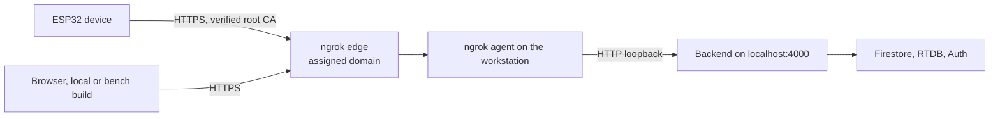

# ngrok Tunnel for the Backend

| Document ID | Version | Status | Last updated |
|---|---|---|---|
| EKI-OPS-003 | 1.2 | Current | 2026-11-02 |

## 1. Purpose

This procedure publishes a backend that runs on a workstation at a stable HTTPS origin through an ngrok agent. Devices and browsers outside the workstation cannot call `localhost`; the tunnel gives them one reusable origin, so restarting the backend or the agent does not require a firmware rebuild.

Since 2026-11-01 the staging web app uses the Cloud Run service `eki-backend-staging` instead of the tunnel, and the tunnel that the staging site used is offline ([current state](CI_CD_AND_RELEASES.md#71-current-state)). Devices flashed with the tunnel origin need the Cloud Run origin and its root CA ([issue #376](https://github.com/notnamansinha/Eki/issues/376)). Use this procedure for bench tests and demonstrations. A tunnelled backend is available only while the workstation, the backend process and the ngrok agent all run.



Figure 1. Request path through the tunnel.

## 2. Prerequisites

- An ngrok account with an assigned development domain. Use the exact hostname that the ngrok dashboard shows; the suffix (for example `ngrok-free.dev`) is not fixed in advance.
- The ngrok agent installed on the workstation.
- The repository installed and `backend/.env` configured for the Firebase project as in [getting started](../GETTING_STARTED.md), with Application Default Credentials or a service account for that project.
- For devices: PlatformIO, a USB cable and the device's provisioned credentials ([local testing](LOCAL_TESTING.md#33-prepare-a-device)).

## 3. Set up ngrok once

1. Save the account authtoken in ngrok's user configuration, outside the repository:

   ```powershell
   ngrok config add-authtoken <ngrok-authtoken>
   ngrok config check
   ngrok diagnose
   ```

   Expected: `config check` reports a valid file and `diagnose` reaches the ngrok service [1].
2. Never put the authtoken in the repository, an environment template, firmware, screenshots or logs.

## 4. Start the backend and the tunnel

1. In `backend/.env`, set `NODE_ENV=development`, `PORT=4000` and `TRUST_PROXY=loopback`, and list every frontend origin that calls this backend in `CORS_ORIGIN` (for example `https://bustrack-be165.web.app`). In development the backend also allows `http://localhost:3000`. Expected: the values are saved.

   `TRUST_PROXY=loopback` makes Express accept `X-Forwarded-For` only from a proxy on the same machine, so each caller gets its own pre-authentication rate-limit bucket. Without it every tunnelled caller shares the agent's loopback bucket, and a flood from one caller can return `429` to real devices. Do not put the tunnel URL in `CORS_ORIGIN`; it is the backend's own origin.
2. In terminal 1, start the backend:

   ```powershell
   npm run dev --workspace=backend
   ```

   Expected: the log shows `BusTrack backend running on port 4000`. `npm run dev` restarts the process when files in the checkout change. For an unattended host, run `npm run build --workspace=backend`, then `npm run start --workspace=backend`.
3. In terminal 2, start the agent with the assigned domain:

   ```powershell
   $NgrokDomain = "<assigned-domain>"
   ngrok http 4000 --url "https://$NgrokDomain"
   ```

   Expected: the agent shows the session as online and forwarding to `http://localhost:4000`. Always pass `--url`; without it ngrok assigns a random URL that no device or build knows.
4. In terminal 3, check both ends:

   ```powershell
   Invoke-RestMethod http://localhost:4000/health
   Invoke-RestMethod "https://$NgrokDomain/health"
   ```

   Expected: both return `status: ok`. A `503` with `status: degraded` means the backend cannot reach Firestore or RTDB; fix credentials or the database URL before continuing.
5. Keep both processes running and stop the workstation from sleeping.

## 5. Provision TLS trust in the firmware

The firmware validates the server certificate chain and hostname. ngrok renews the leaf certificate; the device trusts the issuing root CA.

1. Inspect the chain that the tunnel presents:

   ```powershell
   openssl s_client -showcerts -verify_return_error -connect "${NgrokDomain}:443" -servername $NgrokDomain
   ```

   Expected: verification succeeds and the chain names its root CA.
2. Download that root certificate from the issuing CA's own repository. Compare its subject, issuer, validity and SHA-256 fingerprint with the chain. Do not use a certificate copied from a chat, and do not pin the leaf certificate.
3. In the ignored `hardware/include/secrets.h`, set the origin (no path or query) and the root:

   ```cpp
   #define BACKEND_URL "https://<assigned-domain>"
   #define BACKEND_ROOT_CA \
     "-----BEGIN CERTIFICATE-----\n" \
     "<verified root CA PEM>\n" \
     "-----END CERTIFICATE-----"
   ```

4. Build, flash and watch the device (replace `COM3` with the port from `py -m platformio device list`):

   ```powershell
   py -m platformio test --project-dir hardware -e native
   py -m platformio run --project-dir hardware -e esp32dev
   py -m platformio run --project-dir hardware -e esp32dev --target upload --upload-port COM3
   py -m platformio device monitor --project-dir hardware --port COM3 --baud 115200
   ```

   Expected: the serial log shows Wi-Fi, time synchronisation and telemetry responses `200` or `202`. A `401` means the device ID, secret or registry entry is wrong; a TLS error means the URL, hostname, clock or CA is wrong.

Vehicles in university service use only the signed `esp32dev-secure` image built under [hardware security provisioning](../security/HARDWARE_SECURITY_PROVISIONING.md).

## 6. Point the consumers at the tunnel

| Consumer | Setting | Apply the change |
|---|---|---|
| Deployed frontend | `NEXT_PUBLIC_BACKEND_URL` secret in the GitHub environment. The staging secret names the Cloud Run service; pointing it at a tunnel moves every staging user off Cloud Run. | Merge to `main` or dispatch Deploy; the strict build regenerates the CSP `connect-src` ([CI, deployment and releases](CI_CD_AND_RELEASES.md)) |
| Local frontend | `NEXT_PUBLIC_BACKEND_URL` in the ignored `frontend/.env.local` | Restart the frontend |
| Local production build | `NEXT_PUBLIC_BACKEND_URL` in `frontend/.env.production` or the shell, then `npm run build:production` | The build fails if the CSP would block the backend |
| Device | `BACKEND_URL` and `BACKEND_ROOT_CA` in `hardware/include/secrets.h` | Rebuild and reflash |
| Backend | `CORS_ORIGIN` lists frontend origins only | Restart the backend |

The frontend adds the `ngrok-skip-browser-warning` header to requests for `*.ngrok-free.dev`, `*.ngrok-free.app` and `*.ngrok.io` hosts, so API calls do not receive the free-plan browser page. The deployed staging frontend calls the Cloud Run backend; to reach a tunnelled backend from a phone, use a frontend build that names the tunnel origin. Tunnelling a local frontend needs a second stable domain, its own Firebase Auth authorized domain and a `CORS_ORIGIN` entry.

## 7. When a device must be reflashed

| Change | Reflash |
|---|---|
| Restart the backend on the same workstation and port | No |
| Restart ngrok with the same `--url` | No |
| ngrok renews the leaf certificate under the same root | No |
| Change backend code | No |
| Change the local port behind the same public origin | No; change the `ngrok http` port |
| Change the public scheme, hostname or port | Yes |
| The issuing root CA changes | Yes |
| Change Wi-Fi or device credentials | Yes |
| Change firmware behaviour | Yes |

## 8. Verification

1. From a phone on mobile data, open `https://<assigned-domain>/health`. Expected: `{"status":"ok"}`.
2. From the repository root, run `node scripts/check-stationary-runtime.mjs --frontend https://bustrack-be165.web.app --backend https://<assigned-domain>`. Expected: every check passes, including the CORS preflight.
3. Check the device serial log. Expected: telemetry responses `200` or `202`.
4. Open Live Ops. Expected: the device appears online with a fresh position.

The ngrok inspection page at `http://127.0.0.1:4040` shows each request's status and latency. It also shows authorization headers and location payloads: do not share or keep unredacted captures.

## 9. Troubleshooting

| Symptom | Check | Action |
|---|---|---|
| Device serial log shows telemetry `HTTP 404` or `HTTP 502` | ngrok returned `ERR_NGROK_3200` (tunnel offline) or `ERR_NGROK_8012` (backend unreachable); the firmware keeps such samples and retries them, while other `404` responses drop the sample | Restart the agent with the same `--url`, or start the backend |
| Public `/health` fails, local `/health` works | Agent stopped, wrong `--url`, or account limit reached | Restart the agent; check usage in the ngrok dashboard |
| Both `/health` checks return `503` | Backend cannot reach Firestore or RTDB | Fix credentials, `FIREBASE_DATABASE_URL` or network |
| Device TLS error | Clock, hostname or root CA in the serial log | Reflash only if the compiled origin or root is wrong (Section 7) |
| Browser CORS error | `CORS_ORIGIN` lacks the frontend origin, or the deployed build has another backend URL | Correct `CORS_ORIGIN` and restart; or correct the secret and redeploy |
| Devices receive `429` | `TRUST_PROXY` is not `loopback` | Set it and restart the backend |
| Deploy fails at the backend readiness step | The origin in `NEXT_PUBLIC_BACKEND_URL` failed the readiness check; Deploy retries `/health` for up to 90 s while it answers 502, 503 or 504 or does not answer. The staging secret names the Cloud Run service unless it was pointed at a tunnel. | For a tunnel, start the backend and the agent; then rerun Deploy ([CI, deployment and releases](CI_CD_AND_RELEASES.md#52-steps)) |

Telemetry is sent once per second while moving and while stopped, so each device makes about 3,600 requests per hour, plus a diagnostic report every five minutes and all browser API traffic. Compare this with the account's request and data limits before every field session [2]. Do not disable TLS verification on a device to work around a tunnel problem.

## 10. References

[1] ngrok, "Agent CLI," ngrok.com/docs/agent/cli. Accessed: 2026-10-30.

[2] ngrok, "Free plan limits," ngrok.com/docs/pricing-limits/free-plan-limits. Accessed: 2026-10-30.
