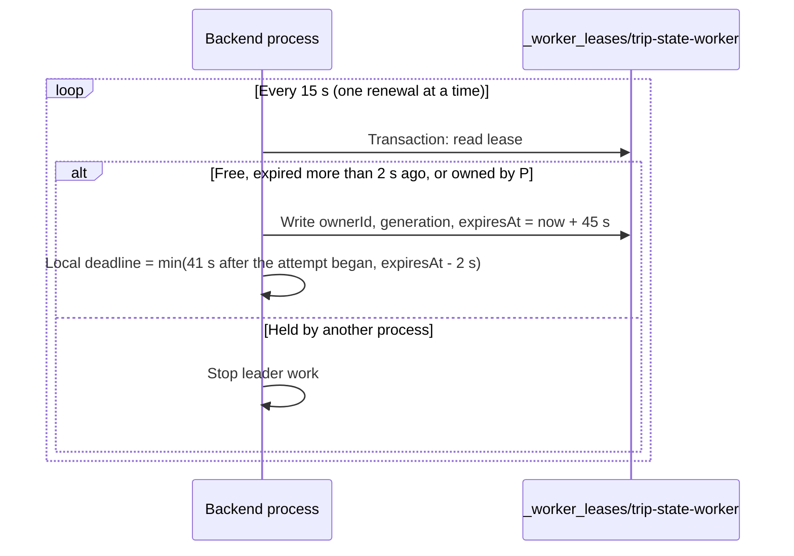

# Worker Leadership and Fencing

| Document ID | Version | Status | Last updated |
|---|---|---|---|
| EKI-OPS-026 | 1.0 | Current | 2026-10-30 |

## 1. Purpose

Several backend replicas can run at once, but singleton background work must run in one process only. This document describes the Firestore lease that elects that process, how its authority ends, and how each destination store rejects writes from a leader that has lost it.

## 2. Scope

The process that holds the lease is the worker leader. It runs the trip state engine (lifecycle listeners, stale presence sweep and lifecycle recovery), the public live projection, the retention sweeper, the privacy deletion worker, the abandoned-session reconciler and the periodic fleet authorization reconciler. HTTP, admin and device requests do not need leadership; they keep their own assignment, ordering and durable operation contracts.

## 3. Behaviour

### 3.1 Lease

The lease is the document `_worker_leases/trip-state-worker` with `ownerId`, `generation`, `renewedAt` and `expiresAt`. Each process sets its owner ID to `WORKER_INSTANCE_ID` (default `worker`) followed by a random UUID, so two processes with the same label never share ownership.

Figure 1. Lease acquisition and renewal.

A new acquisition increments `generation`; a renewal by the same live owner keeps it. Orderly shutdown sets `ownerId` to `null` and `expiresAt` to the epoch but keeps `generation`, so generations only increase. Do not delete the lease document or reset its generation while any worker or its requests may still exist.

### 3.2 Local authority

Each acquisition creates a fence that asynchronous work carries in its context and that RTDB listeners are bound to explicitly. Local authority ends at the earlier of two times: 41 s after the renewal attempt started (the 45 s lease minus twice the 2 s clock allowance), and 2 s before the recorded wall-clock expiry. A timer that does not depend on the renewal promise revokes the fence at that moment. Admission also compares `performance.now()` with the deadline, so an event loop that was suspended cannot admit work before the overdue timer runs. A slow or late lease response cannot activate or revive a revoked fence.

A process has at most one renewal in flight and runs at most one fleet reconciliation. On revocation the coordinator stops listeners and timers before waiting for cleanup. Shutdown does not wait for an unsettled renewal; a dispatched lease write may still commit, but its response cannot start workers, and the lease then expires on its own.

A queue shared by fenced and unfenced callers, for example durable ride restores used by both device ingestion and the trip engine, starts each item in its requester's context and deduplicates in-flight work only within one generation. A revoked leader's queued restore is rejected without writing, and device ingestion never inherits a leader's fence.

### 3.3 Destination checks

| Destination | Check |
|---|---|
| Firestore lifecycle transactions and deletion batches | The transaction reads the lease and requires the same owner and generation, a valid local deadline and a wall-clock expiry more than 2 s away, before and after the callback. A takeover changes the read set, so Firestore serializes the earlier commit first or retries or aborts it. Each worker write transaction costs one extra lease read. |
| RTDB lifecycle and retention transactions | Local authority is checked on dispatch and on every SDK callback retry. Written objects carry `_workerGeneration`; a lower generation cannot overwrite a newer projection. Session, timestamp and unchanged-value checks still apply. |
| Firebase Auth and recursive deletes | No destination fence exists. Local authority is checked immediately before each call; a dispatched call can finish after revocation with an unknown outcome. Fleet Auth reconciliation keeps its durable lock until every dispatched call settles, and lease expiry never authorizes a lock takeover or a blind replay. Durable deletion jobs survive an interrupted cleanup and are removed only under a valid lease. |

Firestore and RTDB cannot share one lease atomically. An RTDB generation check applies only after a newer generation has written to that node, and deleting a node also deletes its generation. Requests already dispatched cannot be recalled.

## 4. Configuration

| Item | Value | Source |
|---|---|---|
| Lease document | `_worker_leases/trip-state-worker` | `backend/src/lib/workerFence.ts:5` |
| Lease duration | 45 s | `backend/src/services/workerCoordinator.ts:15` |
| Renewal interval | 15 s | `backend/src/services/workerCoordinator.ts:16` |
| Clock allowance | 2 s | `backend/src/lib/workerFence.ts:6` |
| Local deadline | `min(45 s - 2 x 2 s - elapsed, expiresAt - now - 2 s)` | `backend/src/services/workerCoordinator.ts:117` |
| Fleet reconciliation interval | 10 min | `backend/src/services/workerCoordinator.ts:171` |
| `WORKER_ENABLED` | Default `true`; `false`, `0`, `no` or `off` keeps the process out of the election | `backend/src/services/workerCoordinator.ts:20` |
| `WORKER_INSTANCE_ID` | Default `worker`; diagnostic label only | `backend/src/services/workerCoordinator.ts:27` |

## 5. Failure modes and recovery

Every runtime clock must stay within 2 s of the reference clock. Monitor time synchronization and take an unsynchronized replica out of worker service by setting `WORKER_ENABLED=false`. A larger clock error is an infrastructure failure that the lease cannot correct; a backward wall-clock change cannot extend the local monotonic deadline.

| Symptom | Meaning | Action |
|---|---|---|
| Log `[Worker] Lease renewal failed` followed by `Leadership lost` | Firestore was unreachable or slow; leader work stopped. | None if Firestore recovers: the next renewal reacquires the lease. |
| No process logs `[Worker] Leadership acquired` | Every replica has `WORKER_ENABLED=false`, or the lease cannot be written. | Enable the worker on at least one replica and check Firestore access. |
| Leadership moves often between replicas | Renewals take longer than the local deadline allows, or clocks differ. | Check Firestore latency and clock synchronization. |

## 6. Verification

| Behaviour | Tests |
|---|---|
| Cutoff, late replies, timely renewal, backward clock changes, clock allowance, unique ownership, preserved generations, a hung renewal | `backend/src/services/workerCoordinator.test.ts` |
| Context propagation and RTDB callback retries | `backend/src/lib/workerFence.test.ts`, `backend/src/services/durableRideRecovery.workerFence.test.ts` |
| Valid and superseded Firestore writes, expiry after a destination read, RTDB generation rejection, against the Firebase emulators | `backend/src/workerFence.integration.test.ts` |

`npm run test:rules` runs the emulator suite; it needs the Firestore, Database and Auth emulators and never contacts a real Firebase project. CI runs it on Linux. Failover across real replicas, clock monitoring and ride recovery after a failover need staging evidence.
