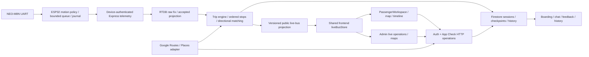

# Deterministic QA baseline and first implementation slice

Inspection date: 11 October 2026, Asia/Calcutta. Base: remote `testing`
`5ce9d03222b52a9394c249a7bb068c6be803cd00`, fetched during this task.
The supplied master specification's `ab74d88` snapshot is historical.
The owner's original checkout at `db937ae` on `codex/issue-246-audit-followups`
was clean and remains separate. Work uses the managed `qa-traceability` worktree
and `codex/qa-traceability` branch. No application or device changes are included.

## Current architecture and component dependencies (L0)

Source entry points: `backend/src/server.ts`, `backend/src/services/`,
`frontend/src/app/`, `frontend/src/components/`, `hardware/src/main.cpp` and
`hardware/platformio.ini`. The generated inventory records every current tracked
production import edge; it does not claim a complete runtime dependency graph.

Four Next page routes are `/`, `/passenger`, `/admin`, `/feedback`.
The existing static mounted-router extractor verifies 71 HTTP operations against
OpenAPI. Dynamic route/method styles fail closed in that existing extractor.
The JSX census finds 163 production control/event sites, to be expanded by
rendered state, role and repeated record identity. Static detection is not a DOM
interaction census; non-JSX gestures, SDK callbacks and service worker events
need explicit browser coverage.

## Requirement and test inventory

| Inventory | Observation | Evidence boundary |
| --- | --- | --- |
| Original plan | 2,983,188 bytes, scanned to EOF with SHA-256/line count | Full programmatic scan; not manual semantic review of all historical comments |
| Features | 351 unique source-attributed exact IDs and original full table oracles | Historical contract overrides remain alongside rows; source must resolve thresholds |
| Universal matrices | C01-C22 and H01-H18, 40 entries | Apply to each eligible rendered control/HTTP operation |
| A/B protocols | AB01-AB08, eight definitions | No real-user experiment is launched |
| GNSS profiles | 20 declared generator profiles reconciled with the plan | No replay or physical GNSS result |
| Strategy simulations | SIM-01 through SIM-20 | Original actions/oracles retained; execution unmapped |
| Historical feature ledger | 303 NOT_RUN, 48 PARTIAL | Preserved history, not evidence for this task's commit |
| Named test declarations at base | 1,406 literal test entries | Computed titles and runtime expansion excluded; not passing-test counts |
| Firmware modes | native, esp32dev, esp32dev-quiet, esp32dev-journal, esp32dev-secure | Source inventory; no firmware compilation/flash in this slice |

`qa-report.json` is the source-to-case mapping table. At this boundary only H17
has a reviewed exact L0 test mapping to the existing OpenAPI/Express verification.
All feature cases conservatively remain NOT_COVERED by this *new mapping system*;
this does not negate the extensive existing backend/frontend/firmware tests.
Only the current regression checks listed below are verified in this task.

## Historical reconciliation and gaps

- The plan's frozen appendix/API tables contain 59 HTTP operations. The later
  overlay records 71; current code and OpenAPI independently agree on 71.
- ROUTE24's historical lazy-repair oracle is superseded by the read-only cached
  geometry contract. Preserve the row and override; do not test a forbidden GET
  mutation to make the historical wording pass.
- Old R01-R15 scope restrictions describe prior work and do not restrict this
  owner's master implementation request.
- The passenger fixture's boarding/chat/profile children remain placeholders
  (`e2e/fixtures/panels.tsx`); complete passenger E2E remains a later slice.
- The existing rules runner uses `eki-rules-test`, not a demo identifier. Its
  isolated rule copies are useful, but the new preflight does not authorize that
  configuration for future mutating QA. Upgrade and verify in the emulator slice.
- 10 October QA recorded 46 locally skipped emulator cases and Java loopback
  failure. That record neither disproves newer Linux evidence nor certifies the
  current integration suite. This slice performs no emulator integration.
- PRs #297 (`d8ba27f`) and #298 (`5ce9d03`) are merged into current testing.
  #298 adds stationary fault-recovery/rollout evidence; do not repeat that repair.
  No open PR targeted testing was returned during the initial query.
- Issues [#245](https://github.com/notnamansinha/Eki/issues/245) and
  [#246](https://github.com/notnamansinha/Eki/issues/246) remain open. Their status
  is context, not proof that every listed old defect remains reproducible.
- Reviewed guidance includes TEST_STRATEGY/README, 9/10 October browser reports,
  GNSS trace, return-route, transport, reroute, ESP32 latency, boarding-budget,
  stationary and non-moving evidence. These retain their original run boundaries.

## Risks and release gates

| Priority | Risk | First mitigation / remaining gate |
| --- | --- | --- |
| P0 | QA targets live Firebase/Maps or exposes credentials | Reject known external configuration; future backend runtime attestation and outbound deny controls still required |
| P0 | Old/duplicate/wrong-session events alter current state | Reviewed validator/ordering/fencing mappings, then emulator sequences and real frontend outcomes |
| P0 | Auth/rules/boarding/privacy authority or ownership defect | Require exact mappings and test changes for changed critical source; verify actual assertions during review |
| P0 | Catalog silently drops requirements or fabricates completion | Exact ID contracts, malformed-row checks, separate history, prohibit synthesized execution results |
| P1 | Compound faults hide behind individually passing tests | Add ordered GNSS loss/network/reboot/replay/browser-recovery sequences |
| P1 | Plausible gradual wrong-road drift escapes jump gates | Separate synthetic uncertainty tests from measured receiver vulnerability tests |
| P1 | Placeholder browser components imply full acceptance | Real boarding/chat/profile components and isolated persistence in passenger slice |
| P2 | Cross-platform setup mistaken for a product failure | Clean Linux checkout/CI and explicit toolchain/environment reporting |
| Physical | RF accuracy, start acquisition, power, thermal, secure provisioning | Separate observed receiver/bus runbook; all unexecuted in this slice |

The first coverage budget covers changed authority/App Check/boarding,
telemetry/current live position, ride/session/worker-fence and privacy/retention
sources plus Firebase rule files. A change needs reviewed source/case/test mapping
and a changed corresponding test file. This catches unaccounted changes, not
weak assertions or an incomplete runtime census. Expand its scope after case
review; do not waive it by merely inventing a test name.

## Verification and limitations

Windows Node 24.19.0 / npm 12.0.2: clean `npm ci --ignore-scripts` installed 936
packages. New harness tests: 15 passed, zero skipped. Root script regressions:
95 passed, zero skipped (includes those 15). Existing OpenAPI verification:
71 mounted operations, seven verifier tests passed. YAML parsed successfully and
the three QA steps/permissions were checked. `git diff --check` passed.
Frontend/backend lint also passed. JUnit output is written under ignored `artifacts/qa/`; counts are actual runner
results, not static declaration counts or 351-case completion.

Initial WSL Node 22.23.2 run: 14/15 passed; the census failed because the Windows
managed worktree's `.git` pointer contains a Windows path. This is not a
catalog/application assertion failure and is not reported as a Linux pass.
The final review uses a separate clean Linux clone and PR CI; their observed
results are recorded with the PR, not assumed here. Docker's local Linux daemon
was unavailable during inspection; no Docker/emulator claim is made.

The software testing infrastructure project remains incomplete. This branch
delivers the catalog/safety/PR-gate slice. Remaining slices are deterministic
GNSS/property generation, emulator ingestion/recovery, passenger E2E, admin
E2E, scheduled reporting, measured stress/mutation and field acceptance.
No main workflow installation, deployment, merge, live data mutation, firmware
flash, real OAuth/Maps or vehicle experiment is included.
