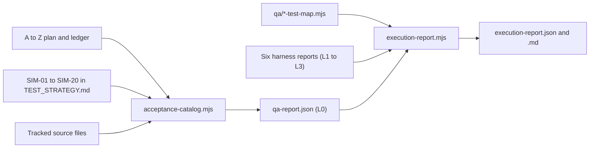

# Eki QA Programme

| Document ID | Version | Status | Last updated |
|---|---|---|---|
| EKI-TST-003 | 1.0 | Current | 2026-10-30 |

## 1. Purpose

The QA programme measures how much of the [A to Z acceptance plan](../docs/testing/WEBAPP_A_Z_AB_TESTING_PLAN.md) has been observed on a given commit. It has three parts:

1. A static acceptance catalog that imports every requirement and inventories the current source.
2. Isolated harnesses that run selected tests and record exact assertion identities, the source commit and whether the working tree was dirty.
3. An execution ledger that links those observations to requirement IDs through reviewed test maps.

The programme never marks a requirement complete. It shows which parts of each requirement have been observed and at which level. The [test strategy](../docs/testing/TEST_STRATEGY.md) defines the levels L0 to L5 and lists every command; the [testing index](../docs/testing/README.md) lists dated results.

## 2. Components



Figure 1. Data flow from requirement definitions and harness reports to the execution ledger.

| Component | Path | Role |
|---|---|---|
| Acceptance catalog | `scripts/qa/acceptance-catalog.mjs` | Parses the plan, the historical ledger and the SIM rows of the test strategy; fails on a missing, duplicate or unknown requirement ID |
| Source census | `scripts/qa/source-census.mjs` | Lists Next.js page routes, mounted Express operations, JSX control sites, literal test declarations and firmware environments |
| Test maps | `qa/*-test-map.mjs`, merged by `qa/test-map.mjs` | Reviewed links from a requirement ID to named tests, each with a level and the semantics it proves |
| Safety preflight | `scripts/qa/safety-preflight.mjs` | Rejects cloud credentials, non-demo projects and non-loopback targets before any harness starts |
| Network guard | `scripts/qa/network-guard.mjs` | Preloaded into harness child processes; blocks non-loopback sockets and DNS from Node |
| Harness runners | `scripts/qa/run-*.mjs`, `scripts/run-rules-emulator.mjs` | Run one family each and write its report under `artifacts/qa/` |
| Execution ledger | `scripts/qa/execution-report.mjs` | Validates the six family reports for one clean commit and derives a status per requirement |
| Campaigns | `scripts/qa/campaign.mjs`, `campaign-report.mjs`, `weekly-report.mjs` | Nightly and weekly runs; see [scheduled reliability](SCHEDULED_RELIABILITY.md) |
| Coverage budget | `scripts/qa/coverage-budget.mjs` | On pull requests, requires changed critical source to have a reviewed mapping and a changed test file |
| Workflow policy | `scripts/qa/workflow-policy.mjs` | Checks that the nightly and weekly workflows keep read-only permissions, pinned actions, bounded timeouts and the resolve, suites, report job graph |

## 3. Evidence model

### 3.1 Denominators

The catalog counts each set separately and never merges them:

| Set | Count | Source |
|---|---|---|
| Feature cases | 351 | Plan Section 5 (AUTH to REL) |
| Per-control matrix entries | 22 (C01 to C22) | Plan Section 4.1 |
| Per-HTTP-operation matrix entries | 18 (H01 to H18) | Plan Section 4.2 |
| Experiment protocols | 8 (AB01 to AB08) | Plan Section 11 |
| GNSS generator profiles | 20 | Plan Section 6, reconciled with `docs/testing/simulations/generate-gnss.mjs` |
| Simulation scenarios | 20 (SIM-01 to SIM-20) | [Test strategy](../docs/testing/TEST_STRATEGY.md), Section 7.1 |

The catalog stops importing at the plan's first `## Appendix` heading, so historical appendix rows cannot redefine a current case.

### 3.2 Statuses

The static catalog can produce only `NOT_RUN` (mapped to at least one test) or `NOT_COVERED` (no reviewed mapping). It cannot import a pass: `validateCatalog` rejects any other status or an execution commit. Historical notes from the ledger are attached with `currentEvidence: false`.

The execution ledger reports `PARTIAL`, `FAIL`, `BLOCKED`, `NOT_RUN` or `NOT_COVERED` for each of the 399 definitions. A passing mapped assertion yields `PARTIAL`, because each test map covers a limited scope of its requirement. The ledger always reports `completeFeatureCases: 0`, `softwareRelease: NOT_RELEASE_READY` and `vehicleFieldDeployment: NOT_VERIFIED`; see [execution ledger](EXECUTION_EVIDENCE.md).

Unmapped does not mean untested. Many requirements have regression tests that nobody has yet reviewed against the requirement's oracle.

### 3.3 Priorities

The catalog assigns P0 to the AUTH, BOARD, GNSS, TRIP, DATA and SEC categories and P1 to the rest, and proposes the levels each kind of requirement needs (feature: L1 to L3; matrix: L0 to L3; experiment: L4). The proposed levels are marked `PROPOSED_REVIEW_REQUIRED` and the priorities are labelled conservative triage; neither is an approved waiver.

## 4. Running the static checks

Use Node 24 and locked dependencies.

```powershell
npm ci
npm run qa:test
npm run qa:check
npm run qa:catalog
```

| Command | Result |
|---|---|
| `npm run qa:test` | Runs the QA tooling tests (`scripts/qa*.test.mjs`) |
| `npm run qa:check` | Safety preflight, catalog check and workflow policy; writes nothing |
| `npm run qa:catalog` | Writes `artifacts/qa/qa-report.json` and `qa-report.md`, and appends the Markdown to the GitHub step summary in CI |

The report records the source commit, the dirty flag, byte count, SHA-256 and line count of each parsed document, every case with its source line, the historical ledger notes and the source census. A report from a dirty tree cannot serve as evidence for a commit.

For a committed pull request, `EKI_QA_BASE_SHA=<full base SHA> npm run qa:budget` fails when a changed critical file has no reviewed `sourcePaths` mapping or no changed mapped test file. Critical files are `firestore.rules`, `database.rules.json` and non-test files under `backend/src/` or `frontend/src/` whose path contains `auth`, `appcheck`, `boarding`, `telemetry`, `tripstate`, `workerfence`, `livebus`, `ride`, `session`, `privacy`, `retention` or `fleet` (case-insensitive). CI supplies the base SHA. The budget checks traceability, not assertion strength; reviewers check the semantics.

## 5. Safety boundary

`npm run qa:safety` checks the process environment without reading `.env` files, importing SDKs or opening sockets. It rejects:

- credentials such as `GOOGLE_APPLICATION_CREDENTIALS`, `FIREBASE_SERVICE_ACCOUNT`, Maps keys and model API keys;
- any Firebase or GCP project variable other than `demo-eki-qa`;
- target URLs that are not literal `http://127.0.0.1:<port>` or `http://[::1]:<port>`, including DNS names, alternative IPv4 notation, credentials, query strings and fragments.

Errors name the variable, never its value. `npm run qa:safety -- --emulator` additionally requires:

| Variable | Required value |
|---|---|
| `GCLOUD_PROJECT` | `demo-eki-qa` |
| `FIRESTORE_EMULATOR_HOST` | `127.0.0.1:8085` or `[::1]:8085` |
| `FIREBASE_DATABASE_EMULATOR_HOST` | `127.0.0.1:9005` or `[::1]:9005` |
| `FIREBASE_AUTH_EMULATOR_HOST` | `127.0.0.1:9095` or `[::1]:9095` |
| `FIREBASE_DATABASE_URL` | `http://127.0.0.1:9005/` |
| `EKI_QA_BASE_URL` | Loopback backend root with an explicit port |
| `EKI_QA_EXTERNAL_PROVIDERS` | `mock` |
| `EKI_QA_CONFIRM_DISPOSABLE` | `1` |

A passing preflight proves the configuration only. Runtime isolation comes from the emulator launcher, the network guard and the browser request allowlist described in each harness guide. None of them is an operating-system sandbox. `qa/qa.env.example` lists the optional synthetic property controls (`EKI_QA_SEED`, `EKI_QA_REPLAY_PATH`).

## 6. Harness guides

| Family | Level | Command | Guide |
|---|---|---|---|
| GNSS properties | L1 | `npm run qa:gnss` | [GNSS properties](GNSS_PROPERTIES.md) |
| Reviewed units | L1 | `npm run qa:unit:reviewed` | [Reviewed unit sub-oracles](REVIEWED_UNIT_EVIDENCE.md), [HTTP policy sub-oracles](HTTP_UNIT_EVIDENCE.md) |
| Native firmware | L1 | `npm run qa:native` | [Native firmware evidence](NATIVE_EVIDENCE.md) |
| Emulator integration | L2 | `npm run test:rules` | [Emulator acceptance](EMULATOR_ACCEPTANCE.md) |
| HTTP authorization | L2 | `npm run qa:api` | [HTTP authorization sweep](HTTP_AUTHORIZATION.md) |
| Browser | L3 | `npm run qa:browser` | [Browser acceptance](BROWSER_ACCEPTANCE.md) |
| Ledger | All | `npm run qa:report` | [Execution ledger](EXECUTION_EVIDENCE.md) |
| Scheduled campaigns | L1 to L3 | `npm run qa:nightly`, `npm run qa:weekly` | [Scheduled reliability](SCHEDULED_RELIABILITY.md) |
| Witnessed field | L5 | Manual | [Field acceptance package](FIELD_ACCEPTANCE.md) |

[qa/BASELINE_2026_10_11.md](BASELINE_2026_10_11.md) (EKI-EVD-060) records the inspection that started this programme.

## 7. Limits

- The catalog is a programmatic scan. It does not review every historical comment or rendered browser state.
- The source census counts static control sites; a site can render many times, and non-JSX interactions need browser execution.
- Declared tests are literal declarations, not runtime-expanded counts.
- Database call candidates need review to identify actual writes.
- No harness contacts real Google, Firebase or model services, and none moves a vehicle. L4 and L5 evidence comes only from the procedures in the [field acceptance package](FIELD_ACCEPTANCE.md).
