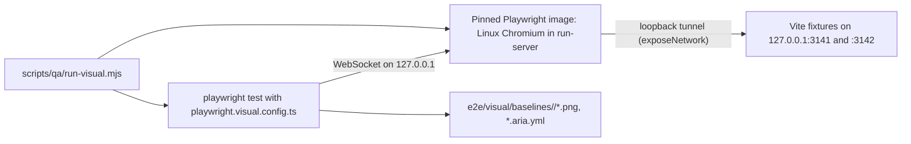

# Visual and Accessibility-Tree Baselines

| Document ID | Version | Status | Last updated |
|---|---|---|---|
| EKI-TST-019 | 1.2 | Current | 2026-11-26 |

## 1. Purpose

This suite records reviewed baselines of the public, passenger and admin surfaces and fails when a change alters one of them. Each reviewed state has two baselines:

- a viewport screenshot, compared pixel by pixel;
- the accessibility tree of the same moment (roles, accessible names, states and heading levels), which is what a screen reader is given.

It covers the "visual regression against reviewed baselines" item of issue #523. It does not replace testing on real devices or with screen readers; see the [device and screen-reader acceptance procedure](DEVICE_AND_SCREEN_READER_ACCEPTANCE.md).

Issue #523 names a template command that runs `tests/responsive-visual.spec.ts` with `VISUAL=1` and a `web-test-arsenal` Playwright configuration; that spec and configuration belong to an external QA template and are not part of Eki. This suite (`npm run qa:visual`, specs in `e2e/visual/`) is the repository's implementation of that responsive visual baseline check and its only visual suite.

## 2. How it works



Figure 1. The tests run on the host; only the browsers run in the pinned container, so every machine renders with the same browser build and fonts.

| Part | Path | Role |
|---|---|---|
| Runner | `scripts/qa/run-visual.mjs`, `scripts/qa/visual-plan.mjs` | Starts `playwright run-server` in `mcr.microsoft.com/playwright` pinned by digest, published on `127.0.0.1` only, with the host's `node_modules/playwright-core` mounted read-only; runs the suite against it; stops the container; writes `artifacts/visual/run.json` with the commit, dirty flag, image and Playwright version |
| Configuration | `playwright.visual.config.ts` | Refuses to run without the runner's endpoint; three projects; starts both fixtures; stores baselines without a platform suffix |
| Passenger surfaces | `e2e/fixtures/` ([passenger UI fixture](../e2e/fixtures/README.md)) | The real passenger layout, workspace, profile and feedback modal on synthetic routes and buses |
| Public and admin surfaces | `e2e/visual/fixture/` | The real landing, install, not-found and admin pages and panels on the synthetic boundaries of `e2e/production-audit/state.ts`, plus a synthetic feedback list |
| Specs | `e2e/visual/*.visual.spec.ts`, helpers in `e2e/visual/visual.ts` | Open each state and call `capture()` |
| Warm-up | `e2e/visual/warm-up.ts` | Opens every surface once before the tests, so no test races Vite's first dependency bundling |

### 2.1 Projects

All three projects render with Chromium.

| Project | Emulation | Viewport (CSS px) |
|---|---|---|
| `phone` | Playwright `Pixel 7`: Android user agent, touch, `isMobile` | 412 x 839 |
| `tablet` | Playwright `iPad Pro 11`: iPadOS user agent, touch, `isMobile` | 834 x 1194 |
| `desktop` | Playwright `Desktop Chrome` | 1280 x 800 |

Screenshots use `scale: "css"`, so a baseline has one pixel per CSS pixel whatever the device pixel ratio.

### 2.2 Reviewed states

| State | Spec | Projects |
|---|---|---|
| `landing` (signed out, with the transit artwork) | `public.visual.spec.ts` | all |
| `install` (Android, iPadOS and desktop variants by user agent) | `public.visual.spec.ts` | all |
| `not-found`, `not-found-dark` | `public.visual.spec.ts` | all |
| `passenger-home` (one live route) | `passenger.visual.spec.ts` | all |
| `passenger-live-routes` (sheet raised, two routes) | `passenger.visual.spec.ts` | phone, tablet (pointer screens have no sheet) |
| `passenger-tracking`, `passenger-tracking-gnss-lost` | `passenger.visual.spec.ts` | all |
| `passenger-no-service`, `passenger-routes`, `passenger-profile` | `passenger.visual.spec.ts` | all |
| `passenger-feedback`, `passenger-delete-account` (dialogs) | `passenger.visual.spec.ts` | all |
| `admin-live-ops`, `admin-routes`, `admin-fleet`, `admin-history`, `admin-feedback`, `admin-settings` | `admin.visual.spec.ts` | all |

That is 19 states on phone and tablet and 18 on desktop: 56 screenshots and 56 accessibility trees.

### 2.3 Determinism

| Source of variation | Control |
|---|---|
| Operating system fonts and rasterisation | Browsers run only in the pinned image; `scripts/qa-visual.test.mjs` fails if the image tag and the installed `@playwright/test` differ |
| Clock, dates and relative ages | `page.clock.setFixedTime(2026-11-23T09:30:00+05:30)`, `timezoneId: "Asia/Kolkata"`, `locale: "en-IN"` |
| Animations and the text caret | `animations: "disabled"`, `caret: "hide"` |
| Lazy views and images | `capture()` waits until the fixtures' "Loading fixture view…" placeholder is gone, the network is idle, fonts are ready and every image has loaded |
| Network | Every request outside `127.0.0.1` is aborted and fails the test |
| Fixture controls | `e2e/visual/capture.css` hides the passenger fixture's QA controls during the screenshot only |

## 3. Prerequisites

- Node 24 and `npm ci`.
- Docker with Linux containers (Docker Desktop on Windows or macOS). The first run pulls the image (about 3.6 GB on disk).
- Free loopback ports 3141 and 3142.

## 4. Procedures

Run every command from the repository root.

### 4.1 Compare with the baselines

```powershell
npm run qa:visual
```

Expected result: every test passes, except that the touch-only `passenger-live-routes` state is skipped on `desktop` (Section 2.2). A comparison never writes a baseline, so a missing baseline fails. Differences, traces and an HTML report go to `artifacts/visual/`; CI keeps them for 7 days as the `visual-baselines` artifact. Arguments after `--` go to `playwright test`, for example `npm run qa:visual -- --project=phone -g "profile"`.

### 4.2 Update and review baselines after an intended change

1. Make the change and run `npm run qa:visual`. Expected result: the states you meant to change fail, and no others.
2. Open `artifacts/visual/report/index.html` and read each failure's expected, actual and diff images and the accessibility-tree diff. Any other failure is a regression: fix it before continuing.
3. Run `npm run qa:visual:update`. Expected result: only the baselines that differed are rewritten.
4. Open each rewritten file in `git diff` (`*.png` in an image viewer, `*.aria.yml` as text) and confirm it shows what you intended on all three projects.
5. Run `npm run qa:visual` twice more. Expected result: both runs pass.
6. Commit the baselines with the change. In the pull request, list each changed state and why it changed.

To add a state, call `capture(page, "<name>", { tree })` in a spec and follow steps 3 to 6. `scripts/qa-visual.test.mjs` requires every project to hold the same states (except the touch-only sheet), each with both files.

### 4.3 Upgrade Playwright

When `@playwright/test` changes version, `scripts/qa-visual.test.mjs` fails with `VISUAL_IMAGE_MISMATCH`.

1. Pull `mcr.microsoft.com/playwright:v<version>-noble` and read its digest with `docker image inspect --format "{{json .RepoDigests}}" mcr.microsoft.com/playwright:v<version>-noble`.
2. Set `VISUAL_IMAGE_TAG` and `VISUAL_IMAGE_DIGEST` in `scripts/qa/visual-plan.mjs`.
3. Follow Section 4.2. A new browser build usually changes anti-aliasing in every screenshot; review a sample from each project and state in the pull request that the change comes from the browser upgrade.

## 5. Tolerance

Screenshots are compared with zero differing pixels tolerated, except `passenger-tracking` and `passenger-tracking-gnss-lost`, which tolerate up to 1000 differing pixels (0.1 % of the desktop viewport). In these two states, anti-aliasing of the text on the translucent route timeline sheet and of the location prompt over the map varied by 133 to 660 pixels between runs (133 to 543 on the first review; 660 after the passenger baselines were regenerated for the demo ride and the thumb drawer). Turning off the sheet's backdrop blur did not remove this. The accessibility trees of these two states are still compared exactly, so a changed label fails there.

## 6. Limits

- **Fonts.** In production, `next/font` serves Roboto and Playfair Display. The fixtures have no font origin, so `visual.ts` sets `--font-roboto` to Liberation Sans (metrics of Arial, wider than Roboto) and `--font-playfair` to Liberation Serif. Text wraps and truncates close to production but not identically.
- **Artwork.** Only `landing` shows the transit artwork. Every other state replaces it with a flat tone (`e2e/visual/capture-no-artwork.css`) to keep baselines small; `e2e/passenger-layout/transit-artwork.spec.ts` checks the artwork itself.
- **Placeholders.** Chat, the boarding view and the Google map are fixture stand-ins (labelled on screen). Their real rendering is not baselined here.
- **Chromium only.** The tablet project uses the iPad viewport and user agent, rendered by Chromium. WebKit and Firefox are not baselined.
- **Not hardware.** Emulation does not reproduce iOS toolbars, safe areas, text zoom, font boosting or a screen reader's output. Those checks are in the [device and screen-reader acceptance procedure](DEVICE_AND_SCREEN_READER_ACCEPTANCE.md).
- **Accessibility tree, not speech.** The `.aria.yml` baselines record what the browser exposes, not what a screen reader says. When it records a baseline, Playwright replaces some numbers in text with `\d+` patterns (dates, times, durations), so a change to one of those numbers is caught by the screenshot, not the tree.

## 7. Troubleshooting

| Symptom | Cause and action |
|---|---|
| `Run the visual baselines with npm run qa:visual` | The configuration was started directly. Use the npm script. |
| `VISUAL_IMAGE_MISMATCH` | Section 4.3. |
| `The browser server did not start within 60 s` | Docker is not running, or the image pull failed. Run `docker pull` with the image from `scripts/qa/visual-plan.mjs` and retry. |
| `http://127.0.0.1:3141 is already used` | Another fixture server is running. Stop it. |
| `requests outside loopback` | A change made a surface fetch an external origin. The fixtures must stay offline; stub the new boundary in the fixture. |
| Many baselines differ by a few pixels and the image digest did not change | The pinned image should render identically on any host. Record the host's Docker version and the diff images in an issue instead of updating the baselines. |
