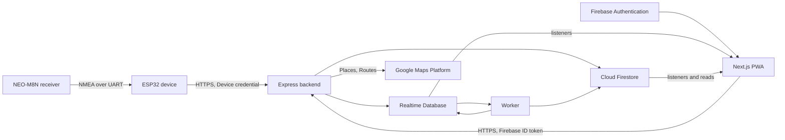

# Software Requirements Specification

| Document ID | Version | Status | Last updated |
|---|---|---|---|
| EKI-REQ-001 | 1.0 | Current | 2026-10-30 |

## 1. Introduction

### 1.1 Purpose

This specification states what Eki shall do. It is an as-built specification: each requirement describes behaviour that the code at the head of the documented branch implements, and names the source line that implements it. Where the repository records a gap, the requirement is marked `Open`. Developers, testers, reviewers and university acceptance owners use it to check a change against the agreed behaviour and to find the tests that verify it.

### 1.2 Scope

Eki tracks a university bus fleet in near real time. It consists of:

- an ESP32 device with a u-blox NEO-M8N GNSS receiver in each bus;
- an Express backend that authenticates devices and people, validates telemetry and runs a lease-owned background worker;
- Firebase Authentication, Cloud Firestore, Realtime Database (RTDB) and Hosting;
- a Next.js progressive web app (PWA) with a passenger workspace and an administrator workspace.

Out of scope: ticketing and payment, vehicle control, dead reckoning during GNSS loss, multiple campuses or tenants in one deployment, and long-term storage of every coordinate.

### 1.3 Definitions and conventions

Domain terms (ride session, live record, passenger projection, arrival corridor, GNSS gap, device, operator, worker and others) are defined in the [glossary](../GLOSSARY.md). This document adds the following conventions.

| Term | Meaning in this document |
|---|---|
| shall | Mandatory requirement. Every row in Section 3 uses it. |
| Implemented | The code implements the requirement and automated tests or inspection verify it. |
| Implemented but not physically accepted | The code implements the requirement and software tests pass, but the repository records that a physical ride, board or deployment acceptance is still needed. |
| Open | The repository records the requirement as not yet met, not yet approved, or a deployment gate. |
| T | Verification by automated test. |
| I | Verification by inspection of code, configuration or build output. |
| A | Verification by analysis (bounds, static assertions, simulation). |
| D | Verification by demonstration on real hardware, a deployment or a real browser. |
| Source | `path:line` relative to the repository root, or a document when the requirement is a recorded gate. |

### 1.4 References

Internal documents:

| Document | Use |
|---|---|
| [Architecture summary](../design/ARCHITECTURE.md) | System structure and data flow |
| [High-level design](../design/HIGH_LEVEL_DESIGN.md), [Low-level design](../design/LOW_LEVEL_DESIGN.md) | Component design |
| [Tracking algorithms](../design/TRACKING_ALGORITHMS.md) | Plausibility, map matching and stop progress detail |
| [UI design system](../design/UI_DESIGN_SYSTEM.md) | Visual tokens and components |
| [Firebase data model](../data/FIREBASE_DATA_MODEL.md) | Collections, RTDB paths and rule matrix |
| [Backend API](../../backend/API.md), [HTTP contract](../api/HTTP_CONTRACT.md), [Operation resources](../api/OPERATION_RESOURCES.md) | HTTP interface |
| [Security architecture](../security/SECURITY_ARCHITECTURE.md) | Trust boundaries and authorization |
| [Hardware telemetry](../hardware/HARDWARE_TELEMETRY.md), [Hardware setup](../../hardware/README.md) | Device contract and build profiles |
| [Configuration](../CONFIGURATION.md) | Environment variables and defaults |
| [Test strategy](../testing/TEST_STRATEGY.md), [QA programme](../../qa/README.md) | Test layers and quality gates |
| [A to Z acceptance plan](../testing/WEBAPP_A_Z_AB_TESTING_PLAN.md) | Feature case families and proposed budgets |
| [Field ride repairs, 29 October 2026](../testing/PASSENGER_FIELD_RIDE_REPAIRS_2026_10_29.md) | Evidence for the arrival corridor and live health thresholds |
| [Field acceptance package](../../qa/FIELD_ACCEPTANCE.md) | Physical motion and latency gates |
| [University deployment checklist](../operations/UNIVERSITY_DEPLOYMENT_CHECKLIST.md) | Deployment and institutional gates |

External sources:

[1] ISO/IEC/IEEE, "Systems and software engineering: Life cycle processes: Requirements engineering," ISO/IEC/IEEE 29148:2018, 2018.

### 1.5 Overview

Section 2 describes the product context, users, environment, constraints and assumptions. Section 3 lists the requirements by user class and quality attribute. Section 4 maps requirement groups to implementing modules and tests, and lists the requirements that are open or not physically accepted.

## 2. Overall description

### 2.1 Product perspective

Eki is a modular monolith attached to one Firebase project. Devices push telemetry over HTTPS; the backend never polls them. The backend writes the current position of each bus to RTDB and durable state to Firestore. One worker, chosen by a Firestore lease, advances ride lifecycle and publishes the passenger projection. Browsers receive live changes through Firebase listeners and send commands to the backend over HTTPS. The [architecture summary](../design/ARCHITECTURE.md) describes the structure.

Figure 1. System context: the device pushes to the backend, the backend and worker write both Firebase stores, and browsers read through listeners and send commands to the backend.

### 2.2 Product functions

- Ingest authenticated GNSS telemetry and publish a live position per bus and route.
- Match positions to the route, detect confirmed deviations and reroute through remaining stops.
- Start rides automatically or on request, infer direction, advance stops in route order and complete rides at the terminal.
- Show passengers live routes, bus health, stop progress and arrival estimates; let them board, chat and give feedback.
- Let administrators monitor the fleet, end rides, manage vehicles, operators, routes and settings, review history and feedback.
- Retain, expire and delete data under fixed retention periods and on account deletion requests.
- Deliver signed firmware updates to devices when no ride is active.

### 2.3 User classes and characteristics

| User class | Identity and access | Characteristics |
|---|---|---|
| Signed-out visitor | No account. Sees the landing page only; every workspace redirects to `/` (`frontend/src/components/shared/RoleGuard.tsx:28-30`). There is no guest access. | Any browser. |
| Passenger | Google account with role `passenger`, the default for any new or unknown role (`frontend/src/hooks/useAuth.ts:265`). Uses `/passenger`. | Mostly a phone browser, often outdoors, sometimes on weak mobile data. |
| Operator | Google account with role `driver`, linked by an administrator to a `drivers` record with an assigned bus. Has no dedicated workspace: may open `/passenger` but cannot board (`backend/src/routes/sessions.ts:170-322`). Through the API an operator may start a ride, set delay, issue a boarding code and chat. | Exactly one operator assigned to a bus is a precondition for automatic service. Operators do not use the app while driving ([deployment checklist](../operations/UNIVERSITY_DEPLOYMENT_CHECKLIST.md)). |
| Administrator | Role `admin` with the `admin` claim and a current `authorizationVersion` (`backend/src/middleware/requireAdmin.ts:55-80`). Uses `/admin`, `/feedback` and `/passenger`. | Desktop or phone. Performs ride operations on behalf of operators. |
| Device | ESP32 with a per-device secret, bound by the server registry to one bus and route. | Vehicle-powered, unattended, intermittent connectivity. |
| Maintainer | Runs the deployment: environment variables, Firebase project, role claims (backend script `sync-role-claims`, `backend/src/syncRoleClaims.ts`), device provisioning (backend script `provision-device`, `backend/src/provisionDevice.ts`) and firmware signing. | No in-app interface. |

### 2.4 Operating environment

| Element | Environment |
|---|---|
| Browser (automated) | Chromium through Playwright with the Desktop Chrome profile. Viewports: 360 x 800, 390 x 844, 440 x 956, 1280 x 585, 1280 x 800, plus edge cases 320 x 568 and 844 x 390 (`playwright.passenger-layout.config.ts:13-17`, `e2e/passenger-layout/video-audit.spec.ts:263`); 1920 x 1080 for live map routing (`playwright.routing.maps.config.ts:7`). |
| Frontend | Next.js 16 static export (`frontend/next.config.ts:92`), React 19.2.4, Firebase JavaScript SDK 12, Google Maps JavaScript API. Served by Firebase Hosting with the headers in `firebase.json`. |
| Backend | Node.js 24 (`backend/Dockerfile:1`, `.github/workflows/ci.yml:23`), Express 5, Firebase Admin SDK 14. |
| Firebase | Authentication (Google provider), Cloud Firestore, Realtime Database, Hosting. The RTDB region choice is recorded in the [RTDB region decision](../design/RTDB_REGION_LATENCY_DECISION.md). |
| Google Maps Platform | Maps JavaScript API in the browser; Places text search and Routes API from the backend (`backend/src/lib/googleMaps.ts`). |
| Device hardware | ESP32 board `esp32dev`, 4 MB flash, PlatformIO `espressif32@7.0.1` (`hardware/platformio.ini:5-13`); fleet builds require chip revision ECO3 or later (`hardware/sdkconfig.defaults:15`). NEO-M8N on UART2. Fused 12 V to 5 V vehicle supply. Wi-Fi station only. |

### 2.5 Design and implementation constraints

| ID | Constraint | Source |
|---|---|---|
| CON-001 | One deployment serves one Firebase project and one operational authority. | [High-level design](../design/HIGH_LEVEL_DESIGN.md) |
| CON-002 | The frontend is a static export with no server-side rendering. | `frontend/next.config.ts:92` |
| CON-003 | Devices push over HTTPS. There is no message broker and the backend never polls devices. | `backend/src/routes/devices.ts:85` |
| CON-004 | Firestore and RTDB rules deny by default. Live, lifecycle and internal data are written only by the backend through the Admin SDK. | `firestore.rules:303-305`, `database.rules.json:3-4` |
| CON-005 | Stop progress assumes left-hand traffic, a maximum speed of 90 km/h, and straight lines between stops as a stand-in for road geometry. | `backend/src/services/tripStateReducer.ts:101-117` |
| CON-006 | Device Wi-Fi, device ID, secret, backend URL and root CA are compile-time values. Changing any of them requires a new firmware image: a USB reflash, or for a provisioned fleet board a signed OTA image built with the new values. | `hardware/src/main.cpp:653-665`, [hardware setup](../../hardware/README.md) |
| CON-007 | The system shows a GNSS interruption instead of a guessed position. | `frontend/src/lib/liveBusHealth.ts:38-55` |
| CON-008 | Arrival estimates use stored route polylines and client-side arithmetic. The browser never calls the Directions service. | `frontend/src/components/maps/DirectionsRoute.tsx:15-54` |
| CON-009 | A production backend refuses to start unless `RETENTION_SWEEPER_ENABLED=true` and `CORS_ORIGIN` is set. | `backend/src/server.ts:98-105` |
| CON-010 | The web client does not use Firebase App Check. Abuse resistance relies on authentication, rules and rate limits. | `frontend/src/lib/firebaseCore.ts:12-30` |
| CON-011 | HTTP rate limits are kept in process memory and divided by `RATE_LIMIT_SHARD_FACTOR`; device limits are shared through RTDB by default. | `backend/src/lib/rateLimitShard.ts:27-45`, `backend/src/services/deviceRateLimiter.ts:3-6` |

### 2.6 Assumptions and dependencies

| ID | Assumption or dependency | Consequence if it does not hold |
|---|---|---|
| ASM-001 | Each configured stop pin lies within 15 m of the lane the bus drives in that direction (`backend/src/services/tripStateReducer.ts:68-75`). | The stop is never observed. It is credited `passed_unobserved` only when the bus drives through one of the next two stops; otherwise the ride waits at that stop. |
| ASM-002 | A healthy device publishes about once per second, moving or stopped (`hardware/include/telemetry_policy.h:48-55`). | Passengers see "Updates delayed" after 12 s and "Live tracking lost" after 30 s; the backend opens a GNSS gap after 10 s. |
| ASM-003 | Device and backend clocks agree within the accepted window (sample time from now minus 60 s to now plus 10 s). | Telemetry is rejected with HTTP 400. |
| ASM-004 | `GOOGLE_MAPS_API_KEY` is configured with Places and Routes quota. | Place search and route geometry return HTTP 503; route saves and reroutes fail. |
| ASM-005 | Exactly one enabled operator is assigned to each bus that should run automatically. | Automatic service publishes `assignment_required` and no ride starts. |
| ASM-006 | The device firmware sends the nine-field schema with HDOP. | Rides fed by the eight- or six-field schema cannot reroute, start automatically, infer direction from an endpoint or complete at the terminal (`backend/src/services/telemetryRouteService.ts:1279-1287`, `backend/src/services/automaticServiceAdmission.ts:127`, `backend/src/services/tripStateReducer.ts:562-564`). |
| ASM-007 | Firebase, Google Maps and the university HTTPS front end are available within quota. | Live data, sign-in or commands stop; the UI reports the failure. |

## 3. Specific requirements

### 3.1 Requirement table format

Each row has an ID, the requirement, its source, a verification method from Section 1.3 and a status. IDs are stable; gaps in numbering are reserved for insertions. Detailed algorithms are in [Tracking algorithms](../design/TRACKING_ALGORITHMS.md); this section states only the observable behaviour and thresholds.

### 3.2 Passenger functional requirements

#### 3.2.1 Access and sign-in

| ID | Requirement | Source | Method | Status |
|---|---|---|---|---|
| FR-PAS-001 | The landing page shall offer Google as the only sign-in method, by popup, and shall use a full-page redirect on Android, iPhone, iPad, iPadOS and installed PWAs when the auth domain equals the page host. | `frontend/src/app/page.tsx:154-162`, `frontend/src/lib/googleSignInFlow.ts:4-13` | T | Implemented |
| FR-PAS-002 | When the popup has not completed after 8 s, or is blocked, or fails with an internal or network error, the page shall offer "Continue with full-page Google sign-in". | `frontend/src/hooks/useAuth.ts:93-97,495-500` | T | Implemented |
| FR-PAS-003 | The client shall read the role from refreshed ID token claims within 10 s, shall call `POST /api/users/bootstrap` when no role claim exists, and shall retry transient failures after 1, 2, 4, 8, 16 and 30 s. | `frontend/src/hooks/useAuth.ts:18-27,207-347` | T | Implemented |
| FR-PAS-004 | The backend shall create a passenger profile only from verified token fields (email at most 320, display name at most 100, photo URL at most 2,048 characters) and shall return 409 while an account deletion is pending. | `backend/src/routes/users.ts:64` | T | Implemented |
| FR-PAS-005 | `/passenger` shall admit the roles `passenger`, `driver` and `admin`, and shall redirect a signed-out user to `/`. | `frontend/src/app/passenger/layout.tsx:16-17`, `frontend/src/components/shared/RoleGuard.tsx:28-30` | T | Implemented |
| FR-PAS-006 | After sign-in the landing page shall send an administrator to the workspace stored in `eki:last-workspace` (default `/admin`) and every other role to `/passenger`. | `frontend/src/app/page.tsx:9-18,55-65` | T | Implemented |
| FR-PAS-007 | A user without access to a workspace shall see "Unauthorized" with their email and role, and the actions "Sign out" and "Return Home". | `frontend/src/components/shared/RoleGuard.tsx:98-154` | T | Implemented |
| FR-PAS-008 | When sign-in has not loaded after 10 s, or routing after sign-in takes more than 10 s, the page shall show "Sign-in is still loading." or a "Try reloading" action. | `frontend/src/app/page.tsx:37-47,84-98,178-185` | T | Implemented |

#### 3.2.2 Route list and bus selection

| ID | Requirement | Source | Method | Status |
|---|---|---|---|---|
| FR-PAS-010 | The home view shall list a route only when the live route catalog reports at least one active or available bus and the route has stops, and shall list nothing while disconnected or after a data error. | `frontend/src/components/passenger/PassengerWorkspace.tsx:170-175` | T | Implemented |
| FR-PAS-011 | The client shall use the route catalog only when `clientProjectionStatus/public` reports schema version 1 and `ready`, and shall ignore catalog receipts older than 60 s. | `frontend/src/hooks/useLiveRouteCatalog.ts:34-80`, `frontend/src/lib/liveBusFreshness.ts:72-75` | T | Implemented |
| FR-PAS-012 | Each route card shall show the route name, first and last stop, stop count, route duration and one action label: "TRACK ROUTE", "VIEW STATUS" or "{n} AVAILABLE". | `frontend/src/components/passenger/ui/RouteCarousel.tsx:31-98` | T | Implemented |
| FR-PAS-013 | When no route is live, the home view shall show the administrator's "no buses" message and sub-message (defaults "No buses running" and "Service starts at {time}"). | `frontend/src/components/passenger/PassengerWorkspace.tsx:555-573` | T | Implemented |
| FR-PAS-014 | When the announcement is active, the home view shall show its text as a banner of at most three lines. | `frontend/src/components/passenger/PassengerWorkspace.tsx:531-540` | T | Implemented |
| FR-PAS-015 | A bus shall be selectable only when its device is online, automatic service is not paused, GNSS is not lost and its last receipt is at most 30 s old. | `frontend/src/lib/passengerAvailability.ts:10-20` | T | Implemented |
| FR-PAS-016 | When more than one bus is selectable on a route, the tracking header shall offer a "Live bus" picker, hidden while the passenger's joined ride is on that route. | `frontend/src/components/passenger/PassengerWorkspace.tsx:609-633` | T | Implemented |
| FR-PAS-017 | The passenger views shall never show an offline bus or a bus whose last update is older than the bus expiry (default 300 s, `NEXT_PUBLIC_BUS_EXPIRY_MS`). | `frontend/src/lib/passengerLiveBus.ts:59-66`, `frontend/src/lib/liveBusFreshness.ts:3-13` | T | Implemented |
| FR-PAS-018 | When the ride direction is pending or service has not started, the tracking view shall say "Direction pending" or "Bus online · service not started" and offer only a destination picker. | `frontend/src/components/passenger/PassengerWorkspace.tsx:673-702` | T | Implemented |

#### 3.2.3 Live map and bus health

| ID | Requirement | Source | Method | Status |
|---|---|---|---|---|
| FR-PAS-020 | The client shall classify each bus, in this priority, as offline, GPS signal lost (`signalState` `gnss_lost` or motion `uncertain`), lost (no timestamp or older than 30 s), delayed (older than 12 s) or live. | `frontend/src/lib/liveBusHealth.ts:38-55`, `frontend/src/lib/liveBusFreshness.ts:21-22` | T | Implemented |
| FR-PAS-021 | The client shall show the titles "Live", "Updates delayed", "GPS signal lost", "Live tracking lost" and "Bus offline" with the update age ("just now" below 5 s, then seconds, minutes, "over an hour ago"). | `frontend/src/lib/liveBusHealth.ts:69-106` | T | Implemented |
| FR-PAS-022 | The client shall change the health state at the moment a threshold passes without new data, re-evaluate every 5 s while degraded, and re-evaluate on visibility, focus and online events. The client clock drives these changes, so they occur even when the backend is down. | `frontend/src/hooks/useLiveHealthClock.ts:9-48` | T | Implemented |
| FR-PAS-023 | Freshness shall use the backend receipt time when it lies from 10 s before to 60 s after the sample time, and the sample time otherwise. | `frontend/src/lib/liveBusFreshness.ts:28-38` | T | Implemented |
| FR-PAS-024 | The bus marker shall be 44 px with a heading pointer, blue `#2563eb` when moving and amber `#b45309` when stopped, uncertain, delayed, GPS lost or approximate. The heading shall update only when the bus is online and moving at 3 km/h or more. | `frontend/src/components/maps/PassengerMap.tsx:63-117`, `frontend/src/components/maps/BusPositionGlyph.tsx:4-24` | T | Implemented |
| FR-PAS-025 | The marker shall use the map-matched position only at a match confidence of 0.45 or more, hold a pending match for at most 2 s, and then show the accepted raw position as approximate. | `frontend/src/lib/liveBusMarkerPosition.ts:6,13` | T | Implemented |
| FR-PAS-026 | Marker movement shall animate over 250 ms, ignore moves under 1 m, and not animate when the user prefers reduced motion. | `frontend/src/hooks/useSmoothPosition.ts:7-34` | T | Implemented |
| FR-PAS-027 | The route line shall show passed sections grey `#71717a` and the active leg blue `#3b82f6` only when one bus has a match confidence of 0.7 or more. | `frontend/src/components/maps/DirectionsRoute.tsx:146-201`, `frontend/src/components/maps/PassengerMap.tsx:648-652` | T | Implemented |
| FR-PAS-028 | The client shall fetch missing route geometry from `GET /api/routes/{routeId}/geometry`. | `frontend/src/components/maps/DirectionsRoute.tsx:15-54,80-84` | T | Implemented |
| FR-PAS-029 | The map shall offer "Center on bus" and "Show route overview" controls; panning or touching the map shall stop following the bus. | `frontend/src/components/maps/PassengerMap.tsx:123-186,712-731` | T | Implemented |
| FR-PAS-030 | The map shall announce a route deviation only for a confirmed `OFF_ROUTE` or `REROUTING` state, never for `POSSIBLE_OFF_ROUTE`. | `frontend/src/lib/passengerRouteStatus.ts:9-17` | T | Implemented |
| FR-PAS-031 | The map notice shall show the worst health among the displayed buses. | `frontend/src/components/maps/PassengerMap.tsx:512-526` | T | Implemented |
| FR-PAS-032 | Stop markers shall be lettered A to Z then AA, green when the bus is at the stop, grey when passed, and dashed when passed unobserved. | `frontend/src/components/maps/PassengerMap.tsx:686-706` | T | Implemented |

#### 3.2.4 Stop progress and arrival estimates

| ID | Requirement | Source | Method | Status |
|---|---|---|---|---|
| FR-PAS-040 | The tracking header shall show "At {stop} · Next: {stop}" from the published `atStopIndex` and the next stop, without opening the timeline. | `frontend/src/components/passenger/PassengerBoardingView.tsx:149-152` | T | Implemented |
| FR-PAS-041 | The route timeline shall mark each stop as passed, passed unobserved ("Passed · not confirmed"), at ("Bus is here"), next ("Next Stop") or upcoming. | `frontend/src/components/passenger/RouteTimelineSheet.tsx:74-206`, `frontend/src/lib/stopProgress.ts:9-59` | T | Implemented |
| FR-PAS-042 | The client shall accept a published "at" stop only when it is the stop before the current index, or the current index at the first or last stop. | `frontend/src/lib/stopProgress.ts:28-32` | T | Implemented |
| FR-PAS-043 | The arrival estimate shall follow each bus's own path at the greater of its reported speed and 25 km/h, add 45 s for each intermediate stop and the ride's delay minutes, round up to whole minutes, refresh every 15 s and on each bus change, and use the earliest bus when several serve the route and none is selected. | `frontend/src/lib/busEta.ts:93-133`, `frontend/src/lib/etaConstants.ts:1`, `frontend/src/components/maps/PassengerMap.tsx:391-510` | T | Implemented |
| FR-PAS-044 | The client shall withhold arrival estimates and "Bus is here" unless health is live or delayed, and shall show the reason instead (for example "GPS signal lost", "Live tracking lost", "Tracking paused", "Direction pending"). | `frontend/src/components/maps/PassengerMap.tsx:417-430,527-529,537-545` | T | Implemented |
| FR-PAS-045 | For a destination the passenger chose, the client shall show a walking estimate at 5 km/h straight-line distance ("At stop" or "{n} min walk"). | `frontend/src/components/maps/PassengerMap.tsx:60-62,302-323` | T | Implemented |
| FR-PAS-046 | The timeline sheet shall collapse to 56 px, open to at most half the viewport height, and close on Escape with focus returned to its toggle. | `frontend/src/components/passenger/RouteTimelineSheet.tsx:49-54`, `frontend/src/components/passenger/ui/BottomSheet.tsx:22-93` | T | Implemented |
| FR-PAS-047 | When the followed ride completes, the tracking view shall show "Route ended" and return to the home view after 10 s. | `frontend/src/components/passenger/PassengerWorkspace.tsx:432-451,774-803` | T | Implemented |

#### 3.2.5 Boarding

| ID | Requirement | Source | Method | Status |
|---|---|---|---|---|
| FR-PAS-050 | The boarding card shall appear only when the ride direction is resolved and a session exists, and shall stay mounted through a short tracking loss. | `frontend/src/components/passenger/PassengerWorkspace.tsx:642-672` | T | Implemented |
| FR-PAS-051 | The passenger shall choose a boarding stop ("Choose boarding stop") and a destination ("Choose destination stop"); the destination list shall exclude the boarding stop. | `frontend/src/components/passenger/PassengerBoardingView.tsx:264-295` | T | Implemented |
| FR-PAS-052 | The Board button shall be disabled while joining or joined, when a stop is missing, when both stops are equal, and while the bus is not selectable under FR-PAS-015, with the hint "Boarding resumes when live tracking returns." | `frontend/src/components/passenger/PassengerBoardingView.tsx:159-162,296-305`, `frontend/src/components/passenger/PassengerWorkspace.tsx:652` | T | Implemented |
| FR-PAS-053 | On Board, the client shall request a high-accuracy location (maximum age 10 s, timeout 10 s) and send `POST /api/sessions/{sessionId}/join` with the location, its accuracy and both stop IDs, with a 10 s timeout. | `frontend/src/components/passenger/PassengerBoardingView.tsx:38-39,57-77,164-247` | T | Implemented |
| FR-PAS-054 | The backend shall admit a first join only when the caller has role `passenger` (or none) and a profile, the reported accuracy is at most 100 m, the bus fix is online, not uncertain, at most 60 s old and at most 10 s in the future, the passenger is within 150 m of the bus, the boarding stop precedes the destination in the ride direction, and the manifest has fewer than 1,000 entries. No boarding code shall be required. | `backend/src/services/boardingPolicy.ts:3-7,52-132`, `backend/src/routes/sessions.ts:33,168,251` | T | Implemented |
| FR-PAS-055 | A joined passenger shall be able to change stops without a new proximity check. | `backend/src/routes/sessions.ts:170-322` | T | Implemented |
| FR-PAS-056 | The client shall keep a pointer to the joined ride in `localStorage` key `eki:joinedRide:{uid}` for 24 h (passenger role only), restore it through `GET /api/sessions/{sessionId}/status`, and report "Your joined ride has ended." when it has ended. | `frontend/src/lib/joinedRidePointer.ts:1-23`, `frontend/src/lib/joinedRideStatus.ts:10-32`, `frontend/src/components/passenger/PassengerWorkspace.tsx:136-169` | T | Implemented |
| FR-PAS-057 | While the joined bus is missing from live data, the client shall check ride status every 15 s while the page is visible and online. | `frontend/src/components/passenger/PassengerWorkspace.tsx:276-305` | T | Implemented |

#### 3.2.6 Live chat

| ID | Requirement | Source | Method | Status |
|---|---|---|---|---|
| FR-PAS-060 | The client shall offer live chat only when connected, service is not paused, health is live, delayed or GPS lost, a session exists and the device is online; the button shall show unread count up to "9+". | `frontend/src/components/passenger/PassengerWorkspace.tsx:351-354,717-737` | T | Implemented |
| FR-PAS-061 | The chat panel shall show the latest 200 messages of `ride_sessions/{sessionId}/messages` and send through `POST /api/sessions/{sessionId}/messages` with an idempotent request ID. | `frontend/src/components/shared/MessagingPanel.tsx:94-151,227-239` | T | Implemented |
| FR-PAS-062 | The backend shall accept a chat message only from a passenger in the manifest, the assigned operator or an administrator, while the session is armed or active; it shall normalize the text to 1 to 500 code points (input at most 2,000 characters), mask profanity as `***`, and enforce a 3 s gap, 10 per minute and 60 per hour per user per session with HTTP 429 and `Retry-After`. | `backend/src/services/chatRateLimit.ts:1-7,56-81,204-210`, `backend/src/routes/sessions.ts:331-498` | T | Implemented |

#### 3.2.7 Feedback

| ID | Requirement | Source | Method | Status |
|---|---|---|---|---|
| FR-PAS-070 | The client shall open ride feedback 10 s after a ride completes, only when the passenger boarded it; general feedback shall open from "Send Feedback" on the Profile tab. | `frontend/src/components/passenger/PassengerWorkspace.tsx:432-451`, `frontend/src/lib/rideFeedbackEligibility.ts:40-45`, `frontend/src/components/passenger/AccountTab.tsx:174-191` | T | Implemented |
| FR-PAS-071 | Ride feedback shall take a 1 to 5 star rating, a comment or both; general feedback shall require a comment; comments shall be at most 200 words and 2,000 characters. | `frontend/src/components/shared/FeedbackModal.tsx:226-322`, `frontend/src/config/passenger.ts:4` | T | Implemented |
| FR-PAS-072 | The client shall write feedback directly to Firestore in one transaction that creates `feedbacks/{sha256(uid, requestId)}` with status `new` and updates `feedbackCooldowns/{uid}`. | `frontend/src/lib/feedbackStore.ts:48-116` | T | Implemented |
| FR-PAS-073 | Firestore rules shall accept feedback only with the exact field set, a user name equal to "Passenger" or the profile display name, the server timestamp, the comment limits, and for ride feedback a completed session whose manifest contains the user with matching bus and operator; and only when the user has not submitted within the previous 24 h. | `firestore.rules:163-235` | T | Implemented |
| FR-PAS-074 | The client shall show the remaining cooldown ("Wait {h}h {m}m") and "Feedback limit reached. You can send feedback once every 24 hours." when the cooldown blocks a submission, and shall keep an unsent draft per user. | `frontend/src/components/shared/FeedbackModal.tsx:11,34-51,101-203` | T | Implemented |

#### 3.2.8 Profile and account

| ID | Requirement | Source | Method | Status |
|---|---|---|---|---|
| FR-PAS-080 | The Profile tab shall show the Google photo, display name (or "Rider") and role, and an "Admin Panel" link for administrators. | `frontend/src/components/passenger/AccountTab.tsx:104-173` | T | Implemented |
| FR-PAS-081 | "Sign Out" shall ask for confirmation and then clear the stored role and last workspace and the collection, settings and live bus caches. | `frontend/src/components/passenger/AccountTab.tsx:195-210,293-303`, `frontend/src/hooks/useAuth.ts:541-596` | T | Implemented |
| FR-PAS-082 | "Delete Account" (passenger only) shall send `POST /api/v2/privacy-deletion-requests`, require `accepted: true` in the response, show "Deletion requested" and sign the user out. | `frontend/src/components/passenger/AccountTab.tsx:64-94,211-232,305-325` | T | Implemented |
| FR-PAS-083 | The backend shall reject an account deletion request from an administrator or operator with HTTP 409. | `backend/src/routes/privacy.ts:32-33` | T | Implemented |

#### 3.2.9 Connectivity

| ID | Requirement | Source | Method | Status |
|---|---|---|---|---|
| FR-PAS-090 | The client shall follow the RTDB `.info/connected` state; after the tab was hidden for 30 s or more it shall force a reconnect (500 ms debounce, 0.5 to 1 s jitter, 5 s cooldown) and show "Reconnecting to live bus data...". | `frontend/src/hooks/useRTDBResume.ts:14-123`, `frontend/src/components/passenger/PassengerWorkspace.tsx:471-480` | T | Implemented |
| FR-PAS-091 | A failure to load routes or live data shall show a banner with a "Retry" action. | `frontend/src/components/passenger/PassengerWorkspace.tsx:482-500` | T | Implemented |

### 3.3 Administrator functional requirements

#### 3.3.1 Workspace

| ID | Requirement | Source | Method | Status |
|---|---|---|---|---|
| FR-ADM-001 | `/admin` and `/feedback` shall admit only the `admin` role. | `frontend/src/app/admin/layout.tsx:7-13`, `frontend/src/app/feedback/layout.tsx:10` | T | Implemented |
| FR-ADM-002 | The workspace shall offer the tabs Live Ops (default), Routes, Fleet & People, History, Feedback and Settings, navigable with Left, Right (wrapping), Home and End, followed by a "Passenger Panel" link as the last item. | `frontend/src/app/admin/page.tsx:34-45,75-118,86-95` | T | Implemented |
| FR-ADM-003 | A failure in one tab shall show "This section could not be displayed." with "Try again" and leave other tabs usable. | `frontend/src/components/admin/AdminPanelErrorBoundary.tsx:17-26` | T | Implemented |
| FR-ADM-004 | Leaving a tab or the page with unsaved route or settings edits shall ask "Discard unsaved changes?". | `frontend/src/app/admin/page.tsx:50-53,135-147`, `frontend/src/lib/unsavedChanges.ts:12-26` | T | Implemented |

#### 3.3.2 Live operations

| ID | Requirement | Source | Method | Status |
|---|---|---|---|---|
| FR-ADM-010 | The Live Ops map shall show a traffic layer, active route overlays in ride direction and bus markers; clicking a marker shall centre the map at zoom 15. | `frontend/src/components/admin/DashboardPanel.tsx:112-117,862-892` | T | Implemented |
| FR-ADM-011 | Markers shall be `#34D399` in service and moving, `#FBBF24` in service and not moving, `#FB923C` offline, unknown or motion uncertain, and `#94949C` otherwise, with a dashed border for an approximate position. | `frontend/src/components/admin/DashboardPanel.tsx:312-315,343` | T | Implemented |
| FR-ADM-012 | The stats row shall count In Service, Awaiting Start, Direction Pending, Devices Online and Offline / Unknown, counting service only for online buses without lost signal and each session once. | `frontend/src/components/admin/DashboardPanel.tsx:706-721,958-972` | T | Implemented |
| FR-ADM-013 | Each fleet card shall show the ride status ("Tracking paused", "Assignment required", "Awaiting return service", "Offline", "Service paused", "Service setup pending", "Direction Pending", "Awaiting Stop 1", "In Service", "Completed") and badges for delayed updates or last seen time, motion, speed and delay. | `frontend/src/components/admin/DashboardPanel.tsx:56-79,449-455` | T | Implemented |
| FR-ADM-014 | An expanded card shall show speed, heading, last update, next stop as n of N, route progress, operator, route, direction and coordinates. | `frontend/src/components/admin/DashboardPanel.tsx:486-589` | T | Implemented |
| FR-ADM-015 | The administrator shall adjust ride delay by -2, -1, +1 or +2 minutes (not below 0) during active service; the backend shall accept integers 0 to 1,440 for rides in `pre_departure` or `in_service`. | `frontend/src/components/admin/DashboardPanel.tsx:541-562,758-785`, `backend/src/routes/shifts.ts:553` | T | Implemented |
| FR-ADM-016 | The Live Details drawer shall show trip state, signal, next stop, delay, route matching state, match confidence, route context, distance to route and raw and matched diagnostics; it shall be a bottom sheet on phones and centred from 640 px. | `frontend/src/components/admin/DashboardPanel.tsx:121-300,460-468` | T | Implemented |
| FR-ADM-017 | "Clear Messages" in the drawer shall, after confirmation, call `DELETE /api/shifts/{sessionId}/messages`, which moves chat to `archivedMessages` in pages of 200. | `frontend/src/components/admin/DashboardPanel.tsx:159-177,275-297`, `backend/src/routes/shifts.ts:555` | T | Implemented |
| FR-ADM-018 | The Chat action shall appear only while the device is online, and the chat overlay shall close when the device goes offline or the session is replaced. | `frontend/src/components/admin/DashboardPanel.tsx:469-481,844-856` | T | Implemented |
| FR-ADM-019 | "End ride early" shall be available on the expanded card at every width and in the Live Details drawer for rides with a session in `direction_pending`, `pre_departure` or `in_service`; expanded cards shall not shrink, so the action stays reachable by scrolling on desktop. | `frontend/src/components/admin/DashboardPanel.tsx:278-283,411-416,431,573-582` | T | Implemented |
| FR-ADM-020 | Confirming "End ride early?" shall send `POST /api/shifts/stop` with bus, route, optional operator and session, and report "Ride {id} ended early and was saved to history." or that it had already completed. | `frontend/src/components/admin/DashboardPanel.tsx:801-831` | T | Implemented |
| FR-ADM-021 | The confirmation dialog shall close with "Ride {id} already ended; nothing was interrupted." once that ride is no longer endable. | `frontend/src/components/admin/DashboardPanel.tsx:834-842` | T | Implemented |
| FR-ADM-022 | A current administrator shall be able to end a ride by its session, bus and route even after the operator was reassigned; the backend shall set the session `interrupted` with reason `manual_end_early`, delete the recovery record and bus lock, pause automatic service and mark the live record offline. | `backend/src/routes/shifts.ts:268-415` | T | Implemented |
| FR-ADM-023 | "Resume tracking · {busId}" shall appear for a paused, online bus and call `POST /api/v2/ride-sessions` with an `Idempotency-Key`; it shall require exactly one assigned operator. | `frontend/src/components/admin/DashboardPanel.tsx:736-756,947-955` | T | Implemented |
| FR-ADM-024 | The administrator or assigned operator shall be able to obtain an 8-character boarding code (shown as `XXXX-XXXX`); passengers board without it. | `frontend/src/components/admin/DashboardPanel.tsx:564-572,787-799`, `backend/src/routes/sessions.ts:104-160` | T | Implemented |
| FR-ADM-025 | Live Ops shall show banners when live updates, fleet metadata or last known locations are unavailable, and while reconnecting. | `frontend/src/components/admin/DashboardPanel.tsx:896-933` | T | Implemented |
| FR-ADM-026 | At 1,024 px and wider Live Ops shall show the map beside a 360 px fleet list; below that width it shall stack the map (at least 300 px) over the list (at most 55 % of the height). | `frontend/src/components/admin/DashboardPanel.tsx:859-861,946` | T | Implemented |

#### 3.3.3 Fleet and people

| ID | Requirement | Source | Method | Status |
|---|---|---|---|---|
| FR-ADM-030 | The administrator shall add, edit and delete vehicles through `PUT` and `DELETE /api/fleet/buses/{id}`; the ID shall match `^[A-Za-z0-9_-]{1,128}$` and not `^__.*__$`, the name shall be at most 100 characters, at most 50 routes shall be assigned, and a duplicate ID shall be refused. | `frontend/src/components/admin/FleetManagementPanel.tsx:166-177,366-419`, `frontend/src/lib/adminValidation.ts:6-14`, `backend/src/routes/fleet.ts:274,329` | T | Implemented |
| FR-ADM-031 | The backend shall refuse (409) to delete a vehicle with an active ride, bus lock or bound device, and to remove a route from a vehicle while that route has an active ride or a bound device, or when it is the last route of a vehicle with an assigned operator. | `backend/src/routes/fleet.ts:274-343` | T | Implemented |
| FR-ADM-032 | The administrator shall add, edit and delete operators with ID, name, Firebase Auth UID and assigned vehicle through `PUT` and `DELETE /api/fleet/drivers/{id}`; saving shall set the account role to `driver` and publish claims, deleting shall demote it to `passenger`, and both shall be refused (409) during an active ride. | `frontend/src/components/admin/FleetManagementPanel.tsx:240-254,572-620`, `backend/src/routes/fleet.ts:67-71,400,455,467` | T | Implemented |
| FR-ADM-033 | Every fleet mutation shall be recorded in `_fleet_operations` and serialized by the fleet lock, returning 409 while reconciliation holds it. | `backend/src/routes/fleet.ts:229-257` | T | Implemented |
| FR-ADM-034 | The backend shall repair operator claims and route mirrors through `POST /api/fleet/reconcile` and `POST /api/v2/fleet-reconciliation-jobs` within a 30 s budget, returning 207 with a cursor when partial. | `backend/src/routes/fleet.ts:262,510` | T | Implemented |

#### 3.3.4 Routes

| ID | Requirement | Source | Method | Status |
|---|---|---|---|---|
| FR-ADM-040 | The Routes tab shall list each route with colour, name, ID, stop count and distance, and offer add, edit and delete. | `frontend/src/components/admin/RouteManagementPanel.tsx:172-222,761-806` | T | Implemented |
| FR-ADM-041 | Place search shall start at 3 characters after a 300 ms pause and call `GET /api/places/search`; the backend shall accept 3 to 200 characters, return at most 5 results, apply a 5 s timeout and cache 100 queries for 5 min. | `frontend/src/components/admin/RouteManagementPanel.tsx:46-162`, `backend/src/routes/places.ts:19,41` | T | Implemented |
| FR-ADM-042 | The editor shall add stops by place search or "Pick on Map", allow pin dragging, renaming, reordering and removal, and offer "Swap A & B" for exactly two stops. | `frontend/src/components/admin/RouteManagementPanel.tsx:225-307,376-400,536-604,634-643` | T | Implemented |
| FR-ADM-043 | A route shall have 2 to 100 stops with unique IDs and valid coordinates, a name and stop names of at most 100 characters, short names of at most 32, a `#RRGGBB` colour, and a request body of at most 64 KiB. | `frontend/src/lib/routeStopPayload.ts:38-49,106-140`, `backend/src/lib/routeSaveBody.ts:12` | T | Implemented |
| FR-ADM-044 | Saving shall send `PUT /api/routes/{routeId}` with the expected version and a save ID; the backend shall compute forward and reverse geometry, replay an identical save, and return 409 for a changed payload under the same key, a stale version or a route with an active ride. | `backend/src/routes/polyline.ts:648-663,733-740,893` | T | Implemented |
| FR-ADM-045 | The client shall time out a save after 30 s, then poll the save operation for up to 35 s, then report "The route save outcome is still unknown. Retry to reconcile it." | `frontend/src/lib/routeSaveClient.ts:3-5,79-169` | T | Implemented |
| FR-ADM-046 | An edit that does not change stop positions shall reuse the stored geometry without a Routes API call. | `backend/src/routes/polyline.ts:696` | T | Implemented |
| FR-ADM-047 | The backend shall refuse (409 `ROUTE_IN_USE`) to delete a route referenced by a vehicle, active ride or device. | `backend/src/routes/polyline.ts:776,788-822` | T | Implemented |
| FR-ADM-048 | The backend shall compute geometry previews as idempotent operations (`POST /api/v2/route-geometry-previews`, 2 to 100 waypoints, 10 s budget), list and abandon expired ones, and compute an unrecorded geometry for 2 to 100 waypoints through `POST /api/routes/compute-polyline`. | `backend/src/routes/polyline.ts:361-380,895,922-924` | T | Implemented |

#### 3.3.5 Ride history

| ID | Requirement | Source | Method | Status |
|---|---|---|---|---|
| FR-ADM-050 | History shall list rides newest first, 100 per page with "Load older rides", in the time zone `NEXT_PUBLIC_SERVICE_TIME_ZONE` (default `Asia/Kolkata`). | `frontend/src/components/admin/RideHistoryPanel.tsx:69-70,196-226,575-581`, `frontend/src/lib/rideHistory.ts:120-136` | T | Implemented |
| FR-ADM-051 | Each ride shall show its status ("Not started", "Ready", "In progress", "Completed", "Failed", "Ended early") and the interruption reason. | `frontend/src/components/admin/RideHistoryPanel.tsx:72-90` | T | Implemented |
| FR-ADM-052 | Ride details shall show when service was armed and started, first and last GNSS receipt, signal-loss events and the passenger manifest with boarding and arrival stops. | `frontend/src/components/admin/RideHistoryPanel.tsx:438-508` | T | Implemented |
| FR-ADM-053 | The route log shall label each stop by its evidence: "Skipped (GNSS gap)", "Passed (not observed at stop)", "Recovered {t}", "Not observed {t}" or the arrival time. | `frontend/src/components/admin/RideHistoryPanel.tsx:119-126`, `frontend/src/lib/rideHistory.ts:28-34` | T | Implemented |
| FR-ADM-054 | Ride details shall show live and archived chat, 100 messages per page. | `frontend/src/components/admin/RideHistoryPanel.tsx:170-193` | T | Implemented |
| FR-ADM-055 | The administrator shall permanently delete the history of a completed, interrupted or failed ride after confirmation; the backend shall delete the session and its completed trip and return 409 for a ride that has not ended. | `frontend/src/components/admin/RideHistoryPanel.tsx:542-566`, `backend/src/routes/shifts.ts:556`, `backend/src/services/rideHistoryDeletion.ts:8-85` | T | Implemented |

#### 3.3.6 Feedback review

| ID | Requirement | Source | Method | Status |
|---|---|---|---|---|
| FR-ADM-060 | The Feedback tab and `/feedback` shall read the latest 200 feedback documents from the Firestore server and show Total, Unreviewed and average rating. | `frontend/src/lib/feedbackStore.ts:118-124`, `frontend/src/components/admin/FeedbackPanel.tsx:347-441` | T | Implemented |
| FR-ADM-061 | The administrator shall filter feedback by text, type and status. | `frontend/src/components/admin/FeedbackPanel.tsx:443-500` | T | Implemented |
| FR-ADM-062 | Marking feedback reviewed or resolved shall update only `status`, `reviewedAt` (server time) and `reviewedBy` in Firestore; rules shall allow this update only to administrators. | `frontend/src/lib/feedbackStore.ts:126-130`, `firestore.rules:202-219` | T | Implemented |

#### 3.3.7 Settings

| ID | Requirement | Source | Method | Status |
|---|---|---|---|---|
| FR-ADM-070 | Settings shall hold the service start time (required, at most 64 characters), the no-buses message (required, at most 200), its sub-message (required, at most 300, with a `{time}` placeholder and preview), the announcement text (at most 500) and an announcement visibility switch. | `frontend/src/lib/adminValidation.ts:27-44`, `frontend/src/components/admin/SettingsPanel.tsx:134-234`, `backend/src/routes/settings.ts:19-24,42-48` | T | Implemented |
| FR-ADM-071 | Saving shall send only the changed fields through `PATCH /api/v2/settings/global`. | `frontend/src/hooks/useSettings.ts:158-179` | T | Implemented |

#### 3.3.8 Administration through the API only

These operations have no screen in the admin workspace.

| ID | Requirement | Source | Method | Status |
|---|---|---|---|---|
| FR-ADM-080 | The backend shall assign a device to a bus and route (`PUT /api/devices/{deviceId}`) only when the bus lists the route and no conflicting device, ride or lock exists; it shall increase the assignment revision and invalidate cached credentials. | `backend/src/routes/devices.ts:335-473` | T | Implemented |
| FR-ADM-081 | The backend shall disable a device through `POST /api/devices/{deviceId}/disable` or `PATCH /api/v2/devices/{deviceId}` with exactly `{enabled:false}`. | `backend/src/routes/devices.ts:477-514` | T | Implemented |
| FR-ADM-082 | The backend shall return a device's last diagnostics through `GET /api/devices/{deviceId}/diagnostics`. | `backend/src/routes/devices.ts:311` | T | Implemented |
| FR-ADM-083 | The backend shall list account deletion requests (20 per page) and recover a failed or stuck request. | `backend/src/routes/privacy.ts:44,53` | T | Implemented |
| FR-ADM-084 | The backend shall return fleet counts and completed trips by direction through `GET /api/analytics/fleet`, from a 1,000-document sample or a full count with `scope=all`, cached for 10 s. | `backend/src/routes/analytics.ts:12` | T | Implemented |
| FR-ADM-085 | The backend shall let an administrator abandon an expired operation (route preview, reconciliation job, fleet lock) only after stating that its executor has stopped. | `backend/src/routes/operationRecovery.ts:5`, `backend/src/routes/fleet.ts:539-564` | T | Implemented |
| FR-ADM-086 | The backend shall accept idempotent feedback from signed-in users through `POST /api/feedback`, list the latest 200 feedback documents to administrators through `GET /api/v2/feedback`, and let administrators set status `new`, `reviewed` or `resolved` through `PATCH /api/v2/feedback/{feedbackId}` (legacy `PATCH /api/feedback/{feedbackId}/status`), recording `reviewedAt` and `reviewedBy`. | `backend/src/routes/feedback.ts:71,243-327` | T | Implemented |
| FR-ADM-087 | The backend shall let administrators set a `passenger_requests` document to `pending`, `accepted`, `completed` or `cancelled` through `PATCH /api/requests/{id}` and delete it through `DELETE /api/requests/{id}`. | `backend/src/routes/requests.ts:9,17-60` | I | Implemented |

### 3.4 Device functional requirements

| ID | Requirement | Source | Method | Status |
|---|---|---|---|---|
| FR-DEV-001 | The device shall configure the receiver to emit GGA and RMC once per fix and disable GLL, GSA, GSV and VTG. | `hardware/src/main.cpp:1841-1872` | I | Implemented |
| FR-DEV-002 | The device shall accept a fix only with a valid RMC checksum and status `A`, location age at most 5 s, HDOP (when present) from 0 to 4, coordinates in range and speed from 0 to 200 km/h; an RMC older than 2 s shall be treated as invalid. | `hardware/include/telemetry_policy.h:23-40,102-120`, `hardware/src/main.cpp:104,1798-1834,1880-1888` | T | Implemented |
| FR-DEV-003 | When the receiver reports no HDOP the device shall send `gpsHdop` 99.0. | `hardware/src/main.cpp:1818` | I | Implemented |
| FR-DEV-004 | The device shall reject a fix that moves farther than a 15 to 50 m error budget plus the distance possible at 200 km/h since the reference, and shall move the reference after 3 consecutive coherent rejected fixes 0.5 to 5 s apart with HDOP at most 4. | `hardware/include/telemetry_policy.h:31-33,136-158,216-288,303-369` | T | Implemented |
| FR-DEV-005 | The device shall classify motion as moving at 2.5 km/h or more and stopped at 1.5 km/h or less, after 3 consecutive qualifying readings, starting as stopped. | `hardware/include/telemetry_policy.h:26-27,56,160-188` | T | Implemented |
| FR-DEV-006 | The device shall evaluate the fix every 1 s and capture the first fix, then at most one sample per second on a motion change, 5 m of travel, 15 degrees of heading, 5 km/h of speed change, or a 1 s heartbeat whether moving or stopped. | `hardware/include/telemetry_policy.h:23-25,48-55,483-515` | T | Implemented |
| FR-DEV-007 | The device shall not capture samples until its clock is synchronized. | `hardware/src/main.cpp:2037` | I | Implemented |
| FR-DEV-008 | On GNSS loss the device shall send one loss packet per episode (last position, speed 0, `gpsHdop` 99.0, motion `uncertain`, current time) and send nothing more until a fix returns. | `hardware/src/main.cpp:2010-2034` | T | Implemented |
| FR-DEV-010 | The device shall accept GNSS time only when valid, at most 2 s old, in the years 2023 to 2099, and confirmed by 3 epochs 0.5 to 3 s apart within 250 ms. | `hardware/include/clock_policy.h:8-10,36-52,83-97` | T | Implemented |
| FR-DEV-011 | The device shall reject a time correction that disagrees by more than 1.5 s with a peer source seen in the last 10 min, shall pause TLS, telemetry, diagnostics and updates while time is rejected, and shall query NTP (`pool.ntp.org`, `time.google.com`) every 6 h. | `hardware/include/clock_policy.h:12-14,99-106`, `hardware/src/main.cpp:106,705-707,780-787,961-969` | T | Implemented |
| FR-DEV-020 | The device shall hold up to 100 samples in RTC memory that survives warm resets, send the newest first, evict the oldest on overflow, and remove a sample and all older ones on acknowledgement. | `hardware/src/main.cpp:119`, `hardware/include/telemetry_queue.h:41-55,77-133` | T | Implemented |
| FR-DEV-021 | The device shall discard samples older than 55 s before sending or retrying. | `hardware/include/telemetry_policy.h:68,470-481`, `hardware/src/main.cpp:1404-1409,2069-2081` | T | Implemented |
| FR-DEV-022 | The device shall write an AES-256-GCM encrypted flash checkpoint for the first fix after boot and then at most every 10 s, and on a cold boot with an invalid RTC queue restore that one committed fix. | `hardware/src/main.cpp:265,508-514,2190-2206`, `hardware/include/encrypted_checkpoint.h:45-70`, `hardware/include/checkpoint_journal.h:36-62` | T | Implemented but not physically accepted |
| FR-DEV-030 | The device shall send `POST {BACKEND_URL}/api/devices/{deviceId}/telemetry` with exactly the nine fields `deviceSentAt`, `lat`, `lng`, `speed`, `heading`, `gpsHdop`, `motionState`, `seq`, `timestamp`, the header `Authorization: Device <secret>`, and a body of at most 512 B. | `hardware/src/main.cpp:612-642,1412-1473`, `hardware/include/json_payload.h:9-16` | T | Implemented |
| FR-DEV-031 | The device shall bound each telemetry request to a 1 s connect, 1.5 s request, 10 s TLS handshake, 1 s body drain and 1 s IPv4 DNS lookup, and restart through a 25 s task watchdog. | `hardware/include/telemetry_policy.h:57-60`, `hardware/include/http_response.h:9-10`, `hardware/include/dns_resolution_policy.h:7-8`, `hardware/src/main.cpp:108-116` | T | Implemented |
| FR-DEV-032 | The device shall treat 200 and 202 as accepted; on 401 stop all publishing, turn Wi-Fi off and blink 3 pulses until restart; wait 60 s after 403 or 404; honour `Retry-After` on 429 (at most 300 s, default 60 s); retry transport errors and 408 after 250 to 749 ms and then 1 to 2 s, and 425 and 5xx with backoff from 1 s doubling to 30 s plus up to 999 ms jitter; and drop the sample after any other status and wait 30 s. | `hardware/include/telemetry_policy.h:62-67,371-468`, `hardware/src/main.cpp:903-917,1589-1596` | T | Implemented |
| FR-DEV-033 | The device shall reuse an HTTPS connection only after a response with `Content-Length` at most 1,024 B, no `Transfer-Encoding`, drained within 1 s. | `hardware/include/http_response.h:63-146` | T | Implemented |
| FR-DEV-034 | The device shall run Wi-Fi as a station without modem sleep and reconnect at once, then after 5, 10, 20, 40 and 60 s, repeating at 60 s indefinitely. | `hardware/src/main.cpp:841-882`, `hardware/include/connectivity_policy.h:11-50` | T | Implemented |
| FR-DEV-035 | The device shall send diagnostics (21 fields, at most 1,024 B) first after 30 s of uptime and then every 5 min, only when no fresh telemetry is queued. | `hardware/src/main.cpp:120-121,1616-1705` | T | Implemented |
| FR-DEV-040 | The device shall verify the backend against the pinned `BACKEND_ROOT_CA`, offer only ECDHE-RSA-AES128-GCM-SHA256 and ECDHE-RSA-AES256-GCM-SHA384 on curve secp256r1, and not follow redirects. | `hardware/src/tls_profile.cpp:15-32`, `hardware/src/main.cpp:1444,2216-2225` | T | Implemented but not physically accepted |
| FR-DEV-041 | The fleet build `esp32dev-secure` shall enable Secure Boot V2 with RSA-3072 signing, release-mode flash encryption, app rollback, and disabled ROM download and JTAG; it shall fail to compile without them, halt with 4 LED pulses at runtime unless both protections are active, and refuse plain HTTP. | `hardware/platformio.ini:39-53`, `hardware/sdkconfig.defaults:14-37`, `hardware/src/main.cpp:57-98,2148-2159` | I, D | Implemented but not physically accepted |
| FR-DEV-042 | The fleet device shall check for firmware first after 2 min of uptime, then every 6 h (15 min after a failure), only when linked, without a credential fault, with a synchronized clock, an empty queue and a stopped fix at most 2 s old; it shall reserve the bus, verify size (at most 1,966,080 B) and SHA-256 while streaming, and abort if the bus moves. | `hardware/include/firmware_update_policy.h:9-16,114-144`, `hardware/src/main.cpp:1106-1308` | T | Implemented but not physically accepted |
| FR-DEV-043 | A newly installed image shall be rolled back unless telemetry (200 or 202) or diagnostics (2xx) succeed within 5 min. | `hardware/include/firmware_update_policy.h:16`, `hardware/src/main.cpp:1069-1104` | T | Implemented but not physically accepted |
| FR-DEV-044 | The device shall halt with 2 LED pulses when its compile-time configuration is invalid (device ID 1 to 128 safe characters, secret 20 to 128, URL at most 256, CA at most 3,072 characters). | `hardware/include/firmware_config.h:12-15,45-172`, `hardware/src/main.cpp:2141-2147` | T | Implemented |
| FR-DEV-045 | The device shall discard its RTC queue, reset statistics and checkpoints when the device ID or backend URL changes. | `hardware/src/main.cpp:653-665` | T | Implemented |
| FR-DEV-046 | The device shall count reset reasons in RTC memory and report the total in diagnostics. | `hardware/include/reset_stats.h:22-127`, `hardware/src/main.cpp:1691` | T | Implemented |

### 3.5 System functional requirements

#### 3.5.1 Telemetry ingestion

| ID | Requirement | Source | Method | Status |
|---|---|---|---|---|
| FR-SYS-001 | `POST /api/devices/{deviceId}/telemetry` shall accept exactly one of three closed schemas (nine fields, eight without `gpsHdop`, legacy six without `seq` and `deviceSentAt`) and reject anything else with 400. | `backend/src/services/telemetryPayload.ts:1-34,73-83` | T | Implemented |
| FR-SYS-002 | The backend shall require latitude within 90 degrees, longitude within 180 degrees, speed 0 to 200 km/h, heading from 0 to below 360, `gpsHdop` 0 to 99, motion `moving`, `stopped` or `uncertain`, `seq` 1 to 4,294,967,295, a sample time from 60 s before to 10 s after server time, and a send time not before the sample time. | `backend/src/services/telemetryPayload.ts:86-138` | T | Implemented |
| FR-SYS-003 | The backend shall verify the `Device` secret (20 to 512 characters) against a salted scrypt verifier with a timing-safe comparison, cache valid credentials for 60 s and invalid ones for 5 s (at most 1,000 each), and invalidate caches on every replica when a credential changes. | `backend/src/services/deviceTelemetryService.ts:49-54,186-187,307-388,800-806` | T | Implemented |
| FR-SYS-004 | The backend shall take the bus and route from the device registry and return 403 unless the device is enabled and its bus and route exist and the route is assigned to the bus. | `backend/src/services/deviceTelemetryService.ts:330-350,480-503` | T | Implemented |
| FR-SYS-005 | The backend shall treat a sample as new only when its timestamp is later, or equal with a higher `seq`; it shall answer 202 for a new sample and 200 for a duplicate or older one, which is not processed further. | `backend/src/services/deviceTelemetryService.ts:246-273,658-665`, `backend/src/routes/devices.ts:110-164` | T | Implemented |
| FR-SYS-006 | The backend shall write `activeBuses/{busId}_{routeId}` in one RTDB transaction with the raw location, `deviceState` `online`, `signalState` (`gnss_lost` for an uncertain sample) and server receipt time, and shall never create ride lifecycle fields from telemetry. | `backend/src/services/deviceTelemetryService.ts:119-126,713-761` | T | Implemented |
| FR-SYS-007 | The backend shall hold the position at the last plausible anchor, with motion `uncertain`, when a fix moves farther than 15 + 7 x HDOP m (clamped to 15 to 50 m) plus maximum-speed travel; it shall accept any fix after a gap over 5 min and move the anchor after 3 coherent fixes. | `backend/src/lib/telemetryMotion.ts:8-145`, `backend/src/services/deviceTelemetryService.ts:686-703` | T | Implemented |
| FR-SYS-008 | The backend shall show a GNSS-loss packet as `gnss_lost` but shall never use it as the plausibility or route-matching anchor. | `backend/src/services/deviceTelemetryService.ts:704-711`, `backend/src/services/telemetryRouteService.ts:838-839,1123-1124,1237-1240` | T | Implemented |
| FR-SYS-009 | The backend shall add `X-Eki-Server-Received-At` and `X-Eki-Server-Responded-At` to each telemetry response. | `backend/src/server.ts:159-165`, `backend/src/routes/devices.ts:89-94` | T | Implemented |
| FR-SYS-010 | The backend shall accept device diagnostics of 18 or 21 keys and at most 1 KB and store them at `_device_diagnostics/{deviceId}`. | `backend/src/services/deviceDiagnostics.ts:5-127` | T | Implemented |

#### 3.5.2 Passenger projection

| ID | Requirement | Source | Method | Status |
|---|---|---|---|---|
| FR-SYS-020 | The worker shall publish `publicRouteBuses/{routeId}/buses` with an allow-listed field set, and route counts in `liveRouteCatalog` that include only online, unpaused buses with a fix at most 90 s old, in 30 s buckets. | `backend/src/services/liveBusProjection.ts:15-102` | T | Implemented |
| FR-SYS-021 | The passenger projection shall include `atStopIndex` and the unobserved stop indices only when they belong to the current session. | `backend/src/services/liveBusProjection.ts:57-70` | T | Implemented |
| FR-SYS-022 | `GET /api/buses` and `GET /api/buses/{busId}` shall return the public fields of live records to any signed-in user (list pages of 1 to 250, cached 1 s). | `backend/src/routes/buses.ts:15,46` | T | Implemented |

#### 3.5.3 Map matching and rerouting

| ID | Requirement | Source | Method | Status |
|---|---|---|---|---|
| FR-SYS-030 | The backend shall match each new sample to the geometry of the ride's direction by distance, heading (only when moving at 3 km/h or more), backward travel and continuity, and publish `matchedLocation` only when the match is unambiguous with confidence 0.45 or more. | `backend/src/services/routeMatching.ts:259-335`, `backend/src/services/telemetryRouteService.ts:56,1146-1173,1237-1253` | T | Implemented |
| FR-SYS-031 | Against a match at most 10 s old, the backend shall penalise along-route progress that the bus's speed cannot explain, only for candidates that shortcut a loop or turnaround; after a longer gap, a turnaround leg admitted only by the earlier speed shall be reported as ambiguous. | `backend/src/services/routeMatching.ts:15-27,222-269`, `backend/src/services/telemetryRouteService.ts:320,1181-1193` | T | Implemented but not physically accepted |
| FR-SYS-032 | The route state shall be `ON_ROUTE` for an unambiguous match within 45 m at confidence 0.45 or more, `POSSIBLE_OFF_ROUTE` for an ambiguous match or a bus not reliably moving, and `OFF_ROUTE` after 2 consecutive reliable deviating samples or one at 120 m or more. "Reliably moving" means motion `moving`, at least 3 km/h and HDOP 0 to 4. | `backend/src/services/routeMatching.ts:8-11,347-409`, `backend/src/services/telemetryRouteService.ts:1274-1288` | T | Implemented |
| FR-SYS-033 | For an active `in_service` ride in `OFF_ROUTE`, the backend shall request a traffic-aware route through the remaining stops with a 3.5 s timeout, publish it only if it starts within 45 m of the bus, treat a `REROUTING` claim older than 60 s as lost, and back off failed attempts from 10 s doubling to 300 s with jitter. | `backend/src/services/telemetryRouteService.ts:288-294,706-852,957-1040`, `backend/src/services/rerouteRetry.ts:1-20`, `backend/src/lib/googleMaps.ts:23-24,51-62` | T | Implemented |
| FR-SYS-034 | The backend shall stop calling the Routes API for 60 s (doubling to 300 s) after 5 consecutive provider failures, then admit a single probe. | `backend/src/services/rerouteRetry.ts:23-54` | T | Implemented |

#### 3.5.4 Ride sessions and lifecycle

| ID | Requirement | Source | Method | Status |
|---|---|---|---|---|
| FR-SYS-040 | `POST /api/shifts/start` and `POST /api/v2/ride-sessions` shall start or resume a ride only for the assigned operator or an administrator, on a route assigned to the bus with at least 2 stops (else 422), with a device fix at most 60 s old (else 409); the v2 operation shall require an `Idempotency-Key` of 16 to 128 characters. | `backend/src/services/rideSessionStart.ts:150-156,276-317`, `backend/src/routes/shifts.ts:88-135,554,557` | T | Implemented |
| FR-SYS-041 | The backend shall allow at most one session per bus across routes through the lock `_active_bus_locks/{busId}`; a start that loses the lock shall mark its own session `failed`. | `backend/src/services/rideSessionStart.ts:322-441,551-565` | T | Implemented |
| FR-SYS-042 | The backend shall start service automatically for a committed fix with no session when the fix is at most 60 s old, HDOP 0 to 4 and not uncertain, exactly one enabled operator is assigned, and the bus is active and not paused; otherwise it shall publish `automaticServiceState` `assignment_required`, `paused`, `awaiting_return` or `setup_pending`, and retry after 30 s. | `backend/src/services/automaticServiceAdmission.ts:10-159`, `backend/src/services/deviceTelemetryService.ts:845-855` | T | Implemented |
| FR-SYS-043 | The backend shall resolve the ride direction from a stopped fix (HDOP 0 to 4) within 10 m of exactly one route endpoint, or from at least 3 reliable moving samples with at least 30 m of net progress that fit exactly one direction; it shall never default silently to forward. | `backend/src/lib/automaticRideDirection.ts:10-17,67-86`, `backend/src/services/departureDirection.ts:7-68` | T | Implemented |
| FR-SYS-044 | The trip state shall move through `pre_departure`, `in_service` and `completed`; an early end removes the trip state instead of setting another value; a session shall be `pending`, `armed`, `active`, `completed`, `interrupted` or `failed`. | `backend/src/services/tripStateReducer.ts:311-320,586-596`, `backend/src/services/rideSessionStart.ts:51` | T | Implemented |
| FR-SYS-045 | The worker shall mark the origin left when the moving bus is at least min(50 m, max(10 m, half the origin to stop 1 distance)) away, or crosses stop 1. | `backend/src/services/tripStateReducer.ts:85-86,219-223,353-374` | T | Implemented but not physically accepted |
| FR-SYS-046 | The worker shall record arrival at the next expected stop only, in route order, when a reliable fix is within 15 m of it or the segment from the previous reliable fix (at most 250 m and 10 s) passes within 15 m. | `backend/src/services/tripStateReducer.ts:75,225-241,393-397,543-579` | T | Implemented but not physically accepted |
| FR-SYS-047 | The worker shall not record arrival for a moving bus at a stop more than 6 m to its right (the far kerb under left-hand traffic). | `backend/src/services/tripStateReducer.ts:101-110,188-201,429-436` | T | Implemented but not physically accepted |
| FR-SYS-048 | With telemetry continuous, when the bus drives through one of the next 2 stops in the route direction (moving at least 4 m, within 70 degrees of the leg), the worker shall credit the skipped stops as `passed_unobserved`, never as arrivals. | `backend/src/services/tripStateReducer.ts:87-94,511-527` | T | Implemented but not physically accepted |
| FR-SYS-049 | The worker shall open a GNSS gap on an unreliable fix (uncertain, or HDOP outside 0 to 4), a segment over 250 m or more than 10 s between fixes, and shall credit stops hidden by the gap as `skipped_gnss_gap` only when reachable at 25 m/s within the gap. | `backend/src/services/tripStateReducer.ts:20-24,111-117,283-294,444-506` | T | Implemented |
| FR-SYS-050 | The worker shall publish `atStopIndex` for a fresh (at most 60 s) reliable fix within 15 m of the origin before departure, of the terminal while confirming, or of the last observed stop, and never for an unobserved stop. | `backend/src/services/tripStateReducer.ts:616-632`, `backend/src/services/tripStateEngine.ts:999-1002` | T | Implemented |
| FR-SYS-051 | The worker shall complete a ride when the departed bus is stopped (speed at most 2.5 km/h, HDOP 0 to 4) within 15 m of the terminal for at least 2 samples over `TERMINAL_ARRIVAL_CONFIRMATION_MS` (default 2 s); it shall then write `completed_trips`, complete the session, delete the recovery record and lock only when they carry the same session ID, and mark the live record offline after 30 s. | `backend/src/services/tripStateReducer.ts:118-122,561-577`, `backend/src/services/tripStateEngine.ts:1060-1266` | T | Implemented |
| FR-SYS-052 | After `AUTOMATIC_TURNAROUND_DWELL_MS` (default 30 s) with a fresh stopped fix (HDOP 0 to 4) within 75 m of the terminal, the worker shall start the turnaround: an armed session in the opposite direction with an empty manifest. | `backend/src/services/tripStateEngine.ts:110-116,174-403`, `backend/src/lib/automaticRideDirection.ts:14-15,104-126` | T | Implemented but not physically accepted |
| FR-SYS-053 | The worker shall checkpoint stop progress to `active_rides` and record each reached stop with evidence `gnss_progress`, `recovered_checkpoint`, `skipped_gnss_gap` or `passed_unobserved`. | `backend/src/services/tripStateEngine.ts:654-786`, `backend/src/services/rideProgressHistory.ts:12-53` | T | Implemented |
| FR-SYS-054 | On signal loss the worker shall record the last raw fix in the session's `lastKnownLocation` and `connectionEvents`. | `backend/src/services/tripStateEngine.ts:434-550`, `backend/src/services/journeyLocation.ts:1-22` | T | Implemented |
| FR-SYS-055 | Ride status (`GET /api/sessions/{sessionId}/status`, `GET /api/v2/ride-sessions/{sessionId}`) shall be returned only to an administrator, the assigned operator or a passenger in the manifest; the legacy endpoint shall answer an unknown session with the same 403, and the v2 endpoint with 404. | `backend/src/routes/sessions.ts:505-520`, `backend/src/routes/shifts.ts:522-548` | T | Implemented |
| FR-SYS-056 | When live lifecycle fields are missing, the backend shall restore them from `active_rides` without delaying the telemetry response. | `backend/src/services/durableRideRecovery.ts:10-97` | T | Implemented |

#### 3.5.5 Background work

| ID | Requirement | Source | Method | Status |
|---|---|---|---|---|
| FR-SYS-060 | One worker, holding the lease `_worker_leases/trip-state-worker` (45 s, renewed every 15 s), shall run the trip state engine, passenger projection, retention, privacy deletion, abandoned-ride reconciliation and a 10 min fleet authorization check; its writes shall be fenced by lease generation in both stores. | `backend/src/services/workerCoordinator.ts:14-16,89-187`, `backend/src/lib/workerFence.ts:5-6,43-96` | T | Implemented |
| FR-SYS-061 | Every second the worker shall find live records silent for `BUS_STALE_MS` (default 300 s, minimum 90 s); it shall mark a record with an active ride `offline` with signal `lost`, and delete a record without a ride. | `backend/src/services/tripStateEngine.ts:110,1342-1357`, `backend/src/services/staleBusSweeper.ts:4-93` | T | Implemented |
| FR-SYS-062 | Every hour the worker shall mark sessions inactive for `ABANDONED_RIDE_THRESHOLD_HOURS` (default 12 h, minimum 1 h) `interrupted` and remove their stale recovery record, lock and live record, and shall close an unused turnaround session after 24 h. | `backend/src/services/abandonedRideReconciler.ts:18-211`, `backend/src/services/abandonedRideReconciliationLogic.ts:1-152` | T | Implemented |
| FR-SYS-063 | `GET /api/devices/{deviceId}/firmware` shall return the single configured release manifest, the same for every device, only when its sequence is greater than the device's and the bus has no active ride or lock; it shall return 503 for an incomplete or invalid release configuration and 204 otherwise. | `backend/src/routes/devices.ts:168-228`, `backend/src/services/firmwareRelease.ts:1-95` | T | Implemented |
| FR-SYS-064 | `POST /api/devices/{deviceId}/firmware/installation` shall acquire and release a firmware reservation that shares the bus lock with ride start, returning 409 "Bus is busy" on conflict. The reservation has no expiry. | `backend/src/routes/devices.ts:230-275` | T | Implemented |

#### 3.5.6 Route data

| ID | Requirement | Source | Method | Status |
|---|---|---|---|---|
| FR-SYS-070 | `GET /api/routes-list` and `GET /api/v2/routes` shall return the route catalog to signed-in users (1 to 250 per page, cached 5 s). | `backend/src/routes/routesList.ts:33-34` | T | Implemented |
| FR-SYS-071 | `GET /api/routes/{routeId}/geometry` shall return stored forward and reverse polylines without calling Google, and 409 `GEOMETRY_REPAIR_REQUIRED` when they are stale. | `backend/src/routes/polyline.ts:382,425` | T | Implemented |
| FR-SYS-072 | `POST /api/plan` and `GET /api/v2/routes/{routeId}/segments` shall cut the stored polyline between two different stops, optionally via a third. | `backend/src/routes/plan.ts:205,209` | T | Implemented |

### 3.6 External interface requirements

#### 3.6.1 User interfaces

Screens and their behaviour are specified in Sections 3.2 and 3.3. Visual tokens are in the [UI design system](../design/UI_DESIGN_SYSTEM.md).

| ID | Requirement | Source | Method | Status |
|---|---|---|---|---|
| UI-001 | The passenger workspace shall have two bottom tabs, "Routes" and "Profile", each 60 x 140 px in an 81 px bar above the safe-area inset, with `aria-current="page"` on the active tab. | `frontend/src/components/passenger/PassengerWorkspace.tsx:823-870`, `frontend/src/components/passenger/passengerFrame.ts:4` | T | Implemented |
| UI-002 | All user-facing text shall be English and the document language `en`. | `frontend/src/app/layout.tsx:44` | I | Implemented |
| UI-003 | The installed PWA shall use short name "Eki", standalone display, theme colour `#FA5D29` and icons of 192 and 512 px. | `frontend/src/app/manifest.ts:5-35` | I | Implemented |
| UI-004 | Search engines shall be told not to index `/admin`, `/passenger`, `/feedback` and `/api/`; the sitemap shall list only `/`. | `frontend/src/app/robots.ts`, `frontend/src/app/sitemap.ts` | T | Implemented |

#### 3.6.2 Hardware interfaces

| ID | Requirement | Source | Method | Status |
|---|---|---|---|---|
| HWI-001 | The GNSS receiver shall connect to ESP32 UART2 at 9,600 baud 8N1, receiver TX to GPIO16 and receiver RX to GPIO17, with an 8,192 B receive buffer. | `hardware/src/main.cpp:144,2168-2171` | I | Implemented |
| HWI-002 | GPIO2 shall drive a status LED repeating every 2 s: 2 pulses for invalid configuration, 3 for a latched credential fault, 4 for a fleet security halt. | `hardware/src/main.cpp:903-917,2141-2159` | I | Implemented |
| HWI-003 | The serial console shall run at 115,200 baud. | `hardware/src/main.cpp:2124` | I | Implemented |
| HWI-004 | The secure partition table shall provide two 1,966,080 B application slots and an encrypted checkpoint partition. | `hardware/partitions_secure.csv:7-10` | I | Implemented |
| HWI-005 | The device shall draw power from a fused 12 V to 5 V vehicle converter. | [Hardware setup](../../hardware/README.md) | D | Open |

#### 3.6.3 Software interfaces

| ID | Requirement | Source | Method | Status |
|---|---|---|---|---|
| SWI-001 | The system shall authenticate people with Firebase Authentication and the Google provider, and carry authorization in the custom claims `role`, `admin`, `authorizationVersion`, `driverId` and `assignedBusId`. | `backend/src/services/userAuthorization.ts:44-83` | T | Implemented |
| SWI-002 | The system shall store durable data in the Firestore collections and live data in the RTDB paths listed in the [Firebase data model](../data/FIREBASE_DATA_MODEL.md). | `firestore.rules`, `database.rules.json` | I | Implemented |
| SWI-003 | The backend shall call Google Places text search for admin place search and the Routes API for route geometry and live rerouting; browsers shall call only the Maps JavaScript API. | `backend/src/routes/places.ts:41`, `backend/src/lib/googleMaps.ts:23-62` | T | Implemented |
| SWI-004 | The published contract `backend/openapi.json` shall match the mounted Express routes. | `scripts/verify-openapi.mjs`, `backend/src/openapiContract.test.ts` | T | Implemented |

#### 3.6.4 Communications interfaces

| ID | Requirement | Source | Method | Status |
|---|---|---|---|---|
| COM-001 | Browsers shall call the backend over HTTPS (HTTP only for localhost) with a Firebase ID token bearer and a default 10 s timeout. | `frontend/src/lib/apiClient.ts:1,37-56,142-159` | T | Implemented |
| COM-002 | Browsers shall receive live and durable state through Firebase listeners and shall not poll the API for live positions. | `frontend/src/lib/createLiveBusStore.ts:3,38-55` | I | Implemented |
| COM-003 | The backend shall allow only origins listed in `CORS_ORIGIN` (plus `http://localhost:3000` outside production), without credentials, and expose `Location`, `Retry-After`, `X-Reconciliation-Complete` and `X-Next-Cursor`. | `backend/src/server.ts:78-81,98-100,130-134` | T | Implemented |
| COM-004 | The backend shall return errors as JSON `{error}` with optional `code`, `phase` and `retryAfterMs`, and a `Retry-After` header when retrying is useful. | `backend/src/lib/requestErrors.ts:29-56` | T | Implemented |
| COM-005 | Operations that accept an `Idempotency-Key` (pattern `[A-Za-z0-9_-]{16,128}`) shall replay the stored result for the same payload, return 409 `IDEMPOTENCY_KEY_REUSED` for a different payload, and report `processing`, `succeeded` or `failed`. See [Operation resources](../api/OPERATION_RESOURCES.md). | `backend/src/services/httpOperations.ts:9-11,62-173` | T | Implemented |
| COM-006 | The backend HTTP server shall use a 15 s request timeout, 70 s header timeout and 65 s keep-alive. | `backend/src/server.ts:107-110` | T | Implemented |

### 3.7 Non-functional requirements

#### 3.7.1 Performance and latency

| ID | Requirement | Source | Method | Status |
|---|---|---|---|---|
| NFR-PER-001 | The backend shall answer telemetry within an 8 s deadline with a 5 s limit per dependency, admitting at most 8 concurrent and 32 queued requests, 1 queued per device, after credential verification; overload shall return 503 with `Retry-After: 1`. | `backend/src/lib/executionDeadline.ts:25`, `backend/src/services/deviceTelemetryService.ts:43,769-770,880-893` | T | Implemented |
| NFR-PER-002 | Map matching shall run after the telemetry response, with at most 1 task in flight and 1 latest pending per bus. | `backend/src/services/telemetryRouteService.ts:1069-1077,1290-1320` | T | Implemented |
| NFR-PER-003 | The device's DNS, connect, TLS, request and drain bounds shall sum to 14.5 s, below the 25 s watchdog. | `hardware/src/main.cpp:938-959` | A | Implemented |
| NFR-PER-004 | The backend shall cache read responses: live buses 1 s, route catalog 5 s, analytics 10 s, place search 5 min. | `backend/src/routes/buses.ts:9`, `backend/src/services/apiReadCache.ts:35`, `backend/src/routes/analytics.ts:9`, `backend/src/routes/places.ts:8` | T | Implemented |
| NFR-PER-005 | End-to-end latency targets (for example sample to settled marker p95 at most 2 s, backend ingress to RTDB commit p95 at most 500 ms) shall be approved by the owner and measured on at least 100 accepted moving samples. | [A to Z acceptance plan](../testing/WEBAPP_A_Z_AB_TESTING_PLAN.md) Section 7.2, [Field acceptance package](../../qa/FIELD_ACCEPTANCE.md) | D | Open |

#### 3.7.2 Availability and recovery

| ID | Requirement | Source | Method | Status |
|---|---|---|---|---|
| NFR-AVL-001 | `GET /live` shall always answer 200; `GET /health` shall answer 200 or 503 from a store probe repeated every 30 s with a 5 s timeout and 65 s freshness; `GET /api/health` shall give administrators ingestion, queue, rate-limit, dependency and worker detail with p50, p95 and p99 latencies. | `backend/src/server.ts:224-281`, `backend/src/lib/healthState.ts:39-40` | T | Implemented |
| NFR-AVL-002 | When the worker process stops renewing the lease, another backend replica shall take the lease after it expires (45 s). | `backend/src/services/workerCoordinator.ts:14-16` | T | Implemented |
| NFR-AVL-003 | On shutdown the backend shall drain queues within a 10 s backstop. | `backend/src/server.ts:318` | T | Implemented |
| NFR-AVL-004 | An operation whose executor stopped shall be recoverable as `OPERATION_ABANDONED_AFTER_EXECUTOR_STOP` without replaying its effects. | `backend/src/services/httpOperations.ts:218-241` | T | Implemented |
| NFR-AVL-005 | Page navigations shall try the network for 3 s and then fall back to the cached shell; authenticated data shall never come from the cache. | `frontend/src/sw.js:68-103,134-140,174-192` | T | Implemented |
| NFR-AVL-006 | Production shall run at least two backend replicas behind university-managed HTTPS. | [University deployment checklist](../operations/UNIVERSITY_DEPLOYMENT_CHECKLIST.md) | D | Open |
| NFR-AVL-007 | Backups, alerts, credential rotation and rollback shall be demonstrated before release, including an owned restore drill. | [University deployment checklist](../operations/UNIVERSITY_DEPLOYMENT_CHECKLIST.md), [High-level design](../design/HIGH_LEVEL_DESIGN.md) | D | Open |
| NFR-AVL-008 | GNSS loss, network loss, device reboot with queued replay, backend replica restart and mobile suspension shall each be demonstrated on a witnessed ride. | [Field acceptance package](../../qa/FIELD_ACCEPTANCE.md) | D | Open |
| NFR-AVL-009 | Outside development the browser shall register `/sw.js` after page load and check for a new worker every 15 min and whenever the page becomes visible; in development it shall unregister every worker. | `frontend/src/components/ServiceWorkerRegistrar.tsx:14-63` | I | Implemented |

#### 3.7.3 Security

The [security architecture](../security/SECURITY_ARCHITECTURE.md) describes the trust model.

| ID | Requirement | Source | Method | Status |
|---|---|---|---|---|
| NFR-SEC-001 | Every `/api` request except device ingress shall carry a Firebase ID token verified with revocation checking; cached results shall last at most `AUTH_REVOCATION_CACHE_MS` (default 15 s, maximum 60 s) and never apply to administrator or operator tokens; more than 256 pending verifications shall return 503. | `backend/src/lib/browserAdmission.ts:33`, `backend/src/services/authTokenVerifier.ts:5-9,44-50,90-121` | T | Implemented |
| NFR-SEC-002 | Endpoints guarded by `requireAdmin` shall require `admin` true, role `admin` and an `authorizationVersion` that matches the current record in both Firestore and RTDB `_userAuthorization/{uid}`; an unreadable record shall return 503. The ride-operation routes in `shifts.ts` and `sessions.ts` do not apply the version check yet (risk SEC-03 in the [risk register](../operations/ARCHITECTURE_RISK_REGISTER.md)). | `backend/src/middleware/requireAdmin.ts:55-80`, `backend/src/services/userAuthorization.ts:22-32` | T | Implemented |
| NFR-SEC-003 | A role change shall block the account, revoke refresh tokens, publish claims with a new version and then activate it. | `backend/src/services/userAuthorization.ts:44-83` | T | Implemented |
| NFR-SEC-004 | Firestore and RTDB rules shall deny by default, define an administrator by the same claims plus the current authorization record, and give clients no access to devices, recovery, locks, leases, operations or diagnostics. | `firestore.rules:12-34,241-305`, `database.rules.json:3-44` | T | Implemented |
| NFR-SEC-005 | The backend shall limit each IP to 1,000 requests per minute, each verified user to 200 reads and 30 mutations per minute, route computation to 10, route segments to 30 and place search to 20 per user per minute, each divided by `RATE_LIMIT_SHARD_FACTOR`. | `backend/src/lib/browserAdmission.ts:19-37`, `backend/src/lib/routeComputeLimiter.ts:6-15`, `backend/src/server.ts:148-155`, `backend/src/routes/places.ts:19` | T | Implemented |
| NFR-SEC-006 | The backend shall limit devices before authentication per IP per 10 s (telemetry 15 x N, diagnostics and firmware 2 x N, where N is `HTTPS_INGRESS_DEVICES_PER_IP`, default 100) and after authentication to `HTTPS_DEVICE_RATE_PER_MINUTE` (default 90) per device. | `backend/src/routes/devices.ts:39-73`, `backend/src/services/deviceRateLimiter.ts:3-6,74-124` | T | Implemented |
| NFR-SEC-007 | The backend shall reject JSON bodies over 16 KB (512 B for telemetry, 1 KB for diagnostics, 64 KiB for route saves), send Helmet headers with a `default-src 'none'` CSP, and answer `TRACE` and `CONNECT` with 405. | `backend/src/server.ts:116-142,166-179`, `backend/src/lib/routeSaveBody.ts:12` | T | Implemented |
| NFR-SEC-008 | Hosting shall send a hashed-script CSP, HSTS for one year with subdomains, `X-Frame-Options: DENY`, `nosniff`, `Cross-Origin-Opener-Policy: same-origin-allow-popups`, a strict referrer policy and a permissions policy that allows geolocation only for the site. | `firebase.json:22-47` | T | Implemented |
| NFR-SEC-009 | The service worker shall send Firebase, identity, token and backend API requests to the network only. | `frontend/src/sw.js:134-140,174-192,209` | T | Implemented |
| NFR-SEC-010 | Each device secret shall be 32 random bytes, shown once by the provisioning tool, and stored only as a salted scrypt verifier. | `backend/src/provisionDevice.ts:22-120` | T | Implemented |
| NFR-SEC-011 | `TRUST_PROXY` shall accept only unset, `false`, `loopback` or 0 to 10 hops. | `backend/src/lib/trustProxy.ts:22-29` | T | Implemented |
| NFR-SEC-012 | The deployment shall place the backend behind university WAF and global rate limits and restrict the browser Maps key by HTTPS referrer. | [High-level design](../design/HIGH_LEVEL_DESIGN.md), [University deployment checklist](../operations/UNIVERSITY_DEPLOYMENT_CHECKLIST.md) | D | Open |

#### 3.7.4 Privacy and retention

| ID | Requirement | Source | Method | Status |
|---|---|---|---|---|
| NFR-PRV-001 | The worker shall delete ended ride sessions, feedback and completed trips after 180 days and operation logs after 90 days, each configurable. | `backend/src/services/retentionSweeper.ts:98-101` | T | Implemented |
| NFR-PRV-002 | The worker shall delete reroute geometry versions in `activeRouteGeometry` that are older than 180 days and have been unreferenced for at least 24 h, and, when `LEGACY_RTDB_RETIRED=true`, legacy RTDB `users` and `messages` records whose newest activity is older than 180 days. | `backend/src/services/rtdbRetention.ts:3-128` | T | Implemented |
| NFR-PRV-003 | The deletion worker shall process requests every 60 s, delete the user's rate-limit, profile, cooldown and request records and then the Auth account, keep feedback, manifests and messages, retry with backoff up to 60 min, and mark a request failed after 5 attempts. | `backend/src/services/privacyDeletionWorker.ts:9-127`, `backend/src/services/privacyDeletionRequests.ts:7-48` | T | Implemented |
| NFR-PRV-004 | The manifest shall store the passenger's ID, name, chosen stops and join time, and not the location sent at boarding. | `backend/src/routes/sessions.ts:299-315` | T | Implemented |
| NFR-PRV-005 | Passenger manifests shall be readable only by administrators and the assigned operator. | `firestore.rules:111-122` | T | Implemented |
| NFR-PRV-006 | Firestore shall record lifecycle changes and stop evidence, not every coordinate. | `backend/src/services/tripStateEngine.ts:654-786` | I | Implemented |
| NFR-PRV-007 | The location purpose, notice and retention periods shall be approved by the university's privacy and legal owners. | [University deployment checklist](../operations/UNIVERSITY_DEPLOYMENT_CHECKLIST.md) | D | Open |

#### 3.7.5 Accessibility

| ID | Requirement | Source | Method | Status |
|---|---|---|---|---|
| NFR-ACC-001 | Dialogs shall trap Tab focus, close the top dialog on Escape, lock page scroll and restore focus; confirmation dialogs shall focus Cancel first. | `frontend/src/hooks/useDialogFocus.ts:18-101`, `frontend/src/components/ui/ConfirmModal.tsx:100-111` | T | Implemented |
| NFR-ACC-002 | With reduced motion requested, animations and transitions shall last 0.01 ms; keyboard focus shall show a 2 px outline. | `frontend/src/app/globals.css:616-631` | I | Implemented |
| NFR-ACC-003 | The passenger back button, stop markers, chat send and close, feedback stars and admin route actions shall be at least 44 x 44 px; map controls and the chat button 48 x 48 px. | `frontend/src/components/passenger/PassengerWorkspace.tsx:597,721`, `frontend/src/components/shared/MessagingPanel.tsx:306,435`, `frontend/src/components/maps/PassengerMap.tsx:716`, `e2e/admin-responsive.spec.ts:11-20` | T | Implemented |
| NFR-ACC-004 | Stop and bus pickers shall support arrow keys, Home and End, Page Up and Page Down (10 items), type-ahead within 700 ms, Enter or Space to select and Escape to close. | `frontend/src/components/ui/InAppSelect.tsx:77-174` | T | Implemented |
| NFR-ACC-005 | Bus markers shall carry labels that state the health ("GPS signal lost, last known location", "updates delayed", "approximate GNSS position"), so the state does not depend on colour alone. | `frontend/src/components/maps/PassengerMap.tsx:102-111` | T | Implemented |
| NFR-ACC-006 | Hidden passenger views shall be inert and hidden from assistive technology; status text shall use polite live regions and errors `role="alert"`. | `frontend/src/components/passenger/PassengerWorkspace.tsx:808` | I | Implemented |
| NFR-ACC-007 | The viewport shall not block zoom. | `frontend/src/app/layout.tsx:9-13` | I | Implemented |
| NFR-ACC-008 | Screen reader, 200 % and 400 % zoom, contrast and touch checks shall be demonstrated on physical devices. | [A to Z acceptance plan](../testing/WEBAPP_A_Z_AB_TESTING_PLAN.md) Section 8 | D | Open |

#### 3.7.6 Usability

| ID | Requirement | Source | Method | Status |
|---|---|---|---|---|
| NFR-USE-001 | Each degraded health state shall state its cause and effect in plain language (for example "ETAs and boarding resume when GPS returns."). | `frontend/src/lib/liveBusHealth.ts:83-106` | T | Implemented |
| NFR-USE-002 | Boarding failures shall show a specific message for denied location, location timeout, unavailable location, missing sign-in, missing configuration and request timeout. | `frontend/src/components/passenger/PassengerBoardingView.tsx:69-73,169-181,232-235` | T | Implemented |
| NFR-USE-003 | The passenger frame shall respect safe-area insets, fill `100dvh` and disable page overscroll. | `frontend/src/app/globals.css:212,237,636-652`, `frontend/src/components/passenger/passengerFrame.ts:10-37` | T | Implemented |

#### 3.7.7 Compatibility

| ID | Requirement | Source | Method | Status |
|---|---|---|---|---|
| NFR-CMP-001 | The passenger UI shall lay out without overlap or clipping at 360 x 800, 390 x 844, 440 x 956, 1280 x 585 and 1280 x 800, and at 320 x 568 and 844 x 390. | `playwright.passenger-layout.config.ts:13-17`, `e2e/passenger-layout/video-audit.spec.ts:262-263` | T | Implemented |
| NFR-CMP-002 | The admin UI shall work at 390 x 844 and 1280 x 800. | `playwright.admin-access.config.ts:8-9` | T | Implemented |
| NFR-CMP-003 | Core flows shall work on Firefox, WebKit, iOS Safari and Android Chrome on real devices. | [A to Z acceptance plan](../testing/WEBAPP_A_Z_AB_TESTING_PLAN.md) case WEB05 | D | Open |
| NFR-CMP-004 | The backend shall accept the eight- and six-field telemetry schemas from older firmware. | `backend/src/services/telemetryPayload.ts:24-26` | T | Implemented |
| NFR-CMP-005 | The backend shall serve each legacy endpoint and its v2 equivalent, and count traffic on each. | `backend/src/lib/apiCompatibilityTraffic.ts:6-27` | T | Implemented |

#### 3.7.8 Maintainability

| ID | Requirement | Source | Method | Status |
|---|---|---|---|---|
| NFR-MNT-001 | `npm run verify` shall run lint, all unit and script tests, the production build and a production dependency audit. | `package.json:27` | T | Implemented |
| NFR-MNT-002 | Every backend environment variable shall be documented in [Configuration](../CONFIGURATION.md); a test shall fail otherwise. | `backend/src/envDocumentation.test.ts` | T | Implemented |
| NFR-MNT-003 | Documentation mirrors, control blocks, links and writing rules shall be checked by `npm run docs:check`. | `backend/src/docsMirror.test.ts`, `scripts/documentation-quality.test.mjs` | T | Implemented |
| NFR-MNT-004 | QA test maps shall link tests to acceptance cases, checked by `npm run qa:check`. | `package.json:29`, `qa/test-map.mjs` | T | Implemented |
| NFR-MNT-005 | Adding `?telemetryTrace=1` shall record up to 25,000 browser telemetry events for the tab and offer a download to signed-in users. | `frontend/src/lib/telemetryTrace.ts:5-6,74-160`, `frontend/src/components/TelemetryTraceControls.tsx:11-21` | T | Implemented |
| NFR-MNT-006 | Firmware policy shall be covered by native Unity suites runnable with `platformio test --project-dir hardware -e native`, and fleet builds checked by `hardware/scripts/verify_secure_fleet.py`. | `hardware/test/README.md`, `hardware/platformio.ini:55-61` | T | Implemented |

## 4. Verification and traceability

### 4.1 Verification approach

The [test strategy](../testing/TEST_STRATEGY.md) defines the test layers and quality gates; the [QA programme](../../qa/README.md) defines the case maps and evidence levels. The commands that verify this specification are:

| Command (repository root) | Verifies |
|---|---|
| `npm run verify` | Lint, backend and frontend Vitest suites, script tests, build, dependency audit |
| `npm run test:rules` | Firestore and RTDB rules and emulator integration suites (Java 21) |
| `npm run test:e2e`, `npx playwright test --config <config>` | Browser suites per Playwright configuration in Section 2.4 |
| `npm run test:e2e:admin` | Admin access and resilience in Chromium |
| `platformio test --project-dir hardware -e native` | Firmware policy suites |

Requirements marked D need a witnessed procedure; software tests do not close them.

### 4.2 Traceability matrix

Test paths are relative to the repository root. The A to Z family is the case prefix in the [A to Z acceptance plan](../testing/WEBAPP_A_Z_AB_TESTING_PLAN.md).

| Requirements | Implementing modules | Tests | A to Z family |
|---|---|---|---|
| FR-PAS-001 to 008, SWI-001 | `frontend/src/hooks/useAuth.ts`, `frontend/src/app/page.tsx`, `frontend/src/components/shared/RoleGuard.tsx`, `backend/src/routes/users.ts` | `frontend/src/hooks/useAuth.test.tsx`, `frontend/src/app/page.test.tsx`, `frontend/src/app/passenger/layout.test.tsx`, `frontend/src/app/admin/layout.test.tsx`, `frontend/src/components/shared/RoleGuard.test.tsx`, `frontend/src/lib/googleSignInFlow.test.ts`, `frontend/src/lib/firebaseAuth.test.ts`, `backend/src/routes/profileSettings.test.ts`, `e2e/admin-access.spec.ts` | AUTH |
| FR-PAS-010 to 018, FR-SYS-020 to 022 | `frontend/src/components/passenger/PassengerWorkspace.tsx`, `frontend/src/components/passenger/ui/RouteCarousel.tsx`, `frontend/src/hooks/useLiveRouteCatalog.ts`, `frontend/src/lib/passengerAvailability.ts`, `backend/src/services/liveBusProjection.ts`, `backend/src/routes/buses.ts` | `frontend/src/components/passenger/ui/RouteCarousel.test.tsx`, `frontend/src/components/passenger/ui/RouteCarousel.acceptance.test.tsx`, `frontend/src/hooks/useLiveRouteCatalog.test.tsx`, `frontend/src/hooks/useLiveRouteCatalog.acceptance.test.tsx`, `frontend/src/lib/passengerAvailability.test.ts`, `frontend/src/lib/passengerBusAvailability.test.ts`, `frontend/src/lib/passengerLiveBus.test.ts`, `frontend/src/components/passenger/PassengerWorkspace.test.tsx`, `backend/src/services/liveBusProjection.test.ts`, `backend/src/liveBusProjection.integration.test.ts`, `backend/src/routes/buses.test.ts` | PAX |
| FR-PAS-020 to 032 | `frontend/src/lib/liveBusHealth.ts`, `frontend/src/lib/liveBusFreshness.ts`, `frontend/src/hooks/useLiveHealthClock.ts`, `frontend/src/components/maps/PassengerMap.tsx`, `frontend/src/lib/liveBusMarkerPosition.ts`, `frontend/src/components/maps/DirectionsRoute.tsx` | `frontend/src/lib/liveBusHealth.test.ts`, `frontend/src/lib/liveBusHealth.adversarial.test.ts`, `frontend/src/lib/liveBusFreshness.test.ts`, `frontend/src/hooks/useLiveHealthClock.test.tsx`, `frontend/src/components/maps/PassengerMap.test.tsx`, `frontend/src/components/maps/PassengerMap.health.test.tsx`, `frontend/src/lib/liveBusMarkerPosition.test.ts`, `frontend/src/lib/telemetryMarkerPosition.test.ts`, `frontend/src/hooks/useSmoothPosition.test.tsx`, `frontend/src/components/maps/DirectionsRoute.test.tsx`, `frontend/src/lib/passengerRouteStatus.test.ts`, `e2e/passenger-progress/progress.spec.ts`, `e2e/passenger-layout/warnings.spec.ts`, `e2e/routing/marker.spec.ts` | MAP |
| FR-PAS-040 to 047 | `frontend/src/lib/stopProgress.ts`, `frontend/src/lib/busEta.ts`, `frontend/src/lib/passengerStopEstimates.ts`, `frontend/src/components/passenger/RouteTimelineSheet.tsx` | `frontend/src/lib/stopProgress.test.ts`, `frontend/src/lib/busEta.test.ts`, `frontend/src/lib/busEta.cache.test.ts`, `frontend/src/lib/passengerStopEstimates.test.ts`, `frontend/src/lib/routeProgressPaths.test.ts`, `frontend/src/lib/routeLegPaths.test.ts`, `frontend/src/components/passenger/RouteTimelineSheet.test.tsx`, `frontend/src/components/passenger/ui/BottomSheet.test.tsx`, `e2e/passenger-progress/progress.spec.ts` | MAP, TRIP |
| FR-PAS-050 to 057, NFR-PRV-004 | `frontend/src/components/passenger/PassengerBoardingView.tsx`, `frontend/src/lib/joinedRidePointer.ts`, `frontend/src/lib/joinedRideStatus.ts`, `backend/src/routes/sessions.ts`, `backend/src/services/boardingPolicy.ts` | `frontend/src/components/passenger/PassengerBoardingView.test.tsx`, `frontend/src/components/passenger/PassengerBoardingView.budgets.test.tsx`, `frontend/src/components/passenger/PassengerWorkspace.restore.test.tsx`, `frontend/src/components/passenger/PassengerWorkspace.trackingBlip.test.tsx`, `frontend/src/lib/joinedRidePointer.test.ts`, `frontend/src/lib/joinedRideStatus.acceptance.test.ts`, `backend/src/services/boardingPolicy.test.ts`, `backend/src/routes/sessions.test.ts`, `backend/src/routes/sessionsStatus.test.ts`, `backend/src/services/qaBoardingCodeRejectionEdge.test.ts` | BOARD |
| FR-PAS-060 to 062 | `frontend/src/components/shared/MessagingPanel.tsx`, `backend/src/routes/sessions.ts`, `backend/src/services/chatRateLimit.ts` | `frontend/src/components/shared/MessagingPanel.test.tsx`, `backend/src/services/chatRateLimit.test.ts`, `backend/src/routes/sessionsMessages.test.ts`, `backend/src/services/qaChatRateLimitBurstEdge.test.ts`, `backend/src/rulesIntegration.test.ts` | CHAT |
| FR-PAS-070 to 074, FR-ADM-060 to 062, FR-ADM-086 | `frontend/src/components/shared/FeedbackModal.tsx`, `frontend/src/lib/feedbackStore.ts`, `frontend/src/lib/rideFeedbackEligibility.ts`, `frontend/src/components/admin/FeedbackPanel.tsx`, `firestore.rules`, `backend/src/routes/feedback.ts` | `backend/src/routes/feedback.test.ts`, `backend/src/routes/feedbackList.test.ts`, `frontend/src/components/shared/FeedbackModal.test.tsx`, `frontend/src/lib/feedbackStore.test.ts`, `frontend/src/lib/rideFeedbackEligibility.test.ts`, `frontend/src/components/admin/FeedbackPanel.test.tsx`, `backend/src/rulesIntegration.test.ts`, `e2e/emulator-acceptance.spec.ts` | FEED |
| FR-PAS-080 to 083, NFR-PRV-003 | `frontend/src/components/passenger/AccountTab.tsx`, `backend/src/routes/privacy.ts`, `backend/src/services/privacyDeletionWorker.ts` | `frontend/src/components/passenger/AccountTab.test.tsx`, `backend/src/routes/privacy.test.ts`, `backend/src/services/privacyDeletionQueue.test.ts`, `backend/src/services/qaPrivacyResubmissionEdge.test.ts`, `backend/src/privacyDeletion.integration.test.ts` | DATA |
| FR-PAS-090 to 091 | `frontend/src/hooks/useRTDBResume.ts`, `frontend/src/lib/createLiveBusStore.ts` | `frontend/src/hooks/useRTDBResume.test.tsx`, `frontend/src/hooks/rtdbResumeState.test.ts`, `frontend/src/lib/liveBusStoreRecovery.test.ts`, `frontend/src/lib/createLiveBusStore.acceptance.test.ts`, `frontend/src/components/passenger/PassengerWorkspace.liveRecovery.test.tsx` | PAX |
| FR-ADM-001 to 026 | `frontend/src/app/admin/page.tsx`, `frontend/src/components/admin/DashboardPanel.tsx`, `backend/src/routes/shifts.ts`, `backend/src/routes/sessions.ts` | `frontend/src/app/admin/page.test.tsx`, `frontend/src/components/admin/DashboardPanel.test.tsx`, `frontend/src/components/admin/DashboardPanel.endRide.test.tsx`, `backend/src/routes/shifts.test.ts`, `backend/src/routes/rideSessions.test.ts`, `e2e/admin-access.spec.ts`, `e2e/admin-access/resilience.spec.ts`, `e2e/admin-responsive.spec.ts` | OPS |
| FR-ADM-030 to 034 | `frontend/src/components/admin/FleetManagementPanel.tsx`, `frontend/src/lib/adminValidation.ts`, `backend/src/routes/fleet.ts`, `backend/src/services/fleetMutationLock.ts` | `frontend/src/components/admin/FleetManagementPanel.test.tsx`, `frontend/src/lib/adminValidation.test.ts`, `frontend/src/hooks/useDrivers.test.tsx`, `backend/src/routes/fleetOperations.test.ts`, `backend/src/services/fleetMutationLock.test.ts`, `backend/src/services/fleetReconciliationCache.test.ts`, `backend/src/reconciliation.integration.test.ts` | FLEET |
| FR-ADM-040 to 048, FR-SYS-070 to 072, SWI-003 | `frontend/src/components/admin/RouteManagementPanel.tsx`, `frontend/src/lib/routeSaveClient.ts`, `frontend/src/lib/routeStopPayload.ts`, `backend/src/routes/polyline.ts`, `backend/src/routes/places.ts`, `backend/src/routes/plan.ts`, `backend/src/routes/routesList.ts` | `frontend/src/components/admin/RouteManagementPanel.test.tsx`, `frontend/src/components/admin/RouteManagementPanel.map.test.tsx`, `frontend/src/lib/routeSaveClient.test.ts`, `frontend/src/lib/routeStopPayload.test.ts`, `frontend/src/lib/placeSearchErrors.test.ts`, `backend/src/routes/polyline.test.ts`, `backend/src/routes/places.test.ts`, `backend/src/routes/plan.test.ts`, `backend/src/services/routeEditRideStart.test.ts`, `backend/src/services/routeGeometryReads.test.ts`, `backend/src/lib/routeSaveContract.test.ts`, `e2e/places-audit-recipe.spec.ts`, `e2e/production-audit/audit.spec.ts`, `e2e/production-audit/resilience.spec.ts` | ROUTE |
| FR-ADM-050 to 055 | `frontend/src/components/admin/RideHistoryPanel.tsx`, `frontend/src/lib/rideHistory.ts`, `backend/src/services/rideHistoryDeletion.ts` | `frontend/src/components/admin/RideHistoryPanel.test.tsx`, `frontend/src/lib/rideHistory.test.ts`, `backend/src/services/rideHistoryDeletion.test.ts`, `backend/src/services/rideHistoryDeletionRecovery.test.ts`, `backend/src/services/rideProgressHistory.test.ts` | HIST |
| FR-ADM-070 to 071 | `frontend/src/components/admin/SettingsPanel.tsx`, `frontend/src/hooks/useSettings.ts`, `backend/src/routes/settings.ts` | `frontend/src/components/admin/SettingsPanel.test.tsx`, `frontend/src/hooks/useSettings.test.tsx`, `backend/src/routes/settingsAuthorization.test.ts`, `backend/src/routes/profileSettings.test.ts` | SET |
| FR-ADM-080 to 082, FR-SYS-063 to 064 | `backend/src/routes/devices.ts`, `backend/src/services/firmwareRelease.ts`, `backend/src/services/deviceAssignmentRetirement.ts`, `backend/src/provisionDevice.ts` | `backend/src/routes/devicesAssignment.test.ts`, `backend/src/routes/devicesFirmware.test.ts`, `backend/src/services/firmwareRelease.test.ts`, `backend/src/services/deviceAssignmentRetirement.test.ts`, `backend/src/provisionDevice.test.ts`, `backend/src/routes/qaDeviceCredentialStatusEdge.test.ts` | FLEET, FW |
| FR-ADM-083 to 085, FR-ADM-087, COM-005, NFR-AVL-004 | `backend/src/services/httpOperations.ts`, `backend/src/routes/operationRecovery.ts`, `backend/src/routes/analytics.ts`, `backend/src/routes/requests.ts` (inspection only) | `backend/src/services/httpOperations.recovery.test.ts`, `backend/src/httpOperations.integration.test.ts`, `backend/src/routes/analyticsLifecycle.test.ts` | API |
| FR-DEV-001 to 046, HWI-001 to 004 | `hardware/src/main.cpp`, `hardware/src/tls_profile.cpp`, `hardware/include/*.h` | `hardware/test/test_telemetry_policy`, `hardware/test/test_checkpoint_journal`, `hardware/test/test_firmware_update_policy`, `hardware/test/test_http_response`, `hardware/test/test_http_reuse_guard`, `hardware/test/test_json_payload`, `hardware/test/test_reset_stats`, `hardware/test/test_dns_resolution_policy`, `hardware/test/test_bounded_dns_resolver`, `hardware/scripts/test_signed_image.py`, `hardware/scripts/test_verify_secure_fleet.py` | FW |
| FR-SYS-001 to 010 | `backend/src/routes/devices.ts`, `backend/src/services/deviceTelemetryService.ts`, `backend/src/services/telemetryPayload.ts`, `backend/src/lib/telemetryMotion.ts`, `backend/src/services/deviceDiagnostics.ts` | `backend/src/routes/devicesTelemetry.test.ts`, `backend/src/services/deviceTelemetryService.test.ts`, `backend/src/services/telemetryPayload.test.ts`, `backend/src/services/deviceCredentialCache.test.ts`, `backend/src/services/deviceCredentialFillIsolation.test.ts`, `backend/src/services/deviceTelemetryOutage.test.ts`, `backend/src/services/deviceDiagnostics.test.ts`, `backend/src/services/qaGnssProperties.test.ts`, `backend/src/services/qaTelemetrySequences.test.ts`, `backend/src/lib/telemetryMotion.test.ts`, `backend/src/lib/telemetryOutageReacquisition.test.ts`, `backend/src/qaTelemetryChain.integration.test.ts` | GNSS |
| FR-SYS-030 to 034 | `backend/src/services/routeMatching.ts`, `backend/src/services/telemetryRouteService.ts`, `backend/src/services/rerouteRetry.ts`, `backend/src/lib/googleMaps.ts` | `backend/src/services/routeMatching.test.ts`, `backend/src/services/routeMatchingSearch.test.ts`, `backend/src/services/routeMatchingGapBraking.integration.test.ts`, `backend/src/services/telemetryRouteService.test.ts`, `backend/src/services/telemetryRouteCatalog.test.ts`, `backend/src/services/rerouteRetry.test.ts`, `backend/src/services/rerouteBackoff.integration.test.ts`, `backend/src/services/liveRouting.integration.test.ts`, `e2e/routing/live-maps/in-app.spec.ts` | TRIP, MAP |
| FR-SYS-040 to 056, NFR-PRV-006 | `backend/src/services/rideSessionStart.ts`, `backend/src/services/automaticServiceAdmission.ts`, `backend/src/services/departureDirection.ts`, `backend/src/lib/automaticRideDirection.ts`, `backend/src/services/tripStateReducer.ts`, `backend/src/services/tripStateEngine.ts`, `backend/src/services/durableRideRecovery.ts` | `backend/src/services/tripStateReducer.test.ts`, `backend/src/services/tripStateReducer.fieldRide.test.ts`, `backend/src/services/tripStateReducer.adversarial.test.ts`, `backend/src/services/tripStateReducer.dwell.test.ts`, `backend/src/services/tripStateReducer.terminal.test.ts`, `backend/src/services/tripStateReducer.property.test.ts`, `backend/src/services/tripStateReducer.performance.test.ts`, `backend/src/services/tripStateEngine.lifecycle.test.ts`, `backend/src/services/tripStateLifecycle.test.ts`, `backend/src/services/automaticServiceAdmission.test.ts`, `backend/src/services/automaticServiceAdmission.rearm.test.ts`, `backend/src/services/departureDirection.test.ts`, `backend/src/lib/automaticRideDirection.test.ts`, `backend/src/services/rideSessionStart.lockRelease.test.ts`, `backend/src/services/routingLifecycle.integration.test.ts`, `backend/src/services/routingLifecycle.regression.test.ts`, `backend/src/services/durableRideRecovery.integration.test.ts`, `backend/src/routes/sessionsStatus.test.ts`, `e2e/emulator-acceptance.spec.ts` | TRIP |
| FR-SYS-060 to 062, NFR-AVL-002 | `backend/src/services/workerCoordinator.ts`, `backend/src/lib/workerFence.ts`, `backend/src/services/staleBusSweeper.ts`, `backend/src/services/abandonedRideReconciler.ts` | `backend/src/services/workerCoordinator.test.ts`, `backend/src/workerFence.integration.test.ts`, `backend/src/lib/workerFence.test.ts`, `backend/src/services/durableRideRecovery.workerFence.test.ts`, `backend/src/services/staleBusSweeper.test.ts`, `backend/src/staleBusSweeper.integration.test.ts`, `backend/src/services/abandonedRideReconciler.bounds.test.ts`, `backend/src/services/abandonedRideReconciler.recovery.test.ts`, `backend/src/services/abandonedRideReconciliationLogic.test.ts` | TRIP, OBS |
| NFR-PER-001 to 004, NFR-AVL-001, NFR-AVL-003 | `backend/src/server.ts`, `backend/src/lib/healthState.ts`, `backend/src/lib/executionDeadline.ts`, `backend/src/services/deviceTelemetryService.ts` | `backend/src/services/deviceTelemetryDeadline.test.ts`, `backend/src/lib/executionDeadline.test.ts`, `backend/src/lib/healthState.test.ts`, `backend/src/server.http.test.ts`, `backend/src/apiReads.integration.test.ts`, `backend/src/services/apiReadCache.test.ts` | API, OBS |
| NFR-SEC-001 to 011, COM-001 to 006, SWI-004 | `backend/src/lib/browserAdmission.ts`, `backend/src/middleware/requireAuth.ts`, `backend/src/middleware/requireAdmin.ts`, `backend/src/services/authTokenVerifier.ts`, `backend/src/services/userAuthorization.ts`, `backend/src/services/deviceRateLimiter.ts`, `backend/src/lib/trustProxy.ts`, `firebase.json` | `backend/src/middleware/requireAdmin.test.ts`, `backend/src/middleware/verifiedRequest.test.ts`, `backend/src/services/authTokenVerifier.test.ts`, `backend/src/services/userAuthorization.test.ts`, `backend/src/lib/browserAdmission.test.ts`, `backend/src/services/deviceRateLimiter.test.ts`, `backend/src/lib/rateLimitShard.test.ts`, `backend/src/lib/rateLimitIdentity.test.ts`, `backend/src/lib/trustProxy.test.ts`, `backend/src/securityConfig.test.ts`, `backend/src/openapiContract.test.ts`, `scripts/verify-openapi.test.mjs`, `scripts/csp-directive-coverage.test.mjs`, `scripts/inline-script-hashes.test.mjs`, `scripts/qa/api-authorization.integration.test.mjs` | SEC, API |
| NFR-SEC-004, NFR-PRV-005, SWI-002 | `firestore.rules`, `database.rules.json` | `backend/src/rulesIntegration.test.ts`, `scripts/rules-for-emulator.test.mjs`, `e2e/emulator-acceptance.spec.ts` | SEC |
| NFR-SEC-009, NFR-AVL-005, NFR-AVL-009, UI-003, UI-004 | `frontend/src/sw.js`, `frontend/src/components/ServiceWorkerRegistrar.tsx`, `frontend/src/app/manifest.ts`, `frontend/src/app/robots.ts` | `scripts/service-worker-auth.test.mjs`, `scripts/pwa-safety.test.mjs`, `frontend/src/lib/siteMetadata.test.ts` | WEB |
| NFR-PRV-001 to 002 | `backend/src/services/retentionSweeper.ts`, `backend/src/services/rtdbRetention.ts`, `backend/src/services/firebaseRtdbRetention.ts` | `backend/src/services/retentionSweeper.test.ts`, `backend/src/services/retentionSweepExecution.test.ts`, `backend/src/services/retentionRecovery.test.ts`, `backend/src/services/rtdbRetention.test.ts`, `backend/src/services/firebaseRtdbRetention.test.ts`, `backend/src/rtdbRetentionCli.test.ts` | DATA |
| NFR-ACC-001 to 007, NFR-USE-001 to 003, NFR-CMP-001 to 002, UI-001 to 002 | `frontend/src/hooks/useDialogFocus.ts`, `frontend/src/components/ui/InAppSelect.tsx`, `frontend/src/components/passenger/passengerFrame.ts`, `frontend/src/app/globals.css` | `frontend/src/hooks/useDialogFocus.test.tsx`, `frontend/src/components/ui/InAppSelect.test.tsx`, `frontend/src/components/passenger/passengerFrame.test.ts`, `e2e/passenger-layout/video-audit.spec.ts`, `e2e/passenger-layout/warnings.spec.ts`, `e2e/admin-responsive.spec.ts`, `scripts/interaction-audit.test.mjs` | WEB |
| NFR-CMP-004 to 005 | `backend/src/services/telemetryPayload.ts`, `backend/src/lib/apiCompatibilityTraffic.ts` | `backend/src/services/telemetryPayload.test.ts`, `backend/src/lib/apiCompatibilityTraffic.test.ts` | GNSS, API |
| NFR-MNT-001 to 006 | `package.json`, `scripts/`, `qa/` | `backend/src/envDocumentation.test.ts`, `backend/src/docsMirror.test.ts`, `scripts/documentation-quality.test.mjs`, `frontend/src/lib/telemetryTrace.test.ts`, `frontend/src/components/TelemetryTraceControls.test.tsx` | REL |

### 4.3 Open and physically unaccepted requirements

| Status | Requirements | Closing evidence |
|---|---|---|
| Implemented but not physically accepted | FR-SYS-031, FR-SYS-045 to 048 | An instrumented ride with the production receiver on the same route, including the divided-road U-turn. The 15 m corridor, offside gate and matcher change are validated on synthetic tracks only ([field ride repairs](../testing/PASSENGER_FIELD_RIDE_REPAIRS_2026_10_29.md)). |
| Implemented but not physically accepted | FR-SYS-052 | Physical turnaround and return-route cases ([testing index](../testing/README.md)). |
| Implemented but not physically accepted | FR-DEV-022, FR-DEV-040 to 043 | Board acceptance of flash checkpoint, TLS against the deployed hosts, witnessed secure first boot and signed update with rollback on a spare board. Host tests do not establish these (`hardware/test/README.md`). |
| Open | NFR-PER-005, NFR-AVL-008 | Witnessed motion matrix and at least 100 accepted moving latency samples ([field acceptance package](../../qa/FIELD_ACCEPTANCE.md)). |
| Open | HWI-005, NFR-AVL-006, NFR-AVL-007, NFR-SEC-012, NFR-PRV-007 | Deployment and institutional gates in the [university deployment checklist](../operations/UNIVERSITY_DEPLOYMENT_CHECKLIST.md). |
| Open | NFR-ACC-008, NFR-CMP-003 | Physical device, assistive technology and cross-browser runs per the [A to Z acceptance plan](../testing/WEBAPP_A_Z_AB_TESTING_PLAN.md). |
