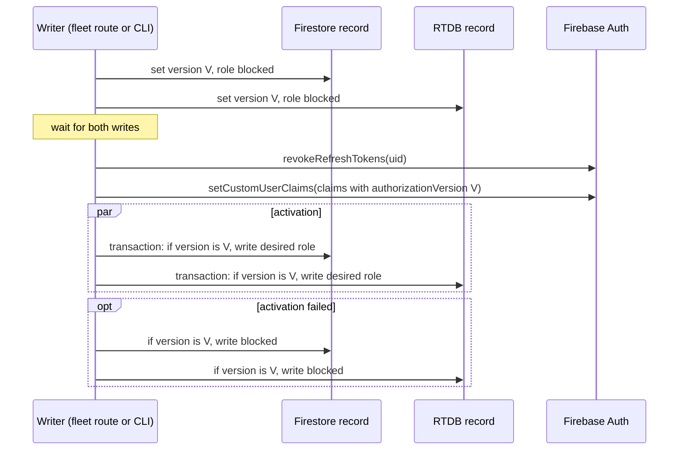

# Privileged Database Authorization

| Document ID | Version | Status | Last updated |
|---|---|---|---|
| EKI-SEC-004 | 1.0 | Current | 2026-10-30 |

## 1. Introduction

### 1.1 Purpose

This document describes how Eki grants and withdraws driver and administrator authority in Firestore, the Realtime Database (RTDB) and the backend API, and how operators change a privileged role safely. Developers who change role publication, rules or `requireAdmin`, and operators who change roles or recover a failed change, use it.

### 1.2 Scope

The design covers the `_userAuthorization/{uid}` records, the `authorizationVersion` custom claim, the publisher `publishUserAuthorization` (`backend/src/services/userAuthorization.ts`), the checks that read these records, and the `sync-role-claims` command. Passenger access to public projections and to ride chat does not use these records.

## 2. Context

Firebase ID tokens carry custom claims until they expire, and Firebase revocation compares the token's `auth_time` with the revocation time at one-second resolution [1]. A saved administrator token can therefore keep its claims after a demotion, and a token from a sign-in in the same second as a revocation still passes the revocation check. Eki closes both gaps by comparing a per-user version in the token with a version stored by the backend.

| Item | Location | Fields |
|---|---|---|
| Custom claims | Firebase Auth | `role`, `admin` (administrators), `authorizationVersion`, `driverId` and `assignedBusId` (assigned drivers) |
| Authorization record | Firestore `_userAuthorization/{uid}` and RTDB `_userAuthorization/{uid}` | `version`, `role`, `driverId`, `assignedBusId` |
| Profile role | Firestore `users/{uid}.role` | `passenger`, `driver` or `admin` |
| Driver registry | Firestore `drivers/{driverId}` | `authUid`, `assignedBusId` |

Clients cannot read or write `_userAuthorization` in either database, and cannot write `users` or `drivers`.

## 3. Design

### 3.1 Publication sequence

Every change of role or driver assignment goes through `publishUserAuthorization(uid, claims)`:


Figure 1. Publication of a new authorization version V.

1. The publisher generates `V` with `randomUUID()` and writes a blocked record with that version to both databases. From this point every saved token, whose version differs from `V`, fails every check in Section 3.2.
2. It revokes the user's refresh tokens before writing the claims, so an old session cannot obtain a token that carries `V`.
3. It writes the new claims with `authorizationVersion: V`.
4. It activates both records in conditional transactions that write only while the stored version is still `V`. A concurrent, newer publication therefore wins.
5. If activation fails, it returns both records to the blocked state, again only while the version is `V`, and reports the failure. The user stays denied, never over-privileged.

Because each version is a fresh random UUID, a demotion followed by a promotion, even within one second, never makes an earlier token current again.

### 3.2 Checks

| Checker | Administrator rule | Driver rule |
|---|---|---|
| Firestore (`firestore.rules`) | `role == 'admin'`, `admin == true`, the token version equals the stored version, stored `role == 'admin'`, and `users/{uid}.role == 'admin'` | `role == 'driver'`, the token version equals the stored version, stored `role == 'driver'`, token `driverId` and `assignedBusId` equal the stored record, `drivers/{driverId}.authUid` equals the UID, the registry `assignedBusId` matches, and `users/{uid}.role == 'driver'` |
| RTDB (`database.rules.json`) | Reading the `publicRouteBuses` root requires `admin == true`, `role == 'admin'`, and a stored version and role matching the token | Not used |
| `requireAdmin` (`backend/src/middleware/requireAdmin.ts`) | `admin === true`, `role === "admin"`, a string `authorizationVersion`, and both stored records equal to the token's version, role, `driverId` and `assignedBusId` | Not used |
| Administrator ride stop (`backend/src/routes/shifts.ts`) | Same as `requireAdmin` | Driver registry check without the version |

`requireAdmin` reads both records on every request with no positive cache. If either read fails it returns 503 with `Retry-After: 1` (`AUTH_UNAVAILABLE`); a missing or different record returns 403 (`ADMIN_REQUIRED`). A token without `authorizationVersion` fails every administrator check and the Firestore driver rule.

The most expensive driver rule evaluation reads four documents: the ride session, the authorization record, the profile and the driver record. Repeated `get()` calls on one path are evaluated once per request.

Driver authority on other HTTP routes and the RTDB driver assignment mirror do not use the version. [Browser API security](BROWSER_API_SECURITY.md#22-principals) lists which of these routes also check the driver registry.

### 3.3 Writers

| Writer | Trigger | Published claims |
|---|---|---|
| Fleet routes (`backend/src/routes/fleet.ts`) | Driver assignment, unassignment, reconciliation | `role: "driver"` with or without `driverId` and `assignedBusId`; profile role set to `driver` |
| Fleet driver removal | `DELETE /api/fleet/drivers/{id}` and demotion | `role: "passenger"`; profile role set to `passenger` |
| `sync-role-claims` (`backend/src/syncRoleClaims.ts`) | Operator command | The role in `users/{uid}.role`; `admin: true` for administrators; driver assignment from the registry |
| Profile bootstrap (`POST /api/users/bootstrap`) | First sign-in | Only `role: "passenger"`, without an authorization record |

Every publisher holds the durable fleet mutex (`_fleet_reconciliation_locks/singleton`) from its canonical reads until the claims and the RTDB `driverRouteAssignments` mirror settle. `sync-role-claims` pages through `users` 100 documents at a time, takes the mutex for each chunk of eight users, re-reads each profile under the mutex, and waits for every user in the chunk even when one fails. A held mutex makes the command fail; the command never waits for or takes over the lock.

Removing a driver demotes the account before deleting the registry record. If demotion fails, the record stays so that the removal can be retried with its `authUid`. When `sync-role-claims` finds a driver without exactly one registry record, a missing bus, a bus without routes or an invalid bus ID, it first publishes a plain `driver` authorization and removes the assignment mirrors, then reports the user as failed. Earlier `admin` claims never survive a failed driver sync.

## 4. Design rationale

- **Block first, then revoke, then claim.** Writing the blocked version before anything else denies saved tokens immediately; revoking before setting claims stops an old refresh session from minting a token with the new version.
- **Fresh reads in `requireAdmin`.** A positive cache would let a demoted administrator act until the entry expired.
- **Both databases.** Firestore and RTDB rules cannot read each other, so each database holds its own copy of the record.

## 5. Constraints and failure handling

Firestore and RTDB have no shared transaction. A failure during the initial blocked write can leave one database on its previous version; the publisher then throws, and the operation must be retried. A failure during activation leaves both records blocked or rolled back to blocked, and old tokens stay invalid because both versions have already changed. A rollback failure is still reported as a failure.

Treat a failed or unknown fleet operation as not completed:

1. Inspect the operation record and both `_userAuthorization/{uid}` records.
2. If the executor may still be running, follow the stopped-executor procedure in [Operation resources](../api/OPERATION_RESOURCES.md) before any retry.
3. Retry the fleet operation or run `sync-role-claims`.

`revokeRefreshTokens` on its own, a direct edit of Auth claims, or an edit of only the Firestore profile does not change the authorization records. Any new backend path that revokes or changes a privileged user must call `publishUserAuthorization`.

## 6. Procedures

### 6.1 Change an administrator role

Prerequisites: Firebase Admin credentials for the target project, and no other fleet mutation in progress.

1. Set `users/{uid}.role` to `admin` (or to `passenger` to demote) with the Firebase console or the Admin SDK. Clients cannot write this field.
   Expected result: the profile shows the new role.
2. From the repository root, run:

   ```powershell
   npm run sync-role-claims --workspace=backend
   ```

   Expected result: the command prints `Synchronized <n> users; 0 failed.` and exits with code 0.
3. Tell users to sign in again. The command publishes a new version for every user in `users`, passengers included, and so revokes every user's refresh tokens.
   Expected result: after sign-in, the administrator workspace opens for a promoted user and is refused for a demoted user.

If the command reports failed users or exits with code 1, resolve each logged error and run it again. Each run signs all users out again. If it fails because the fleet mutex is held, wait for the current fleet operation to finish.

Driver roles are changed through the fleet management screens, which call the fleet routes, not by editing `drivers` directly.

### 6.2 Verify revocation in staging

1. Sign in as a test administrator and save the current ID token.
2. Demote, reassign or remove that principal through the supported workflow.
3. With the saved token, confirm that `GET /api/health` returns 401 (revoked token) or 403 (version mismatch), and that Firestore administrator reads and the RTDB `publicRouteBuses` root read are denied.
4. Promote the principal again and confirm that the saved token is still denied, while a fresh sign-in succeeds.

Keep redacted results separate from emulator evidence. Local tests use synthetic identities and emulators; they do not exercise live Firebase Auth revocation.

## 7. Verification

| Check | Location |
|---|---|
| Publisher sequence and conditional activation | `backend/src/services/userAuthorization.test.ts` |
| `requireAdmin` claims, versions and 503 handling | `backend/src/middleware/requireAdmin.test.ts` |
| Firestore and RTDB rules against saved tokens | `backend/src/rulesIntegration.test.ts`, run with `npm run test:rules` |
| HTTP authorization acceptance | [HTTP authorization](../../qa/HTTP_AUTHORIZATION.md) |

## 8. References

[1] Google, "Manage user sessions," Firebase Authentication documentation, firebase.google.com/docs/auth/admin/manage-sessions. Accessed: 2026-10-30.
