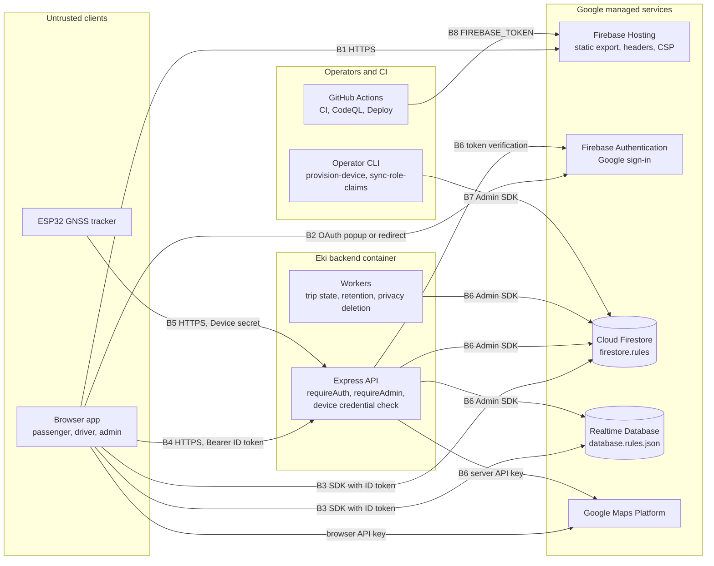

# Security Architecture

| Document ID | Version | Status | Last updated |
|---|---|---|---|
| EKI-SEC-002 | 3.0 | Current | 2026-10-30 |

## 1. Introduction

### 1.1 Purpose

This document describes how Eki protects its users, buses and data: the trust boundaries, the threats considered at each boundary, and the controls the code implements. Security reviewers and contributors who change authentication, authorization, rules, headers, telemetry ingestion or firmware use it to see which control they affect and what risk remains.

### 1.2 Scope

The description covers the browser app (`frontend/`), the Express backend (`backend/`), the Firestore and Realtime Database (RTDB) security rules, Firebase Hosting configuration (`firebase.json`), the ESP32 firmware (`hardware/`), and the build and deployment workflows (`.github/workflows/`). Infrastructure that this repository does not configure, such as the backend load balancer, an edge web application firewall (WAF) or Google Cloud API key restrictions, is named only where a control depends on it.

### 1.3 Related documents

| Document | Content |
|---|---|
| [Security policy](../../SECURITY.md) | Vulnerability reporting, supported branches, secret and location-data handling rules |
| [Browser API security](BROWSER_API_SECURITY.md) | Authentication and authorization contract of the backend API for browser clients |
| [Privileged database authorization](PRIVILEGED_DATABASE_AUTHORIZATION.md) | Administrator and driver authorization records, publication and revocation |
| [Hardware security provisioning](HARDWARE_SECURITY_PROVISIONING.md) | Secure Boot, flash encryption, key custody and signed OTA procedure |
| [Backend API](../../backend/API.md) | Endpoint reference |
| [Firebase data model](../data/FIREBASE_DATA_MODEL.md) | Collections, paths and fields |
| [Privacy deletion](../operations/PRIVACY_DELETION.md) | Passenger account deletion queue and recovery |
| [Architecture risk register](../operations/ARCHITECTURE_RISK_REGISTER.md) | Operational and architectural risks beyond security |

## 2. Context

### 2.1 Components and trust boundaries

Browsers and trackers are untrusted clients. Browsers load the static app from Firebase Hosting, sign in with Firebase Authentication, read Firestore and RTDB directly under security rules, and call the backend API with a Firebase ID token. Trackers call only the backend, with a per-device secret. The backend is the only writer of authoritative state; it uses the Firebase Admin SDK, which bypasses security rules. Operators run command-line tools with the same Admin SDK credential, and GitHub Actions deploys Hosting and rules.

Figure 1. Eki components and trust boundaries B1 to B8.

| Boundary | Between | Authenticated by |
|---|---|---|
| B1 | Browser and Firebase Hosting | None (public static content) |
| B2 | Browser and Firebase Authentication | Google account sign-in |
| B3 | Browser and Firestore or RTDB | Firebase ID token evaluated by security rules |
| B4 | Browser and backend API | Firebase ID token in `Authorization: Bearer` |
| B5 | Tracker and backend API | Per-device secret in `Authorization: Device` |
| B6 | Backend and Google services | Firebase Admin SDK credential; server Google Maps API key |
| B7 | Operator workstation and Firebase | Firebase Admin SDK credential |
| B8 | GitHub Actions and Firebase | Environment-scoped `FIREBASE_TOKEN` |

### 2.2 Assets

| Asset | Where it is held | Consequence of compromise |
|---|---|---|
| Firebase ID and refresh tokens | Browser storage (local storage, IndexedDB or session storage) | Impersonation of the signed-in user |
| Role claims and authorization records | Auth custom claims; `_userAuthorization/{uid}` in Firestore and RTDB | Administrator or driver authority |
| Backend Admin SDK credential | Backend runtime environment | Unrestricted read and write of all Firebase data and Auth accounts |
| Device secrets | Ignored `hardware/include/secrets.h`, the flash-encrypted firmware image and any published signed OTA image (Section 11); only a scrypt verifier in `devices/{deviceId}.secretHash` | Forged telemetry for that bus |
| Secure Boot signing key | Offline signing environment, never in the repository | Arbitrary firmware on fleet trackers |
| Live bus positions | RTDB `activeBuses`, `publicRouteBuses`; Firestore `bus_locations`, ride session `lastKnownLocation` | Tracking of a vehicle and its operator |
| Passenger personal data | `users/{uid}`, ride session manifests, chat messages, `feedbacks` | Disclosure of identity and travel |
| Deploy token | GitHub environment secret `FIREBASE_TOKEN` | Replacement of the hosted app or security rules |
| Server Google Maps key | Backend variable `GOOGLE_MAPS_API_KEY` | Billable API use |

### 2.3 Principals

| Principal | Identity | Authority |
|---|---|---|
| Passenger | Google account; role claim `passenger` or absent | Own profile, live bus reads, route and settings reads (including published route schedules), boarding, own ride chat, feedback, own deletion request |
| Driver (operator) | Google account; claims `role: "driver"`, `driverId`, `assignedBusId` | Rides of the assigned bus; session manifests and chat of those rides |
| Administrator | Google account; claims `role: "admin"`, `admin: true`, current `authorizationVersion` | Fleet, routes, devices, settings and passenger route schedules, feedback review, ride history |
| Tracker | Device ID and device secret | Telemetry, diagnostics and firmware checks for its registered bus and route |
| Backend | Admin SDK service identity | All data; bypasses rules |

## 3. Threat model

### 3.1 Method

Threats are classified with STRIDE (spoofing, tampering, repudiation, information disclosure, denial of service, elevation of privilege) [1] per boundary in Figure 1. Each row lists only controls present in the code or configuration of this repository. "Residual risk" states what the controls leave open; Section 13 collects the material residual risks.

### 3.2 B1: Browser and Firebase Hosting

| STRIDE | Threat | Implemented mitigation | Residual risk |
|---|---|---|---|
| S | Connection downgrade or spoofed site | `Strict-Transport-Security: max-age=31536000; includeSubDomains` | The header has no `preload` directive, so a first visit relies on the browser default. |
| T | Injected script in the app origin | CSP `script-src` allows `'self'`, SHA-256 hashes of the exported inline scripts and named Google origins; no `'unsafe-eval'`; React renders user text as text and `frontend/src` contains no `dangerouslySetInnerHTML` | `style-src` allows `'unsafe-inline'`; `connect-src` and `img-src` allow wildcard Google subdomains. |
| T | Clickjacking | `X-Frame-Options: DENY` and `frame-ancestors 'none'` | None identified. |
| I | Cached account data shown to the next user of a shared browser | The service worker never caches API, Auth or RTDB responses (Section 6.3); HTML shells contain no user data | The Firebase session persists in browser storage until sign-out. |
| E | Misuse of powerful browser features | `Permissions-Policy` disables camera, microphone, payment and USB, and limits geolocation to the app origin | None identified. |

### 3.3 B2: Browser and Firebase Authentication

| STRIDE | Threat | Implemented mitigation | Residual risk |
|---|---|---|---|
| S | Sign-in with a stolen or phished account | Google handles credentials; Eki never receives passwords | Any Google account can sign in. Institutional affiliation is not checked. |
| I | Theft of ID or refresh tokens | CSP limits script origins; tokens are sent as headers, not cookies | Script running in the app origin can read tokens from browser storage. |
| E | Client asserts its own role | Roles exist only as custom claims set through the Admin SDK; the browser forces a token refresh and requires matching claims before it shows a driver or administrator workspace | `RoleGuard` controls rendering only; data access depends on rules and the backend. |

### 3.4 B3: Browser and Firestore or RTDB

| STRIDE | Threat | Implemented mitigation | Residual risk |
|---|---|---|---|
| E | Client writes roles, rides, manifests or messages | Every client write is denied except feedback creation, the paired feedback cooldown and administrator feedback status updates (Section 5.2) | None identified. |
| T | Client publishes or alters a passenger route schedule | `settings/{document}` denies every client write, including from administrators; only `PUT /api/v2/settings/passenger-routes` behind `requireAdmin` writes `settings/passengerRoutes`, after checking each route and stop against `routes/{routeId}`; browsers drop malformed entries on read | Any signed-in account can read the published schedules. |
| I | Reading other passengers' manifests or chat | `ride_sessions` documents are readable by operators only; messages by operators and by manifest passengers whose profile still exists | A manifest passenger who boarded with a spoofed location can read that ride's chat (see B4). |
| E | A demoted administrator or driver keeps reading with a saved token | Rules compare the token's `authorizationVersion` with `_userAuthorization/{uid}` and check the driver registry | None identified. |
| T | Forged or flooded feedback | Rules enforce a field allowlist, sizes, author UID, server time, completed-ride membership and a 24 h cooldown | Feedback text is not moderated. |
| D | Excessive reads by a signed-in user | Rules evaluate authentication before billable `get()` calls | No per-user read quota exists at the database; reads are billed. |

### 3.5 B4: Browser and backend API

| STRIDE | Threat | Implemented mitigation | Residual risk |
|---|---|---|---|
| S | Forged, expired or revoked ID token | `verifyIdToken(token, true)` checks signature, expiry, disabled account and revocation; tokens with privileged claims are re-verified on every request | Tokens without privileged claims are cached for up to `AUTH_REVOCATION_CACHE_MS` (default 15 000 ms, maximum 60 000 ms). |
| E | Non-administrator calls an administrator operation | `requireAdmin`, and `hasCurrentAdminAuthority` on routes shared with operators and passengers, require `role: "admin"`, `admin: true` and a current `authorizationVersion` in both databases | None identified. |
| E | Remote boarding of a ride | Boarding requires a passenger profile, a boarding ride, a browser fix with accuracy of 100 m or better, and a distance of at most 150 m to a bus fix no older than 60 s | The browser fix is client-supplied; a spoofed position passes. |
| T | Malformed or oversized bodies | Strict JSON parsers with size caps; per-route validation; `TRACE` and `CONNECT` return 405. The passenger route schedule handler keeps request stop IDs in a `Map` and builds the stored object only from the stop IDs of the stored route, so request keys never become object properties | None identified. |
| R | Administrator denies a change | Fleet mutations record `adminUid`, method and path in `_fleet_operations`; route geometry previews, fleet reconciliation jobs, operation recovery and privacy recovery record the acting administrator; settings record `updatedBy`, ride interruptions `interruptedBy` and feedback review `reviewedBy` | Device registry changes, route saves and deletions, chat clearing and ride-history deletion store no record of the acting administrator. |
| I | Leakage through errors or diagnostics | Generic error bodies; public `/health` and `/live` return status only; `/api/health` requires `requireAdmin`; private responses carry `Cache-Control: no-store` | None identified. |
| D | Request floods | Limits in Section 7 | Limiters are in memory per replica; the global cap depends on an edge WAF that this repository does not configure. |

### 3.6 B5: Tracker and backend API

| STRIDE | Threat | Implemented mitigation | Residual risk |
|---|---|---|---|
| S | Telemetry from an impostor tracker | Device secret verified against a scrypt verifier with a constant-time comparison; disabled devices are rejected | A secret read from a development build, which has no flash encryption, or from a published OTA image (Section 11) stays valid until the device is re-provisioned. |
| T | Tracker claims another bus or route | Bus and route come from the device registry; payloads use closed field lists with range checks | None identified. |
| T | Replayed or reordered fixes | Timestamps older than 60 s or more than 10 s ahead are rejected; device time and sequence order samples; a duplicate is acknowledged with 200 instead of 202 | None identified. |
| I | Interception of telemetry | TLS with the configured issuing root CA (`BACKEND_ROOT_CA`); fleet firmware halts on a non-HTTPS backend URL | Development firmware may use `http://` for local testing. |
| D | Credential guessing exhausts CPU | Per-IP pre-authentication limiter; at most four concurrent scrypt verifications plus a reserved lane for known devices; rejected pairs are cached for 5 s | None identified. |

### 3.7 B6: Backend and Google services

| STRIDE | Threat | Implemented mitigation | Residual risk |
|---|---|---|---|
| E | Misuse of the backend credential | The Admin SDK credential exists only in the backend runtime; the container runs as an unprivileged user (UID 1001) without npm | The Admin SDK bypasses all rules; a compromised backend controls all data and accounts. |
| T | Invalid state written by the backend | Transactions, session and worker fences, and input validation before every write | None identified. |
| D | Cost abuse of billable Maps calls | Route computation and place search are administrator-only and rate limited per user | Key restrictions are set in Google Cloud, outside this repository. |

### 3.8 B7: Operator workstation

| STRIDE | Threat | Implemented mitigation | Residual risk |
|---|---|---|---|
| E | Unauthorized role or device changes | The CLIs require the Admin SDK credential | Anyone with that credential can change roles and provision devices. |
| I | Device secret disclosure | `provision-device` prints the secret once and stores only its verifier | The plaintext remains in terminal history and the signing environment. |
| T | Concurrent role publication | `sync-role-claims` holds the fleet mutex and fails when it is busy | None identified. |

### 3.9 B8: CI and deployment

| STRIDE | Threat | Implemented mitigation | Residual risk |
|---|---|---|---|
| T | Compromised third-party action | Every `uses:` reference is pinned to a full commit SHA; workflows default to `contents: read` | None identified. |
| E | Untrusted code reaches staging or production | Staging deploys only the commit of a successful same-repository push build on `main` or a manual dispatch from `main`; production deploys only by manual dispatch from `main` in the `production` environment | Required reviewers for that environment are configured in GitHub, not in this repository. |
| I | Secret leakage from CI | Deploy secrets are environment-scoped; the verification build uses placeholders | `FIREBASE_TOKEN` is a long-lived Firebase CLI token. |
| T | Vulnerable dependency | `npm audit`, CodeQL, Trivy and an SBOM (Section 10) | No automated dependency update configuration exists. |

## 4. Authentication

### 4.1 Browser users

The browser uses Firebase Authentication with the Google provider only (`frontend/src/lib/firebaseAuth.ts`), by popup or redirect. The session persists in local storage, IndexedDB or session storage, in that order of preference. Until Firebase reports the restored auth state, the browser treats the user as unknown: it mounts no protected view and publishes no signed-out state, and a slow restoration produces a notice with **Reload**, not an access error ([frontend guide](../../frontend/README.md#8-authentication-flow)).

After sign-in, the browser calls `POST /api/users/bootstrap`. The backend creates `users/{uid}` with role `passenger` if it is missing and sets only the passenger claim; it never grants `driver` or `admin`. For a profile whose role is `driver` or `admin`, the browser forces a token refresh and requires matching claims (`admin: true` for administrators) before it publishes the user to the app.

The backend authenticates every `/api` request except tracker endpoints before any router runs (`backend/src/lib/browserAdmission.ts`). `verifyRevocationAwareIdToken` (`backend/src/services/authTokenVerifier.ts`) calls `verifyIdToken(token, true)` [2], [3], which checks signature, expiry, disabled accounts and revocation. A short cache keyed by the SHA-256 of the token avoids repeated Auth calls; tokens carrying `admin`, `role: "admin"`, `role: "driver"`, `driverId` or `assignedBusId` bypass the cache. When `AUTH_MAX_PENDING_VERIFICATIONS` (default 256) verifications are already pending, the backend returns 503 with `Retry-After: 1`. The API contract is in [Browser API security](BROWSER_API_SECURITY.md).

### 4.2 Role claims and administrator authority

| Claim | Values | Set by |
|---|---|---|
| `role` | `passenger`, `driver`, `admin` | `publishUserAuthorization`; the bootstrap route sets only `passenger` |
| `admin` | `true` for administrators | `publishUserAuthorization` through `sync-role-claims` |
| `authorizationVersion` | Random UUID | `publishUserAuthorization` |
| `driverId`, `assignedBusId` | Driver registry ID and bus ID | `publishUserAuthorization` through fleet routes or `sync-role-claims` |

Administrator authority requires all three of `role: "admin"`, `admin: true` and an `authorizationVersion` equal to the version in `_userAuthorization/{uid}` in both Firestore and RTDB. `requireAdmin`, `hasCurrentAdminAuthority` (`backend/src/middleware/adminAuthority.ts`, for handlers shared with operators and passengers), the Firestore rules and the RTDB fleet-root rule apply the same contract. Every role or assignment change writes a new version and revokes refresh tokens, so a saved token loses privilege as soon as the new version is written, including tokens that Firebase revocation alone would still accept. [Privileged database authorization](PRIVILEGED_DATABASE_AUTHORIZATION.md) describes the records, the publication sequence and recovery.

### 4.3 Devices

`npm run provision-device --workspace=backend -- --device-id <id> --bus-id <id> --route-id <id>` generates a 32-byte random secret, stores `salt:hash` (16-byte salt, 64-byte scrypt key) in `devices/{deviceId}.secretHash`, prints the plaintext once and publishes a cache invalidation. Running it again for the same device rotates the secret.

Four paths accept device credentials and skip browser authentication (`backend/src/lib/deviceIngressPolicy.ts`): `POST /api/devices/{deviceId}/telemetry`, `POST /api/devices/{deviceId}/diagnostics`, `POST /api/devices/{deviceId}/firmware/installation` and `GET /api/devices/{deviceId}/firmware`. Each request carries `Authorization: Device <secret>` with a secret of 20 to 512 characters. The backend (`backend/src/services/deviceTelemetryService.ts`):

1. Reads the registry record and derives the scrypt key from the supplied secret, using a dummy salt when no valid verifier exists so that unknown IDs cost the same work.
2. Compares keys with `timingSafeEqual`.
3. Requires `enabled` not `false`, an existing bus and route, and the route in the bus's assigned routes. A correct secret without a usable assignment returns 403; any other failure returns 401.
4. Caches a verified pair for 60 s, or up to 10 min longer while the refill lane for known devices is saturated, and a rejected pair for 5 s. Rotation and `POST /api/devices/{deviceId}/disable` write `_deviceCredentialVersions/{deviceId}` in RTDB; every replica listens there and drops its cached entry.

Bus and route identity always come from the registry, never from the request body.

### 4.4 Backend service identity

`backend/src/lib/firebaseAdmin.ts` uses the service-account JSON in `FIREBASE_SERVICE_ACCOUNT` when it is set and Application Default Credentials otherwise. In production the backend refuses to start without `FIREBASE_DATABASE_URL`, without `CORS_ORIGIN`, or without `RETENTION_SWEEPER_ENABLED=true`.

### 4.5 App Check

Firebase App Check is not used. The browser initializes no App Check provider and sends no App Check token, the backend has no App Check middleware, and the Firestore rules contain no App Check condition (`backend/src/securityConfig.test.ts` asserts this). Because enforcement left on in a Firebase project would reject this browser, both deploy jobs run `node scripts/disable-appcheck-enforcement.mjs --project <project-id> --disable`, which sets Firestore and RTDB enforcement to `UNENFORCED` and fails unless both services report that mode. Without `--disable` the script only verifies the mode.

## 5. Authorization

### 5.1 Backend middleware

`backend/src/server.ts` applies middleware in this order:

1. Metrics, `trust proxy` (from `TRUST_PROXY`), Helmet and CORS.
2. The pre-authentication browser limiter, keyed by client IP.
3. Rejection of `TRACE` and `CONNECT`.
4. JSON body parsers with route-specific size caps.
5. Browser admission on `/api`: `requireAuth`, then the per-user read or mutation limiter. Tracker paths skip this step and authenticate inside their handlers.
6. Route handlers, which add `requireAdmin` or a role check.

| Principal check | Implementation | Additional conditions |
|---|---|---|
| Authenticated user | `requireAuth` (`backend/src/middleware/requireAuth.ts`) | None |
| Passenger | Handler checks that `role` is absent or `passenger` | Existing `users/{uid}` profile; manifest membership for ride-scoped actions; proximity for first boarding |
| Driver | `authorizeOperator` in `backend/src/routes/shifts.ts` (ride start, delay, stop, v2 ride read); token comparison in `backend/src/routes/sessions.ts` (chat, boarding code, legacy ride status) | Shift routes: token `driverId` and `assignedBusId`, `drivers/{driverId}.authUid` equals the UID, the driver's bus matches, the bus lists the route. Session routes: token `driverId` and `assignedBusId` equal the session's driver and bus |
| Administrator | `requireAdmin` (`backend/src/middleware/requireAdmin.ts`); `hasCurrentAdminAuthority` (`backend/src/middleware/adminAuthority.ts`) on routes shared with operators and passengers | Fresh reads of both `_userAuthorization/{uid}` records on every request (once per request on shared routes); unavailable records return 503 from `requireAdmin` and the handler's own error status elsewhere |

### 5.2 Firestore rules

`firestore.rules` denies every path that it does not match. Admin and driver functions read `_userAuthorization/{uid}`, `users/{uid}` and, for drivers, `drivers/{driverId}`.

| Collection or path | Client read | Client write |
|---|---|---|
| `users/{uid}` | Owner | Denied (backend creates profiles) |
| `routes/{routeId}`, `buses/{busId}`, `settings/{document}` (`settings/global` and `settings/passengerRoutes`) | Any signed-in user | Denied; the backend writes settings through `PATCH /api/v2/settings/global` and `PUT /api/v2/settings/passenger-routes` |
| `bus_locations/{busId}`, `completed_trips/{tripId}` | Administrator | Denied |
| `ride_sessions/{sessionId}` | Administrator or the assigned driver | Denied |
| `ride_sessions/{id}/messages/{messageId}` | Administrator, assigned driver, or manifest passenger whose profile exists | Denied (backend writes) |
| `ride_sessions/{id}/archivedMessages/{messageId}` | Administrator or assigned driver | Denied |
| `ride_sessions/{id}/messageRateLimits/{uid}` | Owner who can read the session | Denied |
| `drivers/{driverId}` | Administrator, or the current driver whose `authUid` matches | Denied |
| `feedbacks/{feedbackId}` | List: administrator. Get: author, administrator, or a missing document | Create: validated author with a profile and an atomic cooldown. Update: administrator, `status`, `reviewedAt`, `reviewedBy` only. Delete: denied |
| `feedbackCooldowns/{uid}` | Owner | Create or update: owner, paired with a new feedback document in the same commit. Delete: denied |
| `devices`, `_userAuthorization`, `active_rides`, `_active_bus_locks`, `_ride_session_creation_keys`, `_worker_leases`, `_privacy_deletion_requests`, `_fleet_operations`, `_route_geometry_previews`, `_fleet_reconciliation_jobs`, `_fleet_reconciliation_locks`, `_route_save_operations`, `_health`, `_device_diagnostics` | Denied | Denied |
| Any other path, including `passenger_requests` | Denied | Denied |

### 5.3 Realtime Database rules

`database.rules.json` denies reads and writes at the root, and no path allows a client write.

| Path | Client read |
|---|---|
| `activeBuses` | Denied (backend-only canonical live state) |
| `publicRouteBuses` (root) | Administrator with a current `authorizationVersion` |
| `publicRouteBuses/{routeId}/buses` | Any signed-in user |
| `liveRouteCatalog/values` | Any signed-in user |
| `clientProjectionStatus/public` | Any signed-in user |
| `activeRouteGeometry` | Any signed-in user |
| `_userAuthorization`, `_deviceRateLimits`, `_deviceCredentialVersions` | Denied |
| Any other path, including `driverRouteAssignments` | Denied |

## 6. Browser security

### 6.1 Hosting response headers

`firebase.json` sets these headers on every Hosting response:

| Header | Value |
|---|---|
| `Content-Security-Policy` | See Section 6.2 |
| `Strict-Transport-Security` | `max-age=31536000; includeSubDomains` |
| `X-Frame-Options` | `DENY` |
| `X-Content-Type-Options` | `nosniff` |
| `Cross-Origin-Opener-Policy` | `same-origin-allow-popups` (keeps the Google sign-in popup working) |
| `Referrer-Policy` | `strict-origin-when-cross-origin` |
| `Permissions-Policy` | `camera=(), microphone=(), geolocation=(self), payment=(), usb=()` |

The HTML routes `/`, `/admin`, `/driver`, `/feedback`, `/passenger` and the service worker `/sw.js` are served with `Cache-Control: no-cache, no-store, must-revalidate`.

### 6.2 Content Security Policy generation

The Content Security Policy [6] keeps `default-src 'self'`, `base-uri 'self'`, `object-src 'none'`, `frame-ancestors 'none'`, `worker-src 'self' blob:` and `form-action 'self'`, and does not allow `'unsafe-eval'`. `npm run build` regenerates four directives after the static export, and the deploy jobs run that build through `npm run build:production`:

1. `scripts/generate-sw.mjs` writes the service worker into `frontend/out/`.
2. `scripts/update-csp.mjs` hashes the text of every inline `<script>` without `src` in `frontend/out/**/*.html` (`scripts/inline-script-hashes.mjs`, SHA-256, Base64). It refuses to write a policy when it finds no inline scripts or when a managed directive is missing.
3. It rewrites `script-src`, `connect-src`, `img-src` and `frame-src` in the `**` header of `firebase.json` and keeps the other directives unchanged.

| Directive | Generated sources |
|---|---|
| `script-src` | `'self'`, the inline-script hashes, `https://apis.google.com`, `https://www.gstatic.com`, `https://maps.googleapis.com`, and only the `/.lp` path of RTDB hosts (the configured instance and `*.firebaseio.com`, `*.firebasedatabase.app`) |
| `connect-src` | `'self'`, Google API and Firebase hosts over HTTPS and `wss:`, and the origin of `NEXT_PUBLIC_BACKEND_URL` |
| `img-src` | `'self'`, `data:`, `blob:`, Google image hosts |
| `frame-src` | `'self'`, `https://accounts.google.com`, `https://*.firebaseapp.com`, and the RTDB `/.lp` paths |

Scripts allow RTDB hosts only at `/.lp`, the long-polling transport, because the bare origin would also allow RTDB REST responses with a `callback` parameter. `scripts/csp-backend-origin.mjs` rejects a backend URL that contains credentials or uses HTTP for a host other than `localhost`, `127.0.0.1` or `[::1]`. The committed `firebase.json` holds the policy from the last build; a deployment always carries a freshly generated one.

### 6.3 Service worker

`frontend/src/sw.js` uses Workbox. It caches HTML navigations (network first, at most 10 entries; after 2.5 s without a network answer it serves the route's precached HTML shell or its cached copy), hashed `/_next/static/` assets, same-origin images and Google Fonts. These requests are network-only and never cached: Firebase Auth helpers (`apis.google.com`, `www.gstatic.com/firebasejs/`), `identitytoolkit.googleapis.com`, `securetoken.googleapis.com`, every `*.firebaseio.com` and `*.firebasedatabase.app` request, Google Maps, and every request without a matching route, which includes all backend API calls. A cached URL cannot represent the signed-in user, so no account-scoped response is replayed to another account. Navigation handling excludes Firebase Auth helper paths under `/__/`. On activation the worker deletes the obsolete `eki-firebase-sdk`, `eki-navigations` and `eki-google-maps` caches.

### 6.4 Backend API headers and CORS

Helmet sets its default headers and a CSP of `default-src 'none'; script-src 'none'; object-src 'none'` for the JSON API. CORS allows only the comma-separated origins in `CORS_ORIGIN` (plus `http://localhost:3000` outside production) with `credentials: false`. Browser credentials travel only in the `Authorization` header, so cross-site request forgery through cookies does not apply.

## 7. Rate limiting and abuse controls

Every HTTP limiter keeps its counters in process memory and divides its budget by `RATE_LIMIT_SHARD_FACTOR`, the expected replica count; startup fails if the factor exceeds a limiter's budget. Pre-authentication limiters key on the client IP because headers and unverified tokens are attacker-controlled; `TRUST_PROXY` selects which proxy hop may set `X-Forwarded-For`.

| Control | Scope and key | Limit | Source |
|---|---|---|---|
| Browser ingress | All requests except `OPTIONS`, `/health`, `/live` and tracker paths; client IP | 1000 per 60 s | `backend/src/lib/browserAdmission.ts` |
| Browser admission | `/api` except `GET /api/health`, after authentication; UID | 200 reads and 30 mutations per 60 s | `backend/src/lib/browserAdmission.ts` |
| Route computation | Non-GET on `/api/routes` and `/api/v2/route-geometry-previews`, and `PUT` on `/api/v2/routes`; UID | 10 per 60 s | `backend/src/lib/routeComputeLimiter.ts` |
| Route planning | `/api/plan` and route segment reads; UID | 30 per 60 s | `backend/src/server.ts` |
| Place search | `/api/places/search` (administrator); UID | 20 per 60 s | `backend/src/routes/places.ts` |
| Tracker ingress | Tracker paths, before authentication; client IP | Per 10 s: telemetry 15, diagnostics and firmware 2 each, multiplied by `HTTPS_INGRESS_DEVICES_PER_IP` (default 100) | `backend/src/routes/devices.ts` |
| Tracker budget | After authentication; device ID | `HTTPS_DEVICE_RATE_PER_MINUTE` (default 90); shared across replicas through RTDB `_deviceRateLimits` token leases unless `HTTPS_DEVICE_RATE_LIMIT_MODE=local` | `backend/src/services/deviceRateLimiter.ts` |
| Ride chat | Per user per ride session | 3 s between messages, 10 per minute, 60 per rolling hour; text normalized, formatting controls removed, a fixed profanity list masked | `backend/src/services/chatRateLimit.ts` |
| Feedback | Per user | One submission per 24 h, enforced by rules | `firestore.rules` |
| Token verification | Process | 256 pending verifications by default, 2000 maximum | `backend/src/services/authTokenVerifier.ts` |
| scrypt | Process | 4 concurrent derivations, plus 2 for previously verified credentials | `backend/src/services/deviceTelemetryService.ts` |
| Request bodies | Per request | Telemetry 512 B, diagnostics 1 KB, route save `PUT` 64 KiB, other routes 16 KB | `backend/src/server.ts` |
| Connections | HTTP server | 15 s request timeout, 100 requests per socket | `backend/src/server.ts` |

The HTTP limiters return 429 with `RateLimit-*` headers; tracker limit responses also carry `Retry-After` and `retryAfterMs`. [Work admission](../operations/WORK_ADMISSION.md) describes the bounded internal queues.

## 8. Secrets management

| Secret | Where it is kept | Repository control |
|---|---|---|
| Firebase Admin credential | `FIREBASE_SERVICE_ACCOUNT` or Application Default Credentials on the backend host | `.gitignore` excludes `.env` files, `serviceAccountKey.json`, `service-account.json` and `*.json` apart from an allowlist of configuration files; `.dockerignore` excludes `.env` and `.env.*` |
| Server Google Maps key | `GOOGLE_MAPS_API_KEY` in the backend environment; separate from the browser key | Not committed; `backend/.env.example` holds placeholders |
| Device secret and Wi-Fi password | `hardware/include/secrets.h`, created from `secrets.example.h` inside the signing environment | `hardware/.gitignore` excludes `include/secrets.h` |
| Secure Boot signing key | `hardware/keys/secure_boot_signing_key.pem` inside the offline signing environment only | `*.pem` and `keys/*.pem` are ignored; CI generates a disposable key |
| Firebase deploy token | GitHub environment secret `FIREBASE_TOKEN` in `staging` and `production` | Referenced only by `deploy.yml` |
| RTDB origin for the release check | GitHub environment secret `FIREBASE_DATABASE_URL` | Referenced only by `deploy.yml` |
| Browser configuration | `NEXT_PUBLIC_*` values, stored as environment secrets for the deploy jobs | Public once built into the app; restrict the keys by HTTP referrer and API in Google Cloud |
| OpenTelemetry export headers | `OTEL_EXPORTER_OTLP_HEADERS` in the backend environment | The structured logger redacts Grafana tokens |

The CI verification build uses placeholder values, and the firmware job builds with a `secrets.h` copied from the example file. [Security policy](../../SECURITY.md) lists the handling rules and the response to an exposed secret.

## 9. Privacy

### 9.1 Stored personal and location data

| Data | Store | Client readers | Retention |
|---|---|---|---|
| Profile: UID, email, display name, photo URL, role | `users/{uid}` | Owner | Deleted by passenger account deletion |
| Manifest entry: UID, display name, boarding and alighting stop IDs, join time | `ride_sessions/{id}.passengers`, `passengerIds` | Administrator, assigned driver | `RIDE_SESSION_RETENTION_DAYS` (default 180) |
| Chat message: moderated text, sender UID and name | `ride_sessions/{id}/messages`, `archivedMessages` | See Section 5.2 | With the ride session; administrators can clear a ride's chat |
| Feedback: UID, display name, comment, rating, ride IDs | `feedbacks` | Author, administrator | `FEEDBACK_RETENTION_DAYS` (default 180) |
| Live bus position, speed, heading, timestamps, driver ID, session ID | RTDB `activeBuses` (backend only), `publicRouteBuses` | Any signed-in user (public projection) | Live record; the backend removes a silent bus after `BUS_STALE_MS` (default 300 000 ms) |
| Last accepted bus fix at signal loss or ride end | `ride_sessions/{id}.lastKnownLocation`, `bus_locations/{busId}.lastKnownLocation` | Administrator; assigned driver for the session copy | With the ride session; the `bus_locations` copy is overwritten by later fixes |
| Completed trip records | `completed_trips` | Administrator | `COMPLETED_TRIP_RETENTION_DAYS` (default 180) |
| Operation records; all except route saves carry the administrator UID | `_fleet_operations`, `_route_save_operations`, `_route_geometry_previews`, `_fleet_reconciliation_jobs`, `_fleet_lock_recoveries` | None | `OPERATION_LOG_RETENTION_DAYS` (default 90) |
| Passenger browser position | Boarding request body only | None | Used for the distance check; not written to the manifest |

### 9.2 Retention

The retention sweeper in `backend/src/services/retentionSweeper.ts` deletes records older than the configured number of days. A production backend refuses to start unless `RETENTION_SWEEPER_ENABLED=true`. [RTDB retention](../operations/RTDB_RETENTION.md) covers live-database records.

### 9.3 Deletion

A passenger requests deletion with `POST /api/v2/privacy-deletion-requests`; the UID comes from the verified token. The worker deletes the Auth account, `users/{uid}`, `feedbackCooldowns/{uid}`, `passenger_requests/{uid}`, the user's message rate-limit documents and the queue record. Feedback, manifest entries and chat messages are retained with their stored names until retention removes them. Driver and administrator accounts are excluded and follow institutional offboarding. [Privacy deletion](../operations/PRIVACY_DELETION.md) describes the queue, limits and recovery.

### 9.4 Logs and metrics

The backend logger (`backend/src/lib/logger.ts`) replaces the value of any key that matches authorization, cookie, token, secret, password, credential, service account, private key, email, phone, latitude, longitude, `lat` or `lng`, and masks `Bearer` values inside strings. OpenTelemetry telemetry metrics are labelled only by fixed reason, schema and HDOP-band values, without device IDs or coordinates.

## 10. Supply chain

| Control | Implementation |
|---|---|
| Static analysis | `.github/workflows/codeql.yml` runs CodeQL with the `security-extended` query suite for `javascript-typescript` and `python` on every push and pull request |
| Dependency audit | The `Production verification` workflow (`ci.yml`) runs `npm audit --omit=dev --omit=optional` and a full `npm audit`; `npm run verify` runs the runtime audit locally |
| SBOM | CI generates a CycloneDX SBOM of production dependencies and retains it for 30 days |
| Container image | CI builds `backend/Dockerfile` on every push, smoke-boots it and fails on fixable `CRITICAL` or `HIGH` findings from Trivy; both stages use a digest-pinned `node:24.21.0-alpine3.23` image |
| Pinned actions and tools | Every GitHub Action is pinned to a commit SHA; the Firebase CLI is pinned as `firebase-tools@15.14.0`; PlatformIO 6.2.0, `espressif32@7.0.1` and firmware libraries are pinned |
| Lockfile | `package-lock.json` is committed and CI installs with `npm ci` |
| Dependency overrides | Root `package.json` `overrides` pin transitive versions of `qs`, `fast-glob`, `@fastify/busboy`, `@grpc/grpc-js`, `postcss`, `nanoid`, `js-yaml`, `uuid`, `glob`, `minimatch`, `sharp` and `deepmerge` |

The repository has no automated dependency update configuration. [CI/CD and releases](../operations/CI_CD_AND_RELEASES.md) describes the pipelines.

## 11. Firmware security

Only the PlatformIO environment `esp32dev-secure` (`hardware/platformio.ini`) produces fleet artifacts. It signs the image with `keys/secure_boot_signing_key.pem` and runs `hardware/scripts/verify_secure_fleet.py` before the build. That script fails the build unless `hardware/sdkconfig.defaults` enables minimum chip revision 3, Secure Boot V2 with signed binaries [4], application rollback, release-mode flash encryption [5] and disabled ROM download mode, and keeps `CONFIG_SECURE_BOOT_ALLOW_JTAG` and `CONFIG_ESP32_WIFI_NVS_ENABLED` off. It also rejects `DISABLE_OTA` and requires `PROJECT_VER` to match `EKI_FIRMWARE_SEQUENCE`. The development environments (`esp32dev`, `esp32dev-quiet`, `esp32dev-journal`) enable neither Secure Boot nor flash encryption and are not fleet artifacts.

Device configuration, including the device secret, Wi-Fi credentials, backend URL and root CA, is compiled from `secrets.h`; any change needs a new signed image and a reflash. Fleet firmware halts when the backend URL is not HTTPS (`hardware/src/main.cpp`). TLS verifies the backend against `BACKEND_ROOT_CA` and restricts the client to ECDHE-RSA AES-GCM cipher suites on curve P-256 (`hardware/src/tls_profile.cpp`). A 401 response latches a credential fault and stops authenticated publishing; a 403 keeps Wi-Fi on and retries. Each diagnostics report includes `flashEncryption` and `secureBoot` flags, which administrators read through `GET /api/devices/{deviceId}/diagnostics`.

The backend returns a firmware release descriptor only when all six `FIRMWARE_RELEASE_*` variables are valid, and withholds it while the bus has an active ride. It is one global descriptor, read from the environment (`backend/src/services/firmwareRelease.ts`), and every authenticated device with a lower sequence receives the same image URL. The signed image embeds every `secrets.h` value of the build that produced it, including the device ID, device secret and Wi-Fi password, and the tracker downloads it without credentials (`hardware/src/main.cpp`). Anyone who can fetch the published file can read those values, and every device that installs it takes the identity of that build. The tracker discards an image whose size, SHA-256 digest, or signed version and sequence differ from the descriptor, and Secure Boot V2 rejects an image without a valid signature. CI builds the secure environment with a disposable key and runs `hardware/scripts/test_signed_image.py` to confirm that a modified image and an image signed with a foreign key are rejected. [Hardware security provisioning](HARDWARE_SECURITY_PROVISIONING.md) defines key custody, first-boot eFuse burning and the OTA release procedure.

## 12. Design rationale

- **Backend-only writes.** Clients cannot write rides, manifests, messages, roles or the device registry, because these writes depend on live ride state, the device registry and rate windows that rules cannot check. Feedback is the exception: the browser writes it under rules so that it works when the backend is unreachable.
- **Versioned authorization records.** Firebase revocation compares `auth_time` with a revocation time at one-second resolution [2], and custom claims stay in an ID token until it expires. A random version per publication, compared by both rule sets and by `requireAdmin`, removes privilege from saved tokens without waiting for expiry.
- **Hashed device secrets.** The registry stores only scrypt verifiers, so a read of `devices` does not yield a usable credential, and the concurrency caps bound the CPU cost of guessing.
- **IP keys before authentication.** Request headers, URL parameters and unverified tokens are attacker-controlled until verification, so pre-authentication limiters use the client IP and per-user limits run only after `requireAuth`.

## 13. Constraints and residual risks

1. The backend Admin SDK credential bypasses all security rules. Compromise of the backend runtime or of `FIREBASE_SERVICE_ACCOUNT` exposes all data and Auth accounts.
2. HTTP rate limits are per replica and in memory. A global limit needs the edge WAF listed in the [university deployment checklist](../operations/UNIVERSITY_DEPLOYMENT_CHECKLIST.md), which this repository does not configure.
3. Boarding proximity relies on the browser's reported position. A signed-in user who spoofs a position near a live bus can join that ride and read its chat.
4. Any signed-in Google account can read live bus positions, including the driver ID and session ID in the public projection.
5. Driver authorization on HTTP routes never compares the `authorizationVersion`, and chat, the boarding code and legacy ride status do not read the driver registry. A driver token whose claims are no longer current keeps that authority on chat, the boarding code and legacy ride status until it expires or is revoked.
6. OTA distribution serves one global release, and the signed image embeds the compiled device secret and Wi-Fi password (Section 11). Configure a release only on a backend that serves a single device, and protect the image URL like the device secret.
7. Revocation of a token without privileged claims takes effect at the backend after at most `AUTH_REVOCATION_CACHE_MS`.
8. `style-src 'unsafe-inline'` remains in the CSP.
9. Development firmware builds store secrets in unencrypted flash and may use HTTP.
10. `FIREBASE_TOKEN` is a long-lived token; its rotation is manual.
11. Dependency updates are manual; audits detect known vulnerabilities but do not apply fixes.

## 14. References

[1] A. Shostack, *Threat Modeling: Designing for Security*. Indianapolis, IN, USA: Wiley, 2014.

[2] Google, "Manage user sessions," Firebase Authentication documentation, firebase.google.com/docs/auth/admin/manage-sessions. Accessed: 2026-10-30.

[3] Google, "Verify ID tokens," Firebase Authentication documentation, firebase.google.com/docs/auth/admin/verify-id-tokens. Accessed: 2026-10-30.

[4] Espressif Systems, "Secure Boot v2," ESP-IDF Programming Guide, docs.espressif.com/projects/esp-idf/en/stable/esp32/security/secure-boot-v2.html. Accessed: 2026-10-30.

[5] Espressif Systems, "Flash encryption," ESP-IDF Programming Guide, docs.espressif.com/projects/esp-idf/en/stable/esp32/security/flash-encryption.html. Accessed: 2026-10-30.

[6] W3C, "Content Security Policy Level 3," W3C Working Draft, www.w3.org/TR/CSP3/. Accessed: 2026-10-30.
