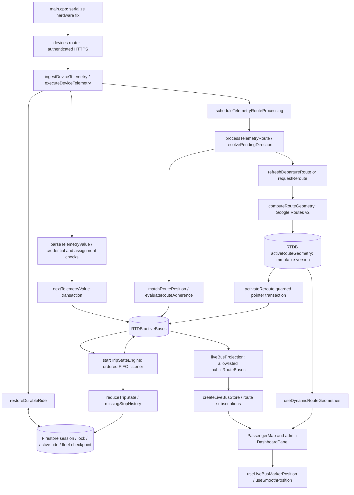

# Routing lifecycle audit and verification

Audit date: 2026-10-17 (Asia/Calcutta). Baseline: `origin/testing` at
`a523731295d37c9ecaf1a917cebefa4502b34dab`, fetched before the audit.
Local branch: `codex/routing-lifecycle-audit`, isolated managed worktree.
Original workspace: `codex/full-webapp-interaction-audit` at
`bb6b7c4d8277027f55bee694105d2e012fdf4ef3`, with extensive pre-existing changes;
none were copied or modified. Local `testing` was older (`454a6963`).

## Independent findings recorded before implementation

Source inspection, rather than the earlier answer, established:

* `hardware/src/main.cpp`, telemetry serialization, sends lat/lng, speed,
  heading, HDOP, motion, sequence and sample timestamp over authenticated HTTPS.
  It does not own ride/session/direction. `telemetry_policy.h` uses a one-second
  stopped heartbeat as well as a one-second moving heartbeat.
* `deviceTelemetryService.nextTelemetryValue` orders samples by time/sequence,
  preserves rawLocation separately from its plausibility-filtered location,
  and updates private RTDB `activeBuses/{busId}_{routeId}` transactionally.
* `telemetryRouteService` resolves endpoint direction, synchronizes session/lock
  projections, matches the direction-specific geometry, and asynchronously
  reroutes through remaining ordered stops. It does not refresh an ordinary
  on-route journey at arming/departure. Catalog invalidation and reroute
  publication already have session/direction/version guards.
* `tripStateEngine` is a leader-owned listener. It persists stop progress and
  session history transactionally in Firestore, then publishes RTDB lifecycle.
  The reducer consumes only the next expected stop; missing intermediate stops
  cannot be silently skipped. But terminal arrival shares the intermediate
  segment-crossing rule and has no quality/stopped/repeated-fix guard.
* `pre_departure` changes to `in_service` merely by being at the origin.
  Thus the existing automatic return can label a parked vehicle in service.
* Completion deletes `active_rides` and `_active_bus_locks`, saving
  `completed_trips` and closing `ride_sessions`. Return readiness lives in
  the completed RTDB node. `durableRideRecovery` only restores lock-owned active
  journeys; `staleBusSweeper` may remove completed nodes after five minutes.
  This leaves no reachable automatic return after that cleanup.
* `liveBusProjection.publicLiveBus` publishes allowlisted fields to route-scoped
  public RTDB. Admin uses private fleet entries; passenger uses public entries.
  Both marker components use `useLiveBusMarkerPosition` and `useSmoothPosition`.
  The selector holds pending matches for two seconds, but matching completion
  without a displayable point falls directly back to raw accepted coordinates.

These are confirmed software paths, not observations from a physical drive.
No deployed environment, hardware trace, credential, or production database was
accessed. Tests use mocked providers and disposable emulator data only.

## Baseline

Focused backend: 82/82 passed (five lifecycle/recovery/routing/matching files).
Focused frontend: 55/55 passed (four selector/store/map files).
An initial broader run could not resolve workspace-local `ajv/dist/2020.js`;
the isolated checkout now shares both root and workspace installed dependencies
through directory junctions. This is a test setup issue, not a routing defect.
Exact expanded results and red/green evidence are recorded below after execution.

## Result and audit limits

Implemented locally: qualified terminal service, durable unconsumed terminal intent,
one armed return, parked/serving separation, overnight preservation of an already
armed return, bounded journey traffic computation, coherent geometry selection,
and transient marker-confidence hysteresis. The existing architecture and IDs remain.
This is ready for code review, **not a claim of road-tested or deployed correctness**.
The Java Firestore emulator could not start; its assertions remain unexecuted.

Method limitation: opening the supplied document in full initially exposed
Appendix B earlier than its requested reading order. The findings above were
subsequently established from source and reproductions before implementation;
the comparison below cites code/tests, never Appendix B as repository evidence.

Tooling: Node 24.19.0, npm 12.0.2, installed Vitest 4.1.11, TypeScript 5.9.3,
Next 16.3.8, React 19.2.4. Both workspace packages are version 1.0.0/0.1.0
(backend/frontend). Root and workspace dependency junctions reuse installed
dependencies; no lockfile or dependency version was changed. The tracked-tree
inventory covered backend, frontend, hardware, e2e, qa, scripts, observability,
rules/indexes and workflows (612 tracked files across those areas). This is a
focused routing audit, not a claim that every unrelated file was read line by line.
Recent routing history includes `f3c8062`, `954d221`, `c0163b9`, `418912e`,
`dd11d08`, `c9e5940`, and `b6f18a6`; merged code, rather than PR discussion,
is the baseline. Open PRs and deployed runtime configuration were not queried.

## Architecture, authority, and actual call graph

| Data or decision | Authoritative record and writers | Consumers / race boundary |
| --- | --- | --- |
| Hardware identity and assignment | `deviceTelemetryService.checkDeviceCredentials`; `devices`, `buses`, `routes`; provision/device/fleet admin routes own assignments and revisions | Payload is closed: it cannot choose bus/route/driver/session. Sequence may reset on reboot; sample timestamp orders across that reset. IDs and bus tag remain distinct roles. |
| Sample/receipt time, raw and accepted position | `telemetryPayload.parseTelemetryValue`: 60 s age / +10 s future window, future clamped to server time; `deviceTelemetryService.nextTelemetryValue`: timestamp/sequence transaction, plausibility anchor, independent `rawLocation` | RTDB keeps raw diagnostics separate from accepted coordinates and `matchedLocation`. No raw coordinate offset was added. |
| Direction, origin/destination, session identity | `routes/shifts.startShift`, `telemetryRouteService.persistResolvedSessionDirection`, `tripStateEngine.maybeArmAutomaticTurnaround`; Firestore `ride_sessions`, `_active_bus_locks`, `active_rides`; transactional RTDB projection | A resolved session direction cannot be reinferred on a later fix. Device-only direction remains a provisional endpoint classification. Endpoint version includes the ordered stop IDs/coordinates (`endpointSnapshotVersion`). |
| Required-stop progress | `tripStateEngine.persistActiveRideLifecycle`, `reduceTripState`, `rideProgressHistory.missingStopHistory`; durable `active_rides.currentStopIndex` / `hasDepartedOrigin`, session `stopsReached` | Index means **next expected stop**, not nearest stop or a count of all visited stops. Only ordered bounded crossings can advance it. Missing earlier observations are labelled `recovered_checkpoint`, with original existing history retained. |
| Arrival/completion/next eligibility | `tripStateEngine.processLiveSnapshot`: one Firestore transaction closes session, writes `completed_trips/{sessionId}`, removes owned active ride/lock, and saves `bus_locations.terminalJourney` | RTDB completion follows that commit. Existing completion replay restores the first completion time. Arrival candidate is durable in `active_rides.terminalArrival`; confirmed intent lives independently of presence. |
| Automatic return | `maybeArmAutomaticTurnaround`: RTDB claim, then Firestore transaction validating session, bus/driver assignment, stop version and unconsumed checkpoint; creates one armed session/lock/active ride and consumes checkpoint | RTDB activation is conditional on old session and claim. `restoreDurableRide` repairs the commit/publication gap, reusing the lock-owned session. No second direction detector was introduced. |
| Active road geometry | Configured `routes.forwardPolyline/reversePolyline` from `routes/polyline.computeDirectionalPolylines`; dynamic `activeRouteGeometry/{node}/{version}` and live pointer from `telemetryRouteService.activateReroute` | API work is fenced by session/direction/version/request/config generation and expected next-stop index. Whole polyline is published before the pointer. Raw GPS is not overwritten by route matching. |
| Map selection and display | `liveBusProjection.publicLiveBus`, `createLiveBusStore`, `PassengerMap`, `DashboardPanel`, `useDynamicRouteGeometries`, `liveBusMarkerPosition.selectLiveBusMarkerPosition`, `useSmoothPosition` | Both marker components use the same selector/hook. Geometry needs compatible route/session/direction/version; subscription epochs/auth generations reject detached callbacks; animation cancels superseded frames. |
| Other lifecycle writers | `routes/shifts` start/stop/delay, `abandonedRideReconciler`, `staleBusSweeper`, fleet/device retirement and history/retention workers | Manual stop marks interrupted and releases owned records. New manual creation clears earlier terminal intent. Presence cleanup is separate from history retention. New undeparted automatic returns survive abandonment; manual/departed sessions retain their old timeout policy. |

`server.ts` starts the catalog watcher and `workerCoordinator`. Workers can be
disabled by `WORKER_ENABLED=false`; otherwise leadership uses a 45 s lease with
15 s renewals (`workerCoordinator`). `workerFence.workerTransaction` reads the
lease in the destination transaction; RTDB writes reject lower worker generations.
Per-node FIFO lifecycle work and the existing bounded schedulers remain. API
route processing runs on replicas and uses RTDB request CAS, separate from the
leader's lifecycle authority. Firestore and RTDB are **not one atomic database**:
publication/replay and ownership guards provide recovery between their commits.

Stale cleanup defaults to five minutes, with a 90 s configuration minimum
(`tripStateEngine`, `staleBusSweeper.createStaleBusSweeper`). It keeps active
predeparture/in-service nodes, marking the device offline, and may delete completed
presence. The separate abandoned-session scan defaults to 12 hours
(`abandonedRideReconciliationLogic`). Its new `ready` guard protects only automatic,
armed, undeparted returns with a matching predeparture durable record. Manual
stops and assignment controls remain available; an unused return may intentionally
hold its one bus lock until an operator stops it.

One conflicting legacy helper remains intentionally unchanged:
`mapRouteGeometry.decodeRoutePathForDisplay` can reverse a forward-only legacy
polyline. In `PassengerMap` that `routePath` is used for preview points, not its
live road/ETA path. Live road geometry is gated by `polylineQuality`, both stored
directions, `routeDisplayPath(..., true)`, and `DirectionsRoute.requestRoadGeometry`,
whose reverse read requires an actual reverse polyline. The backend catalog also
requires both directions. This distinction matters when reading old comments.

## Transitions and recovery policy

```mermaid
stateDiagram-v2
  [*] --> Pending: device presence, no authorized journey
  Pending --> Ready: explicit session / reliable unique endpoint
  Ready --> InService: observed movement beyond origin departure radius
  InService --> ArrivalCandidate: all preceding stops progressed; reliable stopped terminal fix
  ArrivalCandidate --> InService: poor, stale, moving, outside, or long-gap evidence
  ArrivalCandidate --> Completed: later reliable fix spans confirmation interval
  Completed --> Completed: waiting / ambiguous / offline / no qualifying fresh fix
  Completed --> Ready: dwell elapsed, fresh stopped destination fix, unconsumed intent
  Ready --> Ready: parked, reboot, overnight abandonment scan
  InService --> InService: ordinary reboot / active checkpoint restore
  Ready --> Interrupted: explicit manual stop
  InService --> Interrupted: explicit stop or existing abandonment policy
```

`Ready`, `ArrivalCandidate`, and `Pending` above are conceptual labels. Actual
fields are `tripState=pre_departure`, a `terminalArrival` object on an in-service
ride, and unresolved `directionState=pending`/device-only presence. No new enum
family or parallel state machine was added.

| Source / event and guard | Atomic write set / idempotency | Passenger meaning and crash recovery |
| --- | --- | --- |
| Unknown/no fresh fix, mid-route boot, or overlapping endpoints | Preserve existing committed direction; no automatic journey from an ambiguous fix. Existing explicit operator start can create pending state. | Device visibility does not authorize boarding. Endpoint-only provisional reverse at B is not a recovered service session. |
| Automatic ready at A or B | Session `armed`, active ride `pre_departure`, index 0, departure false, owned bus lock | Return route may be displayed while parked. It remains armed, including after 45 minutes and an overnight power-off. Explicit manual start retains existing operator semantics. |
| Ready departure | `motionState=moving`, displacement at least adaptive departure radius: min(150 m, max(10 m, half first leg)); lifecycle/checkpoint/history before live projection | Session becomes active only on actual progression. A parked automatic return is excluded from `analytics.ongoingTrips`; `activeBuses` still includes ready availability. |
| Candidate at final required stop | HDOP 0..4, stopped, speed <=2.5 km/h, <=10 m, departed origin, ordered previous progress, valid sample age; persist `startedAt/lastSampledAt` | Default confirmation spans 2,000 ms and distinct increasing sample timestamps. Duplicate delivery cannot confirm. Gap >60 s resets evidence. No heading-based flip. |
| Completion | Close session and terminal history, delete only owned lock/active ride, save terminal checkpoint together; key is previous session ID | Old service ends before terminal wait. A lost RTDB acknowledgement is replayable. Immediate power-off before qualification preserves an incomplete active ride, requiring new evidence. |
| Post-arrival dwell | `turnaroundEligibleAt = committed completion time + dwell`; default 30,000 ms; qualifying fix is at/after eligibility and fresh | No in-memory timer owns direction. The existing 30 s retirement timer affects presence only. Moving away before the wait ends does not manufacture a return; return remains pending until reliable terminal readiness or operator recovery. |
| Arm opposite direction | RTDB claim + unique bus lock + matching, unconsumed `terminalJourney`; checkpoint `consumedBy` and new session/lock/active ride commit together | Exactly one successor effect in adapter concurrency replay. Crash after commit restores the same successor. Old/manual/consumed/deleted-history or route/driver mismatch fails closed. |
| Completed presence was deleted | Ingestion schedules terminal restoration only for a sessionless node; read checkpoint, session, lock, assignment and route version; then conditionally restore completed state | Boot after 30 s, 5 min, 30 min, or 24 h retains completed direction until qualification arms the opposite journey. Existing completed nodes use the cheap active-restore miss cache, avoiding terminal reads every second. |
| Already armed return off overnight | Matching durable automatic armed/predeparture intent is protected by reconciliation; ordinary lock-owned recovery restores it | Same return session ID after a 24 h gap, including the real reconciliation routine with offline adapters. It is not recreated, interrupted by age alone, or counted as transporting passengers. |
| Manual end/new start, deletion, reassignment | Existing manual stop status/ownership checks; a new manual session clears terminal intent; recovery verifies current terminal assignment and stop version, and requires retained completed session proof | No resurrected cancelled/history-deleted journey. Legacy records without confirmed terminal proof require normal fresh operator recovery; no speculative backfill. |

The 10 m stop radius (tightened from 20 m in the review follow-up), HDOP 4, stationary speed 2.5 km/h, 60 s freshness window,
150 m departure cap, confidence 0.45 and 2 s display hold already exist in the
contracts/motion/matching code and are retained. The **2 s confirmation** derives
from the actual one-second stopped heartbeat; the **30 s post-completion wait**
matches the existing terminal retirement interval while separating its semantics.
They are starting policies requiring field calibration, not empirically optimal
values. `TERMINAL_ARRIVAL_CONFIRMATION_MS` accepts >=1,000; dwell accepts explicit
0 for compatibility. If deployment already sets dwell 0, set it deliberately to
30,000 to obtain the new default waiting policy. No deployed values were assumed.

## Competing causes and independent verdict

| Candidate cause | Supporting evidence | Contradicting evidence / discriminating test | Verdict |
| --- | --- | --- | --- |
| Direction flips whenever a fix nears another terminal | Endpoint inference exists in `automaticRideDirection` | Resolved session direction is frozen by `resolvePendingDirection`; pending/provisional state is distinct | Rejected as a general active-journey explanation. |
| Completion can come from a single crossing | Baseline `reduceTripState` shares `wasStopReached` with terminal, no quality/debounce | Ordered-index/departure guards already reject arbitrary downstream arrival; new regression isolates single terminal sample from missing-stop cases | Confirmed mechanism; fixed. |
| No durable recovery anywhere | Baseline recovery requires active ride + matching bus lock | Existing claimed-return recovery already repairs post-creation publication failures | Contradicted broadly; **completed-before-arming** cleanup gap confirmed in four reboot replays and fixed. |
| All stops were blindly skipped | Baseline reducer only consumes the next required stop with bounded ordered crossings | `routingLifecycle.integration` missed-middle case stays in service at index 1; long-jump and reverse tests | Rejected for current code. Missing physical observations still require recovery, not silent skip. |
| Parked return is prematurely active | Baseline predeparture enters service at origin; analytics aliases ongoing trips to active fleet | New parked/departure reducer tests and two analytics HTTP tests distinguish armed availability from service | Confirmed; fixed. |
| Overnight cleanup erases a return | 12 h reconciler includes armed sessions | Active recovery alone cannot recover deleted lock/session state; new actual-sweep adapter test and policy test both fail before guard | Confirmed for already armed undeparted returns; fixed narrowly. |
| Traffic never influences route choice | `polyline.computeDirectionalPolylines` and `googleMaps.computeRouteGeometry` request traffic-aware Routes v2 | Ordinary on-route starts did not call provider; compute-time traffic does not refresh persisted geometry | Partly true: missing journey refresh confirmed; requests now occur at lifecycle boundaries. |
| Every asynchronous route response is unfenced | Existing reroutes validate request/session/direction/version/config generation | New late-departure test, existing stale reroute/edit-publication tests | Rejected generally; extended the same guards to departure and added next-stop index guard. |
| Matcher ignores heading/progress | Existing `routeMatching.matchRoutePosition` scores heading, distance, backward progress, ambiguity and physical bounds | Parallel/crossing tests already pass | Rejected. A cleared low-confidence display match did lose its continuity anchor; separate private anchor now survives transient loss. |
| Marker twitch must be GNSS hardware | Raw GNSS noise/HDOP can explain real deviations | Two selector regressions, geometry identity reproduction and headless hook replay show independent software paths without hardware | Hardware cause unknown; software transitions confirmed. No physical trace identifies the user's exact twitch cause. |
| Frontend geometry is safe if version numbers match | Baseline selector checked version and bus ID | Same-number new route/session reproduction fails; now route/session/direction/metadata are required too | Confirmed coherence defect; fixed. |
| Publication/raw source mismatch | Matching writes separately from accepted fixes, and selector may temporarily use accepted raw position | Sample/version checks, `rawLocation` and current-match identity prevent pretending a stale snap is current | Intentional asynchronous boundary; bounded low-confidence hold now covers completed-but-unusable matches too. Persistent uncertainty still becomes approximate raw display. |

### Appendix B claim-by-claim comparison (baseline commit)

| Claim | Verdict | Current-source evidence and implication |
| --- | --- | --- |
| Separate forward/reverse road routes already exist | Verified | `routes/polyline.computeDirectionalPolylines` makes two independent provider computations from opposite ordered waypoint lists. It does not reverse encoded road coordinates. |
| Google traffic-aware routing exists | Verified with qualification | Configured route calculation requests `TRAFFIC_AWARE_OPTIMAL`; live deviation requests `TRAFFIC_AWARE`. Request time defaults to now. This proves the request contract, not a deployed provider response or continuously fresh route. |
| Automatic return creation exists | Verified | `tripStateEngine.maybeArmAutomaticTurnaround` already has RTDB claim + Firestore bus lock and armed return creation. No rewrite was needed. |
| Stop radius is 20 m and turnaround radius 75 m | Verified at baseline; arrival now 10 m | Review follow-up tightens `tripStateReducer.STOP_ARRIVAL_GEOFENCE_M` and initial `ENDPOINT_GEOFENCE_M` to 10 m. `automaticRideDirection.TURNAROUND_ARRIVAL_RADIUS_M` remains 75 m for parked readiness after completion; it cannot mark a stop arrived. |
| `AUTOMATIC_TURNAROUND_DWELL_MS` defaults to 0 | Verified at baseline | `tripStateEngine` and `.env.example` had 0. This patch defaults to 30 s, preserving explicit configured 0. A 90 s value was not adopted as an established requirement. |
| Power-cycle recovery is unreliable | Partly verified | Active/claimed successor recovery already exists and is tested. Completed presence deletion before a successor exists was the actual uncovered phase. An additional armed-return abandonment phase was found independently. |
| Stale sweeper removes state after ~5 minutes | Partly verified | It may remove completed/device presence, but preserves active predeparture/in-service sessions and marks devices offline. A separate 12 h reconciler matters for armed returns. |
| Two-second raw fallback may cause twitching | Mechanism verified; physical attribution unverified | `liveBusMarkerPosition` did immediately use raw after a completed unusable match and use raw after pending timeout. Reproductions prove selector behavior, not that it caused every field symptom. Timeout fallback remains bounded and explicitly uncertain. |
| Refresh on every departure is missing | Verified | Baseline `processTelemetryRoute` uses configured geometry until deviation. The new bounded ready/departure policy closes this gap. |
| Firestore should become durable authority | Already substantially present | Session, active ride and lock authority were already Firestore-based. The patch adds bounded terminal intent to the existing fleet record, not a new owner or database. |
| ESP sends HDOP | Verified against current source | `hardware/src/main.cpp` serialization, `telemetry_policy.h`, and `telemetryPayload` agree. Older accepted schemas yield null HDOP and cannot qualify terminal automation. No field-device firmware census was available. |
| External Roads matching is needed/useful | Unverified necessity | Existing trajectory-aware matcher and synthetic tests support a smaller correction. No Roads API calls, new lane offsets, or new paid dependency were introduced. |

## Traffic, matching, and compatibility decisions

* Keep session/lock/lifecycle authority in the existing backend. A device reboot
  is a transport event, not a trip-start command. Keep all identifier abstractions.
* Preserve intermediate passage policy and strict ordered progress. A sparse
  intermediate crossing can be accepted within the existing 250 m segment bound;
  missing a mandatory observation cannot be silently repaired by nearest-stop
  lookup. Terminal **service** now requires additional stopped/repeated evidence.
* Persist one operational terminal checkpoint per bus, atomically with completion.
  It is not another telemetry stream. Consumption belongs in the same transaction
  as the successor lock. Retention/history deletion cannot make it manufacture a
  journey: recovery still requires the completed session and current assignment.
* Return creation at eligibility produces `armed`/`pre_departure`, not transporting
  service. Its geometry can be shown then. Protect undeparted automatic readiness
  overnight; leave ordinary abandoned/manual/departed policies unchanged.
* Reuse existing dynamic geometry storage/source (`dynamic-reroute`) for departure
  computations; `departureRoute.phase` distinguishes ready/departure internally.
  Avoid a new frontend source enum. Publish `routeComputedAt` and
  `routeTrafficState=pending/current/fallback` together with route pointer fields.
  `current` means computed at that timestamp, not perpetually refreshed traffic.
* One successful ready computation is reused if <=5 minutes old at observed
  departure (the existing catalog-cache interval). A longer parked preview gets
  one departure computation; no timer refreshes a parked vehicle. A phase/config/
  session has at most three attempts with existing jittered backoff and shared
  provider circuit, using the existing two-worker/64-pending queue. Failed or
  missing geometry uses same-direction configured fallback, with truthful metadata.
* `googleMaps` now requests provider `fallbackInfo`; if any chunk falls back,
  resulting traffic metadata is conservative. Required stops remain ordered;
  no waypoint optimization or dropped intermediate is requested. A response that
  would revisit a newly passed stop is discarded. Normal ingestion never awaits
  Google; matching continues while a compute is pending.
* Request count is **per chunk**, not necessarily per logical computation.
  Existing `computeOrderedRouteGeometry` chunks beyond 25 intermediates (up to
  four calls for a 100-stop itinerary). Normal fresh-preview reuse is one logical
  computation; a long parked wait can use two. Three attempts per phase can mean
  up to 24 chunk requests across two phases for 100 stops, excluding separately
  bounded deviation calls and explicit route edits. Process restarts retain RTDB
  claims/backoff; deliberate destruction of an active RTDB node can require a
  fresh computation. Existing stale cleanup does not destroy active nodes.
* Retain a private, version-bound `routeMatchAnchor` through low-confidence output,
  without publishing it as a current match. Physical progress bounds use elapsed
  time from that anchor. Geometry change/reconnect invalidates incompatible state.
  Both maps hold a lost match for the existing bounded 2 s window, then display an
  uncertain accepted raw position if confidence remains unavailable. There is no
  fabricated left/right pixel offset and no guaranteed lane/carriageway claim.
* New persistent fields are additive: `active_rides.terminalArrival/lastRouteVersion`,
  `ride_sessions.terminalArrivalConfirmedAt`, `bus_locations.terminalJourney`;
  live private state adds `routeMatchAnchor/departureRoute`, and public optional
  fields expose only computation time/state. Geometry siblings add session/time
  metadata. Legacy absent fields default conservatively; no production backfill
  or new collection/index is required. `bus_locations` is admin-readable and
  client-write-denied; public projection does not include checkpoint/claim/history.
* Analytics adds one cached aggregate for active in-service buses and selects
  `tripState` for sampled results. Two equality filters use existing single-field
  index merging; no new index manifest was added. This separates ongoing service
  from ready availability without changing response shape.

Provider documentation checked on 2026-10-17: Google documents
[traffic routing preferences](https://developers.google.com/maps/documentation/routes/config_trade_offs),
[default departure time](https://developers.google.com/maps/documentation/routes/reference/rest/v2/TopLevel/computeRoutes),
[ordered waypoints](https://developers.google.com/maps/documentation/routes/opt-way),
and [per-request Pro traffic billing / waypoint limits](https://developers.google.com/maps/documentation/routes/usage-and-billing).
Firebase documents [equality index merging](https://firebase.google.com/docs/firestore/query-data/index-overview)
and [aggregation using existing query indexes](https://firebase.google.com/docs/firestore/query-data/aggregation-queries).
Actual bill rates and production quotas were not tested. The initial offline
validation consumed no Google quota; the subsequent live fixture probe is
recorded below. Existing UI ETA calculation remains
an app estimate using each bus's geometry; it is not newly claimed to be Google's
traffic duration. Stop-side coordinates/curb approach are not separately modeled
per direction; legal provider geometry and physical stop-pin suitability need field review.

## Exact patch inventory

All paths are repository-relative in this isolated checkout. No dependency,
firmware, authentication, rules, index, or deployment file was changed.

| File | Functions / change |
| --- | --- |
| `backend/.env.example` | Document dwell, arrival confirmation and departure-compute switch. |
| `backend/src/lib/automaticRideDirection.ts` | `automaticTurnaroundIsReady`: require known usable HDOP. |
| `backend/src/lib/googleMaps.ts` | `RouteGeometry`, `computeRouteGeometry`: retain provider fallback information across chunks. |
| `backend/src/lib/liveRouteContext.ts` | Clear anchor, refresh and freshness fields on session reset. |
| `backend/src/routes/analytics.ts` | Both fleet-stat scopes count ongoing trips only while active/in-service. |
| `backend/src/routes/shifts.ts` | `startShift`: clear predecessor terminal intent when deliberately creating a manual session. |
| `backend/src/services/abandonedRideReconciliationLogic.ts` | `reconciliationDecision`: preserve matching armed, undeparted automatic return intent. |
| `backend/src/services/deviceTelemetryService.ts` | `persistTelemetry` / background restore scheduling distinguish sessionless terminal recovery from ordinary completed-node checks. |
| `backend/src/services/durableRideRecovery.ts` | `restoreDurableRide` / `performDurableRideRestore`: restore eligible terminal intent; retain bounded queue/cache; validate assignments/route/session. |
| `backend/src/services/durableRideRecoveryPolicy.ts` | `durableTerminalLifecycle`; candidate and monotonic geometry revision recovery in `durableLifecycle`. |
| `backend/src/services/lifecycleIntake.ts` | Fingerprint quality, speed and candidate evidence. |
| `backend/src/services/liveBusProjection.ts` | Allowlist only optional public traffic computation metadata. |
| `backend/src/services/telemetryRouteService.ts` | `departureRoutePlan`, `refreshDepartureRoute`; reuse `activateReroute` with phase/stop guards; retain anchor; validate geometry identity/cache; reset stale metadata on fallback. |
| `backend/src/services/tripStateEngine.ts` | Durable candidate/terminal checkpoint, atomic successor consumption, configurable wait, transition diagnostics, monotonic persisted route version. |
| `backend/src/services/tripStateReducer.ts` | Fresh, stopped, quality-gated terminal debounce; real departure for ready journeys. |
| `frontend/src/hooks/useDynamicRouteGeometries.ts` | Full route/session/direction/version selection; reject incompatible sibling metadata and stale callbacks. |
| `frontend/src/lib/activeBusEntries.ts` | Optional public computation metadata types. |
| `frontend/src/lib/activeRouteGeometry.ts` | Retain optional sibling identity metadata. |
| `frontend/src/lib/liveBusMarkerPosition.ts` | Bridge completed low-confidence output with bounded hold; reject older geometry revision for same ride. |
| `backend/src/routes/analyticsLifecycle.test.ts` | New real HTTP handler tests for sampled/all armed-vs-active counts. |
| `backend/src/services/routingLifecycle.regression.test.ts` | New terminal/departure/quality/time/ordering regressions. |
| `backend/src/services/routingLifecycle.integration.test.ts` | New deterministic adapters exercising actual ingest, engine, restore, reconciliation, matching, provider scheduling, public selector and multiple journeys/buses. |
| `backend/src/services/liveRouting.integration.test.ts` | Ready direction, old preview, late response, progressed stop, outage cap, lost anchor and missing sibling cases. |
| `backend/src/services/abandonedRideReconciliationLogic.test.ts` | Overnight ready preservation and unchanged manual/departed cleanup. |
| `backend/src/services/tripStateEngine.lifecycle.test.ts` | Current quality/checkpoint fixtures; claim and completion recovery tests retained. |
| `backend/src/services/tripStateReducer.test.ts` | Qualified-arrival fixtures; parked-ready semantics; ordered 100-stop coverage retained. |
| `backend/src/services/rerouteBackoff.integration.test.ts` | Isolate deviation-only counters using supported departure feature switch; new departure outage budget tested separately. |
| `backend/src/lib/automaticRideDirection.test.ts` | Include known HDOP in qualifying turnaround fixtures. |
| `backend/src/lib/googleMaps.test.ts` | Test provider traffic fallback and field mask. |
| `backend/src/lib/rideDirection.test.ts` | Reverse journey now waits for departure and qualified arrival. |
| `backend/src/qaTelemetryChain.integration.test.ts` | New actual-emulator authenticated terminal/stale-delete/leader-restart/public-projection scenario (blocked by Java startup). |
| `backend/src/apiReads.integration.test.ts` | Updated expected aggregate census for separate ongoing-service count (emulator blocked). |
| `backend/src/securityConfig.test.ts` | Retain background-recovery source contract with extended scheduling argument. |
| `frontend/src/hooks/useDynamicRouteGeometries.test.ts` | Reproduce same-number route/session cache alias and retain prior version/pending checks. |
| `frontend/src/lib/liveBusMarkerPosition.test.ts` | Low-confidence and old-revision regressions; reflect bounded-hold semantics. |
| `e2e/routing/index.html` | Disposable loopback marker harness. |
| `e2e/routing/entry.tsx` | Synthetic parallel-road display using actual production selection/animation hooks in both labelled views. |
| `e2e/routing/vite.config.mts` | Loopback-only fixture, no Firebase/Google keys or calls. |
| `e2e/routing/marker.spec.ts` | Headless confidence, fallback, parity and old-revision assertions; screenshot/trace evidence. |
| `playwright.routing.config.ts` | Separate offline browser scope and artifacts. |
| `playwright.config.ts` | Exclude dedicated routing harness from the general app base-URL suite. |
| `docs/routing-lifecycle-verification.md` | This audit, evidence, policy, inventory and controlled live-drive handoff. |

Rollback: deploy the previous backend/frontend bundle together through the usual
release workflow if necessary; additive fields are ignored by old code and need
no destructive migration. Disabling `LIVE_DEPARTURE_ROUTES_ENABLED` stops the new
departure provider work without disabling existing matching/deviation reroutes.
Keep the chosen dwell explicitly configured. Rolling back also restores the old
terminal/parked/cleanup weaknesses; use operator-controlled sessions during that
period. Nothing was pushed, published, merged, deployed or written to production.

## Validation evidence

The synthetic fixture fixes a UTC epoch (`2026-10-17T08:00:00Z`), per-device
sequence, sample/server time, coordinates, speed, heading, HDOP, motion, and
expected stop/session/direction. Outbound and configured return geometry are
separate synthetic paths. It uses real ingestion, lifecycle, recovery, matching
and projection functions with isolated adapters and mocked Google results, not a
new simplified journey implementation. Existing seeded GNSS properties use seed 42.

Baseline focused backend: 181 passed in 9 files after fixing dependency resolution;
focused frontend: 55 passed in 4 files. Pre-change lint and backend TypeScript build
passed. The expanded earlier all-unit run identified stale expectations for the
deliberately changed arrival/ready/HDOP semantics; these were updated with qualified
fixtures, without weakening the ordered progression or ownership guards.

### Red / green and observable timelines

| Original-code reproduction | Original result | Patched proof |
| --- | --- | --- |
| Terminal/departure regression file | 6 failed | Distinct stopped samples and actual departure required. |
| Marker selector additions | 2 failed, existing 21 passed | Pending hold covers unusable completion; newer raw timestamp cannot revive older route revision. |
| Initial ingest/listener integration additions | 5 failed | Four cold-gap recoveries and ordinary on-route traffic computation now succeed. |
| Same-number geometry identity regression | 1 failed, existing 4 passed | Route/session/direction identity prevents cache alias. |
| Analytics lifecycle HTTP tests | 2 failed | Both scopes distinguish ready fleet from ongoing service. |
| Armed return overnight policy + actual-sweep adapter | 2 failed, 24 passed | Ready return and same session survive 24 h; manual/departed cleanup still works. |
| Confirmation mutation | Deliberately disabled only confirmation guard: 1 failed, 12 filtered/skipped | Original guard restored immediately, then all regression/integration checks rerun green. No mutation remains. |

Before/after replay (elapsed from fixture epoch; default policy):

| Scenario | Baseline / changed behavior | Provider-count evidence |
| --- | --- | --- |
| A start, departure, middle | No ordinary departure compute / one same-direction dynamic computation | New ordinary on-route test: exactly 1 logical compute over three samples. |
| B arrival at +55/+56/+57 s | Baseline single reach could complete; now candidate then completion at +57 s | Completion has no Google call. Old service closes once; one completion document. |
| Powered waiting at B | +86 s still completed; +87 s eligible and +88 s return ready; moving beyond origin later activates same return | One return preview; fresh preview reused at departure. |
| B off 30 s / 5 min / 30 min / 24 h before arming | Baseline inferred reverse device position but no authorized successor; now restore terminal checkpoint and create exactly one armed return | Opposite-direction provider request after ready processing; no resurrection of outbound service. |
| Return already armed, ESP off 24 h | Baseline abandonment interrupted and removed its ownership; now ready guard preserves and cold recovery uses the same return ID | New adapter test runs actual `runAbandonedRideReconciliation`; no new successor created. |
| Three A-B-A-B journeys with deliberate active-node erasure | All three completed once, ordered progress and identities retained | Exactly 4 logical computations: 3 journeys + one fresh calculation after deliberate active-presence destruction. Normal stale sweep preserves active nodes. |
| Old outbound Google reply after return chosen | Existing reroute protection retained and extended to departure | Old reply cannot replace current pointer, direction, session or stop progress; orphan sibling is not made active. |
| Provider failure on normal route | Configured same-direction fallback remains; attempts capped | Exactly 3 attempts across 100 one-second ticks in departure outage test. No per-fix provider calls. |
| Completed B heartbeat read cost | Candidate recovery could otherwise reread terminal documents every tick | 29 completed heartbeats: zero terminal-checkpoint reads and zero active-restore reads after the existing miss cache is established; credential cache refresh is separate. |
| Parallel-road transient confidence loss | Baseline completed failed match selected raw; now both hook views hold same trusted point | Two-second bound is retained; persistent uncertainty becomes labelled approximate raw, rather than an indefinitely exact frozen marker. |

Exact final commands and observed counts are recorded in the handoff below;
raw local logs are ignored `routing-*.log` files at the worktree root.

### Initial offline command results

Working directory is the isolated repository root unless specified. Vitest was
invoked directly because appending a filename to the workspace npm test script
also retained its broad `src` filter. No final source mutation remains.

| Command | Observed result | Local evidence |
| --- | --- | --- |
| In `backend`: `..\node_modules\.bin\vitest.cmd run src --maxWorkers=2` | **1,188 passed, 56 skipped, 0 failed**; 110 files passed, 11 skipped | `routing-backend-final.log` |
| In `frontend`: `..\node_modules\.bin\vitest.cmd run src --maxWorkers=2` | **640 passed, 0 failed**, 76 files | `routing-frontend-final.log` |
| `node --test scripts/*.test.mjs` | **138 passed, 0 failed, 0 skipped** | `routing-scripts-final.log` |
| `.\node_modules\.bin\playwright.cmd test --config playwright.routing.config.ts` | **2 passed, 0 failed**, headless Chromium | `routing-browser.log`; `artifacts/routing-browser/results.json`, two screenshots and traces |
| `npm run lint` | Exit 0, backend and frontend | `routing-lint-final.log` |
| `npm run build --workspace=backend` | Exit 0, TypeScript | `routing-backend-build-final.log` |
| `.\node_modules\.bin\tsc.cmd --noEmit --incremental false --project frontend/tsconfig.json` | Exit 0 | `routing-frontend-types.log` |
| `npm run build --workspace=frontend -- --webpack` | Exit 0, production compile/typecheck and 11 static pages | `routing-webpack-build.log` |
| `node scripts/generate-sw.mjs` | Exit 0; 29 files / 1,054 KB precached | `routing-service-worker.log` |
| `node scripts/update-csp.mjs` | Exit 0; its generated hosting CSP hash update was removed from the source diff after validation to keep deployment config out of this patch | `routing-csp-final.log` |
| `node scripts/verify-web-backend-contract.mjs` | Exit 0 but **check skipped**: no backend URL configured for this local build; deployed web/backend compatibility unverified | `routing-web-contract-final.log` |
| `npm run verify:openapi` | Exit 0; 71 registered operations verified | `routing-openapi-final.log` |
| `npm run verify:ui-contracts` | Exit 0 | `routing-ui-contracts-final.log` |
| `git diff --check` | Exit 0 | Final worktree check |
| `node scripts/run-rules-emulator.mjs` | **Blocked before assertions**; retried with `JAVA_TOOL_OPTIONS=-Djava.nio.channels.spi.SelectorProvider=sun.nio.ch.WindowsSelectorProvider`, same socket failure | `routing-emulator.log`, `routing-emulator-retry.log`, `firestore-debug.log` |
| `npm run build` (default Turbopack) | **Blocked at frontend bundling**, external dependency-junction rejection | `routing-build-final.log`; alternative production build above passed |

The initial offline pass executed **1,968** passing tests. Its **56 skipped**
integration tests were not counted as passes. The later pre-PR recheck below
supersedes those initial emulator limitations. This initial patch comprised
42 modified/added files; subsequent replay and integration-fixture changes are
listed in the follow-up sections. Logs, build output and screenshots remain
ignored local artifacts.

### L01-L30 matrix

PASS below means the stated **deterministic software scope** was executed;
it does not claim physical GNSS accuracy or a paid Google result.

| ID | Status | Executed evidence / remaining boundary |
| --- | --- | --- |
| L01 | PASS | Existing shift/session tests + real ingest/ordered departure replay; configured direction and single owned session. |
| L02 | PASS | Powered +86/+87/+88 s completion/wait/ready boundary; departed service separate. |
| L03 | PASS | Four offline gaps and same successor count in ingest/listener replay. |
| L04 | PASS | Candidate-only power loss stays in old active session until new qualification; existing lost-completion-publication recovery tests. |
| L05 | PASS | Endpoint classifier rejects overlap/mid-route/poor/stale data; device-only provisional direction cannot create authorized service. |
| L06 | PASS | Reverse mid-journey node loss in three-journey replay restores active direction/progress. |
| L07 | PASS | Single fix, moving crossing, uncertain and poor quality cannot complete or reverse service. |
| L08 | PASS | Outside radius / unknown HDOP remain active; operator recovery policy documented. |
| L09 | PASS | Missing middle then B stays at expected index 1, no completion. |
| L10 | PASS | Existing seeded reordered/duplicate/reboot/outage telemetry tests plus new timestamp/debounce guards. |
| L11 | PARTIAL | Two independent engine module instances pass duplicate-effect checks with atomic adapters; the final real Firebase worker-fencing/transaction suite passes. A dual-engine terminal race against real stores is not separately claimed. |
| L12 | PASS | Durable candidate restore, committed completion replay, claimed-return publication recovery and backend stop/start replay, plus final real Firestore/RTDB stale deletion and worker restart. A database-service crash is not injected. |
| L13 | PASS | Real authenticated HTTP telemetry, Firestore terminal checkpoint, actual stale-node deletion, leader restart, public return projection and exactly one successor passed in the final Firebase emulator suite. |
| L14 | PASS | Independent directional geometry and ordered-provider arguments, followed by two real Google route responses and exact SDK-path assertions in both app maps. Physical bus access and actual assigned stop pins remain unverified. |
| L15 | PASS | New on-route compute and provider request assertions; timestamp/fallback metadata and Google default-now contract checked. |
| L16 | PASS | Ready reverse request uses reverse ordered stops; long parked preview refreshes only at departure. |
| L17 | PASS | Existing adherence, remaining-stop, retry, wrong-progress and route recovery suites; direction remains frozen. |
| L18 | PASS | Late outbound departure/reroute, route edits during sibling publication and passed-stop-during-compute guards. |
| L19 | PASS | Mocked failures/timeouts, 3-attempt departure cap, existing deviation backoff/circuit, provider fallback metadata. Quota exhaustion was simulated; no real provider load/429 test was performed. |
| L20 | PASS | Existing parallel/opposed segment scoring, synthetic crossing/ambiguity fixtures and new transient continuity-anchor/hook replay. Actual carriageway assignment is unvalidated. |
| L21 | PASS | Heading is speed-conditioned; existing stationary noise and ambiguity tests; zero is legitimate North, not missing heading. |
| L22 | BLOCKED | Synthetic corner/crossing/loop/progress tests pass; no labelled flyover/service-road/elevation trace or real road topology was supplied. The 2D payload cannot certify a physical level. |
| L23 | PASS | Shared-hook browser replay and actual Google advanced-marker checks cover match->uncertain->fallback->match in both app map components. |
| L24 | PASS | New same-number context/old-revision regressions, existing version selection and callback cancellation, browser old revision during smoothing. |
| L25 | PARTIAL | Store reconnect/auth-generation tests and both real app map components with Google tiles pass. The final authenticated emulator browser result is recorded below. Full production Next navigation and real OAuth/App Check are not claimed. |
| L26 | PASS | 24 h pre-arm terminal restore and already-armed return through real reconciliation routine with adapters. |
| L27 | PASS | 45-minute parked return remains armed; both analytics scopes exclude it from ongoing service. |
| L28 | PASS | Three directional journeys with active-node loss, one completion each, expected 4 logical provider computations. |
| L29 | PASS | Interleaved buses/routes maintain independent progress/session/geometry context. |
| L30 | PARTIAL | Backend, frontend, scripts, Firebase emulator and real Maps checks pass; see the final browser census below. Default Turbopack rejects this checkout's external dependency junctions; Webpack production export passes. |

## Follow-up: verification without connected GNSS

On 2026-10-17 the user confirmed the GNSS device was disconnected and explicitly
requested simulation/tests and Google Maps route verification. The existing
frontend on port 3000 and backend on port 4000 serve the original working copy,
not this patched worktree. The ngrok tunnel points to the backend on port 4000.
Those processes were not restarted or changed, and no simulated telemetry was
sent to their Firebase-backed ingestion endpoint.

The patched worktree was tested again:

* Focused backend run: 50 tests passed across four files covering the routing
  lifecycle, regression guards, live routing and Google request contract.
* `playwright.routing.config.ts`: both production marker-hook browser tests
  passed (8.4 seconds). This remains an isolated synthetic-road fixture.
* The actual localhost application opened successfully, but its initial page
  required sign-in. Authenticated passenger/admin application screens and the
  deployed assignment were not exercised in this follow-up.

An explicit bounded live-provider probe loaded only the configured Google key
from the original local backend environment, then called this worktree's built
`computeRouteGeometry`. It imported no Firebase modules and made no database
writes. It used the five public preset coordinates for `route_au_samras` from
`frontend/src/lib/predefinedRoutes.ts`, including all three ordered intermediate
points; return travel independently reversed the waypoint order.

| Direction | HTTP | Distance | Provider duration | Decoded points | Traffic preference | Reported fallback |
| --- | --- | --- | --- | --- | --- | --- |
| Forward | 200 | 3,409 m | 708 s | 147 | TRAFFIC_AWARE_OPTIMAL | None |
| Reverse | 200 | 3,374 m | 658 s | 145 | TRAFFIC_AWARE_OPTIMAL | None |

The successful probe started at 09:12:40 UTC (14:42:40 IST). Geometry endpoints
were close to their requested terminals, and an offline comparison confirmed
that reverse geometry was not simply the forward coordinates in reverse order.
These are responses computed at that time, not continuously refreshed traffic,
a guarantee of the fastest route, lane accuracy, or proof of a physical journey.

Exactly three Google Routes requests were made in this follow-up: one successful
HTTP 200 response in the first probe, followed by two successful directional
requests. The first probe's standalone assertion mistakenly treated decoded
`{lat, lng}` objects as coordinate pairs; that probe was corrected, and the
initial failure evidence was retained. This was a probe error, not a production
decoder change or a provider failure. The probe limits itself to at most two
requests per manual execution and performs no retries or background polling.
No API key or upstream error body is present in its output.

Google Maps was also opened with the same five coordinates in each order. Its
visible driving directions showed approximately 4.0 km / 13 minutes outbound
and 3.4 km / 11 minutes return. Maps UI and Routes API are separate calculations;
these UI estimates are not asserted to match the API geometry. Maps displayed a
private/restricted-road warning for this fixture. Several coordinates resolved
to nearby place names rather than the preset stop labels. Stop-pin placement,
bus access and the actual deployed assignment therefore still need review;
no preset coordinates were changed based solely on reverse-geocoded labels.

Local evidence is under `artifacts/routing-provider/` (ignored test artifacts):
`verify.cjs`, `initial-probe.json`, `result.json`, `google-maps-forward.png` and
`google-maps-reverse.png`. Repeat the simulated browser run from this worktree
with `node_modules/.bin/playwright.cmd test --config playwright.routing.config.ts`.
The live probe can be run manually with `node artifacts/routing-provider/verify.cjs`
followed by the absolute path to the configured backend `.env`; each execution
can consume two Google requests. Do not schedule or put it in ordinary CI.

GNSS hardware is unnecessary for the completed simulations and provider checks.
Real GNSS accuracy, an authenticated full application replay and the Firebase
emulator checks below remain unverified. No automated recurring check was set up.

## Corrected follow-up: the Google Maps integration used by Eki

The user clarified that a separate maps.google.com page did not satisfy the
request: the target is the Maps API integration inside the webapp. The earlier
external-page screenshots are not used as evidence for Eki's map rendering.

An opt-in local replay now imports the actual, unchanged `MapProviders`,
`PassengerMap`, admin `DashboardPanel`, `DirectionsRoute`, marker-selection and
animation components from this patched worktree. It loads the configured real
Google Maps JavaScript API, real basemap tiles, admin traffic layer, SDK road
polylines and advanced markers. Only auth/Firebase/fleet subscription inputs are
replaced by local synthetic adapters. Each panel has its own map provider
context, matching their separate application pages. No product auth bypass or
simulation switch was added to the normal app.

The fixture reuses the public two-direction Google geometry obtained earlier;
it does not request fresh routing on each replay. The new manual runner binds
only `127.0.0.1:3163`, while the original npm dev and ngrok services remain
unchanged. It is openable at `http://127.0.0.1:3163/?telemetryTrace=1` while that
runner is active. The configured frontend browser key/map ID are loaded locally;
no server Routes key or Firebase credentials are exposed to this replay.

Final browser test: **1 passed, 25.6 seconds**, started at 15:08:10 IST on
2026-10-17. It proved all of the following against the real SDK objects:

* Both actual maps completed Google's `tilesloaded` event (RASTER rendering).
* A → B drew the 147-point forward road geometry independently in each map;
  B → A replaced it with the 145-point return geometry. Each map had exactly
  its own outline and colored route line; no stale forward line remained.
* Both real advanced markers moved on a simulated next fix.
* Low confidence held both markers, then exposed approximate GNSS fallback;
  a reliable fix recovered both markers. A delayed lower route version did not
  move either marker away from its last accepted point.
* The actual admin live-details dialog opened and closed successfully.
* No page/console errors were observed, and no unexpected external host was
  contacted. The browser test allowed Maps and font hosts but blocked any
  Firebase, Eki backend or new Routes request. Final provider host counts were
  58 Maps API requests, 6 Maps static assets and 4 font requests. These resource
  requests are not equivalent to 68 billable map loads; billing was not queried.

The stricter tile-wait test replaced an initial screenshot that captured
overlays before basemap painting. Test-setup failures involving a frozen Google
library export and an unclosed live-details dialog were corrected in the
replay/observer/test only; no production map code changed during this follow-up.

The replay TypeScript check also passed. The original offline browser suite was
rerun with **2 passed** and now excludes this opt-in live-provider directory.
The default app browser suite already excludes the routing fixture directory.
Ordinary CI therefore does not consume Maps quota or require configured keys.

Additional files in this follow-up:

| Path | Purpose |
| --- | --- |
| `playwright.routing.maps.config.ts` | Explicit live-provider desktop check, traces disabled. |
| `playwright.routing.config.ts` | Keep the existing offline check independent of live Maps. |
| `e2e/routing/live-maps/index.html` | Local replay entry page. |
| `e2e/routing/live-maps/entry.tsx` | Render real app maps; observe actual SDK objects/events. |
| `e2e/routing/live-maps/store.tsx` | In-memory bus/fleet/auth adapters and simulated fixes. |
| `e2e/routing/live-maps/excluded-messaging.tsx` | Prevent unrelated messaging from connecting to Firebase. |
| `e2e/routing/live-maps/vite.config.mts` | Loopback-only server and explicit data-boundary adapters. |
| `e2e/routing/live-maps/style.css` | Use production CSS plus a replay toolbar/panel layout. |
| `e2e/routing/live-maps/in-app.spec.ts` | Real tile, geometry, marker and dialog assertions. |
| `e2e/routing/live-maps/virtual.d.ts` | Local cached fixture module contract. |
| `e2e/routing/live-maps/tsconfig.json` | Typecheck replay and its actual component imports. |
| `e2e/routing/live-maps/README.md` | Exact manual start/retest commands and scope. |

Actual screenshots are
`artifacts/routing-in-app-maps/in-app-real-Eki-passenger--f9e0b-nd-stable-simulated-markers/eki-in-app-forward.png`
and `eki-in-app-return.png` in the same directory. `results.json` contains the
test result and SDK attachments; `sdk-evidence.json` is its decoded evidence.
These show Eki's own map components on real Google basemaps, not an external
Google Maps directions page or the earlier SVG marker fixture.

This closes the real-provider **component rendering** gap. Full authenticated
Next page navigation and Firebase subscription/ingestion transport remain
outside this isolated replay, as does physical GNSS accuracy. The later pre-PR
recheck adds separate real Firebase transport/browser evidence; it does not
turn this isolated map replay into a full production Next or physical test.

## Pre-PR recheck (2026-10-17)

The user authorized final verification, commit, push and a PR targeting
`testing`. A fresh fetch confirmed that both the branch parent and current
`origin/testing` are `a523731295d37c9ecaf1a917cebefa4502b34dab`; no integration
merge or rebase was needed. The original dirty workspace and its running
development processes remain untouched.

| Final check | Result | Local evidence |
| --- | --- | --- |
| Backend full suite, `npm test --workspace=backend -- --maxWorkers=2` | 1,188 passed; 56 emulator-only assertions skipped in this unit-mode run and executed separately below | `routing-pr-backend.log` |
| Frontend full suite, `npm test --workspace=frontend -- --maxWorkers=1 --no-file-parallelism` | 640 passed, 76 files, no errors | `routing-pr-frontend-serial.log` |
| Root script tests | 138 passed | `routing-pr-scripts.log` |
| Firebase rules/integration suite | 56 passed, zero failures or blocked assertions | `routing-pr-emulator-final.log`; `artifacts/qa/emulator-report.json` |
| Offline routing browser | 2 passed | `routing-pr-browser-offline-final.log` |
| Real Google Maps component browser | 1 passed, 22.7 seconds, real tiles in both app maps | `routing-pr-browser-maps-verified.log` |
| Admin access browser, mobile + desktop | 22 passed | `routing-pr-admin-browser.log` |
| Authenticated Firebase browser journeys, mobile + desktop | 38 passed, zero failures/skips/flaky executions; terminal completion, return arming, feedback and history passed on both viewports | `routing-pr-browser-confirmed.log`; `artifacts/qa/browser-report.json` |
| General Places recipe + authenticated-responsive discovery | 8 passed, 4 responsive checks skipped because no authenticated Next storage state was provided | `routing-pr-general-browser.log` |
| Backend build | Exit 0 | `routing-pr-backend-build.log` |
| Frontend Webpack production export | Exit 0, compilation, typecheck and 11 static pages | `routing-pr-webpack.log` |
| Frontend + live-replay TypeScript | Exit 0 | `routing-pr-frontend-types.log`, `routing-pr-replay-types-final.log` |
| OpenAPI + UI source contracts | Exit 0, 71 HTTP operations | `routing-pr-openapi.log`, `routing-pr-ui-contracts.log` |
| Service worker + CSP generation | Exit 0; generated hosting changes restored to the exact pre-check bytes | `routing-pr-sw.log`, `routing-pr-csp.log` |
| Local postbuild web/backend origin contract | Explicitly skipped: isolated build has no backend URL | `routing-pr-origin-contract.log` |
| Production dependency audit | Zero vulnerabilities | `routing-pr-dependency-audit.json` |
| QA configuration/catalog/workflow checks | Exit 0; broad acceptance catalog still reports NOT_RELEASE_READY, which is not a routing failure or an assertion of complete product acceptance | `routing-pr-qa-check.log` |

The first concurrent frontend pass had two worker-start timeouts (606 passing
assertions, two files never started). The complete serial rerun above resolved
that environment/resource failure; no test timeout or application behavior was
weakened to obtain the pass.

The default Turbopack build was retried and still rejects the worktree's external
dependency junction (`frontend/node_modules` points outside its filesystem
root). Webpack export and all TypeScript checks pass. No Next bundler config
change was included to hide that local checkout limitation.

The earlier Firestore startup blocker was resolved without modifying the JDK,
system configuration or application: inspection of the installed JDK source
showed that its Unix-domain pipe listener falls back to TCP if the configured
socket directory cannot be bound. For these disposable emulator processes only,
we set `JAVA_TOOL_OPTIONS=-Djdk.net.unixdomain.tmpdir=C:\eki-routing-qa-no-unix-dir`
after asserting that the directory did not exist. That forces the existing JDK
TCP fallback instead of its broken Unix-domain connect path. The option was
scoped to each tool process and was not saved globally or in repository config.
Normal CI hosts need no such workaround.

The first now-executable emulator pass found one obsolete catalog-test
assumption: an armed service was expected never to request routing. That suite
now explicitly disables departure refresh while checking its catalog-only read
budget. Enabled refresh/cost/request-contract behavior remains covered by the
dedicated live-routing tests. The full emulator rerun passed all 56 assertions,
including real authenticated device ingestion, qualified terminal confirmation,
the default 30-second wait, actual stale-node deletion, leader restart, public
reverse projection and exactly one consumed successor claim.

The authenticated browser fixture now sends three real HTTP telemetry samples
at the terminal: arrival candidate, confirming fix after 2.1 seconds, then a
fresh post-completion fix. Only its post-completion dwell is set to
zero to keep browser journeys bounded; the HTTP emulator test above retains
the default 30 seconds. With explicit zero dwell, the successor may already
replace the completed projection before the third fix, so the fixture waits
on durable session completion rather than requiring that transient projection
to remain visible. Its old first-fix completion wait was updated to wait
for arrival evidence, and its return assertion now requires `armed` /
`pre_departure` with `hasDepartedOrigin: false`. Reset also clears the disposable
`bus_locations` checkpoint. These changes do not add production test endpoints.

Further review improvements before commit: `prepare-geometry.cjs` is now
tracked with exact fresh-checkout instructions, so reviewers can regenerate the
ignored public route artifact. Routing Vite caches are separated to avoid
cross-fixture cache churn. The delayed-old-revision button sends a different
position and the browser test observes unchanged actual SDK markers across the
production animation interval, preventing a vacuous same-position pass.

Additional modified integration files: `backend/src/telemetryCatalog.integration.test.ts`,
`e2e/emulator/backend.mjs` and `e2e/emulator-acceptance.spec.ts`.
The final browser gate is `GREEN_FOR_EXECUTED_BROWSER_SCOPE`, finished at
15:40:39 IST. Across backend, frontend, scripts, real Firebase integration and
the listed browser checks, the final successful executions total **2,093**;
four authenticated Next responsive checks remain skipped. The 56 unit-mode
integration skips were covered by the separate successful emulator run.
The final reviewed patch contains **57 files**. Staged secret-pattern and
whitespace checks passed. The PR targets `testing`; no merge is authorized.
No physical GNSS drive, real OAuth/App Check, production Firebase mutation,
merge or deployment is part of this verification.

## Remaining validation, rollout and out-of-scope work

Initial Firestore emulator attempts (normal and explicit Windows selector) failed
before tests with Java 21 `Unable to establish loopback connection`, caused by
`UnixDomainSockets ... Invalid argument: connect`; a secondary emulator shutdown
path reports `LegacySystemExit` missing. The runner selected only the disposable
`demo-eki-qa` project with isolated rules. No emulator assertions passed by virtue
of startup, and skipped unit-mode integration files are not counted as emulator
successes. The pre-PR section below records the later Windows socket workaround
and the successfully executed integration assertions.

Default `npm run build` reaches Turbopack and fails because a dependency junction
points outside its filesystem root. The supported `--webpack` production build
passes compilation, TypeScript, and all 11 static pages. Use a checkout with local
dependencies to rerun the default build; no product bundler config was changed.
The post-build web/backend origin check also skipped because this isolated build
has no configured backend URL. Its unit tests pass, but that does not establish
the deployed origin contract.

Controlled field validation still required:

1. Use a non-production test assignment and approved provider budget. Record
   deployed SHA, worker generation, actual dwell/confirmation/feature flags,
   route stop versions and both directional polylines. Do not infer deployment
   state from `.env.example` or this report.
2. Log one trace containing sample time, server receipt, sequence, raw/accepted
   coordinates, HDOP, speed, heading, motion; current session/direction/index,
   terminal candidate/confirmation/eligibility, successor claim, geometry revision,
   computed timestamp/fallback and match confidence. New completion diagnostic
   logs omit passenger/driver PII and keys. Use existing telemetry trace hooks
   for selected/rendered target and camera/frame timing.
3. Drive ordered A->B, stop at the configured last stop, hold power through
   confirmation and wait. Verify old session closes once before wait; return is
   armed with independent geometry, starts only after departure, and counts as
   ongoing service only then. Repeat both directions and several full loops.
4. Power off before the first terminal sample, after a candidate, after confirmed
   completion but before arming, after arming, and during publication. Repeat
   30 s / 5 min / 30 min / overnight. Delete only disposable presence using the
   test cleanup path; verify retained intent and exactly one successor/lock.
5. Replay GNSS loss at intermediate/final stops, brief drive-past, poor HDOP,
   adjacent terminal roads, parallel opposing lanes, U-turns, flyovers and service
   roads. Collect labelled physical ground truth; HDOP is not horizontal accuracy
   and two seconds is not a lane-accuracy guarantee. Adjust policies from evidence.
6. Inject provider timeout/429/fallback and delayed old responses; check same-
   direction configured degradation, call ceiling, next-stop preservation and
   timestamps. Check both actual passenger/admin maps on reconnect and two buses.
7. Confirm the new seventh analytics aggregation uses deployed indexes, emulator
   guards work, and operational rollback is ready before authorizing deployment.

No firmware, GNSS heating, authentication, unrelated latency optimization,
general UI polish, assignment-ID simplification, open live-data issue, new Roads
dependency, production record, merge, or deployment was changed. Only routing,
its lifecycle/cleanup/analytics dependencies, shared map selection, regression
fixtures and this report are in the diff.

## Follow-up: active legs and complete ride history (2026-10-17)

The user's follow-up explicitly includes route-leg styling and retained admin
history. This extends the earlier scope to the following changes:

- `routeLegPaths` projects stops onto the existing directional road, preserving
  itinerary order through crossings, and cuts road segments at those projections.
  `DirectionsRoute` draws the entire road grey and only the backend next-stop
  leg blue. Index zero previews the first leg; absent/invalid progress stays grey.
  No straight stop-to-stop chords or extra provider requests are introduced.
  Full-route endpoints remain anchored to the provider's first/last road point,
  preserving legal terminal detours even when the path revisits an endpoint
  coordinate. `routing-followup-endpoint-leg-red.log` captures the red regression
  before this correction; the ordered-leg suite passes with the correction.
- Passenger maps use the selected bus's progress. Fleet views highlight the
  union of the buses' own active legs, rather than copying the first bus's index.
  Admin reverse overlays now supply stops in reverse travel order. A full grey
  configured route remains underneath each bus's own dynamic geometry.
- `activateReroute` stores immutable `firstStopIndex` with versioned geometry:
  one for a ready itinerary, or the first remaining stop at computation time.
  The frontend retains that boundary while progress advances, so a partial
  reroute starting at the bus is not mistaken for a complete origin-to-terminal
  path. Legacy geometry without the boundary stays grey. Stop-coordinate keys
  and deduplicated index keys prevent ordinary location ticks from rebuilding
  Google polylines or repeating ordered projections.
- Street-level browser inspection exposed a separate icon registration bug:
  the default pin anchor placed the passenger arrow approximately 22 pixels and
  the admin arrow approximately 40 pixels above the reported coordinate in this
  fixture. Both custom glyphs now use centered SDK anchors, and the admin label
  is positioned outside the square glyph box. The real-SDK regression compares
  glyph DOM centers against the map's public geographic projection with a
  three-pixel tolerance. It fails before the correction and passes afterwards
  (`routing-followup-visual-anchor-red.log` / `-green.log`). This corrects visual
  registration without moving the selected GNSS coordinate or adding a lane offset.
- `journeyLocation` records validated raw accepted coordinates, sample time,
  sequence and receipt time, with timestamp/sequence rollback protection.
  `persistActiveRideLifecycle` records the first available fix once per session;
  completion, manual early termination and signal loss retain the last available
  fix. Signal-loss snapshots also remain in `bus_locations`. Explicit signal-loss
  evidence participates in duplicate suppression, including after completion.
  The red regression in `routing-followup-shutdown-red.log` reproduced a dropped
  completed-terminal disconnect; the corresponding test passes after the fix.
- `ride_sessions/{id}` retains arming/departure/end times, ordered `stopsReached`,
  the passenger manifest, first/last fixes and per-sample signal-loss events.
  Existing stop records retain their original timestamps/names; recovered missing
  records remain labelled as recovery evidence rather than an invented arrival.
- Clearing live chat now atomically copies each message to the same session's
  `archivedMessages` before deleting its live copy. Batches contain at most 200
  messages/400 writes and retries keep the original message IDs.
  Message sending also checks the archive, preserving request-ID replay and
  rejecting changed content after a clear. Archive transactions read the parent
  session and deletion job so concurrent history deletion cannot recreate
  descendants. New Firestore rules restrict archives to current session operators and prohibit client
  mutations. Admin history merges live and archived messages without duplicate
  IDs and exposes older messages and older rides on request. Explicit terminal
  history deletion still removes the session and all its descendants.

History is associated with an authorized ride beginning at arming; powering a
device alone does not fabricate a passenger service or bypass bus/driver locks.
The device's first available fix and observed signal loss are distinguishable
from service departure/completion. Without a shutdown packet, the server cannot
know the exact instant of an engine switch-off: it saves the last **received**
fix when signal loss/cleanup is observed (the existing stale sweep defaults to
five minutes). No every-second raw GNSS archive or new retention guarantee is
claimed. Reboot with no completed terminal evidence conservatively resumes the
existing journey; overlapping endpoint geofences remain unresolved.

Additional regression evidence: two-stop and 26-stop journeys through real
ingestion, listeners, recovery and simulated transactional persistence assert
all ordered stop records, original passenger/chat identity, terminal confirmation,
return arming after restart and no midroute turnaround during a long traffic
pause. Cold-boot replays reset the device sequence counter while retaining fresh
device timestamps, exercising actual ingestion ordering as well as recovery.
Pure road-leg tests cover both directions, between-vertex stop projections,
loops/crossings, partial reroutes and unavailable geometry. The real Maps SDK
replay checks full grey directional paths and a blue-leg handoff in both actual
passenger/admin components, alongside marker movement, uncertainty and rejection
of an older revision. The authenticated Firebase browser journey additionally
sends a real protected chat message, completes service through device HTTP
telemetry, clears live chat, and checks the retained archive and raw terminal fix
in the actual admin history component before explicit history deletion.

Maps SDK replay uses cached independently computed Google geometry and simulated
stores; the Firebase browser suite uses actual disposable Auth/Firestore/RTDB
with a synthetic map/provider boundary. These are complementary tests, not a
claim of production-cloud transport or a physical road test. No lane-accuracy,
GNSS power-off timing or measured physical latency improvement is claimed.
The existing telemetry timing/unit tests and bounded provider-call checks are
rerun; unrelated ingestion, firmware and latency policy remain unchanged.

PR review follow-up: the initial hosted web job stopped at the exact-source
regression mapping gate. `qa/routing-test-map.mjs` now links the changed critical
sources to their specific assertions. The documentation mirror required for the
new live replay README is included. The CodeQL network-to-file comment concerns
the deliberate fixed-path public geometry JSON cache; the probe now bounds and
validates decoded coordinates/metrics, re-encodes the geometry, and persists an
explicit schema rather than spreading provider objects or saving upstream error
content. Copilot's initial review was unavailable due to account quota; CodeRabbit
and hosted checks must be reported from their actual final-head state, separately
from local test execution.

### Final follow-up local execution record

These runs supersede earlier local attempts. Product sources were unchanged
between the final full-suite run and the follow-up commit; this record and PR
metadata were completed afterwards. Emulator-only cases skipped by the normal
backend invocation were executed explicitly in the isolated suite.

| Scope | Observed result |
|---|---|
| Full backend (`npm test --workspace=backend -- --pool=forks --maxWorkers=2`) | **1,199 passed**; 57 emulator-only cases skipped in this invocation |
| Full frontend (`npm test --workspace=frontend -- --pool=forks --maxWorkers=2`) | **650 passed**, 77 files |
| Root Node scripts (`node --test scripts/*.test.mjs`) | **138 passed** |
| Disposable Firebase rules/HTTP integration | **57 passed**, zero failed/blocked; `GREEN_FOR_EXECUTED_EMULATOR_SCOPE` |
| Authenticated mobile/desktop Firebase browser suite, including archived replay | **38 passed**, zero failed/skipped/flaky; `GREEN_FOR_EXECUTED_BROWSER_SCOPE` |
| Protected HTTP authorization against disposable backend | **8 passed**, zero failed/blocked; `GREEN_FOR_EXECUTED_API_SCOPE` |
| Admin access browser regression | **22 passed** |
| Offline production marker-hook browser simulations | **2 passed** |
| Actual passenger/admin Google Maps SDK replay | **1 passed**, including current-leg handoff, stable polyline identity, and glyph-to-projection registration |
| General Places/browser recipes | **8 passed**; four production-page authenticated responsive cases skipped because no saved production auth state was supplied |
| Lint, frontend/harness types, backend compilation | Passed |
| Frontend production Webpack build | Passed, 11 static pages; service worker generated and CSP hashes checked; source `firebase.json` restored exactly |
| OpenAPI/UI/QA configuration contracts | Passed; 71 registered HTTP operations. The broad product acceptance catalog remains `NOT_RELEASE_READY`, not a claim that every feature/hardware gate passed |
| Production dependency audit (`--omit=dev --omit=optional`) | Zero reported vulnerabilities |

The actual authenticated Firebase suite above is separate from the four skipped
production-page cases, and is not represented as their execution. Default local
Turbopack still has the documented external dependency-junction limitation; hosted
CI installs dependencies normally and must verify its own strict production build.
The local post-build origin check has no configured deployment URL and is not
counted as deployed-origin acceptance. Hosted CI and review disposition are
reported on the pull request for its final pushed commit.
