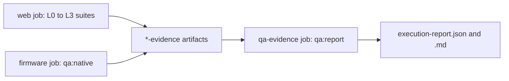

# Eki Test Strategy

| Document ID | Version | Status | Last updated |
|---|---|---|---|
| EKI-TST-002 | 3.0 | Current | 2026-10-30 |

## 1. Purpose and scope

This strategy defines the test levels, suites, commands, environments and CI jobs that verify Eki: the Express backend, the Next.js frontend, the Firebase rules, the ESP32 firmware and the physical tracker. It states what each check proves and what it leaves to a higher level. The structure follows the test strategy and test plan items of ISO/IEC/IEEE 29119-3 [1].

Related documents:

- [Testing and evidence index](README.md): dated results, their status and the open acceptance gates.
- [QA programme](../../qa/README.md): the acceptance catalog, evidence ledger and isolated QA harnesses.
- [A to Z acceptance plan](WEBAPP_A_Z_AB_TESTING_PLAN.md) and [ledger](WEBAPP_A_Z_AB_TESTING.md): the 351 feature cases, 40 matrix entries and 8 experiment protocols that the catalog imports.
- [Firmware policy tests](../../hardware/test/README.md): the native Unity suites.
- [CI, deployment and releases](../operations/CI_CD_AND_RELEASES.md): how a green build reaches staging and production.

## 2. Test levels

The QA test maps (`qa/*-test-map.mjs`) and the execution ledger label every observation with one of six levels. A pass at one level never closes a requirement that needs a higher level.

| Level | Name | Suites | Proves | Does not prove |
|---|---|---|---|---|
| L0 | Static | Acceptance catalog, OpenAPI and UI contract checks, lint, TypeScript, production build, dependency audit, CodeQL | Definitions, contracts, types and packaging are consistent; known advisories are absent | Any runtime behaviour |
| L1 | Unit and component | Backend and frontend Vitest, script tests (`node --test`), native firmware Unity suites, GNSS property tests, reviewed unit selection | Domain rules, reducers, boundaries and mounted components behave as asserted with mocked or synthetic dependencies | Real Firebase transactions, rules, browser networking, radio or GNSS |
| L2 | Emulator integration | `npm run test:rules` (rules and backend integration suites), `npm run qa:api` | Rules, transactions and the compiled backend behave correctly against disposable Auth, Firestore and RTDB emulators | Browser behaviour, provider enforcement, deployed configuration |
| L3 | Browser | Playwright fixture suites, `npm run qa:browser` | Real components in Chromium with synthetic or emulator data, at the configured viewports | Google Maps tiles and roads, OAuth redirects, other browser engines, real devices |
| L4 | Live provider | `playwright.routing.maps.config.ts`, controlled OAuth and Maps checks | Behaviour against real Google services in an approved environment | Fleet behaviour, physical accuracy |
| L5 | Witnessed field | [Field acceptance package](../../qa/FIELD_ACCEPTANCE.md), [field capture procedure](../operations/FIELD_CAPTURE.md) | Moving-bus accuracy, latency, recovery and hardware behaviour, with an independent reference | Anything outside the recorded run |

## 3. Test environment

### 3.1 Tools

| Tool | Version | Needed for |
|---|---|---|
| Node.js | 24 (CI version) | Every JavaScript suite |
| npm dependencies | `npm ci` from `package-lock.json` | Every suite; Playwright `^1.63.0`, Vitest and Stryker 10.0.0 are development dependencies |
| Java | 21 (CI version) | Firebase emulators: `test:rules`, `qa:browser`, `qa:api`, nightly emulator, browser and API campaigns |
| Firebase CLI | 15.14.0, fetched by `npx --yes firebase-tools@15.14.0` inside `scripts/run-rules-emulator.mjs` | Emulator suites; no global install is needed |
| Chromium for Playwright | `npx playwright install chromium` (CI adds `--with-deps`) | Every browser suite |
| Python and PlatformIO | Python 3.12 and `platformio==6.2.0` in CI | Native firmware tests, firmware builds, `qa:native` |
| C++ compiler | Host `g++` or equivalent | Native firmware tests; without it every native suite fails at compilation |

### 3.2 Emulator isolation

`scripts/run-rules-emulator.mjs` writes copies of the rules to a temporary directory, so the committed rule files are never modified. It starts Auth, Firestore and RTDB for project `demo-eki-qa` on fixed loopback ports, runs one child script, and stops the emulators.

| Service | Port |
|---|---|
| Firestore | `127.0.0.1:8085` |
| Realtime Database | `127.0.0.1:9005` |
| Auth | `127.0.0.1:9095` |
| Emulator hub | `127.0.0.1:4405` |
| Emulator logging | `127.0.0.1:4505` |
| `qa:browser` frontend, backend, fixture control | `127.0.0.1:3115`, `3116`, `3117` |

Before tooling starts, `scripts/qa/safety-preflight.mjs` rejects provider and cloud credentials (for example `GOOGLE_APPLICATION_CREDENTIALS` and Maps keys), any project other than `demo-eki-qa`, and non-loopback target URLs. The runner fails fast when a previous run still holds an emulator port. The child processes preload `scripts/qa/network-guard.mjs`, which blocks non-loopback sockets and DNS from Node; it is not an operating-system sandbox.

On some Windows hosts the Firestore emulator fails to start with a Java `SocketException` from Unix domain socket initialisation. The run is then reported as BLOCKED. Use the Linux CI run as evidence in that case.

## 4. Commands

Run every command from the repository root unless stated otherwise.

### 4.1 Repository gate

```powershell
npm run verify
```

`verify` runs, in order: frontend and backend ESLint; `npm test`; `npm run build`; `npm audit --omit=dev --omit=optional`. `npm test` runs the script tests (`node --test scripts/*.test.mjs`), `verify:openapi`, `verify:ui-contracts`, then the backend and frontend Vitest suites. `npm run build` compiles the backend, builds the static frontend export, injects the Workbox service worker, regenerates CSP hashes and checks that the configured backend origin is in the CSP `connect-src`.

`verify` does not run the emulator suites, any Playwright suite or PlatformIO. The backend emulator suites are declared with `describe.skip` unless `FIREBASE_RULES_TEST=1`, so `npm test` passes while they are skipped. Run `npm run test:rules` to execute them.

### 4.2 Root scripts

| Command | What it runs | Requires |
|---|---|---|
| `npm test` | Script tests, OpenAPI and UI contract checks, backend and frontend Vitest | Node |
| `npm run lint` | ESLint in both workspaces | Node |
| `npm run build` | Backend `tsc`, Next.js export, service worker, CSP, web to backend contract | Node |
| `npm run build:production` | Strict production build; fails when required public configuration is missing | Production `NEXT_PUBLIC_*` values |
| `npm run test:rules` | Rules and backend integration suites against emulators (Section 4.3) | Java 21 |
| `npm run test:e2e` | Playwright with `playwright.config.ts` (Section 4.4) | A running frontend |
| `npm run test:e2e:admin` | Playwright with `playwright.admin-access.config.ts` | Chromium |
| `npm run verify:openapi` | Reconciles the OpenAPI document with Express registrations and `backend/API.md` | Node |
| `npm run verify:ui-contracts` | Rejects removed UI behaviour, such as the obsolete route type, in named source files | Node |
| `npm run verify:rtdb-instance` | Checks that frontend and backend RTDB URLs name the same instance | `FIREBASE_DATABASE_URL`, `NEXT_PUBLIC_FIREBASE_DATABASE_URL` |
| `npm run docs:sync`, `npm run docs:check` | Documentation mirrors and the documentation quality, mirror and configuration tests | Node |
| `npm run telemetry:load`, `telemetry:analyze`, `realtime:analyze` | Load generator and trace analysers; see [load test](../operations/TELEMETRY_INGESTION_LOAD_TEST.md) | Node; a target for `telemetry:load` |

The `qa:*` scripts are listed in Section 4.6.

### 4.3 Workspace suites

| Command | Scope |
|---|---|
| `npm run test --workspace=backend` | `vitest run src`: every backend unit and HTTP test; emulator suites skipped |
| `npm run test --workspace=frontend` | `vitest run src`: frontend units and React/jsdom component tests |
| `npm run test:rules-integration --workspace=backend` | The eleven emulator suites below, one worker, no file parallelism. Run it through `npm run test:rules`, which supplies the emulators and `FIREBASE_RULES_TEST=1` |

| Emulator suite (`backend/src/`) | Covers |
|---|---|
| `rulesIntegration.test.ts` | Firestore and RTDB allow and deny rules, including direct feedback writes |
| `workerFence.integration.test.ts` | Worker fencing across replicas |
| `httpOperations.integration.test.ts` | Durable operation claims, unknown outcomes and recovery after a killed worker |
| `reconciliation.integration.test.ts` | Bounded reconciliation and bus edit merge semantics |
| `privacyDeletion.integration.test.ts` | Privacy deletion paging, retries and recovery |
| `telemetryCatalog.integration.test.ts` | Versioned telemetry route catalog and direction binding |
| `staleBusSweeper.integration.test.ts` | Indexed stale-bus pages in RTDB |
| `liveBusProjection.integration.test.ts`, `liveBusProjection.fences.integration.test.ts` | Live projection transactions, publisher fences and listener isolation |
| `apiReads.integration.test.ts` | API read paths |
| `qaTelemetryChain.integration.test.ts` | Authenticated device telemetry through the real router, workers and lifecycle to the public projection |

### 4.4 Browser suites

Every configuration except the default and the live Maps check starts its own Vite fixture server and refuses to reuse a running one.

| Configuration | Command | Specs | Server | Projects (viewport, CSS px) | In CI |
|---|---|---|---|---|---|
| `playwright.config.ts` | `npm run test:e2e` | All of `e2e/` except admin-access, routing, passenger-layout and production-audit | None; `EKI_E2E_BASE_URL`, default `http://127.0.0.1:3000` | mobile 360 x 800, desktop 1280 x 800 | No |
| `playwright.admin-access.config.ts` | `npm run test:e2e:admin` | `e2e/admin-access.spec.ts`, `e2e/admin-access/*.spec.ts` | Admin fixture, port 3105 | mobile 390 x 844, desktop 1280 x 800 | Yes |
| `playwright.passenger-layout.config.ts` | `npx playwright test --config playwright.passenger-layout.config.ts` | `e2e/passenger-layout/` | Passenger fixture, `EKI_QA_PORT` or 3100 | narrow 360 x 800, mobile 390 x 844, reported-phone 440 x 956, short-desktop 1280 x 585, desktop 1280 x 800 | Yes |
| `playwright.passenger-progress.config.ts` | `npx playwright test --config playwright.passenger-progress.config.ts` | `e2e/passenger-progress/` | Progress fixture, port 3127 | mobile 390 x 844, desktop 1280 x 800 | Yes |
| `playwright.production-audit.config.ts` | `npx playwright test --config playwright.production-audit.config.ts` | `e2e/production-audit/` | Audit fixture, port 3123 | narrow 360 x 800, mobile 390 x 844, desktop 1280 x 800 | Yes |
| `playwright.emulator.config.ts` | `npm run qa:browser` (never directly) | `e2e/emulator-acceptance.spec.ts` | Compiled backend 3116, frontend 3115, control 3117, with emulators | mobile 390 x 844, desktop 1280 x 800; one worker, no retries | Yes |
| `playwright.routing.config.ts` | `npx playwright test --config playwright.routing.config.ts` | `e2e/routing/marker.spec.ts` | Routing fixture, port 3162 | Desktop Chrome default (1280 x 720) | No |
| `playwright.routing.maps.config.ts` | Manual; see [live Maps check](../../e2e/routing/live-maps/README.md) | `e2e/routing/live-maps/in-app.spec.ts` | Live Maps fixture, port 3163 | 1920 x 1080 | No |

Fixture guides: [admin access](../../e2e/admin-access/README.md), [passenger UI](../../e2e/fixtures/README.md), [moving marker](../../e2e/motion/README.md), [production audit](../../e2e/production-audit/README.md), [live Maps](../../e2e/routing/live-maps/README.md), [disposable browser acceptance](../../qa/BROWSER_ACCEPTANCE.md).

Two traps in the default configuration:

- `playwright.config.ts` does not ignore `e2e/emulator-acceptance.spec.ts` or `e2e/passenger-progress/`. Those specs need their own servers, so they fail under `npm run test:e2e`. Run them through `qa:browser` and the passenger-progress configuration.
- `e2e/admin-responsive.spec.ts` skips itself unless `EKI_E2E_STORAGE_STATE` names a signed-in administrator storage state. A green run without that variable has not tested the admin UI.

### 4.5 Firmware

```powershell
py -m platformio test --project-dir hardware -e native
py -m platformio run --project-dir hardware -e esp32dev
```

The `native` environment runs the nine Unity suites under `hardware/test/` on the host; [firmware policy tests](../../hardware/test/README.md) lists them. The board environments are `esp32dev`, `esp32dev-quiet` (trace strings removed), `esp32dev-journal` and `esp32dev-secure` (signed fleet image). CI builds all four. A board build needs `hardware/include/secrets.h`; copy it from `secrets.example.h` for a build check, and never commit real device secrets. The CI firmware job also runs three host Python checks: `hardware/scripts/test_verify_secure_fleet.py`, `test_host_protocols.py` and `test_signed_image.py`.

### 4.6 QA programme scripts

The [QA programme](../../qa/README.md) describes the evidence model. Every runner writes JSON, JUnit, Markdown and a log under the ignored `artifacts/qa/` directory, records the source commit and whether the working tree was dirty, and starts from a BLOCKED verdict that only observed passing assertions can change.

| Command | Level | What it runs | Guide |
|---|---|---|---|
| `npm run qa:check` | L0 | Safety preflight, catalog check (`--check`, no output files), workflow policy | [QA programme](../../qa/README.md) |
| `npm run qa:safety` | L0 | Safety preflight alone; `npm run qa:safety -- --emulator` adds the emulator requirements | [QA programme](../../qa/README.md) |
| `npm run qa:catalog` | L0 | Writes `artifacts/qa/qa-report.*`: static definitions and source census, never execution | [QA programme](../../qa/README.md) |
| `npm run qa:budget` | L0 | With `EKI_QA_BASE_SHA=<full base SHA>`: changed critical source needs a reviewed mapping and a changed test file | [QA programme](../../qa/README.md) |
| `npm run qa:test` | L1 | `node --test scripts/qa*.test.mjs`: tests of the QA tooling itself | |
| `npm run qa:gnss` | L1 | Deterministic GNSS payload and reducer properties (Vitest, one worker) | [GNSS properties](../../qa/GNSS_PROPERTIES.md) |
| `npm run qa:unit:reviewed` | L1 | The reviewed backend and frontend file selection in `qa/reviewed-unit-test-map.mjs` | [Reviewed units](../../qa/REVIEWED_UNIT_EVIDENCE.md) |
| `npm run qa:native` | L1 | PlatformIO `native` environment with identity checks | [Native evidence](../../qa/NATIVE_EVIDENCE.md) |
| `npm run test:rules` | L2 | Emulator integration suites | [Emulator acceptance](../../qa/EMULATOR_ACCEPTANCE.md) |
| `npm run qa:api` | L2 | HTTP authorization sweep of every published operation | [HTTP authorization](../../qa/HTTP_AUTHORIZATION.md) |
| `npm run qa:browser` | L3 | Disposable browser acceptance; `qa:browser:providers` and `qa:browser:service` run narrow subsets | [Browser acceptance](../../qa/BROWSER_ACCEPTANCE.md) |
| `npm run qa:report` | Ledger | Combines the six family reports into `artifacts/qa/execution-report.*` | [Execution ledger](../../qa/EXECUTION_EVIDENCE.md) |
| `npm run qa:nightly` | Campaign | `qa:check`, then all six families through `scripts/qa/campaign.mjs`, then `campaign-report.mjs` | [Scheduled reliability](../../qa/SCHEDULED_RELIABILITY.md) |
| `npm run qa:mutation`, `qa:soak`, `qa:weekly` | Campaign | Stryker mutation of `telemetryPayload.ts`; five admission-helper trials | [Scheduled reliability](../../qa/SCHEDULED_RELIABILITY.md) |

`scripts/qa/campaign.mjs` refuses a dirty checkout. `npm run qa:report` blocks any family report from another commit or a dirty tree.

## 5. Choosing checks for a change

Run `npm run verify` for every code change, then add the checks for the area changed.

| Change | Additional checks |
|---|---|
| Documentation | `npm run docs:sync`, `npm run docs:check`, `git diff --check` |
| Firestore or RTDB rules, transactions, workers | `npm run test:rules` |
| Authentication, admin, feedback | `npm run test:e2e:admin`; `npm run test:rules` for rules |
| Passenger UI, map or progress | Passenger layout and passenger progress configurations |
| A Google map element, `MapProviders` or `config/maps.ts` | The map construction counters in Section 7.6 (in `npm test`); after deploying, the Dynamic Maps metric in the Cloud Console |
| Admin dashboard, route editor, history | Production audit configuration; `npm run qa:browser` for persisted flows |
| HTTP routes or OpenAPI | `npm run verify:openapi` (in `npm test`); `npm run qa:api` for authorization |
| Critical source listed by `scripts/qa/coverage-budget.mjs` | A reviewed mapping and a changed test file, checked by `qa:budget` on pull requests |
| Firmware | Native tests and the affected board environments |
| Device movement, power, radio, live latency, provider enforcement | A witnessed L4 or L5 procedure with redacted evidence |

## 6. Continuous integration

| Workflow (file) | Trigger | Jobs and checks |
|---|---|---|
| Production verification (`ci.yml`) | Every push and pull request | `web`: `qa:check`; `qa:budget` on pull requests; `qa:catalog`; `qa:gnss`; `qa:unit:reviewed`; `verify:rtdb-instance`; `verify:openapi`; `lint`; `npm test`; emulator suites; admission benchmark; admin-access, passenger-layout, passenger-progress and production-audit Playwright suites; `qa:browser`; `qa:api`; `build:production` with placeholder values and exported origin checks; `npm audit --omit=dev --omit=optional`; full `npm audit`; CycloneDX SBOM |
| | | `backend-image`: builds `backend/Dockerfile`, checks `/health` returns 503 `degraded` and `/live` returns 200 with placeholder configuration, Trivy scan for critical and high findings |
| | | `firmware`: secure-fleet configuration check, `qa:native`, host protocol tests, builds of `esp32dev`, `esp32dev-quiet`, `esp32dev-journal` and `esp32dev-secure` with an ephemeral signing key, signed-image tamper test |
| | | `qa-evidence`: after `web` and `firmware`, even when they fail, runs `qa:report` on their artifacts |
| CodeQL (`codeql.yml`) | Every push and pull request | `security-extended` queries for JavaScript/TypeScript and Python |
| Isolated nightly QA (`deep-qa.yml`) | Daily 20:17 UTC, manual dispatch, pushes to named QA branches | Six campaign shards (`gnss`, `emulator`, `browser`, `api`, `native`, `reviewedUnit`), two at a time, then `campaign-report.mjs` |
| Isolated weekly reliability (`weekly-reliability.yml`) | Saturday 20:41 UTC, manual dispatch, pushes to `codex/qa-nightly-reliability` | `qa:check`, then `qa:mutation` and `qa:soak` shards, then `weekly-report.mjs` |
| Deploy (`deploy.yml`) | Green Production verification push on `main`; manual dispatch | Staging and approval-gated production releases; see [CI, deployment and releases](../operations/CI_CD_AND_RELEASES.md) |

Scheduled and manually dispatched nightly and weekly runs resolve the head of `main`. The `testing` branch was deleted on 2026-10-25; scheduled runs from then until the resolver was changed to `main` failed in `resolve` with `Not Found` and ran no suite. The last scheduled runs that executed suites were on 2026-10-24 (UTC). The [risk register](../operations/ARCHITECTURE_RISK_REGISTER.md) tracks the first green runs as OPS-02.



Figure 1. Evidence flow in Production verification. Each family report must match the commit under test; a missing or red family keeps the ledger BLOCKED.

Every CI evidence artifact is retained for seven days; the SBOM is retained for 30 days.

## 7. Test design

### 7.1 Simulation scenarios

These scenarios are imported by `scripts/qa/acceptance-catalog.mjs` as a separate denominator (SIM-01 to SIM-20) and are reported as NOT_COVERED until a reviewed test maps to them. Run them only against the Firebase emulators. Before running one, check its expected result against the current [HTTP contract](../api/HTTP_CONTRACT.md); the table records the scenario as defined. For concurrency runs, use a unique correlation timestamp, assert both HTTP outcomes, then inspect `ride_sessions`, `_active_bus_locks`, `active_rides` and the matching RTDB nodes. Clear emulator state between runs.

| ID | Injection | Expected result |
|---|---|---|
| SIM-01 | Two start requests for same bus/different routes in parallel | One 201/valid resume; one 409; one lock/session owner |
| SIM-02 | Send timestamps N, N, N-1, N+1 | 202, 200 duplicate, 200 duplicate, 202; state ends at N+1 |
| SIM-03 | Kill backend after RTDB claim before Firestore projection | Pending/lock is reconciled or resume repairs projection; no second bus session |
| SIM-04 | Kill worker during completion, then restart | Transaction/idempotency completes once; newer session untouched |
| SIM-05 | Delete RTDB lifecycle but retain `active_rides` | Next authenticated fix restores same session/progress |
| SIM-06 | Age active telemetry past stale threshold | Ride remains active, device/signal becomes offline/lost |
| SIM-07 | Age terminal live node | Node is removed and fleet lifecycle remains offline |
| SIM-08 | Remove route while active | Admin API returns 409 |
| SIM-09 | Rotate/reassign device during active lock | Provision/admin update returns conflict |
| SIM-10 | Invalid tokens/roles/direct Firebase writes | 401/403 or rule denial; no state mutation |
| SIM-11 | 61 messages/hour or <3-second gap | Message/rate transaction denied |
| SIM-12 | Feedback twice within 24 hours | Second submission returns 429/cooldown shown |
| SIM-13 | Retention env unset | No deletion job is started |
| SIM-14 | Service worker with account A then account B | No authenticated response exists in runtime caches |
| SIM-15 | Reverse route plan with via | Ordered reverse stops and continuous reverse polyline |
| SIM-16 | Browser hidden/offline/online | Reconnecting state, stale pruning, one listener after resume |
| SIM-17 | Two identical route saves while Routes API is blocked | One durable lease/geometry pair; duplicate gets 202 then identical replay |
| SIM-18 | Route edit computes while a ride starts | Final route transaction returns 409; route/version remain unchanged |
| SIM-19 | Browser times out after route commit | Same `saveId` reconciliation returns saved version; no second mutation |
| SIM-20 | Straight turn/parallel road/U-turn/stationary noise | One ≥120 m measured or two ordinary reliable deviations reroute; heading/progress reject wrong carriageway/back-jump; stationary/missing match does not confirm |

### 7.2 HTTP negative matrix

Test every operation with: a missing or wrong authentication scheme; an expired or revoked token where applicable; the wrong role; an invalid ID; missing and extra body fields; boundary numeric and string sizes; malformed JSON; an oversize body; a repeated request; an unavailable Firebase or upstream dependency; and rate exhaustion. Mutations also need a partial failure followed by a retry. No error response may contain a secret, token or stack trace. The status codes each operation can return are defined in the [HTTP contract](../api/HTTP_CONTRACT.md). `npm run qa:api` covers the missing, malformed and wrong-role partitions; the others need targeted tests.

### 7.3 Hardware bench matrix

Use a dedicated test device and project. Do not expose production secrets in packet captures or serial logs. Firmware constants are in `hardware/include/telemetry_policy.h` and `hardware/src/main.cpp`.

| Test | Method | Pass condition |
|---|---|---|
| Build reproducibility | Clean PlatformIO cache or CI build | Pinned packages, successful binary and size report |
| UART under network stall | GNSS module streaming during a 7 s network stall | NMEA continues; no loss caused by dropped bytes |
| Cold and warm fix | Power cycle indoors and outdoors | Time to first trusted fix recorded; HDOP gate applied |
| Motion hysteresis | Replay speeds around the 1.5 km/h stop and 2.5 km/h moving thresholds | Three consecutive readings change state; no flapping |
| Publish cadence | Replay stationary and moving paths | One publish per second while moving and while stopped (`MOVING_HEARTBEAT_MS`, `STOPPED_HEARTBEAT_MS`) |
| Payload | Capture the backend request in a controlled test | Nine fields, at most 512 bytes, `Device` authorization header, no secrets logged |
| TLS | Correct and wrong CA, hostname and clock | Correct case succeeds; every wrong case fails closed |
| GNSS clock | Block NTP with fresh, stale and invalid GNSS UTC | Fresh UTC sets a TLS-valid clock; stale or invalid UTC never changes it |
| Retry | Stop the backend for 2 minutes | Jittered retries from 1 s to a 30 s cap; bounded queue of 100 samples; recovery |
| Watchdog | Block a task for more than 25 s | Reset with a recorded reset reason; no permanent hang |
| Brownout | Controlled supply interruption | Restart, reconnect, ride resumes |
| Wi-Fi loss | Disable the configured hotspot for more than 2 minutes | No access point or portal is created; bounded retries; same session recovers |
| Credential rejection | Return 401 or 403 repeatedly | Publishing latches off, LED shows the credential code, publishing resumes only after credential repair and restart |
| GNSS loss | Shield or disconnect the antenna | One uncertain fix at the last point; no invented movement |
| Backend or Firebase outage | Stop the service or emulator | Backoff and 503 handling; recovery without duplicate progress |
| OTA gating and integrity | Offer releases before, during and after a ride, then altered images | No update during an active ride; altered or untrusted images rejected |
| OTA rollback | Install an image that cannot reach the backend | Previous slot restored within 5 minutes |

### 7.4 Accessibility and user experience

Test every route with the keyboard only: visible focus, tab order, listbox open, select and Escape, admin tabs, dialogs, focus containment and restoration, no focus behind a modal. Check screen-reader names and status announcements, 200 % zoom, 320 px width, high contrast, slow and offline networks, empty, error and loading states, and `prefers-reduced-motion`. Maps need an equivalent text status; colour must not be the only state cue.

### 7.5 Performance and load

Use a staging project near production topology. The [telemetry ingestion load test](../operations/TELEMETRY_INGESTION_LOAD_TEST.md) defines the generator and metrics. Agree acceptance targets with the university owners; do not derive a latency target from local runs.

### 7.6 Map construction counts

The map-load tests run the real `@vis.gl/react-google-maps` `APIProvider` and `Map` against a fake Maps SDK (`frontend/src/test-support/fakeGoogleMapsSdk.ts`) that records each `google.maps.Map` construction, reuse, script load and overlay attachment.

| Test | Proves |
|---|---|
| `frontend/src/components/maps/PassengerMap.mapLoads.test.tsx` | The first open builds one map and loads the script once; bus, preview, direction and route changes reattach it; camera refit and follow mode work after reattach; a GPS tick neither constructs nor reattaches |
| `frontend/src/components/passenger/PassengerWorkspace.mapLoads.test.tsx` | Back and reopen, the Profile and Routes tabs, route switch, direction resolution, a bus disappearing and returning, service start and the bus picker construct no further map |
| `frontend/src/components/admin/AdminMapLoads.test.tsx` | Live Ops, the route editor and tab switches build one map, and overlays and listeners detach from the cached instance |
| `frontend/src/config/maps.reuse.test.ts` | Every vis.gl `Map` element sets `reuseMaps`, `mapId={MAPS_MAP_ID}` and `{...MAP_OPTIONS}` |

These tests count constructions, not Google billing (acceptance case OBS07). Billing evidence needs the Dynamic Maps metric in the Cloud Console; see [EKI-ADR-004](../design/GOOGLE_MAP_REUSE_DECISION.md).

## 8. Completion and evidence

A change is complete when every applicable check in Section 5 passes on the commit under review and any skipped emulator or browser suite is named in the pull request. Record dated results in an evidence record under `docs/testing/` with a Historical control block and list it in the [testing index](README.md).

Archive for a release: commit and branch, environment class (no secrets), the `npm run verify` log, firmware build, size and hash, emulator output, dependency and CodeQL results, route and device identifiers, latency percentiles, failure-injection results, redacted screenshots and serial extracts, known risks, the rollback plan, and the approver and date. Never describe a physical test or a skipped suite as passed.

## 9. References

[1] ISO/IEC/IEEE, "Software and systems engineering: Software testing, Part 3: Test documentation," ISO/IEC/IEEE 29119-3:2021.
