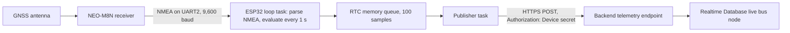
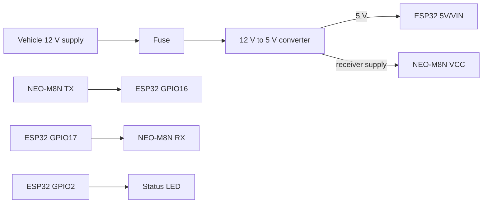

# ESP32 GNSS Tracker

| Document ID | Version | Status | Last updated |
|---|---|---|---|
| EKI-PKG-003 | 1.0 | Current | 2026-10-30 |

## 1. Purpose

This guide describes the tracker hardware, the firmware package in `hardware/`, and the procedure to build, flash and check a development tracker. The tracker is an ESP32 board wired to a u-blox NEO-M8N GNSS receiver. The firmware reads NMEA sentences, timestamps each accepted fix with a disciplined UTC clock and posts it over HTTPS to the backend once per second. It holds no Firebase credential and no route, stop, bus or driver data: the backend device registry maps the device to its bus and route.

| Topic | Authoritative document |
|---|---|
| Payload fields, cadence, queue, retries and failure handling | [Hardware telemetry contract](../docs/hardware/HARDWARE_TELEMETRY.md) |
| Fleet signing, Secure Boot, flash encryption and OTA releases | [Hardware security provisioning](../docs/security/HARDWARE_SECURITY_PROVISIONING.md) |
| Flash checkpoint after complete power loss | [Cold power recovery](../docs/hardware/COLD_POWER_RECOVERY.md) |
| Header files and host tests | [Firmware headers](include/README.md), [firmware tests](test/README.md) |
| Signing-key custody | [Fleet signing keys](keys/README.md) |
| Device endpoints on the backend | [Backend API reference](../backend/API.md) |



Figure 1. Data path from the receiver to the backend.

The loop task owns the UART and the NMEA parser. The publisher task owns Wi-Fi, NTP, TLS and HTTP, so a slow network never stops NMEA parsing.

## 2. Bill of materials

The repository evidences the components below. Prices are in the [cost model](../docs/cost/COST_MODEL.md).

| Item | Model or part | Quantity | Role |
|---|---|---|---|
| ESP32 board | Any board supported by the PlatformIO `esp32dev` board definition with 4 MB flash. Fleet units need ESP32 silicon revision ECO3 (v3.0) or newer, which Secure Boot V2 requires. The vendor board model is not specified in the repository. | 1 | Runs the firmware, Wi-Fi station and status LED |
| GNSS receiver | u-blox NEO-M8N module | 1 | Supplies NMEA RMC and GGA sentences at 9,600 baud |
| GNSS antenna | Active antenna with a clear view of the sky. Model not specified in the repository. | 1 | Satellite reception |
| Vehicle power supply | Fused, automotive-rated 12 V to 5 V buck converter. Model and current rating not specified in the repository. Bench and field tests used USB power. | 1 | Powers the board and receiver |
| Enclosure and cabling | Protected enclosure with strain relief. Model not specified in the repository. | 1 set | Mechanical protection in the vehicle |
| USB cable | Data-capable cable for the board's USB connector | 1 | Flashing, serial log and bench power |
| Status LED | LED on GPIO2, active high. Whether the board provides one is not specified in the repository. | 0 or 1 | Fault codes (Section 8) |
| Wi-Fi network | 2.4 GHz WPA2-PSK access point or phone hotspot with internet access. Model not specified in the repository. | 1 per vehicle | Uplink to the backend |

## 3. Wiring and pin assignments

| ESP32 pin | Connects to | Firmware setting |
|---|---|---|
| GPIO16 (UART2 RX) | Receiver `TX` | `Serial2.begin(9600, SERIAL_8N1, 16, 17)` in `src/main.cpp`; 8,192-byte receive buffer |
| GPIO17 (UART2 TX) | Receiver `RX` | Used at boot to send UBX `CFG-MSG` commands |
| `5V/VIN` | Receiver `VCC` | Connect only if the receiver module accepts 5 V; otherwise use the supply voltage its specification allows |
| `GND` | Receiver `GND` and supply ground | Common reference |
| GPIO2 | Status LED | `STATUS_LED_PIN = 2`, high means on |
| USB (UART0) | Host computer | Serial log at 115,200 baud |



Figure 2. Power and signal connections. All grounds are common.

At boot the firmware sends volatile UBX `CFG-MSG` commands [1] that enable GGA and RMC and disable GLL, GSA, GSV and VTG on the receiver's current port. The serial log prints `[GNSS] CFG-MSG ACK` for each acknowledged command, which confirms both UART directions. The firmware does not change the receiver's baud rate, so the receiver must already output NMEA at 9,600 baud.

## 4. Firmware configuration

### 4.1 PlatformIO environments

All environments in `platformio.ini` use `espressif32@7.0.1` (Arduino-ESP32 2.0.17; ESP-IDF 4.4 for the mixed Arduino and ESP-IDF builds), TinyGPSPlus 1.1.0, ArduinoJson 7.4.3 and `monitor_speed = 115200`. Board environments link wrappers around `mbedtls_ssl_config_defaults` and `mbedtls_ecdh_make_public`, which apply the TLS profile in `src/tls_profile.cpp`.

| Environment | Framework | Partition table | Distinguishing settings | Use |
|---|---|---|---|---|
| `esp32dev` (default) | Arduino | `partitions_development.csv` | `EKI_FLEET_BUILD=0`, `EKI_FIRMWARE_VERSION="development"`, `DISABLE_OTA` | Bench development. Detailed serial traces are on. Never install this image in a vehicle. |
| `esp32dev-quiet` | Arduino | `partitions_development.csv` | Adds `EKI_ENABLE_FLEET_TRACES=0` | Same runtime with trace output compiled out |
| `esp32dev-journal` | Arduino and ESP-IDF | Built with `partitions_development.csv`; only the application image is written | Adds `EKI_LEGACY_JOURNAL_BUILD=1`; `sdkconfig.journal.defaults` disables flash core dumps, Secure Boot and flash encryption | App-only checkpoint acceptance on an older development board ([cold power recovery](../docs/hardware/COLD_POWER_RECOVERY.md)) |
| `esp32dev-secure` | Arduino and ESP-IDF | `partitions_secure.csv` | `EKI_FLEET_BUILD=1`, `EKI_FIRMWARE_SEQUENCE=1`, signing key `keys/secure_boot_signing_key.pem`, pre-build check `scripts/verify_secure_fleet.py`, `sdkconfig.defaults` | The only environment for fleet artifacts |
| `native` | Host, Unity | None | `-std=gnu++11`; DNS test stubs on the include path | Host policy tests without a board |

The firmware does not read `DISABLE_OTA`. Development builds contain no OTA code because `EKI_FLEET_BUILD=0`; the fleet pre-build check rejects `DISABLE_OTA`. Detailed traces default to on when `EKI_FLEET_BUILD=0` and off in fleet builds; set `EKI_ENABLE_FLEET_TRACES=1` for a bounded fleet acceptance capture.

### 4.2 Partition tables

| Layout | Table offset | Application | `gps_log` checkpoint journal | Other partitions |
|---|---|---|---|---|
| Development, `partitions_development.csv` | `0x8000` | `app0` at `0x10000`, 3 MiB | `0x310000`, 896 KiB | `nvs` 20 KiB, `otadata`, `coredump` 64 KiB at `0x3F0000` |
| Fleet, `partitions_secure.csv` | `0x10000` | `ota_0` at `0x20000` and `ota_1` at `0x200000`, 1,966,080 bytes each | `0x3E0000`, 128 KiB, encrypted | `nvs` 24 KiB, `otadata`, `phy_init` |

Arduino-ESP32 2.x initializes the `nvs` system partition during startup. Eki never opens it: the firmware calls `WiFi.persistent(false)` before the Wi-Fi driver starts, and fleet builds disable `CONFIG_ESP32_WIFI_NVS_ENABLED`. The fleet table starts at `0x10000` because the Secure Boot bootloader is larger than the default bootloader region.

### 4.3 Compile-time configuration file

The firmware's only configuration source is the ignored file `include/secrets.h`, copied from the tracked template `include/secrets.example.h`. Device credentials are compiled into the image, so every configuration change needs a new build and a reflash. The firmware validates the six definitions at boot, before it starts networking.

| Definition | Content | Boot validation |
|---|---|---|
| `WIFI_SSID` | Wi-Fi network name | 1 to 32 bytes |
| `WIFI_PASS` | WPA2-PSK passphrase | 8 to 63 printable ASCII characters; open networks are not supported |
| `DEVICE_ID` | Device ID registered by the provisioning command | 1 to 128 characters from `A-Z`, `a-z`, `0-9`, `_`, `-` |
| `DEVICE_SECRET` | One-time secret printed by the provisioning command (43 base64url characters) | 20 to 128 characters from the same set |
| `BACKEND_URL` | Backend origin, for example `https://<backend-host>` | `http://` or `https://`, at most 256 characters, printable ASCII, no path, query, fragment or `@`. Fleet builds accept only `https://`, checked at compile time and at boot. |
| `BACKEND_ROOT_CA` | PEM root certificate that issues the backend certificate, with line breaks written as `\n` | At most 3,072 bytes with `BEGIN CERTIFICATE` and `END CERTIFICATE` markers. Required for `https://`, ignored for `http://`. |

The template's `DEVICE_SECRET` placeholder is shorter than 20 characters. An unedited copy compiles, flashes and then halts at boot with two LED pulses and the serial line `[Boot] Invalid compile-time configuration field DEVICE_SECRET; halted.`

Do not put Firebase keys, service-account credentials, bearer tokens, bus or route IDs, or signing keys in `secrets.h`. Never commit, print, upload or archive `secrets.h` or an unencrypted firmware image built from it.

## 5. Build, flash and check a development tracker

### 5.1 Prerequisites

- PlatformIO Core 6.2.0, the version CI and `npm run qa:native` require: `py -m pip install platformio==6.2.0`.
- The board's serial port name, written below as `<port>` (for example `COM5` on Windows).
- A backend that the tracker's Wi-Fi network reaches by hostname. The tracker cannot reach `localhost` or `127.0.0.1` on a laptop. [Getting started](../docs/GETTING_STARTED.md) and [configuration](../docs/CONFIGURATION.md) cover the backend.
- For an `https://` backend: the issuing root CA in PEM form, and a backend certificate with an RSA key. The firmware's TLS profile offers only ECDHE-RSA cipher suites with AES-GCM on curve P-256; a server that presents an ECDSA certificate fails the handshake.
- A route with ordered stops, and a bus whose `assignedRoutes` contains that route.

### 5.2 Steps

Run every command from the repository root.

1. Run the host tests.

   ```powershell
   platformio test --project-dir hardware -e native
   ```

   Expected result: every suite reports `PASSED`. The first run downloads Unity and the pinned libraries into `hardware/.pio/`.

2. Provision the device in the backend registry.

   ```powershell
   npm run provision-device --workspace=backend -- --device-id <device-id> --bus-id <bus-id> --route-id <route-id>
   ```

   Expected result: the command prints `Device provisioned. Copy this secret now; it is not stored in plaintext:` followed by the secret. Copy it once, directly into step 3. The command refuses a bus and route that has an active ride, a bus lock or another device. If it reports that cache invalidation failed twice, the printed secret is still valid: restore Realtime Database connectivity before you rely on the device, and do not rerun the command, because a rerun rotates the secret.

3. Create the configuration file and set all six definitions from Section 4.3.

   ```powershell
   Copy-Item hardware/include/secrets.example.h hardware/include/secrets.h
   git check-ignore hardware/include/secrets.h
   ```

   Expected result: `git check-ignore` prints `hardware/include/secrets.h`, which confirms Git ignores the file.

4. Build the development image.

   ```powershell
   platformio run --project-dir hardware -e esp32dev
   ```

   Expected result: `SUCCESS` and the image `hardware/.pio/build/esp32dev/firmware.bin`. The build does not check the values in `secrets.h`; the board checks them at boot.

5. Flash the board.

   ```powershell
   platformio run --project-dir hardware -e esp32dev --target upload --upload-port <port>
   ```

   Expected result: esptool reports `Hash of data verified.` for each image and resets the board. This upload writes the bootloader, partition table and application.

6. Open the serial monitor.

   ```powershell
   platformio device monitor --project-dir hardware --port <port>
   ```

   Expected result, outdoors with Wi-Fi in range: `[PowerCheckpoint] ready=true`, six `[GNSS] CFG-MSG ACK` lines, `[WiFi] Connected.` and `[GNSS] Connected.`. With traces on, each delivered sample prints a `[TelemetryTrace]` line with `"event":"device_http"` and `"httpStatus":202` (or `200` for a duplicate). Successful sends print no `[HTTPS]` line.

### 5.3 Verification

1. At least 30 s after boot, an administrator calls `GET /api/devices/<device-id>/diagnostics`. Expected result: a report whose `lastTelemetryResponseCode` is `202` or `200` and whose `gnssFixAvailable` is `true`.
2. Every 5 min the serial log prints `[Telemetry] Evidence ... acceptedSeen=1 ... queue=0`, which shows that telemetry is accepted and nothing is waiting.
3. Disconnect the Wi-Fi network for about 10 s and restore it. Expected result: `[WiFi] Not connected; waiting`, then `[WiFi] Connected.`, and telemetry resumes without a reboot.

To remove credentials from a development board before you reuse or hand it on, erase its flash with `platformio run --project-dir hardware -e esp32dev --target erase --upload-port <port>`. Never run this against a fleet board.

## 6. Changes that require a reflash

| Change | Backend action | Reflash |
|---|---|---|
| Route name, stops, waypoints, colour or geometry | Save the route in the backend | No |
| Same device to another bus or route | Update the device assignment while no ride or bus lock exists | No |
| Bus or route while a ride is active | End the ride first; the backend rejects the reassignment | No |
| Wi-Fi name or passphrase | None | Yes, with new `WIFI_SSID` and `WIFI_PASS` |
| Device ID | Provision the new ID | Yes, with new `DEVICE_ID` and `DEVICE_SECRET` |
| Device secret rotation | Rerun the provisioning command outside an active ride | Yes, with the new `DEVICE_SECRET` |
| Lost or retired device | Disable it with `POST /api/devices/<device-id>/disable` | Not for the lost unit; a replacement needs its own build |
| Backend hostname or root CA | Deploy the backend change | Yes, with new `BACKEND_URL` or `BACKEND_ROOT_CA` |
| Firmware code, timing or security settings | None | Yes, or a signed OTA release for fleet units (Section 9) |

A provisioned fleet board has UART ROM download mode permanently disabled, so a USB reflash no longer works on it. On such a board every change marked "Yes" needs a signed OTA image built with the new configuration.

## 7. Runtime summary

The [telemetry contract](../docs/hardware/HARDWARE_TELEMETRY.md) is authoritative for these values.

| Behaviour | Value | Detail |
|---|---|---|
| Fix evaluation and capture | Every 1 s while the fix is valid, plausible and the clock is trusted, moving or stopped | [Capture](../docs/hardware/HARDWARE_TELEMETRY.md#43-capture-cadence-and-motion-state) |
| GNSS loss | One `uncertain` sample at the last captured position, then nothing until the fix returns | [GNSS-loss packet](../docs/hardware/HARDWARE_TELEMETRY.md#32-gnss-loss-packet) |
| Queue | 100 samples in RTC memory, newest sent first, oldest dropped when full, samples older than 55 s discarded | [Queue and expiry](../docs/hardware/HARDWARE_TELEMETRY.md#44-queue-ordering-and-expiry) |
| Telemetry retry | 250 ms to 2 s after transport errors; 1 s doubling to 30 s after server errors; 60 s after 403, 404 or 429 without `Retry-After`; 30 s after other rejections | [Response handling](../docs/hardware/HARDWARE_TELEMETRY.md#24-response-handling) |
| Wi-Fi retry | First attempt at once, then 5 s doubling to 60 s, indefinitely | [Timing and limits](../docs/hardware/HARDWARE_TELEMETRY.md#5-timing-and-limits) |
| Task watchdog | 25 s, panic and restart | [Timing and limits](../docs/hardware/HARDWARE_TELEMETRY.md#5-timing-and-limits) |
| Remote diagnostics | First at 30 s of uptime, then every 5 min | [Remote diagnostics](../docs/hardware/HARDWARE_TELEMETRY.md#33-remote-diagnostics) |
| Flash checkpoint | First captured fix after boot, then at most every 10 s | [Cold power recovery](../docs/hardware/COLD_POWER_RECOVERY.md) |

## 8. Status LED

GPIO2 repeats its pattern every 2 s. Each pulse is 150 ms on and 150 ms off.

| Pattern | Meaning | Serial evidence |
|---|---|---|
| Off | No latched fault. Normal operation, including Wi-Fi or GNSS outages. | None |
| 2 pulses | Boot halted: an invalid `secrets.h` definition, an over-long request string, or a FreeRTOS task, queue or mutex that failed to start | `[Boot] Invalid compile-time configuration field <NAME>; halted.` or another `[Boot] ...` line; a mutex failure prints no line |
| 3 pulses | Credential fault latched after HTTP 401 from telemetry, diagnostics or the firmware release check. Publishing stops and the Wi-Fi radio is off until the board restarts. | `[HTTPS] Credential fault latched; ...`, `[Diagnostics] Credential fault latched; ...` or `[OTA] Credential fault latched during release check.` |
| 4 pulses | Fleet build halted: `BACKEND_URL` is not `https://`, or flash encryption or Secure Boot is not active | `[Security] Fleet firmware ...` |

## 9. Firmware updates

Development images change only by reflashing over USB. Fleet images (`esp32dev-secure`) also accept signed OTA application updates. The release procedure is in [hardware security provisioning](../docs/security/HARDWARE_SECURITY_PROVISIONING.md#6-signed-ota-release-and-rollback). The device follows this policy:

1. A `firmware-maintenance` task first releases any firmware reservation this device may still hold from an interrupted installation.
2. It checks `GET /api/devices/<device-id>/firmware?sequence=<current-sequence>` once the board has run for 2 min, then 6 h after a check that found no release, or 15 min after a failed check. A check runs only while Wi-Fi is up, the clock is trusted, no credential fault exists, the telemetry queue is empty, the latest fix is valid and stopped (at most 2 s old), and no candidate image awaits validation.
3. The backend returns `204` when no newer release exists or while the bus has an active ride or bus lock. A release manifest must name a strictly higher sequence, an `https://` URL, a size of at most 1,966,080 bytes and a SHA-256 digest; its version must have the form `s<sequence>-<name>`.
4. The device reserves the bus through `POST /api/devices/<device-id>/firmware/installation` with `{"action":"acquire"}`. The reservation uses the same bus lock as ride startup and has no timed expiry.
5. The device downloads the image without its device credential, writes it to the inactive slot and aborts if the bus moves, the fix goes stale or the stream stalls for 15 s. It installs the image only if the size, the SHA-256 digest, and the signed version and sequence all match the manifest, and Secure Boot accepts the signature.
6. The device releases the reservation and restarts into the candidate image. The candidate becomes permanent after the first accepted telemetry or diagnostics response. If none arrives within 5 min of boot, including time without Wi-Fi coverage, the firmware marks the candidate invalid and restarts into the previous image. A candidate that resets before it is confirmed is rolled back by the bootloader.

OTA never changes the bootloader, the partition table or eFuses. The application image does contain every value compiled from `secrets.h`, so a release installs the Wi-Fi credentials, device ID, device secret, backend origin and root CA of the build that produced it. The [provisioning procedure](../docs/security/HARDWARE_SECURITY_PROVISIONING.md#6-signed-ota-release-and-rollback) states the resulting limitation.

## 10. Troubleshooting

| Symptom | Likely cause | Check | Fix |
|---|---|---|---|
| Two LED pulses; `[Boot] Invalid compile-time configuration field <NAME>; halted.` | Placeholder or invalid value in `secrets.h` | Section 4.3 rules for the named definition | Correct the value, rebuild and reflash |
| Four LED pulses; `[Security] Fleet firmware ...` | Fleet image on a board without active protections, or an `http://` backend | Board identity and eFuse summary | Quarantine the board; follow [hardware security provisioning](../docs/security/HARDWARE_SECURITY_PROVISIONING.md). Never bypass the gate. |
| No `[GNSS] CFG-MSG ACK` lines at boot | Receiver TX and RX swapped, receiver unpowered, or receiver not at 9,600 baud | Wiring in Section 3; receiver power indicator | Correct wiring or receiver baud rate |
| `[GNSS] Not connected; waiting for valid fix` persists; diagnostics show `gnssFixAvailable` `false` | Antenna without sky view, HDOP above 4, or receiver status not valid | Move the antenna outdoors; watch `[GnssTrace]` lines in development builds | Fix antenna placement; wait for a valid fix |
| Repeated `[WiFi] Station retry` lines | Wrong SSID or passphrase, 5 GHz-only network, or no coverage | Network settings against `secrets.h` | Correct and reflash, or move into 2.4 GHz coverage |
| Wi-Fi and GNSS connected, but nothing reaches the backend; `[Clock] GNSS correction rejected` or `[Clock] NTP correction rejected` | GNSS and NTP time disagree by more than 1.5 s | Receiver UTC; UDP access to `pool.ntp.org` and `time.google.com` | Restore a consistent time source. The firmware retries NTP every 60 s while the disagreement lasts. |
| `[HTTPS] Transport failure <code> (<reason>)` | Backend unreachable, `localhost` URL, wrong root CA, ECDSA server certificate, or wrong clock | Reach the backend `GET /health` from the same network; check the certificate key type and issuer | Fix the network, URL, CA or certificate. Never disable certificate validation. |
| `[HTTPS] Telemetry rejected (HTTP 400)` | Timestamp outside the backend window or schema mismatch | Clock lines in the serial log; deployed backend version | Restore clock agreement; deploy a backend that accepts the nine-field schema |
| Three LED pulses; HTTP 401 | Wrong `DEVICE_ID` or `DEVICE_SECRET`, or the device is disabled | Device record in the registry | Reprovision and reflash, or re-enable the device; then restart the board |
| `[HTTPS] Device assignment unavailable; retrying without disabling Wi-Fi.` (HTTP 403) | Device has no usable bus and route assignment | Device record and the bus's `assignedRoutes` | Repair the assignment. The device retries every 60 s without a reflash. |
| `[HTTPS] Check BACKEND_URL; the telemetry endpoint was not found.` (HTTP 404) | `BACKEND_URL` points at the wrong host | The URL in `secrets.h` | Correct and reflash |
| `[HTTPS] Rate limited; server retry delay=<n>s.` (HTTP 429) | Backend ingress or per-device limit reached | `HTTPS_INGRESS_DEVICES_PER_IP` and `HTTPS_DEVICE_RATE_PER_MINUTE` in [configuration](../docs/CONFIGURATION.md) | Raise the limit for the fleet size, or find the extra sender |
| `[HTTPS] Backend dependency is unavailable; retaining the latest fix.` (HTTP 5xx) | Backend or Firebase outage | Backend `GET /health` | Restore the backend; the device keeps retrying |
| `[Boot] Recovered from task-wdt reset` repeatedly | A task stalled for more than 25 s | Serial log before the reset; `resetTotal` in diagnostics | Capture the log and report it with the firmware version |
| `[PowerCheckpoint] ready=false` | Board flashed with an older partition table without `gps_log` | `slots=` value and the board's partition table | Follow [cold power recovery](../docs/hardware/COLD_POWER_RECOVERY.md) |

## 11. References

[1] u-blox, "u-blox 8 / u-blox M8 Receiver description including protocol specification," UBX-13003221, content.u-blox.com/sites/default/files/products/documents/u-blox8-M8_ReceiverDescrProtSpec_UBX-13003221.pdf. Accessed: 2026-10-30.
